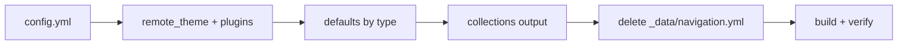

# Agent: Docs-Site Engineer → Config Fixer

Primary agent: **docs-site-engineer** · Consumers: all sites · Skill: `jekyll-remote-theme`, `helix-theme`

## Mission

Fix `_config.yml` in every consuming site so it builds with the remote theme and needs no
`_data`.

## Repair flow

## Checklist

- [ ] `remote_theme: HELIX-Origin/helix-jekyll-theme` present.
- [ ] `plugins:` includes `jekyll-remote-theme`.
- [ ] Defaults scopes are by **type** with match-all path (`scope: { path: "", type: docs }`), never `path: /docs/:path/`.
- [ ] Collections `docs`/`wiki` have `output: true` when the site uses `_docs/` / `_wiki/`.
- [ ] Any `_data/navigation.yml` is **deleted**.
- [ ] Index permalinks set (`/docs/`, `/wiki/`, portal `/`).

## Verify

- `bundle exec jekyll build` passes.
- No `site.data.navigation` in built HTML (`grep -r "site.data" _site`).