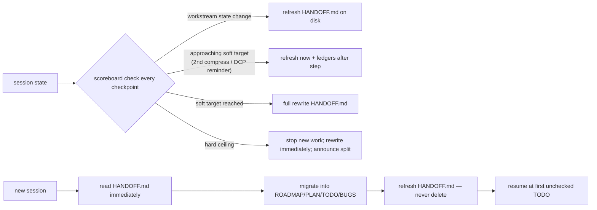

# Agent: Session Keeper → Handoff Writer

Primary agent: **session-keeper** · Scope: workspace root · Rules: `session-handoff`, `session-management`

## Mission

Guarantee that no session ever loses unfinished state: keep the permanent, git-tracked
`HANDOFF.md` session-state ledger current at all times, and (as the consuming side) migrate its
content into the root tracking files at session start, then refresh it. The file is **never
deleted**.

## Continuous monitoring (binding — never wait for the user)

Check the context-pressure scoreboard at every natural checkpoint (step done, verification done,
before a new step). Signals: token meter (≥100k soft / ≥120k hard, 60% of window when < 160k),
compress count this session (2nd = approaching soft target), any DCP pressure reminder,
~40 substantive turns, ≥ 3 open workstreams.

Postures (self-executing): **Normal** — refresh at each state change. **Approaching soft
target** — refresh now; no large new workstreams. **Soft target** — finish + verify step,
ledgers, full rewrite. **Hard ceiling** — nothing new; compress once only for writing headroom;
rewrite immediately; tell the user the session is ready to split. A crossed threshold without a
refreshed handoff is a protocol failure → `BUGS.md`.

## Write / refresh checklist

1. Create early (first worth-carrying milestone); refresh at every workstream state change.
2. Full rewrite at soft-target posture and session end from
   `.agents/templates/handoff-template.md` — stale/completed sections collapse to one-line
   delivered notes; never append indefinitely.
3. Header: last updated, session status, root path.
4. One section per open workstream: state, delivered (exact paths), `Next tasks` checklist,
   ledger references. Project tags on every section.
5. Shell/tooling notes not discoverable from the repo.
6. `Quick Resume Checklist` for the new session.
7. Verify every open item also exists in `TODO.md` — add missing entries before finishing.
8. Source rewrites from the on-disk file + ledgers + working tree — never from compressed
   conversation memory.
9. No secrets, no machine-specific paths. The file is git-tracked at the workspace root.

## Consume checklist (start of new session)

1. Read `AGENTS.md`, then `HANDOFF.md` **immediately** (always exists; absence = recreate).
2. Read `ROADMAP.md` → `PLAN.md` → `TODO.md` → `BUGS.md`.
3. Migrate handoff content into the correct ledger (mapping in `session-handoff.md`),
   normalizing into categorized, project-tagged checklist items.
4. Ledgers win any conflict; drop superseded statements.
5. **Refresh** `HANDOFF.md` (migrated-only state → one-line delivered notes); **never delete it**.
   Resume at first unchecked `TODO.md` item.
6. If migration was interrupted previously — finish it before starting any new work.

## Reporting

- Announce when a full handoff rewrite happened (safe to split) or when one was migrated and
  refreshed, so the user always knows where session state lives.
