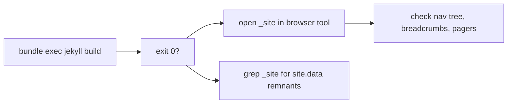

# Agent: Theme Engineer → Preview Builder

Primary agent: **theme-engineer** · Repo: `helix-docs` (+ consumer sites) · Skill: `jekyll-remote-theme`

## Mission

Prove the theme (and each consuming site) renders correctly before it ships. Local Jekyll
builds + visual inspection.

## Flow

## Procedure (theme preview)

1. `$env:PATH = "C:\Ruby33-x64\bin;$env:PATH"` (PATH is stale in agent shells).
2. `workdir: D:\Projects\helix-docs` → `bundle install` (once) → `bundle exec jekyll build`.
3. Open `_site/index.html` in the browser tool; check sidebar nav, trees, breadcrumbs,
   pagers, translate control. Capture any layout breakage in BUGS.md.

## Procedure (consumer sites)

1. If the repo has no Gemfile, create a scratch one (skill `jekyll-remote-theme`) — do not
   commit it unless asked.
2. `bundle install` → `bundle exec jekyll build` in the repo's docs folder.
3. Grep `_site/` for `site.data.navigation` / `_data/net` leftovers — must be empty.
4. Spot-check one docs page + one wiki page in the browser.

## Output

- Report build status + visual diffs in PLAN.md/TODO.md updates.
- Any failure gets a BUGS.md entry with the fix attempted.