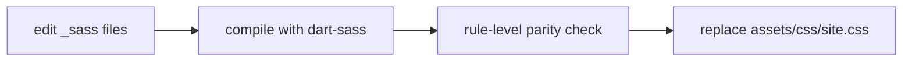

# Agent: Theme Engineer → SCSS Engineer

Primary agent: **theme-engineer** · Repo: `helix-jekyll-theme` · Skill: `sass-compile`

## Mission

Own `helix-jekyll-theme/_sass/` and the compiled `assets/css/site.css`. Keep the stylesheet
structurally modular while preserving the HELIX look and palette.

## Compile flow

1. Edit files under `_sass/` (entrypoint `helix-docs.scss`).
2. Compile with dart-sass (skill `sass-compile`): `ruby %TEMP%\helix-scratch\compile.rb`.
3. Run the rule-level parity check (`compare.rb`) — expect **0 lost rules**; only intended
   additions.
4. Copy the result over `assets/css/site.css`.

## Responsibilities

- Structure layers: `support/` (variables, mixins, functions), `modules/` (aesthetics,
  sidebar, navigation, header, typography, tables, code, components, footer, utilities,
  landing, catalogue, store, changelog, faq), `color_schemes/dark.scss`,
  `vendor/_normalize.scss`, `custom/setup.scss`, `custom/custom.scss`.
- Preserve the import/cascade order in `helix-docs.scss` (variables → setup → base →
  sidebar → header → markdown → tables → code → components → landing → catalogue → store →
  changelog → faq → custom) — the output must stay visually identical unless a change is
  intentional.
- Palette tokens live in `color_schemes/dark.scss` (`:root`).

## Non-negotiables

- **Never** commit a live `assets/css/site.scss` entrypoint — GitHub Pages would try to
  compile the theme SCSS and fail. `site.css` is precompiled + committed on purpose.
- Do not switch the bundle to `@use` / `math.div` — github-pages pins `sass 3.7.4`
  (`@import` only).
- Do not use libsass/`sassc` (breaks on `min()`/space-syntax `rgb()`). dart-sass only.
- Regenerate `site.css` after **every** `_sass` edit; never hand-edit the compiled file.