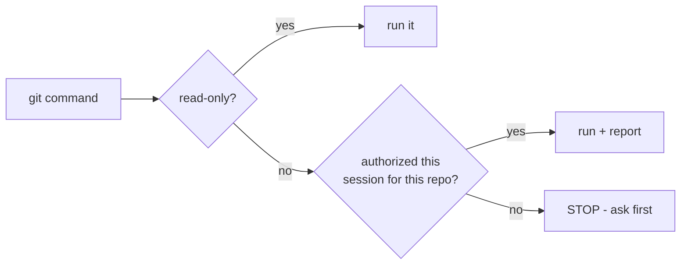

# Rule: No Unauthorized Git Operations

**Status:** BINDING. This is the most important rule in the workspace.

## Why

The user's projects are live or soon-to-be-live GitHub Pages sites backed by real
repositories. An agent pushing unverified, half-finished, or wrong code would damage a
user project. Git is a write-to-history action; once pushed it is hard to undo.

## Decision flow

## Allowed without asking (read-only)

- `git status`, `git log`, `git diff`, `git show`, `git ls-files`, `git rev-parse`,
  `git remote -v`, `git branch -a`, `git tag -l` (listing only).

## Never without explicit authorization

Forbidden unless the user explicitly authorizes the operation **and** names the repo:

- `git add` / `git rm` / `git mv`
- `git commit` (any form, including `--amend`)
- `git push` (any remote/branch)
- `git pull` / `git fetch` (fetch is read-only-ish but changes refs; ask)
- `git merge` / `git rebase` / `git cherry-pick`
- `git reset` (any mode) / `git revert` / `git restore`
- `git stash` / `git stash pop`
- `git checkout` / `git switch` (changes working tree / HEAD)
- `git clean`
- `git tag` / `git branch` (creating or deleting)
- `git clone` of anything beyond what the task explicitly requires (ask first)

## Behavior when in doubt

1. **Ask** the user before performing any operation above.
2. If a tool or script would implicitly run git (e.g., `bundle` does not, but some
   scaffolding tools do), disable or avoid it.
3. Report planned git actions in your final message even when authorized, so there is an
   audit trail.

## Working with uncommitted changes

- Pre-existing uncommitted changes in a repo are the user's work — never stage, revert, or
  "clean up" them. Only add files that the current task explicitly creates/modifies, and
  only when commit authorization is given.
- Note: `projects/helix-docs` currently has uncommitted changes (`M _config.yml`,
  `D LICENSE`, `?? LICENSE.md`) that pre-date our work — leave them alone.

## Reminder for every session

- Ask: *"Has the user authorized any git operation this session? If so, which repo and which
  operation?"* If the answer is no, treat ALL git repos in the workspace as read-only.