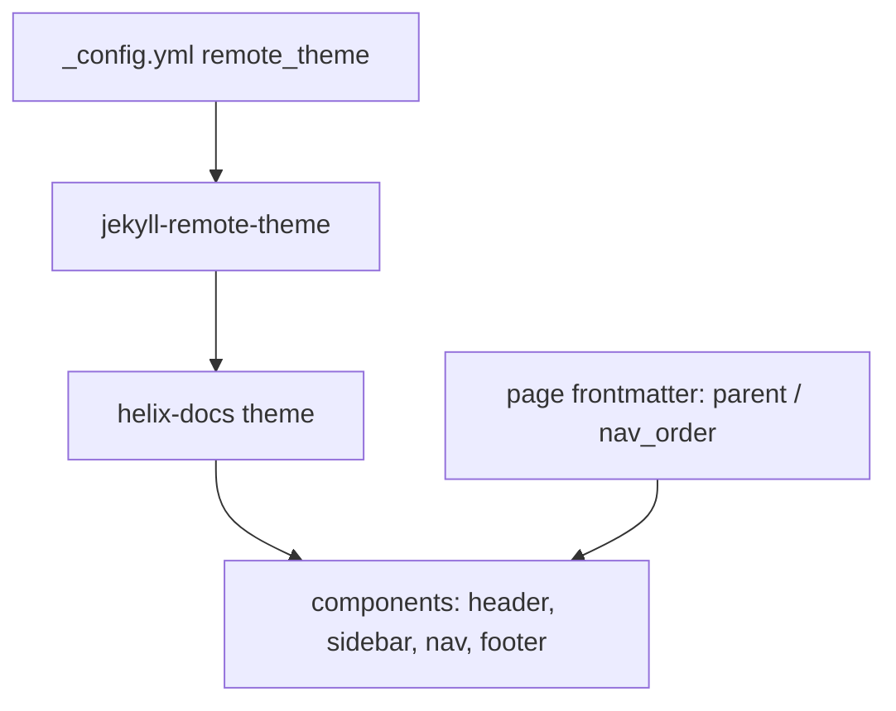

# Skill: GitHub Flavored Markdown content (GFM)

> Rules for writing and repairing content in every docs site under `projects/`.
> Markdown first; raw HTML only where markdown cannot express the structure
> (cards, grids, buttons, embedded media, spanning tables).

## Core formatting rules

- **Headings**: `#`–`######` with a space after the hash. One `# h1` per page (page title);
  `##`/`###` for sections. Don't skip levels (`#` → `###` is invalid).
- **Paragraphs** separated by blank lines. Keep lines ≤ ~100 chars for clean diffs.
- **Inline**: `**bold**`, `*italic*`, `` `code` ``, `[link](target)`, `~~strike~~`.
- **Code blocks** — fenced with a language tag:
  ````md
  ```yaml
  remote_theme: HELIX-Origin/helix-docs
  ```
  ````
  Languages to use: `yaml`/`yml`, `ruby`, `js`, `ps1`, `html`, `css`, `plaintext`, etc.
- **Tables** — pipes + alignment row:
  ```md
  | Setting | Default |
  | :--- | ---: |
  | theme | dark |
  ```
- **Lists**: `- ` unordered, `1. ` ordered, nested with 2-space indent; task lists `- [ ]`.
- **Blockquotes** for callouts — bold label for punch:
  `> **Note:** the nav is frontmatter-driven, no `_data` needed.`
- **Images**: ``; commit assets inside the repo.
- **Links**: relative paths to the target **.md file** (e.g. `[Install](install.md)`,
  `[Overview](../overview.md)`). Never use absolute GitHub URLs for in-site pages.
- **Escapes**: backslash before literal `* _ \` [ ]`.
- **Emoji**: literal or `:name:` shorthand is fine.

## Mermaid diagrams (GFM)

GitHub (and the helix-docs theme, which ships built-in mermaid support) renders
` ```mermaid ` fences. Use them anywhere a diagram clarifies structure, flow, or hierarchy
— in both agent docs and site documentation. **Keep them legible:**

- Prefer `flowchart TB` / `graph LR` with **≤ ~8 nodes** and only 1–2 branch levels.
- **Short node labels** (1–6 words); put detail in prose, not the diagram.
- **Avoid wide diagrams** that force GitHub to shrink them — keep the widest rank ≤ ~4
  nodes so text stays readable at full size.
- Pair every diagram with a one-line lead-in and a short explainer after it.
- `sequenceDiagram`/`stateDiagram-v2` only for genuine interaction/state flows.

Example (architecture, top-down, 5 nodes):



## When raw HTML is allowed

Only for constructs markdown cannot express or cannot adequately control:
- **Badges (HTML Badge Standard)**: Always use HTML `<a></a>` instead of Markdown badge syntax (`[](url)`). Specifying `height="20"` enforces uniform rendering dimensions and prevents layout shift across display densities. Wrap badge groups in `<p align="center">` or `<div align="center">` when centering.
- Card/grid layouts, columns, and buttons.
- Iframes / embedded media (YouTube etc.).
- Tables needing `rowspan`/`colspan` or multi-paragraph cells.

Keep HTML blocks isolated (blank line before and after) so Kramdown still renders the rest
of the page as markdown.


## Verification pass

- Every internal link resolves to an existing file in the same site.
- Titles use sentence case; strip prefixes like `Wiki: ` from titles and frontmatter.
- No `_data` reliance; pages carry frontmatter per the `helix-theme` skill.
- No leftover raw HTML that GFM can express (`<br>`, `<b>`, `<code>`, simple tables, …).