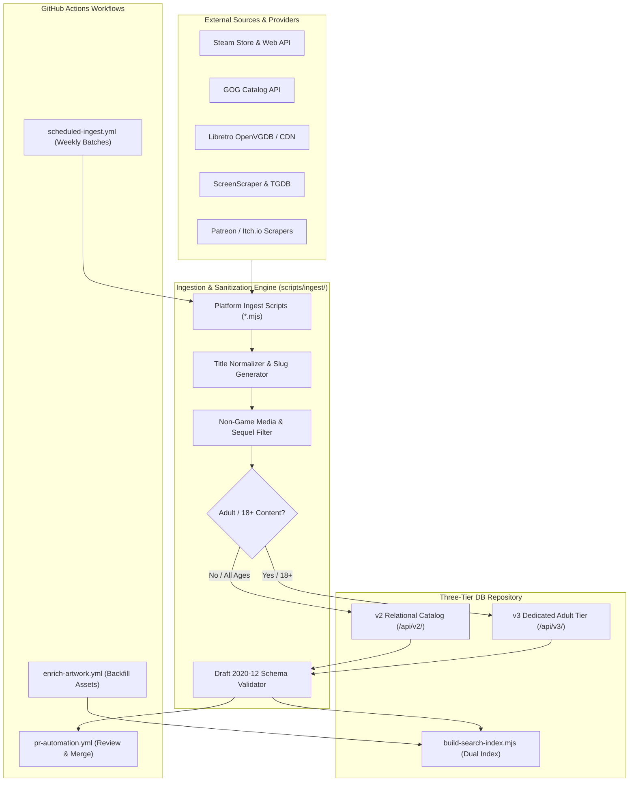

# Skill: HELIX Gaming DB — Multi-Platform Metadata Expansion & Automated Ingestion Pipeline

> Authoritative engineering standard and operational guide for progressively expanding the **HELIX Gaming DB** (`projects/helix-gaming-db`) catalog to cover every game available across all supported PC and emulation platforms via automated ingestion scripts, data sanitization pipelines, and scheduled GitHub Actions workflows.

---

## 1. Multi-Platform Coverage Scope & Taxonomy

HELIX Gaming DB serves as the central, authoritative open metadata API for the HELIX Origin ecosystem (consumed primarily by `universal-game-launcher` and external clients). The catalog must progressively cover all platforms supported by the launcher:

### 1.1 PC Digital Storefronts & Standalone Channels
- **Steam**: PC, Mac, Linux. Comprehensive taxonomy, achievements, tags, 600×900 vertical capsules, 16:9 hero banners, and trailers.
- **GOG.com**: DRM-free PC classics and modern indies with high-resolution vertical box art and clean descriptions.
- **Epic Games Store**: Modern PC titles, weekly free games, and Unreal Engine releases.
- **itch.io & Patreon**: Independent, experimental, and creator-supported games (with automatic routing of mature titles to the v3 tier).
- **Ubisoft Connect, EA App, Battle.net, Rockstar Games Launcher, Amazon Games**: Publisher-specific PC catalogs.
- **Standalone PC / EmulationStation ROMs**: Direct executables and non-storefront distributions.

### 1.2 Emulated & Retro Console Platforms
- **Nintendo**: NES, Famicom, SNES, Super Famicom, Nintendo 64, Game Boy, Game Boy Color, Game Boy Advance, Nintendo DS, Nintendo 3DS, GameCube, Wii, Wii U, Nintendo Switch.
- **Sony PlayStation**: PlayStation (PS1), PlayStation 2 (PS2), PlayStation 3 (PS3), PlayStation Portable (PSP), PlayStation Vita (PS Vita).
- **Sega**: Master System, Genesis / Mega Drive, Sega CD, Sega Saturn, Dreamcast, Game Gear.
- **Microsoft Xbox**: Original Xbox, Xbox 360.
- **Arcade & Vintage Computers**: Arcade (MAME / FinalBurn Neo), SNK Neo Geo, Commodore 64, Commodore Amiga.

---

## 2. Ingestion & Automation Architecture

### 2.1 Ingestion Scripts Architecture (`projects/helix-gaming-db/scripts/ingest/`)
Ingestion scripts are modular, standalone Node.js ES modules (`.mjs`) adhering to the `scripts/ingest/` standard:

1. **`ingest-steam.mjs`**:
   - Queries `https://store.steampowered.com/api/appdetails?appids={appId}&l=english`.
   - Extracts title, shortDescription, detailedDescription, developers, publishers, releaseDate, genres, categories, tags, capsuleImage (`library_600x900_2x.jpg`), heroImage (`library_hero.jpg`), logoImage (`logo.png`), headerImage (`header.jpg`), screenshots, and movies.
   - Automatically sanitizes slugs and validates against `schemas/game.schema.json`.

2. **`ingest-gog.mjs`**:
   - Queries `https://catalog.gog.com/v1/catalog` and `https://api.gog.com/products/{id}`.
   - Extracts DRM-free game metadata, high-resolution vertical cover art, tags, ratings, and video embeds.

3. **`ingest-libretro-rdb.mjs`**:
   - Parses Libretro OpenVGDB databases for retro console ROM catalogs (Nintendo, Sega, PlayStation).
   - Resolves canonical No-Intro game titles, release years, developer studios, and constructs direct Libretro Thumbnails CDN URLs (`Named_Boxarts`, `Named_Snaps`, `Named_Logos`).

4. **`ingest-screenscraper.mjs`**:
   - Interfaces with ScreenScraper API for arcade and retro console enrichment.
   - Emits structured JSON records with rate-limiting and cache checks to prevent API throttling.

5. **`ingest-patreon-itch.mjs`**:
   - Ingests indie creations, itch.io projects, and creator-supported Patreon games.
   - Detects mature/adult tags and automatically routes payloads to `api/v3/games/` and developer profiles to `api/v3/developers/`.

6. **`check-drift.mjs` (Outdated Metadata & Artwork Detector)**:
   - Periodically scans existing game payloads in `api/v2/` and `api/v3/` against live upstream storefront APIs (Steam Storefront API, GOG API, itch.io).
   - Detects updated game descriptions (e.g. episodic releases, early access exits, major seasonal content updates).
   - Detects outdated or broken artwork URLs (404s, replaced Steam library vertical assets, new official logos or hero banners).
   - Flags changes in release dates, review scores, added platforms, or creator updates.
   - Emits a structured drift update payload ready for batch merging and PR generation.

### 2.2 Data Quality & Sanitization Invariants
- **Clean Slugs**: Generated via `title.toLowerCase().replace(/[^a-z0-9]+/g, "-").replace(/^-|-$/g, "")`. If collision occurs, append release year (`{slug}-{year}`) or platform.
- **Persistent HTTPS Artwork**: All artwork must resolve from immutable or high-availability CDNs (Steam CDN, GOG CDN, Libretro CDN, official studio domains). Never reference temporary or signed expiration URLs.
- **Zero Duplicate Titles**: Automated deduplication cross-checks `slug`, `title`, and `aliases` across both `v2` and `v3` catalogs.
- **Two-Tier Separation**:
  - `api/v2/games/`: General, family, teen, and mature (17+) commercial/indie/retro titles.
  - `api/v3/games/`: Explicit, uncensored adult (18+) games, visual novels, and Patreon sandbox creations.
- **Schema Conformity**: Every generated JSON file must pass `scripts/verify-schema.mjs` using Ajv with strict schema validation against `schemas/game.schema.json` and `schemas/developer.schema.json`.

---

## 3. Automated GitHub Actions Workflows

Automating ingestion and maintenance ensures the database scales sustainably without manual human data entry:

### 3.1 Weekly Scheduled Ingestion Workflow (`.github/workflows/scheduled-ingest.yml`)
- **Schedule**: Runs weekly via cron (e.g. Sunday at 00:00 UTC).
- **Execution**:
  1. Executes a designated platform ingestion batch (e.g. `node scripts/ingest/ingest-steam.mjs --batch=20`).
  2. Runs `node scripts/build-search-index.mjs` to regenerate `/api/manifest.json`, `/api/v1/`, `/api/v2/`, and `/api/v3/` search indices.
  3. Executes `npm test` (`scripts/verify-schema.mjs`).
  4. If validation succeeds and new games were added, automatically opens a Pull Request titled `feat(catalog): automated platform ingestion [batch: <platform>]`.
  5. Applies label `automated-ingest` and assigns for validation.

### 3.2 Continuous PR Validation & Auto-Review (`.github/workflows/pr-automation.yml`)
- **Trigger**: Every pull request targeting `main`.
- **Execution**:
  1. Runs `node scripts/verify-pr.mjs` to inspect changed JSON files.
  2. Checks: JSON syntax, schema compliance, slug-filename match, HTTPS image reachability, developer cross-reference.
  3. Posts an automated diagnostic comment detailing passing and failing fields.
  4. Submits an automated `APPROVE` or `REQUEST_CHANGES` review with status labels (`status: validated`, `ready-to-merge` vs `status: needs-work`).

### 3.3 Artwork Backfill & Health Check (`.github/workflows/enrich-artwork.yml`)
- **Schedule**: Bi-weekly background run.
- **Execution**:
  1. Scans existing games in `v2` and `v3` for missing artwork slots (e.g. missing `logoImage` or `heroImage`).
  2. Queries authorized secondary providers (Libretro CDN, Steam CDN, SteamGridDB) to backfill missing assets.
  3. Rebuilds search indices and submits a PR if improvements were made.

### 3.4 Outdated Information & Artwork Auto-Refresh Workflow (`.github/workflows/update-metadata-drift.yml`)
- **Schedule**: Bi-weekly background run (e.g. 1st and 15th of every month).
- **Execution**:
  1. Executes `node scripts/ingest/check-drift.mjs` across all existing catalog games.
  2. Inspects live storefronts for games actively receiving updates (new act/chapter synopses, updated release statuses, modified Steam store capsules/heroes, refreshed logos).
  3. Validates that current image URLs are healthy and active (verifying HTTP 200 responses, replacing outdated or low-res images with newer high-res CDN assets).
  4. Updates modified game records, runs `scripts/build-search-index.mjs` and `npm test`.
  5. Automatically opens a PR titled `chore(catalog): refresh outdated metadata and artwork for actively updated games`.

---

## 4. Multi-Stage Progressive Rollout Strategy

To maintain high data quality and avoid noise, platform coverage is rolled out across 5 structured phases:

| Phase | Target Scope | Target Count | Primary Ingestion Tool | API Tier Destination |
| --- | --- | --- | --- | --- |
| **Phase 1** | Top PC Indie Gems & Steam/GOG Classics | ~250 titles | `ingest-steam.mjs`, `ingest-gog.mjs` | `v2` Relational |
| **Phase 2** | Golden Age 16-bit & 32-bit Consoles (SNES, Genesis, PS1, GBA) | ~500 titles | `ingest-libretro-rdb.mjs` | `v2` Relational |
| **Phase 3** | Dedicated Adult / Patreon Visual Novels & Sandbox Games | ~150 titles | `ingest-patreon-itch.mjs` | `v3` Adult (18+) |
| **Phase 4** | 6th & 7th Generation 3D Classics (GameCube, PS2, Dreamcast, Wii, PSP) | ~500 titles | `ingest-libretro-rdb.mjs`, `ingest-screenscraper.mjs` | `v2` Relational |
| **Phase 5** | Long-tail Digital Storefronts & Retro Arcade (Epic, EA, Ubisoft, Arcade) | ~1,000+ titles | Multi-source batch ingestion | `v2` & `v3` |

---

## 5. Client Consumption Standard (`universal-game-launcher`)

All clients consuming the expanded database must adhere to:
1. **Dynamic Search Index Query**: Query `/api/v2/search/index.json` first, and if adult content is permitted, also query `/api/v3/search/index.json`.
2. **Offline-First Resilience**: Cache search indexes in the client's persistent KV storage (`api.kvSetJson`) with fallback to local cache when network connectivity is lost.
3. **Index Fallback Synthesis**: If a detailed game payload (`/api/v2/games/{slug}.json`) fails to load or is offline, synthesize metadata directly from the rich search index entry (which contains title, developers, publishers, releaseYear, genres, categories, userScore, and complete artwork URLs).
