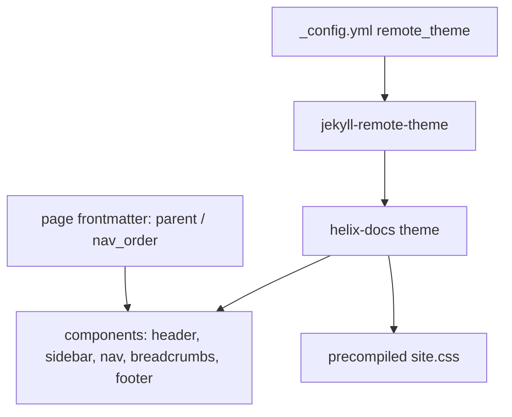

# Skill: helix-docs theme — structure, consumption, repair

> Everything an agent needs to work on the shared Jekyll theme `helix-docs`, or to fix any
> site that consumes it. Applies to **all** projects under `` that use GitHub
> Pages. The theme repo mirrors **just-the-docs**' structure while keeping its own HELIX
> style and palette.

## What helix-docs is

- Repo: `projects/helix-docs` — a remote theme consumed by the other projects.
- Consuming sites set `remote_theme: HELIX-Origin/helix-docs` in `_config.yml`.
- GitHub Pages serves the theme's **precompiled** `assets/css/site.css`; the theme never
  compiles SCSS at build time (see skill `sass-compile`).

## Theme repo layout (mirrors just-the-docs)

```
projects/helix-docs/
  _layouts/             page structure ONLY (default, docs, wiki, catalogue, store,
                        changelog, faq, catalogue-item, store-item) — no nav logic
  _includes/            components/ (header, sidebar, nav, breadcrumbs, footer, toc)
                        + custom hooks (head_custom, header_custom, footer_custom)
                        + translate-control.html
  _sass/                source of truth; helix-docs.scss entrypoint; layered modules
  assets/css/site.css   precompiled + committed; served by GH Pages (RE-generate, don't
                        hand-edit; see skill `sass-compile`)
  _config.yml           theme config
```

## Theme architecture at a glance



## How consuming sites must use it — NO `_data/navigation.yml`

- `_config.yml`:
  ```yaml
  remote_theme: HELIX-Origin/helix-docs
  plugins:
    - jekyll-remote-theme
  ```
- Defaults by **type**, never by path. Write Jekyll's canonical scope form with a
  match-all `path: ""` — identical semantics to type-only scopes, but it satisfies YAML
  schema linters that require `path` (see BUG-10 in `BUGS.md`):
  ```yaml
  defaults:
    - scope: { path: "", type: docs }
      values: { layout: docs }
    - scope: { path: "", type: wiki }
      values: { layout: wiki }
  ```
- Collection setup when a site uses `_docs/` / `_wiki/`:
  ```yaml
  collections:
    docs: { output: true }
    wiki: { output: true }
  ```
- Navigation is computed in Liquid from **page frontmatter**:
  `parent`, `grand_parent`, `nav_order`, `permalink`, and `published: false` (hide from
  nav, keep the file). There is NO `_data/navigation.yml` — delete it wherever it exists.

## Frontmatter schema

- Every page: `layout`, `title`, `nav_order` (integer; lower sorts first).
- Child pages: `parent: <parent page title>` and, for level 3, `grand_parent: <top title>`.
- Index pages anchor the tree by their **title** and get `permalink: /docs/` (or `/wiki/`).
- `published: false` hides a page from ALL navigation; `nav_exclude: true` hides it from the
  nav tree only (the page still builds and is reachable by URL — e.g. `404.md`).
- Never enable `jekyll-titles-from-headings` on a site using this theme — it overrides
  collection-document `title`s and breaks parent matching (see BUG-6 in `BUGS.md`).
- `layout` values the theme supports: `default`, `docs`, `wiki`, `catalogue`, `store`,
  `changelog`, `faq`, `catalogue-item`, `store-item`.

## Per-project parent anchor titles (exact — typo breaks the tree)

| Project | docs parent | wiki parent |
| --- | --- | --- |
| NH-Reader | "Documentation Home" | "NH Reader Technical Wiki" |
| Hentai-Senpai-Multi-DE-Theme | "Documentation Directory" | "Technical Wiki & Reference" |
| Windhawk-Themes | "Documentation Directory" | "Target & Configuration Wiki" |
| helix-origin.github.io | portal root (`/`, layout `default`) | — |

## Repair checklist for a consuming site

1. `_config.yml`: `remote_theme`, `plugins`, defaults by type, collections.
2. Delete any `_data/navigation.yml` (see Agent `config-fixer`).
3. Every page gets valid frontmatter per the schema (see Agent `frontmatter-fixer`).
4. Content is GFM (see skill `gfm-content`); HTML only where markdown can't express it
   (see Agent `content-validator`).
5. Local build must pass; built HTML must contain no `site.data.navigation` remnants
   (see Agent `theme-engineer/preview-builder`).

## Include/layout architecture (target after current refactor)

- `_layouts/default.html`, `docs.html`, `wiki.html` define structure only: header,
  sidebar (nav slot), `{{ content }}`, breadcrumbs, pager, footer.
- `_includes/components/nav.html` renders the 3-level tree from frontmatter, with a
  `docs` vs `wiki` variant (output classes `.docs-nav-list` / `.wiki-nav-list`).
- `translate-control.html` falls back to a hard-coded 18-language list when
  `site.data.languages` is absent (data files are optional, never required).