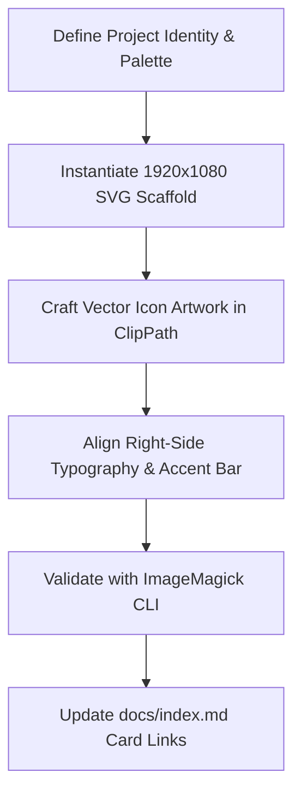

# Skill: Project Artwork Generation

> Complete procedural guide for designing, crafting, and validating 16:9 vector project showcase artwork and thumbnails across the HELIX Origin organization.

---

## Architecture Overview



---

## Step 1: Project Metadata & Palette Selection

Select the primary base dark background and accent gradient reflecting the project's identity:

```xml
<defs>
  <!-- Background gradient: deep dark obsidian to near-black -->
  <linearGradient id="background" x1="0" y1="0" x2="1" y2="1">
    <stop stop-color="#07111f"/>
    <stop offset="1" stop-color="#040a14"/>
  </linearGradient>

  <!-- Accent gradient: brand primary to secondary -->
  <linearGradient id="accent" x1="0" y1="0" x2="1" y2="1">
    <stop stop-color="#48d8f2"/>
    <stop offset="1" stop-color="#b06cff"/>
  </linearGradient>

  <!-- Icon plate clip path -->
  <clipPath id="icon">
    <rect x="218" y="315" width="450" height="450" rx="72"/>
  </clipPath>
</defs>
```

---

## Step 2: Atmospheric Background Layers

Every canvas includes:
1. **Background Fill:** Full canvas `1920×1080` filled with `url(#background)`.
2. **Radial Ambient Glows:** Top-right (`cx="1700" cy="150" r="540"`) and bottom-right (`cx="1400" cy="900" r="420"`) tinted with brand accents (`opacity=".08"` to `".12"`).
3. **Diagonal Ray:** Signature 45° subtle light streak:
   ```xml
   <path d="M0 930 750 180h360L360 1080H0z" fill="#fff" opacity=".025"/>
   ```
4. **Outer Glow Frame:** Soft white backdrop behind the icon plate:
   ```xml
   <rect x="198" y="295" width="490" height="490" rx="92" fill="#fff" opacity=".08"/>
   ```

---

## Step 3: Icon Plate Illustration Design

All internal artwork lives inside `<g clip-path="url(#icon)">` within `(218, 315)` to `(668, 765)`:

1. **Plate Background:** `<rect x="218" y="315" width="450" height="450" fill="#0d1b2d"/>`
2. **Internal Glow Orbs:**
   - Top right: `<circle cx="619" cy="343" r="160" fill="<primary-accent>" opacity=".12"/>`
   - Bottom left: `<circle cx="260" cy="740" r="140" fill="<secondary-accent>" opacity=".10"/>`
3. **Domain Illustration Motif:**
   - **Documentation / IDE:** Window frames, title bar controls, sidebar tree, code syntax cards.
   - **Shell & Theming:** Mica/acrylic glass windows, styler mod pills, docked taskbar items.
   - **Reader / Content:** Open book silhouette, pages, bookmarks, image thumbnail previews.
   - **Game Organizer / Vault:** Game library grid, categorization tag badges, platform badges, launch controls.
   - **Theme & Deskthemepack:** Desktop wallpaper frame, palette color swatch pills, cursor pointer motif.
4. **Outer Border:** Crisp border outline matching the icon plate:
   ```xml
   <rect x="218" y="315" width="450" height="450" rx="72" fill="none" stroke="<primary-accent>" stroke-opacity=".3" stroke-width="3"/>
   ```

---

## Step 4: Typography & Title Block

Positioned to the right of the vertical accent bar:

```xml
<!-- Vertical Accent Divider -->
<rect x="820" y="376" width="10" height="328" rx="5" fill="url(#accent)"/>

<!-- Primary Title (H1) -->
<text x="880" y="485" fill="#edf5ff" font-family="Arial, sans-serif" font-size="82" font-weight="700">Project Name</text>

<!-- Subtitle / Tagline (H2) -->
<text x="880" y="585" fill="#dfeafa" font-family="Arial, sans-serif" font-size="56" font-weight="600">Subsystem &amp; Purpose</text>

<!-- Category Pill / Architecture Tag -->
<text x="885" y="660" fill="#48d8f2" font-family="Arial, sans-serif" font-size="32" letter-spacing="8">FRAMEWORK &amp; SPECIFICATION</text>
```

*(Note: For compact titles, `y="510"` and `y="586"` can be used with a 2-line structure).*

---

## Step 5: ImageMagick Validation & Rendering

Always validate the generated SVG using ImageMagick CLI:

```powershell
# 1. Test raster render to temporary PNG
magick "<svg-path>" "$env:TEMP/artwork-test.png"

# 2. Inspect generated dimensions & format
magick identify "$env:TEMP/artwork-test.png"
# Expected: PNG 1920x1080 1920x1080+0+0 8-bit sRGB

# 3. Optional: Export compressed WebP or thumbnail if requested
magick "<svg-path>" -resize 960x540 "$env:TEMP/artwork-thumb.webp"
```

---

## Step 6: Portal Card Integration

Once validated:
1. Save the vector asset to `helix-origin.github.io/docs/assets/images/<project-slug>.svg`.
2. Update `helix-origin.github.io/docs/index.md`:
   ```html
   <div class="project-card">
   <a href="https://www.helix-origin.club/<project-repo>/" class="project-img">
   .svg' | relative_url }}" alt="<Project Title> icon and project name" loading="lazy" decoding="async">
   </a>
   ```
