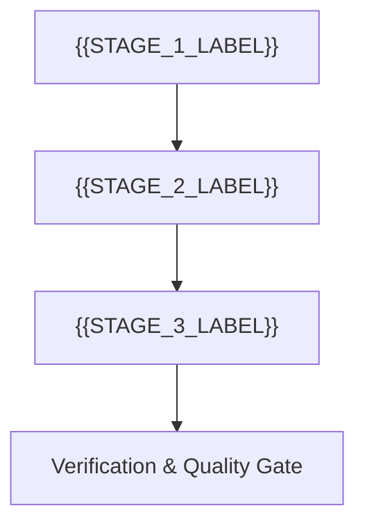

# {{PROJECT_OR_ORG_NAME}} — Roadmap & Milestones

> 🗺️ **Living Source of Truth**: Product direction, positioning principles, and milestone delivery history for **{{PROJECT_OR_ORG_NAME}}**.
> Pair with [`PLAN.md`](./PLAN.md) (sprint execution), [`TODO.md`](./TODO.md) (task ledger), and [`BUGS.md`](./BUGS.md) (issues and quirks).

> [!IMPORTANT]
> AI agents are strictly required to update this page and related tracking ledgers **before** executing new feature work or bug fixes and keep them synchronized.

---

## 📜 Tracking Rules

- **No Typo Duplication**: When recording user reports, clean and fix all typos to preserve professional quality.
- **Consistent Formatting**: Maintain consistent formatting and style throughout all documentation to ensure readability and professionalism.
- **Clear Sectioning**: Use clear and descriptive headers for each section to improve navigation and readability.
- **Active Items First**: The currently active milestone, sprint, task, or workstream must always be placed at the top of the content sections.
- **Regular Updates**: Ensure that the roadmap is regularly updated to reflect the latest developments and changes in the project.
- **Improve User Directives**: Continuously refine and clarify user directives to ensure they are easily understood and actionable.
- **Explicit Project Tagging**: In multi-project or organization tracking ledgers, every milestone, sprint, task, or deliverable header and row MUST explicitly include its project name and repository path (e.g., `[{{PROJECT_NAME}}] ({{PROJECT_PATH}})`) to prevent agent context confusion.
- **Tracking Docs Stay True**: Update `ROADMAP.md`, `TODO.md`, `BUGS.md`, and `PLAN.md` first or in lockstep with code changes so a stale ledger counts as a bug.
- **Always Track Everything**: Every new feature request, enhancement, or bug report must be logged in [`BUGS.md`](./BUGS.md), [`TODO.md`](./TODO.md), and [`ROADMAP.md`](./ROADMAP.md) before execution.

---

## 🔭 Vision & Positioning Principles

1. **Core Value Proposition**: {{VISION_STATEMENT}}
2. **Design Principles**:
   - {{PRINCIPLE_1}}
   - {{PRINCIPLE_2}}
   - {{PRINCIPLE_3}}
3. **Non-Goals & Boundaries**:
   - {{NON_GOAL_1}}
   - {{NON_GOAL_2}}

---

## 🗺️ Milestone Overview

| # | Milestone | Scope / Repository | Status | Release / Target | Focus |
|---|---|---|---|---|---|
| **M1** | [{{PROJECT_NAME}}] {{MILESTONE_1_NAME}} | `{{PROJECT_PATH}}` | ✅ Shipped | {{TAG_OR_COMMIT}} | {{SUMMARY}} |
| **M2** | [{{PROJECT_NAME}}] {{MILESTONE_2_NAME}} | `{{PROJECT_PATH}}` | 🚀 Active | {{TARGET_DATE_OR_VERSION}} | {{SUMMARY}} |
| **M3** | [{{PROJECT_NAME}}] {{MILESTONE_3_NAME}} | `{{PROJECT_PATH}}` | ⏳ Planned | {{TARGET}} | {{SUMMARY}} |

---

## 🚀 Active Milestones

### [{{PROJECT_NAME}}] ({{PROJECT_PATH}}) — Milestone {{ACTIVE_MILESTONE_ID}}: {{ACTIVE_MILESTONE_NAME}}

#### Detailed Deliverables

- 🎯 **[{{PROJECT_NAME}}] {{DELIVERABLE_1_TITLE}}**: {{DELIVERABLE_1_DESC}}
- 🎯 **[{{PROJECT_NAME}}] {{DELIVERABLE_2_TITLE}}**: {{DELIVERABLE_2_DESC}}
- 🎯 **[{{PROJECT_NAME}}] {{DELIVERABLE_3_TITLE}}**: {{DELIVERABLE_3_DESC}}

---

## 🔮 Planned & Future Milestones

### [{{PROJECT_NAME}}] ({{PROJECT_PATH}}) — Milestone {{NEXT_ID}}: {{NEXT_SCOPE_SUMMARY}}
- ⏳ **Backlog Candidates**: {{CANDIDATE_ITEMS}}

---

## 📌 Historical Milestones & Shipped Releases

### [{{PROJECT_NAME}}] ({{PROJECT_PATH}}) — Milestone {{PREV_MILESTONE_ID}}: {{PREV_MILESTONE_NAME}} ({{RELEASE_VERSION_OR_TAG}})
- {{COMPLETED_ITEM_1}}
- {{COMPLETED_ITEM_2}}

---

## 🔖 Metadata

- **Project / Scope**: {{PROJECT_NAME_AND_TYPE}}
- **Tracking Mode**: {{SEMVER_OR_MILESTONES}}
- **Governance**: Governed by `.agents/` rules and organization handoff contracts.
