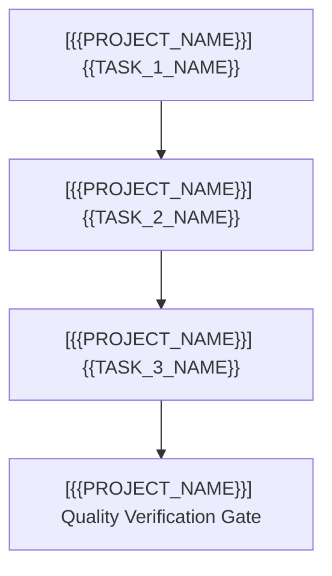

# {{PROJECT_OR_ORG_NAME}} — Task Checklist & Workstream Tracking

> 📋 **Living Source of Truth**: Actionable task ledger for **{{PROJECT_OR_ORG_NAME}}**.
> Statuses: ⬜ backlog · 🚧 in progress · ✅ done (tracked as `- [ ]` and `- [x]` checkboxes).
> High-level direction lives in [`ROADMAP.md`](./ROADMAP.md), active sprints in [`PLAN.md`](./PLAN.md), issues in [`BUGS.md`](./BUGS.md).

> [!IMPORTANT]
> AI agents are strictly required to update this page and related tracking ledgers **before** executing new feature work or bug fixes and keep them synchronized.

---

## 📜 Tracking Rules

- **No Typo Duplication**: When recording user reports, clean and fix all typos to preserve professional quality.
- **Consistent Formatting**: Maintain consistent formatting and style throughout all documentation to ensure readability and professionalism.
- **Clear Sectioning**: Use clear and descriptive headers for each section to improve navigation and readability.
- **Active Items First**: The currently active milestone, sprint, task, or workstream must always be placed at the top of the content sections.
- **Regular Updates**: Ensure that this file is regularly updated to reflect the latest developments and changes in the project.
- **Improve User Directives**: Continuously refine and clarify user directives to ensure they are easily understood and actionable.
- **Same-Change Updates**: When a task changes behavior or scope, update this file **in the same change**.
- **Done Moves Down**: When a task is done, check it off and archive completed sections under Completed Workstreams.
- **Explicit Project Tagging**: In multi-project or organization tracking ledgers, every workstream header, checklist group, and individual checkbox item MUST be explicitly prefixed with its project name and repository path (e.g., `[{{PROJECT_NAME}}] ({{PROJECT_PATH}})` or `- [ ] [{{PROJECT_NAME}}] ...`) to prevent agent context confusion.
- **Tracking Docs Stay True**: Update `ROADMAP.md`, `TODO.md`, `BUGS.md`, and `PLAN.md` first or in lockstep with code changes.
- **Always Track Everything**: Every new feature request, enhancement, or bug report must be logged before execution.

---

## 🔥 Active Workstreams

### 🎯 [{{PROJECT_NAME}}] Workstream {{WORKSTREAM_ID}}: {{WORKSTREAM_TITLE}}
- **Project Identifier:** `[{{PROJECT_NAME}}]`
- **Repository Path:** `{{PROJECT_PATH}}`
- **Target Component:** {{TARGET_COMPONENT_OR_MODULE}}

**Locked user directives:**
- "{{LOCKED_USER_DIRECTIVE_1}}"
- "{{LOCKED_USER_DIRECTIVE_2}}"

**Implementation checklist:**
- [ ] **[{{PROJECT_NAME}}] {{CHECKLIST_GROUP_1}}**:
  - [ ] `[{{PROJECT_NAME}}]` {{TASK_ITEM_1}}
  - [ ] `[{{PROJECT_NAME}}]` {{TASK_ITEM_2}}
- [ ] **[{{PROJECT_NAME}}] {{CHECKLIST_GROUP_2}}**:
  - [ ] `[{{PROJECT_NAME}}]` {{TASK_ITEM_3}}
  - [ ] `[{{PROJECT_NAME}}]` {{TASK_ITEM_4}}
- [ ] **[{{PROJECT_NAME}}] Validation & Verification**:
  - [ ] `[{{PROJECT_NAME}}]` {{VERIFICATION_STEP_1}}
  - [ ] `[{{PROJECT_NAME}}]` {{VERIFICATION_STEP_2}}

---

## ⬜ Backlog / Candidate Tasks

### [{{PROJECT_NAME}}] ({{PROJECT_PATH}}) — Candidates
- [ ] `[{{PROJECT_NAME}}]` **{{BACKLOG_ITEM_1_TITLE}}**: {{BACKLOG_ITEM_1_DESC}}
- [ ] `[{{PROJECT_NAME}}]` **{{BACKLOG_ITEM_2_TITLE}}**: {{BACKLOG_ITEM_2_DESC}}

---

## ✅ Completed Workstreams & Archive

### ✅ [{{PROJECT_NAME}}] Workstream {{PREV_WORKSTREAM_ID}}: {{PREV_WORKSTREAM_TITLE}} ({{COMPLETED_DATE_OR_VERSION}})
- **Project Identifier:** `[{{PROJECT_NAME}}]`
- **Repository Path:** `{{PROJECT_PATH}}`

- [x] `[{{PROJECT_NAME}}]` {{COMPLETED_TASK_1}}
- [x] `[{{PROJECT_NAME}}]` {{COMPLETED_TASK_2}}
- [x] `[{{PROJECT_NAME}}]` {{COMPLETED_TASK_3}}

---

## 🔖 Metadata

- **Project**: {{PROJECT_NAME}}
- **Tracking Status**: {{STATUS_SUMMARY}}
