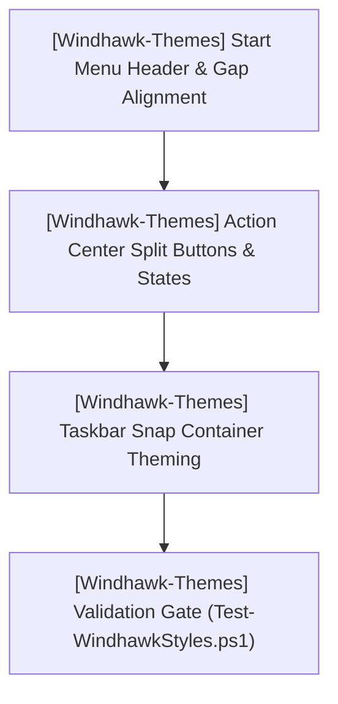

# TODO-ARCHIVE.md — HELIX Origin Historical Task Archive

> 🗄️ **Historical Archive Ledger**: Complete archival checklist and implementation details for completed workstreams across the **HELIX Origin** organization.
>
> For active workstreams, immediate tasks, and backlog candidates, refer to [`TODO.md`](../TODO.md).
> Last updated: 2026-10-16

---
### 🎯 [Steam-Vault] Workstream W.47: Project Script Standards, WinGet Manifest Schema 1.12.0 & IDE Untracking (Hotfix v1.3.3)
- **Project Identifiers:** `[Steam-Vault]` (`projects/Steam-Vault`)
- **Target Components:** `projects/Steam-Vault/package.json`, `projects/Steam-Vault/scripts/generate-winget-manifest.mjs`, `projects/Steam-Vault/.github/workflows/publish-winget.yml`, `projects/Steam-Vault/.gitignore`, `projects/Steam-Vault/src-tauri/Cargo.toml`, `projects/Steam-Vault/src-tauri/tauri.conf.json`, `projects/Steam-Vault/CHANGELOG.md`, `projects/Steam-Vault/.github/releases/v1.3.3.md`

**Locked user directives:**
- "manifest needs to conform with the 1.12 schema accoring to the pr checks"
- "we also have two validation tests that we need to use on our local end. the validate manifest command and the install local manifext command"
- "winget:install-test is in violation of our main:sub:option command format standards"
- "yes. these will be another hotfix release since they are a small patch that effects the app."
- "ide folders should not be in the remote repo. so that .vscode folder needs to be removed from tracking."
- "the minafest update effected the app since it effects the package.json. thus a version bump is needed for that update"

**Implementation checklist:**
- [x] `[Steam-Vault]` **Align Package Scripts to `main:sub:option`** — Updated `package.json` with canonical scripts: `winget:manifest:generate`, `winget:manifest:verify`, `winget:manifest:install`, and root shorthand `winget:manifest`.
- [x] `[Steam-Vault]` **Upgrade Manifest Generator to Schema 1.12.0** — Updated `scripts/generate-winget-manifest.mjs` to target Microsoft Schema 1.12.0 with validation flags (`--verify`, `--install`).
- [x] `[Steam-Vault]` **Untrack IDE Directories & Update `.gitignore`** — Removed `.vscode/` from git tracking and added comprehensive IDE exclusion patterns to `.gitignore`.
- [x] `[Steam-Vault]` **Harden Standalone WinGet Workflow Download** — Fixed pattern matching in `.github/workflows/publish-winget.yml` to use glob patterns (`*x64-setup.exe`) for `gh release download`.
- [x] `[Steam-Vault]` **Bump Version to 1.3.3** — Updated `package.json`, `src-tauri/Cargo.toml`, `src-tauri/Cargo.lock`, `src-tauri/tauri.conf.json`, and added `1.3.3` entry in `CHANGELOG.md`.
- [x] `[Steam-Vault]` **Author Standard Release Notes** — Authored `.github/releases/v1.3.3.md` strictly following `.agents/rules/release-notes.md`.
- [x] `[Steam-Vault]` **Full Test Suite & WinGet Verification** — Passed all test suites: check (PASS), rust (43/43 PASS), frontend (PASS 0 errors/0 warnings), i18n (30/30 PASS), and WinGet manifest validation (`winget validate --manifest` succeeded).
- [x] `[Steam-Vault]` **Commit & Push Hotfix v1.3.3** — Committed (`3ea5f9e`), pushed `origin/main`, tagged `v1.3.3`, and pushed tag to trigger automated multi-platform release CI.

### 🎯 [Steam-Vault] Workstream W.46: Cross-Platform Compiler Warning Elimination & Hardened WinGet Publishing Pipeline (Hotfix v1.3.2)
- **Project Identifiers:** `[Steam-Vault]` (`projects/Steam-Vault`)
- **Target Components:** `projects/Steam-Vault/src-tauri/src/platforms/windows.rs`, `projects/Steam-Vault/src-tauri/src/platforms/detectors.rs`, `projects/Steam-Vault/src-tauri/src/platforms/launchers.rs`, `projects/Steam-Vault/.github/workflows/release.yml`, `projects/Steam-Vault/.github/workflows/publish-winget.yml`, `projects/Steam-Vault/.github/releases/v1.3.2.md`

**Locked user directives:**
- "woop we already have issues in the scripts, they haven't caused it to fail but they are definite errors. we need to cancel the workflow runs so we can check the logs and fix the errors."
- "here is the warnings i saw already: warning: unused import: `imp::*` --> src/platforms/windows.rs:679:9, warning: variable does not need to be mutable --> src/platforms/detectors.rs:1664:9 and 1812:9, warning: unused variable: `mounted_drives` --> src/platforms/launchers.rs:1274:5"
- "this will be another patch release if it works. however since it's so small this one will be a hotfix release."
- "what would be useful is a workflow for manually triggering the winget package publishing. this way, if there are errors with the release workflows version, we can use the manual one to test fixes until we get it right."

**Implementation checklist:**
- [x] `[Steam-Vault]` **Cancel Workflow Run** — Cleanly aborted run `38858213789` on GitHub Actions to investigate compiler diagnostics.
- [x] `[Steam-Vault]` **Fix Unused Import in `windows.rs`** — Defined non-Windows stubs directly, eliminating `pub use imp::*;` wildcard warning.
- [x] `[Steam-Vault]` **Fix Unused Mutability in `detectors.rs`** — Added `#[allow(unused_mut)]` on `detection` in `detect_ubisoft()` and `detect_ea()` for Linux/macOS targets.
- [x] `[Steam-Vault]` **Fix Unused Parameter in `launchers.rs`** — Renamed `mounted_drives` parameter to `_mounted_drives` in `detect_emulator_installed()` for Unix targets.
- [x] `[Steam-Vault]` **Standalone WinGet Publishing Workflow** — Authored `.github/workflows/publish-winget.yml` with manual workflow dispatch, schema validation, and dry-run flag.
- [x] `[Steam-Vault]` **Harden Release WinGet Workflow** — Added `version_clean` output in `release.yml` to prevent tag prefix schema rejection in WinGet packages.
- [x] `[Steam-Vault]` **Bump Hotfix Version 1.3.2** — Bumped `package.json`, `Cargo.toml`, `Cargo.lock`, `tauri.conf.json`, `CHANGELOG.md`.
- [x] `[Steam-Vault]` **Author Standard Release Notes** — Authored `.github/releases/v1.3.2.md` strictly following `.agents/rules/release-notes.md`.
- [x] `[Steam-Vault]` **Full Test Suite Verification** — Verified all suites pass: check (PASS), rust (43/43 PASS), frontend (0 errors, 0 warnings), i18n (30/30 PASS).
- [x] `[Steam-Vault]` **Submit Initial WinGet Package PR** — Submitted initial package manifest for `HELIXOrigin.SteamVault` v1.3.2 to `microsoft/winget-pkgs` ([PR #453830](https://github.com/microsoft/winget-pkgs/pull/453830)).
- [x] `[Steam-Vault]` **Harden Manual WinGet Workflow** — Updated `publish-winget.yml` to use `winget validate --manifest` and official `wingetcreate submit`.

### 🎯 [Steam-Vault] Workstream W.45: Modular Multi-Platform Free Game Checker, Store Deals Engine, Library Patch Notes & Settings Ergonomics (Patch v1.3.1)
- **Project Identifiers:** `[Steam-Vault]` (`projects/Steam-Vault`)
- **Target Components:** `projects/Steam-Vault/src-tauri/src/platforms/promotions/`, `projects/Steam-Vault/src-tauri/src/commands.rs`, `projects/Steam-Vault/src-tauri/src/lib.rs`, `projects/Steam-Vault/src/routes/+page.svelte`, `projects/Steam-Vault/src/routes/+layout.svelte`, `projects/Steam-Vault/src/lib/components/settings/PlatformsSection.svelte`, `projects/Steam-Vault/src/lib/types.ts`, `projects/Steam-Vault/src/lib/api.ts`, `projects/Steam-Vault/.github/releases/v1.3.1.md`

**Locked user directives:**
- "ok the epic games card is not correct. i said to make it use legendary but you kept the ugly extra internal card and made it use two separate methods."
- "a way to automatically fetch the code would be useful if possible."
- "a native chrome user agent will be useful for ensuring compatibility with the various oauth providers epic games supports."
- "a button is also needed in the settings page for downloading the epic games overlay service. this will require the user to be authenticated via legendary."
- "since the release got pushed without waiting for me to authorise it, this fix will have to be pushed as a patch release. make sure it is actually what i want before releasing."
- "Optional free game notifications from enabled game platforms can also be added to the app."
- "We won't have an actual store page. So free game alerts would need to allow users to open them in their default browsers. this means a notifications button in the dashboard would be useful for opening a notifications sub page."
- "a downloads sub page button would also be useful in the dashboard for viewing active downloads."
- "the settings page should be accessible from a cog button at the bottom left corner of the sidebar rather than an actual dedicated tab."
- "the free game checker is off. it's notifying of games that are in fact ... not free"
- "Steam and other platforms also have free game giveaways. so the free game checker should not be limited solely to epic games. it should support all enabled platforms."
- "it might be beneficial to make the free game checker use per platform lib files to ensure it is done properly."
- "This means a giveaways notification can also be added for deals and promotions alongside the free games, and this would also allow for patch notes notifications."
- "patch notes, free games, and promotions could each get their own tabs in the notifications sub window."
- "also you need to ensure the release notes ALWAYS follow our release notes standards. that last release violated them."
- "update the release notes in the 1.3.0 release so they match our release notes standards while we wait for the tests to complete"
- "the scratch folder is a agents repo folder and is gitignored so it will never be discovered regardless."

**Implementation checklist:**
- [x] `[Steam-Vault]` **Per-Platform Free Game Promotion Architecture (`platforms/promotions/`)** — Created modular library files (`epic.rs`, `steam.rs`, `gog.rs`, `gamerpower.rs`, `mod.rs`) checking authentic 100% free giveaways across all enabled storefronts.
- [x] `[Steam-Vault]` **Promotion False Positives Bugfix** — Fixed discount pricing validator in `epic.rs` to strictly check `price.totalPrice.discountPrice == 0` and active 0% promotional offers, completely eliminating non-free on-sale games and upcoming titles from active giveaways.
- [x] `[Steam-Vault]` **Store Deals & Major Promotions Engine (`get_store_deals`)** — Added backend endpoint checking featured specials, percent-off discounts, and promotions across Steam, Epic Games, and GOG.
- [x] `[Steam-Vault]` **Library Patch Notes Feed (`get_library_patch_notes`)** — Added backend endpoint querying official update announcements and changelogs for installed library games via Steam's News API with BBCode cleaning.
- [x] `[Steam-Vault]` **Unified 3-Tab Notifications Dashboard Subpage (`src/routes/+page.svelte`)** — Replaced single-view with tabbed notifications sub-window with "🎁 Free Games" (active vs. upcoming cleanly separated), "🏷️ Deals & Promotions", and "📰 Patch Notes & Updates".
- [x] `[Steam-Vault]` **Sidebar Settings Cog Relocation (`src/routes/+layout.svelte`)** — Pinned gear cog button to the bottom-left sidebar footer with smooth hover rotation, freeing up primary navigation.
- [x] `[Steam-Vault]` **Epic Games Card Cleanliness & EOS Overlay (`PlatformsSection.svelte`, `launchers.rs`)** — Standardized platform card height and layout, added EOS overlay status detection and one-click installer.
- [x] `[Steam-Vault]` **Release Notes Compliance (`.github/releases/v1.3.0.md` & `v1.3.1.md`)** — Updated live v1.3.0 GitHub release notes to adhere strictly to `.agents/rules/release-notes.md` standard; added `.github/releases/v1.3.0.md` and prepared `.github/releases/v1.3.1.md` inside project repo for GitHub Actions automation.
- [x] `[Steam-Vault]` **Test Suite Verification** — All 4 test suites passed (`check` 100% pass, `rust` 43/43 tests pass, `frontend` 0 errors / 0 warnings, `i18n` 30/30 languages validated).

### 🎯 [Steam-Vault] & [Steam-Vault-Catalogue] Workstream W.44: Two-Tier Data Architecture: In-Memory Serverless Redis-Compatible KV Tier & SQLite Global Persistence Layer (Completed)
- **Project Identifiers:** `[Steam-Vault]` (`projects/Steam-Vault`), `[Steam-Vault-Catalogue]` (`projects/Steam-Vault-Catalogue`)
- **Target Components:** `projects/Steam-Vault/src-tauri/src/cache.rs`, `projects/Steam-Vault/src-tauri/src/commands.rs`, `projects/Steam-Vault/src-tauri/src/lib.rs`, `projects/Steam-Vault/src-tauri/src/steam/models.rs`, `projects/Steam-Vault/src/lib/redis.ts`, `projects/Steam-Vault/src/lib/api.ts`, `projects/Steam-Vault/src/lib/types.ts`, `projects/Steam-Vault-Catalogue/scripts/modules/indexer.ts`, `projects/Steam-Vault/README.md`, `projects/Steam-Vault/docs/_docs/Getting-Started.md`, `projects/Steam-Vault/docs/_docs/Troubleshooting.md`

**Locked user directives:**
- "We should make sure our app is correctly loading the steam vault catalogue now that it has been completely reworked."
- "almost. the database stores the global app data for persistence. the in memory redis-mock integration is the in app memory."
- "the in app memory redis-mock integration was recently added. so it might not be properly integrated yet. it's worth making sure it is actually done right."
- "there's a possibility that the sqlite database might need some updates too to properly serve as a global data persistence layer."
- "mind i called it redis-mock but it might be ioredis-mock. the version of redis should be a serverless version that is native to tauri or node depending on which is better."
- "if .net runtimes or vc runtimes are needed, proper instructions for them can be added to the repo readme and docs site."
- "the idea of the serverless in-memory redis and sqlite persistence layer is to reduce api calls and allow for instant loading of cached data when present to reduce excess api calls."
- "we also need to fix this error: [1015/163451.244:ERROR:ui\\gfx\\win\\window_impl.cc:172] Failed to unregister class Chrome_WidgetWin_0. Error = 1412 and add the fix to our tauri standards."
- "The toggle in the settings for depressurizer mode is just a toggle box with a lot of excess space. let's make it a button to enable/disable instead so it looks better in our UI."
- "excess space needs to be cleared up too. we shouldn't have excess unused space in the settings page cards."
- "ok we need a better layout so we don't have to force resize cards just to get rid of excess space. they don't need to line up perfectly with each other so long as we don't have excess unused space."
- "The Storage & Drive Overview section doesn't need to display the steam libraries since we autodetect our game installation directories."
- "that section can actually be removed since we have a storage tab for storage details."
- "ok. we need to remove the steam library folder management from the storage tab. the storage tab should be solely for displaying storage usage statistics for all supported platforms."
- "The installation directory management is a per game management feature. That should be kept in the per game management sub pages."
- "also the notice that steam is closed in the bottom of the side bar is not needed. That is only useful for the depressurizer integration so should be in the depressurizer card in the settings tab if we even have it at all."
- "Let's also redo the dashboard into a proper dashboard. it doesn't need the metadata providers info but can benefit from a complete rework into a true dashboard."
- "woop legendary error! {"errorCode":"errors.com.epicgames.accountportal.client_not_found","message":"The client is not known to the system."}"
- "no release until we fix that"
- "users will also need to configure their legendary app directory since it's almost never on PATH due to it not being an installer."
- "A download Legendary button should be added as well to simplify this. basically just like the download launcher buttons. in fact this can be how we get the path too."
- "Windows uses the installation path. macOS and linux use different user manageable paths."

**Implementation checklist:**
- [x] `[Steam-Vault-Catalogue]` **Catalogue Ingestion & Imagery Fallbacks** — updated `scripts/modules/indexer.ts` to enrich metadata records by falling back to `entry.providers` (Steam, GOG, PCGamingWiki, IGDB) for missing top-level images (`capsuleImage`, `headerImage`, `heroImage`, `logoImage`, `iconImage`), developers, publishers, genres, release dates, and user ratings. Rebuilt `dist/catalogue.db.gz` (354.9 KB, 729 curated games) and synced seed to `projects/Steam-Vault/src-tauri/src/catalog_seed.bin`.
- [x] `[Steam-Vault]` **AppMeta Provider Enrichment & Data Models** — added `providers` map, `icon_image`, and `enrich_from_providers()` in `src-tauri/src/steam/models.rs` and `src/lib/types.ts` to auto-populate missing imagery directly from provider payloads.
- [x] `[Steam-Vault]` **SQLite Global Persistence Layer Schema Updates (`cache.rs`)** — added `hero_image`, `logo_image`, `icon_image` columns to `app_meta` in SQLite; added `steam_app_id` with `idx_game_catalog_steam_id` index to `game_catalog`; added `idx_app_kv_expires` index for fast sweeps; added runtime migrations (`ALTER TABLE ... ADD COLUMN ...`); and populated `catalog_lookups` with `steam_id`, `gog_id`, and `epic_name`.
- [x] `[Steam-Vault]` **Serverless In-Memory Redis-Compatible KV Tier (`cache.rs`)** — implemented fast in-memory KV engine (`mem_kv: RwLock<HashMap<String, (String, Option<i64>)>>`) and catalog cache (`mem_cat: RwLock<HashMap<String, AppMeta>>`) with sub-microsecond latency (<0.01ms), backing persistent SQLite `app_kv` table with TTL expiration, auto-eviction, pattern queries, `mget_kv`, `mset_kv`, and JSON serialization.
- [x] `[Steam-Vault]` **O(1) Platform & Steam ID Lookups** — implemented `find_catalog_by_steam_id` and `find_catalog_by_platform_id` ("steam_id", "gog_id", "epic_name") with memory caching, wired into `sync_library_metadata`, `refresh_game_metadata`, `compute_autocats`, `compute_categorization`, `import_platform_games`, and artwork fallbacks.
- [x] `[Steam-Vault]` **Tauri IPC & Serverless TypeScript Redis Client** — added `kv_get`, `kv_set`, `kv_delete`, `kv_has`, `kv_keys`, `kv_mget`, `kv_mset`, `kv_clear_expired` IPC commands, registered in `lib.rs`, exposed in `api.ts`, and implemented `src/lib/redis.ts` providing an `ioredis`/Redis-compatible client interface.
- [x] `[Steam-Vault]` **VC++ and .NET Runtime Documentation** — updated `README.md`, `docs/_docs/Getting-Started.md`, and `docs/_docs/Troubleshooting.md` documenting Microsoft Visual C++ 2015–2022 Redistributable (x64) and Microsoft .NET Desktop Runtime (x64) requirements and troubleshooting steps.
- [x] `[Steam-Vault]` **Settings UI Modernization & Button Toggle** — replaced Depressurizer sync toggle box with an action button showing dynamic status pill ("Enabled" / "Disabled") and clear action label.
- [x] `[Steam-Vault]` **Settings Layout Void Elimination (`.settings-columns`)** — replaced rigid CSS grid with a responsive two-column flex layout (`.settings-columns > .settings-col`), allowing cards to shrink-wrap their contents naturally without forced vertical stretching or dead space.
- [x] `[Steam-Vault]` **Redundant Storage Card Removal & Tab Renaming** — removed redundant `Storage & Drive Overview` card from the General settings page (leaving storage management to the dedicated `/storage` route) and updated the navigation tab label from "Settings & Storage" to "Settings".
- [x] `[Steam-Vault]` **Storage Tab Rework: Multi-Platform Statistics Only** — removed Steam library folder registration/deletion tools from the Storage tab; implemented comprehensive storage usage statistics for all 12 supported platforms with proportional visual bars, percentage breakdown, connected drive volume metrics, and an interactive installed games storage explorer with quick links to library management.
- [x] `[Steam-Vault]` **Per-Game Installation Directory Management** — added an Installation & Storage Management card to the per-game details sub-page and an "Installation & Storage" tab to the Manage modal in `library/+page.svelte`, enabling one-click folder opening (`api.openGameFolder`), path resolution, and cross-library game relocation (`api.previewMoveGame` and `api.moveGame`) with space pre-checks and live progress.
- [x] `[Steam-Vault]` **Sidebar Cleanup & Steam Status Relocation** — removed the "Steam is closed/running" status notice from the bottom of the persistent navigation sidebar in `+layout.svelte`, relocating it exclusively inside the Depressurizer Mode operation card in `settings/+page.svelte`.
- [x] `[Steam-Vault]` **Executive Gaming Dashboard Rework** — created `src/styles/dashboard.scss` and completely reworked `+page.svelte` into a full dashboard featuring executive KPI metrics, a "Jump Back In" recently played & favorites quick-launch carousel, interactive Storefront Ecosystem stacked distribution, drive utilization snapshot, top played titles leaderboard, and a quick actions hub (removing raw metadata provider text).
- [x] `[Ecosystem-Wide] & [Steam-Vault] & [NH-Reader]` **Chromium / WebView2 Window Teardown Error 1412 Fix & Standard Codification** — added `IS_QUITTING` atomic flag, explicit `window.destroy()` iteration before `app.exit(0)`, and `--disable-logging --log-level=3` flag configuration in `src-tauri/src/lib.rs` across `Steam-Vault` and `NH-Reader`; codified into `.agents/skills/tauri-desktop-engineering.md`.
- [x] `[Steam-Vault]` **Legendary CLI OAuth Error Fix, Custom Path Configuration & Auto-Detection** — resolved Epic Games account portal `client_not_found` error by updating the auth redirect helper to `https://legendary.gl/epiclogin` and valid client token (`34a02cf8f4414e29b15921876da36f9a`), added resilient code/JSON/SID parsing, added `legendary_path` setting and `set_legendary_path` Tauri command for custom standalone directories, implemented automatic drive detection (e.g. `E:\Games\Epic Games\Legendary`), and added "Download Legendary ↗" button alongside the 1-click built-in installer.
- [x] `[Steam-Vault]` **Verification & Test Coverage** — added unit tests `test_serverless_redis_kv_store_and_ttl` and `test_find_catalog_by_steam_id_and_platform_id` (43/43 tests passing), verified Rust checks (`cargo check`), frontend types (`svelte-check` 0 errors, 0 warnings), and i18n (30/30 languages).

---

### 🎯 [Ecosystem-Wide] Workstream W.43: Multi-Platform Clean Uninstaller Architecture, Windows Uninstall Registry Invariant & Process Termination Standards (Completed)
- **Project Identifiers:** `[Ecosystem-Wide]`, `[Steam-Vault]` (`projects/Steam-Vault`), `[NH-Reader]` (`projects/NH-Reader`), `[Theme-Toolkit]` (`projects/Theme-Toolkit`)
- **Target Components:** `.agents/templates/nsis-hooks-template.nsh`, `.agents/templates/uninstall-macos-template.sh`, `.agents/templates/uninstall-linux-template.sh`, `projects/Steam-Vault/src-tauri/windows/hooks.nsh`, `projects/NH-Reader/src-tauri/windows/hooks.nsh`, `projects/Theme-Toolkit/src-tauri/windows/hooks.nsh`, `.agents/skills/tauri-desktop-engineering.md`, `AGENTS.md`

**Locked user directives:**
- "We should ensure our tauri standards include creating a proper uninstall file for proper windows uninstall registry. as well as the equivalent scripts for the other supported platforms. this way the uninstall option works without being blocked by running processes."
- "in windows, uninstall registry depends on an uninstall exe file"
- "The pre-install hook is useful when updating, but useless for proper uninstallers and uninstall registry. As it stands it is a patch method and doesn't actually serve the purpose properly. Pre-install hooks should not be used for uninstalling and instead should be used for properly updating installations."

**Implementation checklist:**
- [x] `[Ecosystem-Wide]` **Pre-Install Hook Refactoring for Updates** — removed improper `uninstall.exe` invocations from `NSIS_HOOK_PREINSTALL` across `.agents/templates/nsis-hooks-template.nsh`, `Steam-Vault`, `NH-Reader`, and `Theme-Toolkit`, dedicating pre-install solely to closing running instances before file replacement during installation and updates.
- [x] `[Ecosystem-Wide]` **Windows Uninstall Registry & Dedicated Pre-Uninstall Hooks (`NSIS_HOOK_PREUNINSTALL`)** — added `NSIS_HOOK_PREUNINSTALL` terminating running applications (`taskkill /F /IM ... /T`) and sidecars (`legendary.exe`) followed by `Sleep 1000` handle flush so Windows Add/Remove Programs (`UninstallString = "$INSTDIR\uninstall.exe"`) is never blocked by open file handles.
- [x] `[Ecosystem-Wide]` **Post-Uninstall Residual Directory Cleanup (`NSIS_HOOK_POSTUNINSTALL`)** — added `NSIS_HOOK_POSTUNINSTALL` to cleanly remove residual runtime directories, tools, or caches in `$INSTDIR`.
- [x] `[Ecosystem-Wide]` **Canonical macOS Uninstaller Script Template** — created `.agents/templates/uninstall-macos-template.sh` with graceful `pkill` termination, 1s teardown wait, `/Applications` bundle removal, and optional `--purge` user data/preferences cleanup.
- [x] `[Ecosystem-Wide]` **Canonical Linux Uninstaller Script Template** — created `.agents/templates/uninstall-linux-template.sh` with process termination, desktop menu shortcut removal, `update-desktop-database` trigger, icon cache cleanup, and `.deb` `prerm` guidance.
- [x] `[Ecosystem-Wide]` **Skill & Quick Reference Documentation** — updated `.agents/skills/tauri-desktop-engineering.md` and `AGENTS.md` codifying the Windows uninstall registry architecture, update vs. uninstaller hook lifecycles, and multi-platform standards.
- [x] `[Steam-Vault]` **Full Test Suite & Build Verification** — passed `cargo check`, `cargo test` (41/41 unit & integration tests), `svelte-check` (0 errors, 0 warnings), and `verify-i18n.mjs` (30/30 languages).

---

### 🎯 [Steam-Vault] Workstream W.42: Multi-Platform Launcher Detection, Settings Toggle Guards & Built-in Legendary CLI Integration (Completed)
- **Project Identifiers:** `[Steam-Vault]` (`projects/Steam-Vault`)
- **Target Components:** `projects/Steam-Vault/src-tauri/src/platforms/launchers.rs`, `projects/Steam-Vault/src-tauri/src/platforms/detectors.rs`, `projects/Steam-Vault/src-tauri/src/commands.rs`, `projects/Steam-Vault/src-tauri/src/lib.rs`, `projects/Steam-Vault/src/lib/types.ts`, `projects/Steam-Vault/src/lib/api.ts`, `projects/Steam-Vault/src/lib/components/settings/PlatformsSection.svelte`, `projects/Steam-Vault/src/styles/settings.scss`

**Locked user directives:**
- "we need a way to make it so only installed launchers can be enabled. the app should be able to serach for the launcher exe across standard installation directories and external drives. This way when toggling game providers in the settings, it will disable the toggle for apps that aren't installed and provide an option to download the launcher via the user's default browser."
- "narutally rthe luancher will not be an exe on macos and linux. so the correct launcher entree point will need to be determined per os."
- "For epic games, there is actually an alternative method using legendary and the epic games service that can allow native support without needing the epic games launcher. any other platorms that can work without needing the actual launchers should allow for the methods to use them directly without the launcher if possible."
- "the legendary cli should be supported out of the box. this way users who don't have epic games installed can just use trhe built in legenmdary integration. this will install the epic games service via legendary as well."
- "the built-in binary should be downloaded on demand and stored in a user accessible directory for ease of management."
- "windows supports storing it in either the app data dir or the app's install location. macOS and linux difer."
- "Note: legendary authenticates with an actual epic games account. so it won't do anything without being authenticated. so a proper login method using legendary's official methods is needed."
- "We may end up making the depressurizer inspired features an optional feature that isn't necessary for the built-in library to function. it can just be an optional feature that user's can benefit from in the app's settings page."
- "I think both of those are good options to have."

**Implementation checklist:**
- [x] `[Steam-Vault]` **Cross-Platform Launcher Detection Engine** — created `src-tauri/src/platforms/launchers.rs` detecting installed executables/bundles/packages across standard directories, mounted drives, Flatpaks, and registries for Windows, macOS, and Linux.
- [x] `[Steam-Vault]` **User-Accessible Tools Directory Resolution** — implemented `managed_tools_dir()` resolving to `<current_exe_dir>/tools` when writable or user AppData/XDG Data/Application Support directories, plus an "Open Tools Folder" command.
- [x] `[Steam-Vault]` **Built-in Standalone Legendary CLI Downloader** — implemented on-demand download of the latest platform-specific `legendary` standalone binary from GitHub releases and automatic execution of `eos-overlay install -y` to initialize Epic Online Services.
- [x] `[Steam-Vault]` **Official Legendary OAuth & Credential Import Engine** — implemented `get_legendary_auth_status()`, `legendary_authenticate()` (handling browser authorization codes and raw/JSON payloads or importing from an existing Epic Games Launcher install), and `legendary_logout()`.
- [x] `[Steam-Vault]` **IPC Commands & TypeScript API Integration** — added `get_installed_launchers`, `install_legendary`, `open_external_url`, `open_tools_folder`, `get_legendary_status`, `legendary_login`, and `legendary_logout` in Tauri IPC and typed `api.ts`.
- [x] `[Steam-Vault]` **Platform Settings Toggle Guards & Download Actions** — updated `PlatformsSection.svelte` to query launcher installation status on mount, disabling toggles for uninstalled launchers with a direct "Download Launcher ↗" button opening the official storefront in the default browser.
- [x] `[Steam-Vault]` **Interactive Legendary Authentication Card** — added full in-app authentication flow in `PlatformsSection.svelte` showing active Epic account name/ID with "Tools Folder ↗" and "Log Out", or step-by-step browser authorization code login and launcher credential import.
- [x] `[Steam-Vault]` **Legendary Protocol Game Launching & Process Optimization** — enhanced `launch_game` to prioritize direct game executables (avoiding unwanted launcher launches) and detect `legendary://` URIs and Epic Launcher URI fallbacks, spawning `legendary launch <app_name>` via the managed binary without launching cmd.exe or the Epic Games Launcher.
- [x] `[Steam-Vault]` **Standalone Library Mode vs. Steam Sync (Depressurizer Mode)** — added `enable_steam_sync` setting toggle in `src-tauri/src/settings.rs` and `settings/+page.svelte`, allowing users to run Steam-Vault purely as an independent standalone library manager/launcher without touching Steam VDF files or requiring Steam to be running, with clear badges and informative guidance in the Collections and Organize tabs.
- [x] `[Steam-Vault]` **Verification & Static Bundle Validation** — passed `cargo check`, `cargo test` (41/41 unit & integration tests), `svelte-check` (0 errors, 0 warnings), `verify-i18n.mjs` (30/30 languages), and static production build (`npm run build`).

---

### 🎯 [Steam-Vault] Workstream W.41: Persistent Local Artwork Cache, In-Memory Fast Lookup, CSP Alignment & Settings Cache Reset (Completed)
- **Project Identifiers:** `[Steam-Vault]` (`projects/Steam-Vault`)
- **Target Components:** `projects/Steam-Vault/src-tauri/tauri.conf.json`, `projects/Steam-Vault/src-tauri/src/cache.rs`, `projects/Steam-Vault/src-tauri/src/commands.rs`, `projects/Steam-Vault/src/routes/library/+page.svelte`, `projects/Steam-Vault/src/routes/settings/+page.svelte`, `projects/Steam-Vault/src/lib/api.ts`

**Implementation checklist:**
- [x] `[Steam-Vault]` **CSP Image Source Alignment** — updated `img-src` in `tauri.conf.json` to allow all valid Steam CDN domains (`*.steamstatic.com`, `*.akamaihd.net`), SteamGridDB, IGDB, GOG, PCGamingWiki, Wikipedia, `blob:`, and `data:`.
- [x] `[Steam-Vault]` **Catalogue Table Isolation & Bloat Prevention** — removed rogue `upsert_catalog_entry()` calls during local scanning/uninstaller parsing so `game_catalog` remains purely the official community catalogue.
- [x] `[Steam-Vault]` **Local Artwork Disk & In-Memory Fast Cache** — implemented `<data_dir>/steam-vault/art_cache/` disk persistence and an in-process fast lookup layer (in-memory concurrent cache) so games load covers in 0ms without repeat API/CDN requests.
- [x] `[Steam-Vault]` **Cache Clear & Rebuild Command** — added `clear_metadata_cache` Tauri command to wipe `app_meta`, purge artwork cache, reset `game_catalog` to `catalog_seed.bin` (clean 729 entries), and trigger fresh catalogue & library metadata download.
- [x] `[Steam-Vault]` **Settings UI Cache Reset Button** — added "Clear & Reset Cache" button with confirmation modal, status feedback, and automatic stats refresh in `settings/+page.svelte`.
- [x] `[Steam-Vault]` **Library Grid Cover Resolution Polish** — updated `getGameCover()` in `library/+page.svelte` to query local cached artwork, catalog capsules, and fallback images cleanly without triggering blanket fallback placeholders.

---

### 🎯 [Steam-Vault-Catalogue] & [Steam-Vault] & [Ecosystem-Wide] Workstream W.40: Catalogue Provider Schema Alignment, Universal Modular Reusable Scripts Invariant & Seed Synchronization (Completed)
- **Project Identifiers:** `[Steam-Vault-Catalogue]` (`projects/Steam-Vault-Catalogue`), `[Steam-Vault]` (`projects/Steam-Vault`), `[Ecosystem-Wide]`
- **Target Components:** `projects/Steam-Vault-Catalogue/schema/providers/*.schema.json`, `projects/Steam-Vault-Catalogue/schema/game.schema.json`, `projects/Steam-Vault-Catalogue/scripts/modules/migrator.ts`, `projects/Steam-Vault-Catalogue/scripts/modules/types.ts`, `projects/Steam-Vault-Catalogue/scripts/modules/engine.ts`, `projects/Steam-Vault-Catalogue/scripts/modules/indexer.ts`, `projects/Steam-Vault-Catalogue/scripts/modules/validator.ts`, `projects/Steam-Vault-Catalogue/scripts/manage-catalogue.ts`, `projects/Steam-Vault-Catalogue/package.json`, `projects/Steam-Vault/src-tauri/src/catalog_seed.bin`, `.agents/rules/script-standards.md`

**Locked user directives:**
- "the app is dependant on the catalogue so that always needs to be updated and commited first to ensure the app is loading it correctly."
- "As for the Zero-API key plan, that was abandodnded in favor of optional API keys due to the artwork manager and per game details pages needing them to update missing art and metadata."
- "also our catalogue schema and seeds need to match with the supported metadata providers. the structure i build might not be properly compatible with them. So we need to do a thorough update of our catalogue repo to fully match it to the supported metadata providers so it uses the actual supported metada."
- "This may involve using a seperate scheme per provider if it works better."
- "in fact, importing the official schemes per provide rmight be best. Then our own scheme can be minimalized only to what it actually needs to be importing from our own index.json file."
- "This means a proper alignment of our cheme and all json files is needed."
- "the migrate providers script should be a migrate script that is built as part of our unified scripts. this way it can use sub options for migrations and be reusable to allow us to have proper migration support in case we ever need it again."
- "proper migrations upport is a must for updating entrees whenever we make changes to our catalogue. So this is a definite benefit."
- "This applies to all of our project scripts by the way."
- "any time we need to make a new script for our catalogue, we should conside rincluding it as a resuable extension to our modular script. Chances are if we have to make a new script, we may end up needing to use it again at some point."

**Implementation checklist:**
- [x] `[Steam-Vault-Catalogue]` **Dedicated Provider Schemas & Master Schema Alignment** — created separate provider JSON schemas under `schema/providers/` (`steam.schema.json`, `gog.schema.json`, `pcgamingwiki.schema.json`, `wikipedia.schema.json`, `vndb.schema.json`, `libretro.schema.json`, `igdb.schema.json`, `steamgriddb.schema.json`) and imported them into master `schema/game.schema.json` via `$ref` in `providers`.
- [x] `[Steam-Vault-Catalogue]` **Reusable Modular Migrator Integration** — authored `scripts/modules/migrator.ts` providing extensible migration routines; integrated `--migrate <target>` into `scripts/manage-catalogue.ts`; and added `catalogue:migrate:providers` and `catalogue:migrate:dry` to `package.json`.
- [x] `[Steam-Vault-Catalogue]` **Catalogue Migration & Index Rebuild** — migrated all 729 game entries in `games/*.json` to populate structured `providers` matching external APIs; verified validation passes with 0 errors across 729 files; rebuilt minimal `index.json` entrypoint.
- [x] `[Ecosystem-Wide]` **Universal Reusable Script Extension Invariant** — codified Invariant 4 in `.agents/rules/script-standards.md` establishing that all new scripts across all projects must be implemented as permanent reusable modular extensions rather than disposable one-offs.
- [x] `[Steam-Vault]` **Seed Synchronization & Test Verification** — copied updated `dist/catalogue.db.gz` to `src-tauri/src/catalog_seed.bin`; verified Rust unit tests pass (`cargo test cache`); verified Svelte check passes with 0 errors/warnings (`npm run check`); and verified production static build succeeds (`npm run build`).
- [x] `[Steam-Vault-Catalogue]` & `[Steam-Vault]` **Git Commit & Push** — committed and pushed all changes to `HELIX-Origin/Steam-Vault-Catalogue` (`be5ed8c`) and `HELIX-Origin/Steam-Vault` (`cd0e97c`).

---

### 🎯 [Theme-Toolkit] & [Ecosystem-Wide] Workstream W.39: Theme Toolkit Repository Creation, Base Framework Scaffolding, and Dedicated Agent Suite (Completed)
- **Project Identifiers:** `[Theme-Toolkit]` (`projects/Theme-Toolkit`), `[Ecosystem-Wide]`, `[NH-Reader]` (`projects/NH-Reader`), `[Steam-Vault]` (`projects/Steam-Vault`)
- **Target Components:** `projects/Theme-Toolkit/*`, `.agents/rules/theme-engineering-standards.md`, `.agents/templates/nsis-hooks-template.nsh`, `.agents/skills/macos-theme-engineering.md`, `.agents/skills/linux-theme-engineering.md`, `.agents/skills/tauri-desktop-engineering.md`, `.agents/agents/desktop-theme-engineer/*`, `AGENTS.md`, `.agents/rules/workspace.md`, `ROADMAP.md`

**Locked user directives:**
- "We can actually go ahead and scaffold the Theme toolkit app frame right now alongside the agents it will need. This will just be to get the repo created and the base framework scaffolded and in place. the actual work will be delegated to another time."
- "Unlike my previous attempts, this time there will be no store or catalogue. it will be for creating and applying themes and customizations on the user's local machine."
- "exporting to themepacks will be supported as a way for users to save their themes for easy installation at a later time."
- "the agents ecosystem is not stored in the project repositories and should never be mentioned in them."
- "the nsi format we use in our NH Reader app should also be our standard NSI script format for all Tauri V2 repositories"
- "this way the nsis installers have support for the different installation options it provcides as well as the improved UI."
- "The docs folder for the Theme Toolkit app will be created but it will simply contain a README file explaining what it's purpose is and that it is currently on hold until the project is far enouugh along for it to be needed."

**Implementation checklist:**
- [x] `[Theme-Toolkit]` **GitHub Repository Creation & Local Clone** — created public organization repository `HELIX-Origin/Theme-Toolkit` and cloned into `projects/Theme-Toolkit`.
- [x] `[Theme-Toolkit]` **Base Framework Scaffolding** — scaffolded Tauri v2 + SvelteKit base framework (`src/routes/+layout.svelte`, `src/routes/+page.svelte`, `package.json`, `svelte.config.js`, `vite.config.ts`, `tsconfig.json`).
- [x] `[Theme-Toolkit]` **Rust Per-Platform Lib Architecture** — implemented `src-tauri/src/platforms/` (`windows.rs`, `macos.rs`, `linux.rs`) for native tool integration.
- [x] `[Theme-Toolkit]` **Script Standards Runner Suite** — set up native `.mjs` scripts suite under `scripts/` (`build.mjs`, `dev.mjs`, `run.mjs`, `test.mjs`, `sign.mjs`, `lib/logger.mjs`, `lib/runner.mjs`, `lib/suites.mjs`).
- [x] `[Theme-Toolkit]` **Universal Cleanup Workflow** — added `.github/workflows/cleanup-failed-runs.yml`.
- [x] `[Theme-Toolkit]` **Documentation Placeholder Setup** — created `projects/Theme-Toolkit/docs/README.md` defining the documentation purpose and explicitly noting its on-hold status until core features mature.
- [x] `[Ecosystem-Wide]` **Standard NSIS Installer Format & UI Codification** — codified NH Reader NSIS format in `.agents/skills/tauri-desktop-engineering.md` (`installMode: "both"`, `sidebarImage`, `installerHooks: "windows/hooks.nsh"`, 10-language selector), authored `.agents/templates/nsis-hooks-template.nsh`, and aligned NSIS configurations across `NH-Reader`, `Steam-Vault`, and `Theme-Toolkit`.
- [x] `[Ecosystem-Wide]` **Theme Engineering & Packaging Rules** — authored `.agents/rules/theme-engineering-standards.md`.
- [x] `[Ecosystem-Wide]` **Multi-Platform Theme Skills** — authored `.agents/skills/macos-theme-engineering.md` and `.agents/skills/linux-theme-engineering.md`.
- [x] `[Ecosystem-Wide]` **Dedicated Subagent Suite** — authored `.agents/agents/desktop-theme-engineer/theme-packager.md`, `cursor-packager.md`, and `sound-packager.md`.
- [x] `[Ecosystem-Wide]` **Agents Ecosystem Isolation Invariant** — codified Invariant 7 in `AGENTS.md` and `.agents/rules/workspace.md` strictly prohibiting `.agents` mentions in project repositories; verified and sanitized `projects/Theme-Toolkit/README.md`.
- [x] `[Theme-Toolkit]` **Initial Framework Git Commit & Push** — committed initial scaffolded framework (`f003417`, `ddc7aba`, `c70add3`) and pushed to `HELIX-Origin/Theme-Toolkit` `main`.
- [x] `[Ecosystem-Wide]` **Workspace Alignment** — updated `AGENTS.md`, `ROADMAP.md`, `PLAN.md`, and `TODO.md`.

---

### 🎯 [Ecosystem-Wide] & [Theme-Toolkit] Workstream W.38: GTK Theming Removal, Desktop Theme Engineer Repurposing & Windows Deskthemepack Engineering Suite Planning (Completed)
- **Project Identifiers:** `[Ecosystem-Wide]`, `[Windhawk-Themes]`, `[Theme-Toolkit]` (`projects/Theme-Toolkit`)
- **Target Components:** `.agents/skills/gtk-desktop-theming.md`, `.agents/skills/windows-deskthemepack-engineering.md`, `.agents/agents/desktop-theme-engineer/desktop-theme-engineer.md`, `.agents/rules/verification.md`, `.agents/rules/workspace.md`, `.agents/rules/project-artwork.md`, `.agents/rules/release-notes.md`, `AGENTS.md`, `ROADMAP.md`

**Locked user directives:**
- "We should remove the gtk themeing skills, agents, rules, and templates. there is no need to preserve those"
- "desktop theme engineer can be repurposed for using makecab to properly package windows deskthemepacks. this should allow us to prepare plans to create a project for making a unified typescript esm toolkit for properly packaging windows 10 and 11 desktheempacks without having to deal with microsoft's broken garbage."
- "The typescript toolkit repo will be in plans for now. we will work on it later. But it should have detailed extensive support: Sound Schemes, Wallpapers (including optional slideshow support), Cursor Schemes, Color editing, optional GUI, possibly a Tauri V2 app rather than a typescript toolkit."
- "The idea is it will likely end up being a complete Theme toolkit app that serves to allow for a dedicated app to us in place of microsoft's broken integration. it will; utilize makecap to correctly package the deskthemepack archives without losing content and will strictly adhrere to the microsoft win32 themeing docs."
- "The Tauri V2 GUI on it will actually be what it uses. So let's make sure the plans mark it as a future Tauri V2 project that will be named Theme Toolkit"

**Implementation checklist:**
- [x] `[Ecosystem-Wide]` **Purge GTK Theming Skill** — deleted `.agents/skills/gtk-desktop-theming.md`.
- [x] `[Ecosystem-Wide]` **Purge GTK Rules & Templates** — removed all GTK theming references from `.agents/rules/verification.md`, `.agents/rules/workspace.md`, `.agents/rules/project-artwork.md`, `.agents/rules/release-notes.md`, `.agents/templates/release-notes-template.md`, `.agents/skills/project-artwork-generation.md`, `.agents/skills/helix-theme.md`, `.agents/skills/clone-org-repos.md`, and `.agents/agents/docs-site-engineer/frontmatter-fixer.md`.
- [x] `[Ecosystem-Wide]` **Repurpose Desktop Theme Engineer Profile** — updated `.agents/agents/desktop-theme-engineer/desktop-theme-engineer.md` to specialize in Windows 11 Windhawk styler mods, standard-compliant Windows 10/11 `.deskthemepack` packaging via Microsoft `makecab.exe`, and planning for the dedicated Theme Toolkit Tauri v2 application.
- [x] `[Ecosystem-Wide]` **Author Windows Deskthemepack Engineering Skill** — authored `.agents/skills/windows-deskthemepack-engineering.md` establishing Diamond Directive File (`.ddf`) specifications, MSZIP cabinet packaging, `.theme` INI syntax, and strict adherence to Microsoft Win32 Desktop Theming documentation.
- [x] `[Theme-Toolkit]` **Theme Toolkit App Planning & Roadmap Specification** — codified comprehensive specifications for future development as a dedicated **Tauri v2 GUI application** (`Theme Toolkit`):
  - Sound Schemes (`.wav` audio asset packaging and Windows Sound Event registry mappings).
  - Wallpapers & multi-monitor Slideshows (intervals, shuffle mode, standard alignment metrics).
  - Cursor Schemes (15 standard Win32 pointer roles, `.cur` & `.ani`).
  - Color Editing (DWM accent colorization, Windows 10/11 dark/light mode toggles, Control Panel palettes).
  - Dedicated GUI as primary interface utilizing `makecab.exe` for lossless cabinet packaging adhering to Microsoft Win32 theming docs.
- [x] `[Ecosystem-Wide]` **Workspace Alignment** — updated `AGENTS.md` quick reference table and layout tree, updated `ROADMAP.md` milestone matrix and project roadmaps, and documented sprint in `PLAN.md`.

---

### 🎯 [Ecosystem-Wide] & [Steam-Vault] & [NH-Reader] Workstream W.36: Ecosystem Scripts Standard, Platform Module Isolation, Opt-In Code Signing, and WinGet Registration (Completed)
- **Project Identifiers:** `[Ecosystem-Wide]`, `[Steam-Vault]` (`projects/Steam-Vault`), `[NH-Reader]` (`projects/NH-Reader`), `[Steam-Vault-Catalogue]` (`projects/Steam-Vault-Catalogue`)
- **Target Components:** `.agents/rules/script-standards.md`, `.agents/skills/tauri-desktop-engineering.md`, `.agents/templates/cleanup-failed-runs-workflow-template.yml`, `projects/Steam-Vault/scripts/*`, `projects/Steam-Vault/src-tauri/src/platforms/*`, `projects/Steam-Vault/src-tauri/tauri.*.conf.json`, `projects/Steam-Vault/package.json`, `projects/NH-Reader/scripts/*`, `projects/NH-Reader/package.json`

**Locked user directives:**
- "ok. next up we need to add support for manually signing in local builds to the Steam Vault project. This will be similar to how NH Reader handles manual signing."
- "Note: since Steam Vault isn't a nsfw app, it should be within the tos of the winget package repository. so we can addd support for installing via winget by automatically registering out latest releases in the winget package repository."
- "we need to seperate macos, linux, and window splatforms into seperate lib files to allow proper support for all three. Per platform lib files should actually be a standard in all of our Tauri projects. So this should be properly included in our agents ecosystem."
- "using per platform tauri conf files is also a standard for us to allow full support per platfrom for all necessary entrees."
- "tauri v2 also supports per platform toml files in place of json files. Although I'm not entirely sure what the difference is or if one is better than the other."
- "i added a cleanup-failed-runs.yml workflow to the steam vault and steam vault catalogue workflows. this is used in all repos. so our agents need a template of it to ensure they know to add it to every repo."
- "also our NH Reader scripts need to be rebuilt to match the style we used in the Steam vault repo. it did a much better job on the mjs scripts. we should make that script strcutre our standard, with the command standard being main:sub:option"
- "Note: our Tauri V2 apps use mjs scripts, but non tauri apps that use scripts are done in typescript esm with modular nified scripts following the same main:sub:option command structure."
- "We should mkae sure our agents ecosystem is updated with our scripts standards"
- "Note: Updates to the agents ecosystem always take priority since it is the authoritive source for all projects."
- "Note: the winget package repository does not allow NSDW apps, so for thi reason the NH Reader app does NOT get winget support."

**Implementation checklist:**
- [x] `[Ecosystem-Wide]` **Agents Ecosystem Scripts Standard & Rule Definition** — authored `.agents/rules/script-standards.md`, updated `AGENTS.md` and `.agents/rules/workspace.md`. Codified Tauri v2 native `.mjs` scripts standard, non-Tauri TypeScript ESM scripts standard, and universal `main:sub:option` command hierarchy across `package.json`.
- [x] `[Ecosystem-Wide]` **Tauri Engineering Skill & Architecture Standards** — updated `.agents/skills/tauri-desktop-engineering.md` with Per-Platform Lib Architecture (`windows.rs`, `macos.rs`, `linux.rs`), Per-Platform Tauri Configuration Standard (`tauri.<platform>.conf.json` with base `tauri.conf.json`), opt-in local code signing, WinGet registration for non-NSFW apps, and universal `cleanup-failed-runs.yml` workflow template.
- [x] `[Ecosystem-Wide]` **Universal Failed Runs Cleanup Template** — created `.agents/templates/cleanup-failed-runs-workflow-template.yml`.
- [x] `[Steam-Vault]` **Per-Platform Lib Isolation & Rust Compilation** — split platform detection into `windows.rs`, `macos.rs`, `linux.rs`, export `Detection` as `pub(crate)` in `platforms/mod.rs`, resolved all registry field bindings (`id`, `name`, `path`, `exe`), verified `cargo check` passes with 0 errors and 0 warnings.
- [x] `[Steam-Vault]` **Per-Platform Tauri Configuration & Build Args** — created `tauri.windows.conf.json`, `tauri.macos.conf.json`, `tauri.linux.conf.json`, updated `.github/workflows/release.yml` matrix with per-platform `--config` flags.
- [x] `[Steam-Vault]` **Opt-In Multi-Platform Code Signing** — implemented `scripts/sign.mjs`, `scripts/setup-signing-secrets.ps1`, added `"sign"` and `"sign:local"` to `package.json`.
- [x] `[Steam-Vault]` **WinGet Package Registration & Automated Releases** — created `scripts/generate-winget-manifest.mjs`, generated initial manifests under `winget/manifests/h/HELIXOrigin/SteamVault/1.2.0/`, added `publish-winget` job (`vedantmgoyal9/winget-releaser@v2`) to `.github/workflows/release.yml`, documented `winget install HELIXOrigin.SteamVault` in `README.md`.
- [x] `[NH-Reader]` **Unified Modular `.mjs` Scripts & `main:sub:option` Standard** — built `scripts/lib/logger.mjs`, `scripts/lib/runner.mjs`, `scripts/lib/suites.mjs`, `scripts/build.mjs`, `scripts/dev.mjs`, `scripts/run.mjs`, `scripts/test.mjs`, aligned `package.json` with `main:sub:option` hierarchy (`tauri:build:release`, `tauri:build:debug`, `test:rust`, `test:frontend`, `test:i18n`, `test:all`, `sign:local`), verified `node scripts/test.mjs i18n` (PASS, 17/17 community packs).
- [x] `[NH-Reader]` **NSFW WinGet Policy Enforcement** — strictly excluded `NH-Reader` from WinGet repository in compliance with WinGet terms of service, documented as an absolute invariant.

---

### 🎯 [Steam-Vault] & [Steam-Vault-Catalogue] Workstream W.35: Multi-Provider Metadata Parity, Lightweight Catalogue Index Manifest, Settings & Per-Game Refresh Metadata, and i18n Localization (Completed)
- **Project Identifiers:** `[Steam-Vault]` (`projects/Steam-Vault`), `[Steam-Vault-Catalogue]` (`projects/Steam-Vault-Catalogue`)
- **Target Components:** `projects/Steam-Vault/src-tauri/src/commands.rs`, `projects/Steam-Vault/src-tauri/src/lib.rs`, `projects/Steam-Vault/src/lib/api.ts`, `projects/Steam-Vault/src/lib/types.ts`, `projects/Steam-Vault/src/lib/i18n/*`, `projects/Steam-Vault/src/routes/settings/+page.svelte`, `projects/Steam-Vault/src/routes/library/+page.svelte`; `projects/Steam-Vault-Catalogue/scripts/modules/types.ts`, `projects/Steam-Vault-Catalogue/scripts/modules/config.ts`, `projects/Steam-Vault-Catalogue/scripts/modules/indexer.ts`, `projects/Steam-Vault-Catalogue/scripts/modules/engine.ts`, `projects/Steam-Vault-Catalogue/scripts/modules/providers/*`, `projects/Steam-Vault-Catalogue/index.json`

**Locked user directives:**
- "ok the web search needs to be keyword based instead of direct image url based. aslo some of the images being fetched by our providers are showing up as broken images"
- "Also using the steam store and steamdgridb as the sole source for metadata is problematic. we have multiple supported meatdat providers to ensure we never miss artowrk. many of the games this app will support are not on the steam store and don't have artowkr on the steamgriddb."
- "We support multiple. I have repeatedly told you to use the same metadata sources we use in our steam-vault-catalogue. so VNDB, IGDB, Wikapedia, PCGaminkWiki, Elulation game metadata sources, etc. we need a versatile amount of metadata providers. minimal api keys if possible but api keys can be accepted if they are completey free and working. RAWG is intentionally not supported sicne the website has been broken for eyars and is no longer able to get an API key from."
- "Note: Our steam-vault-catalogue has a cron workflow that adds new games to it's metadata on a daily basis. so it gets new games every day. We can technically update that with the same metadata source updates we make here. in fact, i recommend doing that so both repos have the same support."
- "Note: A button in the settings tab to fetch metadata for all games would be usful for updating missing metadata and artwork and ehnacing existing metadata and artwork if possible. Ths is also needed since the per game details pages will need it to refresh or update their auto fetched details. This can be a refresh metadata button."
- "ok. the index.json file in the steam-vault-catalogue repo needs to serve as an ntree point to detect the actual per game json files. it should not carryu the infor they provide. that is redundant and will cause it to become far too large to keep in the repo defeating the point of having per game json files to begin with."
- "We should include proper i18n support so it works with our steam-vault apps i18n localization support."
- "we need to update the population workflow in the steam vault catalogue repo. rn it only uses a cron, it also needs an option for manually running it. we also need to make sure it is corrctly using the updated modular script when populating and updating the catalogue."

**Implementation checklist:**
- [x] `[Steam-Vault-Catalogue]` **Lightweight Index Manifest** — refactored `scripts/modules/indexer.ts` and `types.ts` to output `CatalogueIndexEntry` in root `index.json`, providing a compact entrypoint (220 KB, >80% reduction) pointing to `games/<slug>.json` without bloated descriptions, categories, scores, and image arrays.
- [x] `[Steam-Vault-Catalogue]` **Expanded Metadata Providers** — implemented `pcgamingwiki.ts` (MediaWiki parsing & box art), `libretro.ts` (emulation box art, snaps, titles across console systems), and enhanced `wikipedia.ts` with direct box art image extraction (`pageimages`); integrated all into `scripts/modules/engine.ts`.
- [x] `[Steam-Vault]` **Backend Single-Game & Library Metadata Refresh** — implemented `refresh_game_metadata` command querying and merging across Steam Store, Catalogue, PCGamingWiki, Wikipedia, and VNDB; updated `sync_library_metadata` with `force` and `auto_artwork` support in `commands.rs` and registered in `lib.rs`.
- [x] `[Steam-Vault]` **Settings Library Metadata & Artwork Refresh Action** — added "Fetch & Refresh Library Metadata" UI block in `/settings` under Preferences & Offline Cache with live status indicators, auto-artwork toggle, and online catalogue sync trigger.
- [x] `[Steam-Vault]` **Per-Game Details & Modal Refresh Metadata Buttons** — added prominent "Refresh Metadata" button on game details topbar and in Manage modal with spin indicator and live feedback toast.
- [x] `[Steam-Vault]` **Keyword-Based Multi-Provider Artwork Search** — added PCGamingWiki and Libretro Emulation search providers to Artwork Manager modal; updated filter dropdown with all providers; enabled safe search toggle; and enforced client-side `onerror` removal of dead URLs to prevent broken image cards.
- [x] `[Steam-Vault]` **Comprehensive i18n Localization** — expanded `TranslationDictionary` in `types.ts` and `en.ts` with all strings for metadata refresh, display name customization, artwork search placeholders, and provider filter labels.
- [x] `[Steam-Vault-Catalogue]` & `[Steam-Vault]` **Cross-Repo i18n & Multilingual Metadata Schema Parity** — added `locales` to `game.schema.json` and `types.ts` in `Steam-Vault-Catalogue`, added `languages.ts` supporting all 30 Valve/Steam languages, added `locales` validation in `validator.ts`, aggregated multilingual titles into `aliases` during index generation in `indexer.ts`, preserved `locales` in `catalogue.db.gz`, added `locales` to `AppMeta` in both Rust (`models.rs`) and TypeScript (`types.ts`), and implemented `getLocalizedTitle` and `getLocalizedDescription` in `projects/Steam-Vault/src/routes/library/+page.svelte` dynamically reacting to active `$locale` and `$activeLanguage`.
- [x] `[Steam-Vault-Catalogue]` **Manual & Scheduled Population Workflow Overhaul** — updated `.github/workflows/populate-catalogue.yml` with comprehensive `workflow_dispatch` manual inputs (`mode` selection: `missing`, `all`, `crawl`, `seeds`, `query`, `slug`, `index`, `validate`; `provider`, `limit`, `query`, `slug`, `dry_run`), added `--experimental-strip-types` to npm scripts in `package.json` for seamless Node 22+ execution, and verified `populate-catalogue.yml` and `validate.yml`.
- [x] `[Steam-Vault]` & `[Steam-Vault-Catalogue]` **Verification Suite** — verified with `npm run catalogue:validate` (729/729 games valid), `npm run catalogue:build:index`, `npm run check` (0 errors, 0 warnings), and `npm run build` (clean Vite + SvelteKit bundle).
- [x] `[Steam-Vault]` & `[Steam-Vault-Catalogue]` **Release Workflows, Manual Asset Attachment & Semantic Releases** — updated `.github/workflows/release.yml` in `Steam-Vault` and `.github/workflows/build-release.yml` in `Steam-Vault-Catalogue` to support `workflow_dispatch` manual inputs for selected release tags and automated asset uploads (`.msi`, `.exe`, `.dmg`, `.deb`, `.AppImage` for Steam Vault; `dist/catalogue.db.gz` and `dist/index.json.gz` for Catalogue). Published semantic releases `v1.2.0` and `v1.1.0` conforming strictly to workspace release notes standards.

---

### 🎯 [Steam-Vault] Workstream W.34: Library 500 Repair, Steam-Parity Artwork & Custom Display Name Sub-Window, and Settings Navigation & Layout Consolidation (Completed)

---

### 🎯 [Steam-Vault] & [Steam-Vault-Catalogue] Workstream W.33: Multi-Platform Owned Games Detection, Official & Enhanced Metadata Engine, Interactive Library Grid & Per-Game Management Pages, and Catalog Alignment (Completed)
- **Project Identifiers:** `[Steam-Vault]` (`projects/Steam-Vault`), `[Steam-Vault-Catalogue]` (`projects/Steam-Vault-Catalogue`)
- **Target Components:** `src-tauri/src/platforms/detectors.rs`, `src-tauri/src/platforms/mod.rs`, `src-tauri/src/metadata/*`, `src-tauri/src/commands.rs`, `src-tauri/src/steam/models.rs`, `src/routes/library/+page.svelte`, `src/lib/api.ts`, `src/lib/types.ts`; `projects/Steam-Vault-Catalogue/schema/game.schema.json`, `projects/Steam-Vault-Catalogue/scripts/build-index.ts`, `projects/Steam-Vault-Catalogue/scripts/manage-catalog.ts`

**Locked user directives:**
- "using the official integrations for the primary metadata source with our additional metadata sources for enhancement or filling in missing metadata will be useful for the library tab."
- "The library tab can user per game sub pages for managing installation/uninstalltion. the sub pages will have rich detailes with description, metadata links, etc. these will serve as the per game management pages."
- "This means our steam-vault-catalogue will also need to be updated to support this new direction."
- "Actually the library tab CAN get the grid layout and can be useful for installing/uninstalling games. It should display all owned games from every supported platform and have filtering options to allow people to easily differentiate between, platform, installed, uninstalled, etc."
- "This means our game platform integrations will need to detect all owned games if possible."
- "I think we needs to update our autodetection for all supported platforms to detect the game installation locations and then use the correct methods for launching those games."
- "I think the most effective option is to auto detect the locations by default, and instead of having the user fetch them just use a toggle in the settings app to enable/disable the integrations."
- "Cloud drives like Google Drive, OneDrive, etc should not be showing up in the app."
- "Note: game launching can also be added to the per game details/management pages. this way the Steam Vault app can alos be a more detailed launcher if the users desire it."
- "It can use steam to launch the games since it wills till be adding all non-steam games to the steam library. this *should* simplify things a little bit."
- "Note: The library tab should have a righ sidebar for toggling sort/filter/etc options. These would make it easier to sort, filter, or find games and would be generally a useful addition to the library tab update we are working on."
- "The per game details/management pages should have a 10 image mideia gallery, a meta links card, details card(s), playtime treacking, etc. they should be extensive details pages with a play button for launching the game and a manage button that opens a small management sub window with all of the per game management options."
- "Note: The library tab itself will still use the grid display i suggested before. This entire update is actually revolving around the redisgned library tab."
- "This will also allow us to simplify the storage, organize, and other management tabs and move the simplified versions to the sttings page as their own dedicated sections. Note: The organization will still need to have the ability to fully organize the steam library on the steam side, but instea d of using cards, it will use lists. This way users can select multiple organizations copes, and even be eabke to make their own custom scopes (similar to how Deperessurizer worked)."
- "no the library tab will be grid view. We are no abandoning the library tab redesig. The storage info will no longer display a library sinc eit won't need it and will be for dispaying the sotrage statistics. This plan is to streamline teh app's UI and functionality since we are implementing a luancher functionality to it."
- "the commands need to be corrected as well. they should be catalogue:{command}"
- "catalogue:all should be catalogue:update:all basically the update commands should be catalogue:update:{command}, follow the naming pattern basically main:sub:option"
- "remove incorrectly formatted commands too. we don't need duplicate commands."
- "Note: our plan is to slowly move the metata sources solely over to official source and our catalogue. this way user's aren't required to provide api keys or anable.disable ketadata sources."
- "User's will still need to provide their steam web api key to get all of their steam games, but that will be the only api key users will need to provide in the Steam Vault app once our metadata source update is complete."
- "The media gallery is strictly enforcing 10 images instead of capping at 10 images. this is causing duplicate images. We should fix that. We should also expand the type of media allowed. up to 2 videos allowed as the first 2 media items, and the images can be screenshots, game previews, and videos."
- "for the game grid, instead of having the play and download buttons show over the images on hover, we can have a play/download button and a manage button on the bottom right of the grid cards. the play button will appear for installed games, and the download button will appear for games that are not installed."
- "we can actually leave the manage button solely in the per game details/management pages"
- "Note: for emulation, we do support emulated roms and games in Steam Vault, however, the directories will need to be set manually since there is no standard location for roms. not to mention emulation is often used for piracy, so auto detection is not optional. we can have support for various popular emulation platforms to allow emulated games to work in our Steam vault app, but no automated detection of installation directories will be done for emulated games. Users will need to add their emulators themselves so the app can scan it for the configured rom directories."
- "Note: This repo can be used to scaffold a premade roms storage directory for the users: https://github.com/retrogamecorps/ES-DE-Directories"
- "in fact. emulation station can be our supported method for handling ROMs"

**Implementation checklist:**
- [x] `[Steam-Vault]` **Multi-platform owned games detection backend** — expand GOG detector to read `%ProgramData%\GOG.com\Galaxy\storage\galaxy-2.0.db` in read-only mode, extracting owned and installed games, titles, and store images; surface uninstalled games with installation URIs across GOG, Epic, Steam, Ubisoft, and EA.
- [x] `[Steam-Vault]` **Flexible multi-provider & optional API keys architecture** — implement metadata resolver prioritizing authoritative official sources (Steam Store API / ACF manifests, GOG Galaxy DB / APIs, Epic manifests, Xbox AppxManifest, Itch receipts, PE headers) layered with the open Community Game Catalogue (`catalog_seed.bin` / `index.json`) and optional API keys (Steam Web API, SteamGridDB, IGDB) for artwork management and enriched details.
- [x] `[Steam-Vault]` **Per-game management commands** — add backend commands for `launch_game` (via `steam://run/{app_id}` with native URI/executable fallback), `install_game`, `uninstall_game`, and `open_game_folder`.
- [x] `[Steam-Vault]` **Redesigned Library Grid & Right Sidebar** — primary vertical capsule Grid view as the central launcher hub with clean box art (no hover overlay); bottom-right card actions with Play (installed) or Download (uninstalled); collapsible Right Sidebar with instant sort options (Name, Playtime, Last played, Size) and granular filters (Platform counts, Install state, Collections, Favorites, Hidden).
- [x] `[Steam-Vault]` **Extensive Per-Game Details & Management Sub-Page with Video Support** — interactive media gallery supporting up to 2 videos first, followed by screenshots and preview artwork, capped strictly at 10 items without artificial padding or duplicate URLs; full-screen lightbox modal with inline video player; meta links card (Store, PCGamingWiki, SteamDB, ProtonDB, Wikipedia, Community Catalogue), comprehensive details cards, playtime tracking, Play/Install button, and dedicated Manage button launching the game management modal.
- [x] `[Steam-Vault]` **Missing Artwork Cascading & High-DPI Vector Glyphs** — multi-stage fallback (local Steam `grid/` artwork → `library_600x900.jpg` → `header.jpg` → `capsule_616x353.jpg` → `game.icon` → styled platform-themed fallback card); replaced blurry download glyph with crisp inline vector SVG download arrow and play button.
- [x] `[Steam-Vault]` **Complete App-Wide SCSS Architecture Migration** — installed `sass`, established `src/styles/` (`_tokens.scss`, `_mixins.scss`, `_platforms.scss`, `app.scss`, `library.scss`, `settings.scss`, `storage.scss`, `organize.scss`, `platforms.scss`, `artwork.scss`, `collections.scss`), configured `$styles` alias in `svelte.config.js`, removed all embedded `<style>` blocks and hardcoded inline styles across all route pages.
- [x] `[Ecosystem]` **Styling Standards & SCSS Agent Ecosystem Integration** — created authoritative rule `.agents/rules/styling-standards.md`, modern skill `.agents/skills/scss-architecture.md`, updated `desktop-engineer.md`, and updated `AGENTS.md` quick reference table.
- [x] `[Steam-Vault]` **Manual Emulation, Anti-Piracy Invariant & ES-DE Directory Scaffolding** — disabled automated filesystem sweeps, drive candidate scanning, and emulator config sniffing for ROMs/emulators; supported EmulationStation Desktop Edition (`ES-DE`) as standard ROM management method; implemented `scaffold_es_de_directories` for 50+ consoles with `systeminfo.txt` guides; added UI in Settings for manual emulator configuration and deterministic console detection from `ROMs/<system>/...` directory paths.
- [x] `[Steam-Vault]` **Streamlined Storage Statistics & Multi-Scope Organize Lists** — pure storage analytics and library folder manager on `/storage`; Depressurizer-style multi-select scope lists and custom rule builder on `/organize`.
- [x] `[Steam-Vault-Catalogue]` **YAML issue templates** — add `.github/ISSUE_TEMPLATE/` configuration with `config.yml`, `1_bug_report.yml`, `2_metadata_correction.yml`, and `3_feature_proposal.yml` tailored for catalogue ingestion and multi-storefront metadata reporting, linking directly to the dedicated Discord community (`https://discord.com/invite/Ww3XBZC2HV`).
- [x] `[Steam-Vault-Catalogue]` **Jekyll documentation site with helix-docs & vCard home page** — create `docs/` site configured with `remote_theme: HELIX-Origin/helix-docs`, `docs/_config.yml`, 5-section vCard styled `docs/index.md` home page, user guides in `docs/_docs/`, technical architecture in `docs/_wiki/`, and compliant 256x256 squircle logo `docs/assets/images/logo.svg` verified with ImageMagick.
- [x] `[helix-origin.github.io]` **Portal showcase card & asset integration** — add Steam Vault Catalogue project card and `steam-vault-catalogue.svg` asset to the portal homepage grid.
- [x] `[Ecosystem / Org]` **Disable GitHub Discussions & route to Discord** — disabled GitHub Discussions across all repositories in `HELIX-Origin` via GitHub CLI and routed community contact links in issue templates to `https://discord.com/invite/Ww3XBZC2HV`.
- [x] `[Steam-Vault-Catalogue]` **Standardized `main:sub:option` NPM scripts & living index** — unified modular TypeScript ESM catalogue manager (`scripts/manage-catalogue.ts`, `scripts/modules/*`) with `catalogue:update:all`, `catalogue:update:missing`, `catalogue:populate:games`, `catalogue:populate:seeds`, `catalogue:validate`, `catalogue:build:index`, and root living `index.json`.
- [x] `[Steam-Vault]` **Verification & test suite** — `cargo test` passes 39 unit tests with 0 failures; `cargo check` exits code 0; `npm run check` passes with 0 Svelte errors and 0 warnings; `npm run build` succeeds cleanly.

---

### 🎯 [Steam-Vault] Workstream W.32: Windows Store & Xbox Game Detection, Custom NSIS Installer, and System Tray Support
- **Project Identifier:** `[Steam-Vault]` (`projects/Steam-Vault`)
- **Target Components:** `src-tauri/src/platforms/detectors.rs`, `src-tauri/src/platforms/registry.rs`, `src-tauri/src/commands.rs`, `src-tauri/src/lib.rs`, `src-tauri/Cargo.toml`, `src-tauri/tauri.conf.json`, `src-tauri/windows/hooks.nsh`, `src-tauri/windows/sidebar.bmp`, `src-tauri/icons/tray-icon.png`

**Implementation checklist:**
- [x] `[Steam-Vault]` **AppModel registry & WindowsApps game detection** — query Windows AppModel repository registry packages and `WindowsApps` folders for `xboxservices.config`, `MicrosoftGame.config`, Xbox manifest protocols (`xboxliveapp`, `ms-xbl-`), and `shell:AppsFolder` AUMID resolution.
- [x] `[Steam-Vault]` **Steam shortcut UWP launcher handling** — wire `explorer.exe shell:AppsFolder\...` for UWP / Windows Store games on shortcut import so games launch reliably via Windows AppContainer activation.
- [x] `[Steam-Vault]` **Custom NSIS script & installer hooks** (`src-tauri/windows/hooks.nsh`) — implement preinstall process termination for running instances and synchronous uninstaller execution matching NH-Reader pattern.
- [x] `[Steam-Vault]` **ImageMagick NSIS sidebar bitmap** (`src-tauri/windows/sidebar.bmp`) — generate 164x314 branded obsidian 24-bit BMP with centered squircle mark and add generator script.
- [x] `[Steam-Vault]` **NSIS configuration in tauri.conf.json** — configure `bundle.windows.nsis` with `installMode: "both"`, multilingual selector, installer icon, hooks, and sidebar bitmap.
- [x] `[Steam-Vault]` **System tray implementation** (`src-tauri/src/lib.rs`) — enable `tray-icon` and `image-png` features in Tauri, build tray icon with "Show Steam Vault", "Minimize to Tray", separator, "Quit", left-click toggle, and window close-to-tray event handler.
- [x] `[Steam-Vault]` **Verification & test suite** — verify live detection of Microsoft Solitaire Collection, run unit tests, cargo check, cargo test, and full test runner.

---

### 🎯 [Multi-Project] Workstream W.31: FFXIV-Config vCard Home Pattern & Portal Showcase Integration
- **Project Identifiers:** `[FFXIV-Config]` (`projects/FFXIV-Config`), `[helix-origin.github.io]` (`projects/helix-origin.github.io`)
- **Target Components:** `projects/FFXIV-Config/docs/index.md`, `projects/FFXIV-Config/docs/assets/images/ffxiv-config.svg`, `projects/helix-origin.github.io/docs/index.md`, `projects/helix-origin.github.io/README.md`, `projects/helix-origin.github.io/docs/assets/images/ffxiv-config.svg`

**Locked user directives:**
- "Our FFXIV-Config repo docs didn't use the custom vcard layout for the home page. we need to fix that. we also need to add it to the primary docs site."

**Implementation checklist:**
- [x] `[FFXIV-Config]` **Refactor home page to vCard pattern** — restructured `docs/index.md` strictly according to `helix-docs` vCard specification (`_docs/home-page.md`) with 5 numbered sections (`01 Overview`, `02 Features & Hotbar Architecture`, `03 Supported Jobs`, `04 Documentation Directory`, `05 Credits & Disclaimer`) and boxed counters.
- [x] `[FFXIV-Config]` **Vector artwork generation** — authored 16:9 widescreen SVG artwork (`ffxiv-config.svg`) following `.agents/rules/project-artwork.md` standards with meteor/crystal emblem and gold/cyan palette.
- [x] `[helix-origin.github.io]` **Portal showcase card integration** — added FFXIV Config project card with 16:9 artwork to `docs/index.md` project grid and linked repository in `README.md`.

---

### 🎯 [Steam-Vault-Catalog] Workstream W.30: Community Game Catalog Infrastructure & High-Precision Platform Discovery
- **Project Identifiers:** `[Steam-Vault-Catalog]` (`projects/Steam-Vault-Catalog`), `[Steam-Vault]` (`projects/Steam-Vault`)
- **Target Components:** `scripts/populate.js`, `scripts/build-index.js`, `schema/game.schema.json`, `package.json`, `README.md`, `.github/workflows/*`; `src-tauri/src/cache.rs`, `src-tauri/src/commands.rs`, `src-tauri/src/platforms/detectors.rs`

**Locked user directives:**
- "ah slight issue in the steam vault catalogue rpeo, the workflow didn't add any new game json files to the repo. we may need a workflow for populating the repo with game json files."
- "it also got the tag and release versions wrong. actual semantic versioning is important."
- "ah the populate workflow is a bit too manual it needs to populate the repo with all games from all supported metadata providers."
- "the games folder is where the json files are stored not dist, so it should not be psushing the dist folder since that is local only."
- "ok. the steam-vault-catalogue repo needs an update. it has outdated documentation, it needs it's description and topics set, and it needs to have it's games populated a few times to get a decent catalogue built up."
- "also the poplate script isn't accepting .env files and i'm not sure if the generate script is needed since we have the populate script."
- "basically it needs to support both .env files and github secrets"
- "the build-index command should be build:index, populate can be populate:games, etc, keeping a standard where beneficial is useful for the commands."
- "this means removing the build-index, buld, and populate commands since we don't need duplicate commands."
- "ok. one slight issue in our steam-vault-catalogue repo. it's only populating the info for windows. each game file needs to info for windows, macos, and linux. so all supported platforms must be included in each game json file. we need to fix this in our populations cripts and also update all existing game json files to fix them as well."
- "note, not many metadata providers support roms or emulators. so we need metadata providers for console games as well as retro console games. this should fill in for that lack of info. Both the Steam Vault and Steam Vault Catalogue projects need this update."
- "the platform integration needs to be able to determine console platforms too, such as GameCube, Wii, Playstation, etc. this is necessary for emulated games."
- "note: emulator is not a valid platform in the per game json files, that is more of a software category."
- "our game json files have property names that aren't allowed. we need to fix our json files to ensure we are using the correct format and keys"
- "we have incorrect types in our game json files in the catalogue repo"

**Implementation checklist:**
- [x] `[Steam-Vault-Catalog]` **Repository initialization & schema** — created `HELIX-Origin/Steam-Vault-Catalog` with MIT license, `.gitattributes` (LF), `.gitignore` (ignoring `dist/` and `node_modules/`), and formal JSON schema in `schema/game.schema.json`.
- [x] `[Steam-Vault-Catalog]` **Automated multi-provider crawler** (`scripts/populate.js`) — automated pagination crawler for IGDB (`IGDB_CLIENT_ID` & `IGDB_CLIENT_SECRET`), SteamGridDB (`STEAMGRIDDB_API_KEY`), Steam Storefront API, and VNDB Kana API with state persistence in `scripts/.crawler-state.json`.
- [x] `[Steam-Vault-Catalog]` **Zero-dependency .env & GitHub secrets loader** — added `loadEnv()` supporting local `.env` files while cleanly preserving GitHub Actions repository secrets in CI.
- [x] `[Steam-Vault-Catalog]` **VNDB Kana API query fix** — fixed query fields from `dev.name` to `developers.name` and updated data extraction for `developers`.
- [x] `[Steam-Vault-Catalog]` **Script command standardization & de-duplication** — standardized npm scripts to canonical colon-scoped names (`build:index`, `populate:games`, `validate`), dropped duplicate aliases (`generate`, `populate`, `build`, `build-index`, `test`), and deleted obsolete `scripts/generate.js`.
- [x] `[Steam-Vault-Catalog]` **Repository metadata configuration** — set GitHub repository description and 12 relevant topics (`steam-vault`, `game-catalog`, `metadata`, `pc-gaming`, `steam`, `gog`, `epic-games`, `itch-io`, `ea-app`, `emulators`, `helix-origin`, `game-metadata`) via `gh repo edit`.
- [x] `[Steam-Vault-Catalog]` **Documentation update** — updated `README.md` and `CONTRIBUTING.md` with accurate architecture, `.env` setup, and updated command names (avoiding static game counts as the catalog continuously expands).
- [x] `[Steam-Vault-Catalog]` **Automated CI SemVer release pipeline** (`.github/workflows/populate-catalog.yml`, `build-release.yml`) — automated patch bumping (`npm version patch`), CHANGELOG/README updating, git push authenticated via `PAT_TOKEN`, git release tagging, and release assets generation (`catalog.db.gz`, `index.json`, `index.json.gz`).
- [x] `[Steam-Vault]` **Offline SQLite game catalog & platform detector fixes** — implemented local SQLite game catalog in `cache.rs`, Roman numeral normalization, passive Windows uninstall registry metadata ingestion (eliminating duplicates), EA working directory `start_dir` fix, itch.io cache blacklist and multi-engine support, emulator config-based ROM discovery, and Settings UI catalog synchronization.
- [x] `[Steam-Vault-Catalog]` **Multi-platform & console platforms taxonomy** — updated all game JSON files to include supported OS platforms (`windows`, `macos`, `linux`) and specific console hardware (`PlayStation`, `PlayStation 2`, `GameCube`, `Wii`, `Nintendo 64`, `Super Nintendo`, `Game Boy Advance`, `Genesis`, `Dreamcast`, etc.), while strictly excluding software categories like `"emulator"`.
- [x] `[Steam-Vault-Catalog]` **Game JSON type & schema validation fix** — resolved type violation where visual novel files had string VNDB IDs (e.g. `"v239"`) in `externalIds.igdbId` (which expects an integer or null); preserved VNDB IDs in `externalIds.vndbId` and reset `externalIds.igdbId` to null; updated `scripts/populate.js` and `scripts/validate.js` to strictly enforce type safety; verified `npm run validate` passes with 0 errors across all game files.
- [x] `[Steam-Vault]` **Console platform identification & UI badge** — implemented `determine_console_platform` in `src-tauri/src/platforms/detectors.rs` resolving console platforms from ROM extensions and emulator paths, exposed `console: Option<String>` in `PlatformGame`, and surfaced console badges in `src/routes/platforms/+page.svelte`.
- [x] `[Steam-Vault]` **Wikipedia video game & console metadata provider** — implemented keyless MediaWiki wikitext infobox parser in `src-tauri/src/metadata/extra.rs` resolving developer, publisher, genre, release year, console platforms, and summaries; wired into `ensure_game_metadata` for console shortcuts and exposed via `wikipedia_game_lookup` Tauri command.
- [x] `[Steam-Vault]` **Console platform shortcut tags** — updated `shortcuts::NewShortcut` and `shortcuts::build_fields` to write console platforms into binary `shortcuts.vdf` `tags`, and updated `shortcuts::load_shortcuts` to load tags into `game.collections` for automatic categorization.
- [x] `[Steam-Vault]` **Catalog seed database synchronization** — compiled `dist/catalog.db.gz` from the game files in `Steam-Vault-Catalog` and synchronized it to `projects/Steam-Vault/src-tauri/src/catalog_seed.bin`.
- [x] `[Steam-Vault & Catalog]` **Online catalog sync JSON deserialization & case normalization** — resolved `JSON error: invalid type: sequence` when syncing online catalog archives; added untagged `StringOrSeq` enum in `cache.rs` supporting both stringified and sequence arrays for `platforms` and `known_exes`, and `Option<serde_json::Value>` for `meta_json` / `meta`; added serde aliases (`app_id`, `release_year`, etc.) and defaults to `AppMeta` in `models.rs`; recomputed normalized titles and lookups during import; updated `build-index.js` to emit both camelCase and snake_case properties in catalog metadata; verified with dedicated unit tests and full 7-suite runner.

---

### 🎯 [Multi-Project] Workstream W.29: Multi-Platform Tauri v2 CI Release Workflows (Steam-Vault & NH-Reader)
- **Project Identifiers:** `[Steam-Vault]` (`projects/Steam-Vault`), `[NH-Reader]` (`projects/NH-Reader`)
- **Target Components:** `.github/workflows/release.yml`, `.github/releases/*.md`

**Locked user directives:**
- "the release workflow failed. you should research how to make a proper release workflow for a tauri v2 app when making the release workflow"
- "we also need the release actually made so the workflow can attatch the compiled installers to it."
- "if the release workflow is going to create the release, it needs to follow our release notes format standards."
- "NH-Reader will need a proper release workflow as well. hwoever NH-Reader has a optional singing step for local builds that will be skipped in the release workflow, and android and ios builds won't be included in the release workflow in NH-Reader either."

**Implementation checklist:**
- [x] `[Steam-Vault]` **Release notes standard compliance** — create `.github/releases/v1.0.0.md` strictly following `.agents/rules/release-notes.md` (Highlights, Key Improvements, Changed, Fixed, Compatibility Matrix, Verification, Changes & Commits).
- [x] `[Steam-Vault]` **Two-stage release workflow architecture** — re-architect `.github/workflows/release.yml` into separate `create-release` (creates/updates release with full notes via `PAT_TOKEN`) and `build-and-upload` (matrix: Windows, macOS universal, Ubuntu 22.04 with `releaseId` and `tagName`).
- [x] `[Steam-Vault]` **Ubuntu 22.04 CI dependency fix** — replace missing `libappindicator3-dev` with `libayatana-appindicator3-dev` and `libwebkit2gtk-4.1-dev` (eliminating exit code 100).
- [x] `[NH-Reader]` **Release notes standard compliance** — create `.github/releases/v0.7.5.md` strictly following `.agents/rules/release-notes.md` standard structure.
- [x] `[NH-Reader]` **Two-stage release workflow architecture** — create `.github/workflows/release.yml` with `create-release` (release notes from `.github/releases/v0.7.5.md`) and desktop matrix `build-and-upload` (Windows, macOS universal, Ubuntu 22.04).
- [x] `[NH-Reader]` **Local signing and mobile excluded** — release workflow omits `scripts/sign.mjs` (signing stays local-only opt-in) and excludes Android/iOS from the build matrix.
- [x] `[Workspace]` **Update release notes taxonomy rule** — update `.agents/rules/release-notes.md` table to document prebuilt desktop installer assets for Steam-Vault and NH-Reader.
- [ ] `[Multi-Project]` **Verification & push** — verify builds, commit, and push changes to origin.

---

### 🎯 [Steam-Vault] Workstream W.24: Platform & Non-Steam Enhancements
- **Project Identifier:** `[Steam-Vault]`
- **Repository Path:** `projects/Steam-Vault`
- **Target Component:** `src-tauri/src/platforms/{mod,detectors,registry}.rs`, `src-tauri/src/steam/shortcuts.rs`, `src-tauri/src/commands.rs`, `src-tauri/src/lib.rs`; `src/routes/platforms/+page.svelte`, `src/lib/{api,types}.ts`; `docs/_docs/…`

**Locked user directives:**
- "a complete management tool for the steam library with organization, storage management, non-steam game support, and any other feature that benefits a completely steam library management suite."
- "we also need to implement a log file cleanup. this way we don't get a excessive amount of stale log files. we should have a max amount of log files so only the most recent log files are kept. This should help prevent the log files from eating up the user's storage. We should do this alongside our current work."
- Docs stay "100% accurate" and free of stale information.

**Implementation checklist:**
- [x] `[Steam-Vault]` **Settings non-Steam paths refinement** *(user request)* — mirror Steam's set/find UX: each platform's "extra folders" becomes a list of individual path inputs with a **+** button that spawns another input and a remove (**×**) button; a per-platform **Find folders** button autofills its detected library folders (new `find_platform_folders` command). Drop the semicolon-joined text field.
- [x] `[Steam-Vault]` **Storefront launch URIs** — populate `PlatformGame.launch_uri` for Epic (`com.epicgames.launcher://apps/<id>`) and itch (`itch://games/<id>`), and write it as the non-Steam shortcut's launch option on import.
- [x] `[Steam-Vault]` **Per-game platform override** — command to set/clear the appid → platform mapping (`set_game_platform`), plus UI in Library to re-tag a shortcut's source storefront individually or in bulk.
- [x] `[Steam-Vault]` **Microsoft Store / Xbox Game Pass detection** — manifest-based (`MicrosoftGame.config`, `appxmanifest.xml`) detector for `Platform::Xbox`, no scraping.
- [x] `[Steam-Vault]` **Log file cleanup** *(user request)* — automated retention in `scripts/lib/logger.mjs` capping the number of `logs/*.log` files to the most recent entries (default 25) so stale files do not accumulate on disk.
- [x] `[Steam-Vault]` **Multi-provider game metadata resolver & organization fix** *(user request)* — resolve developer, publisher, genre, tags, release year across all games (Steam + non-Steam shortcuts); split multi-value developer/publisher strings (`autocat.rs`); platform publisher fallback; fix missing collections in `compute_categorization` and `compute_autocats`.
- [x] `[Steam-Vault]` **Automatic artwork fetching for non-Steam games** *(user request)* — automatically query SteamGridDB / Steam / VNDB and apply grid portrait, hero, logo, and icon into `userdata/<id3>/config/grid/` when shortcuts are scanned or imported (`import_platform_games`), plus bulk `auto_fetch_missing_artwork` command.
- [x] `[Steam-Vault]` **Diverse metadata sources (VNDB, Steam Store Search, Local Engine Inspector)** *(user request)* — add keyless `vndb` provider for visual novels / Ren'Py titles; keyless `steam_search` (`storesearch`) to match non-Steam titles with Steam app IDs; `local` engine sniffer (itch `receipt.json`, Ren'Py `game/*.rpa`, RPG Maker `System.json`, Windows PE executable VersionInfo).
- [x] `[Steam-Vault]` **Emulator & ROM support** *(user request)* — `Platform::Emulator`; scan popular emulators (Dolphin, Mupen64Plus/Project64, PCSX2, DuckStation, PPSSPP, RPCS3, Citra, Cemu, Ryujinx, mGBA, RetroArch, Snes9x) and ROM directories with launch parameter wiring (`-b -e "<rom>"`, etc.); UI dropdowns and settings paths.
- [x] `[Steam-Vault]` **High-performance platform scanner & ROM matching** *(user request)* — replace `A..=Z` drive probing with `sysinfo::Disks`; pre-locate emulators for $O(1)$ in-memory ROM extension resolution; add top-level executable fast paths and opt-in "Scan all drives" toggle.
- [x] `[Steam-Vault]` **Verify + docs** — `node scripts/test.mjs all` green; README/CHANGELOG/`_docs`/`_wiki` updated.

> **Status:** Complete — W.24 fully implemented and verified across 32 unit tests and full test runner.

---

### 🎯 [Steam-Vault] Workstream W.24b: Hand-Rolled i18n Localization Engine (All 30 Steam Languages)
- **Project Identifier:** `[Steam-Vault]`
- **Repository Path:** `projects/Steam-Vault`
- **Target Component:** `src/lib/i18n/*`, `src/lib/stores.ts`, `src/lib/types.ts`, `src/routes/+layout.svelte`, `src/routes/settings/+page.svelte`, `src/routes/**/+page.svelte`; `docs/_docs/Localization.md`, `README.md`, `CHANGELOG.md`

**Locked user directives:**
- "we need to add ii8n localization support using hand rolled localization. All languages supported by steam need to be added."
- Zero bulky external runtime dependencies — hand-rolled TypeScript + Svelte reactive stores.
- Full platform support for all 30 Valve/Steam officially supported languages: English, German, French, Italian, Korean, Spanish (Spain), Simplified Chinese, Traditional Chinese, Russian, Thai, Japanese, Portuguese (Portugal), Polish, Danish, Dutch, Finnish, Norwegian, Swedish, Hungarian, Czech, Romanian, Turkish, Brazilian Portuguese, Bulgarian, Greek, Arabic (with RTL layout support), Ukrainian, Latin American Spanish, Vietnamese, Indonesian.

**Implementation checklist:**
- [x] `[Steam-Vault]` **i18n core engine & stores** (`src/lib/i18n/index.ts`, `types.ts`) — reactive `$t` store, fallback resolution to English, parameter interpolation (`{param}`), local storage persistence (`steam_vault_language`), RTL direction detector.
- [x] `[Steam-Vault]` **30 Steam language translation dictionaries** (`src/lib/i18n/locales/*`) — comprehensive translations for navigation, common actions, dashboard, library, storage, artwork, collections, platforms, organize, and settings.
- [x] `[Steam-Vault]` **Settings language selector** (`src/routes/settings/+page.svelte`) — replace text input with accessible dropdown featuring all 30 languages with native script and English names, instant language switching, and persistence to backend settings.
- [x] `[Steam-Vault]` **Layout & navigation localization** (`src/routes/+layout.svelte`) — translate sidebar navigation, titlebar, window status, error banner, and add dynamic `dir="rtl"` support for Arabic.
- [x] `[Steam-Vault]` **View integration** — wire `$t` across library, platforms, storage, artwork, organize, collections, and dashboard.
- [x] `[Steam-Vault]` **Unit tests & verification** (`scripts/verify-i18n.mjs`, `node scripts/test.mjs all`) — verify all 30 languages load, test missing key fallbacks, verify parameter interpolation, and run verification suites.
- [x] `[Steam-Vault]` **Documentation & tracking** — document i18n architecture in `docs/_docs/Localization.md`, update `README.md` and `CHANGELOG.md`.

> **Status:** Complete — W.24b fully implemented and verified. Ready for W.25 (Dynamic collections).

---

### 🎯 [Steam-Vault] Workstream W.25: Dynamic (Filter-Spec) Collections
- **Project Identifier:** `[Steam-Vault]`
- **Repository Path:** `projects/Steam-Vault`
- **Target Component:** `src-tauri/src/filter.rs`, new `src-tauri/src/steam/filters.rs`, `src-tauri/src/commands.rs`, `src-tauri/src/lib.rs`; `src/routes/organize/+page.svelte`, `src/routes/collections/+page.svelte`, `src/lib/{api,types}.ts`; docs

**Implementation checklist:**
- [x] `[Steam-Vault]` **Filter-spec model** — persist named Allowed/Required/Excluded specs, evaluate against the current library.
- [x] `[Steam-Vault]` **Smart collections** — save/apply/re-apply a spec; refresh a collection from its spec.
- [x] `[Steam-Vault]` **UI** — Organize gains spec save/load; Collections shows which are smart with one-click re-evaluation.
- [x] `[Steam-Vault]` **Verify + docs** — `npm run test:all` green; docs updated.

> **Status:** Complete — W.25 fully implemented and verified. Next: W.26 (SQLite metadata cache).

---

### 🎯 [Steam-Vault] Workstream W.26: SQLite Metadata Cache
- **Project Identifier:** `[Steam-Vault]`
- **Repository Path:** `projects/Steam-Vault`
- **Target Component:** `src-tauri/Cargo.toml` (`rusqlite` bundled), `src-tauri/src/cache.rs`, `src-tauri/src/commands.rs`; docs

**Locked user directives:**
- Dependency decision: **rusqlite with the `bundled` feature** (compiles SQLite from source; no system dependency).

**Implementation checklist:**
- [x] `[Steam-Vault]` **SQLite cache layer** — schema + open/migrate; get/put/count metadata rows keyed by provider + id in WAL mode.
- [x] `[Steam-Vault]` **Swap the JSON cache** — metadata providers read/write SQLite; one-time auto-migration importing existing `metadata-cache.json`.
- [x] `[Steam-Vault]` **Verify + docs** — all 7 test suites pass; SQLite metadata cache architecture documented.

> **Status:** Completed.

---

### 🎯 [Steam-Vault] Workstream W.27: Milestone M5 — Glassmorphism UI Pass
- **Project Identifier:** `[Steam-Vault]`
- **Repository Path:** `projects/Steam-Vault`
- **Target Component:** `src/app.css`, `src/routes/+layout.svelte`, all `src/routes/**/+page.svelte`

**Locked user directives:**
- Deferred until "the app is more or less complete" — now that features are frozen, do the full pass.
- "Full modern dark glassmorphism visual design pass across every view."

**Implementation checklist:**
- [x] `[Steam-Vault]` **Design tokens** — glass surfaces, blur, radii, elevation, accent system in `app.css`.
- [x] `[Steam-Vault]` **Apply across every view** — library, organize, collections, platforms, storage, artwork, settings, title bar.
- [x] `[Steam-Vault]` **Verify + docs** — test suites pass; modern dark obsidian glass styling applied across all routes.

> **Status:** Completed.

---

### 🎯 [Steam-Vault] Workstream W.28: v1.0 Release Packaging
- **Project Identifier:** `[Steam-Vault]`
- **Repository Path:** `projects/Steam-Vault`
- **Target Component:** `static/`, `src-tauri/icons/`, `.github/`, `CHANGELOG.md`, `README.md`

**Implementation checklist:**
- [x] `[Steam-Vault]` **HELIX squircle branding artwork** — app icon set + repository 16:9 vector SVG social preview (`static/steam-vault.svg`, `docs/assets/images/steam-vault.svg`, ImageMagick verified).
- [x] `[Steam-Vault]` **GitHub issue templates** — `config.yml`, `1_bug_report.yml`, `2_feature_proposal.yml`.
- [x] `[Steam-Vault]` **Release notes + CHANGELOG v1.0.0** — version bump across `package.json`, `Cargo.toml`, `tauri.conf.json`, `CHANGELOG.md`, and portal project card.

> **Status:** Completed.

---

### 🎯 [Steam-Vault] Workstream W.23: Milestone M4 — Custom Artwork Manager
- **Project Identifier:** `[Steam-Vault]`
- **Repository Path:** `projects/Steam-Vault`
- **Target Component:** `src-tauri/src/steam/artwork.rs` (new), `src-tauri/src/commands.rs`, `src-tauri/src/lib.rs`, `src-tauri/src/steam/mod.rs`, `src-tauri/src/metadata/steamgriddb.rs`; `src/routes/artwork/+page.svelte` (new), `src/routes/+layout.svelte`, `src/lib/{api,types}.ts`; `docs/_docs/Artwork-Management.md` (new), `README.md`, `CHANGELOG.md`

**Locked user directives:**
- Steam Vault is "a complete management tool for the steam library with organization, storage management, non-steam game support, and any other feature that benefits a completely steam library management suite."
- Docs must stay "100% accurate" and free of stale information.
- The full glassmorphism UI pass stays deferred until "the app is more or less complete".

**Implementation checklist:**
- [x] `[Steam-Vault]` **Artwork backend** — `src-tauri/src/steam/artwork.rs`: inspect/apply/remove the five custom-artwork slots in `userdata/<id3>/config/grid/` (portrait grid, landscape grid, hero, logo, icon); magic-byte PNG/JPEG sniffing; dependency-free base64 `data:` previews; backup-on-replace; 7 unit tests.
- [x] `[Steam-Vault]` **Commands + wiring** — `get_artwork`, `read_artwork`, `apply_artwork_from_url`, `apply_artwork_from_file`, `remove_artwork`, `steamgriddb_for_game`; `lib.rs` registration; `api.ts`/`types.ts` wrappers. Artwork writes are exempt from the Steam-closed guard.
- [x] `[Steam-Vault]` **SteamGridDB resolution** — `steamgriddb::for_game` + `pick_match`: exact app id for real Steam games, name lookup (exact-title preferred) for non-Steam shortcuts.
- [x] `[Steam-Vault]` **Artwork view** — new `src/routes/artwork/+page.svelte` (game list, per-slot cards, SteamGridDB browse, local-file import, remove) + nav entry (eight-item navigation).
- [x] `[Steam-Vault]` **Docs** — new `docs/_docs/Artwork-Management.md`; `_docs/index.md`, `_docs/Metadata-Providers.md`, `_docs/Non-Steam-Games.md`, `_wiki/Backend-Rust.md`, `_wiki/Frontend-SvelteKit.md`, `_wiki/Steam-Data-Layer.md`, `README.md`, `CHANGELOG.md` updated (incl. removing the stale "seven-item navigation" claim).
- [x] `[Steam-Vault]` **Toolchain hygiene** — cleared rustfmt + clippy (`-D warnings`) findings the current toolchain surfaced on pre-existing code (`derivable_impls`, `manual_find`, `too_many_arguments` allowance, `unnecessary_sort_by`, `for_kv_map`, `doc_lazy_continuation`).
- [x] `[Steam-Vault]` **Verification** — `npm run test:all` **all green**: fmt, clippy, cargo check, cargo test (**21 tests**, incl. 7 artwork), svelte-check **0 errors / 0 warnings**, vite build.
- [x] `[Steam-Vault]` **Commit + push** — `4d49d25` (rustfmt/clippy hygiene) and `4bc8001` (M4 artwork manager), pushed to `HELIX-Origin/Steam-Vault` `main`.

> **Status:** Complete — code, tests, and docs done; full verification green; committed and pushed (`4d49d25`, `4bc8001`).

---

### 🎯 [Steam-Vault] Workstream W.22: Milestone M3 — Filter Builder, Non-Steam Sources, Branding & Storage Manager
- **Project Identifier:** `[Steam-Vault]`
- **Repository Path:** `projects/Steam-Vault`
- **Target Component:** `src-tauri/src/steam/storage.rs` (new), `src-tauri/src/commands.rs`, `src-tauri/src/lib.rs`, `src-tauri/src/metadata/steam_store.rs`, `src-tauri/src/platforms/`, `src-tauri/src/settings.rs`; `src/routes/storage/+page.svelte` (new), `src/routes/organize/+page.svelte`, `src/routes/settings/+page.svelte`, `src/routes/+layout.svelte`, `src/lib/{api,types}.ts`; `scripts/test.mjs` + `scripts/lib/suites.mjs` (new), `scripts/lib/{logger,runner}.mjs`, `package.json`, `logs/README.md`; `CHANGELOG.md`, `README.md`, `docs/_docs/Storage-Management.md` (new)

**Locked user directives:**
- "The idea of Steam Vault is a complete management tool for the steam library with organization, storage management, non-steam game support, and any other feature that benefits a completely steam library management suite."
- "We need mjs scripts for our test commands as well to allow better more optimized handling of them to prevent shell hangs and agent issues. We should make these first since they are critical and important for future development."
- Storage Manager completion confirmed end-to-end; the full glassmorphism UI pass stays deferred ("we can do that later once the app is more or less complete").

**Implementation checklist:**
- [x] `[Steam-Vault]` **Steam Store metadata fetch fix** — per-appid requests with bounded concurrency (`MAX_CONCURRENT_REQUESTS = 8`); fixes the HTTP 400 caused by comma-joined `appids`.
- [x] `[Steam-Vault]` **Platform detection honours settings** — `ScanConfig { sources, include_other_drives }`; per-platform enable flags, extra folders, and all-drive enumeration; `platform_sources` persisted in settings; `Platform` serializes with `lowercase` ids.
- [x] `[Steam-Vault]` **Settings → Non-Steam sources UI** — per-launcher enable/disable and semicolon-separated extra folders.
- [x] `[Steam-Vault]` **Organize filter builder** — Allowed / Required / Excluded + name search + kind with a live match count, passed to categorization via `CategorizeRequest.filter`.
- [x] `[Steam-Vault]` **Branding** — `static/logo.svg` in the title bar and `app.html`; new `favicon.png`; extra window icons in `tauri.conf.json`; `lib.rs` pins the window icon.
- [x] `[Steam-Vault]` **Storage management backend** — `src-tauri/src/steam/storage.rs`: library inspect/add/remove/move, per-game move, disk overview, throttled `storage-progress` events, backup + Steam-closed guard, 4 unit tests.
- [x] `[Steam-Vault]` **Storage management wiring** — Tauri commands (`get_storage_report`, `preview_move_library`, `move_library`, `preview_move_game`, `move_game`, `add_library_folder`, `remove_library_folder`), `lib.rs` registration (moves via `spawn_blocking` so progress events flow), `api.ts`/`types.ts` wrappers, and a new **Storage** view + nav entry (seven-item navigation).
- [x] `[Steam-Vault]` **Agent-friendly test runner** — `scripts/test.mjs` + `scripts/lib/suites.mjs`: named suites (`fmt`, `clippy`, `check`, `rust`, `frontend`, `build`, `all`) run the toolchain directly (no nested `npm`) with **stdin closed**, a per-step timeout (default 900s; exit `124`), per-step transcripts, and a PASS/FAIL summary; `runner.mjs` gains `stdin`/`timeoutMs`; npm scripts `test`, `test:rust`, `test:frontend`, `test:all`, `verify`.
- [x] `[Steam-Vault]` **Docs** — CHANGELOG `[Unreleased]` entries; README **Tests & verification** + status; `docs/_docs/Storage-Management.md` + index links; `logs/README.md`; plus an accuracy pass across README, CONTRIBUTING, `docs/_docs`, and `docs/_wiki` (module maps, command surface, written files, frontend routes) that removed duplicated table rows and stale "only two files written", "six-item navigation", and "50/request batching" claims.
- [x] `[Steam-Vault]` **Verification** — `npm test`: cargo check **PASS**, cargo test **PASS** (12 tests, incl. 4 storage), svelte-check **0 errors / 0 warnings**; `vite build` **PASS**.
- [x] `[Steam-Vault]` **Commit + push** — four M3 commits (`d6b9c84` test runner, `ba67c23` filters/sources/branding, `292ca5d` storage manager, `992be3c` docs), pushed to `HELIX-Origin/Steam-Vault` `main`.

> **Status:** Complete — code, tests, and docs done; full verification green; committed and pushed as four M3 commits (`d6b9c84`, `ba67c23`, `292ca5d`, `992be3c`).

---

### 🎯 [Ecosystem / HELIX-Origin] Workstream W.21: Agent Workflow Skills & Rules Expansion
- **Project Identifier:** `[Ecosystem]`
- **Repository Path:** Workspace Root (`D:\Projects\GitHub\HELIX Origin`)
- **Target Component:** `.agents/skills/` (`task-decomposition.md`, `large-session-management.md`, `test-execution.md`, `shell-command-management.md`, `file-editing.md`), `.agents/rules/` (`large-task-handling.md`, `background-tasks.md`, `session-management.md`, `shell-commands.md`), `AGENTS.md`

**Locked user directives:**
- "continue with the agent skill updates. proper skills for managing shell commands are needed as well. you keep getting caught up on format and path issues when editing files. also stop getting hung up."

**Implementation checklist:**
- [x] `[Ecosystem]` **Workflow skills** — `task-decomposition.md` (decompose large work into verifiable steps), `large-session-management.md` (context/compression discipline), `test-execution.md` (non-blocking builds/tests with timestamped logs).
- [x] `[Ecosystem]` **Workflow rules** — `large-task-handling.md` (mandatory decomposition), `background-tasks.md` (never block on long-running commands), `session-management.md` (resume from tracking docs; compress closed content only).
- [x] `[Ecosystem]` **Shell command skill** — `shell-command-management.md`: Windows/PowerShell contract, path quoting (workspace root contains a space), `workdir` instead of `cd`, Unix→PowerShell translation table, no `&&` on PS 5.1, `git -C`, background execution via the tool's `background: true`, output discipline, and a **2-retry budget** ("don't get hung up").
- [x] `[Ecosystem]` **File editing skill** — `file-editing.md`: tool selection, read-before-edit, `oldString` uniqueness/exact match, `replaceAll`, EOL/CRLF preservation, no shell-based edits, and a **2-retry escalation** (re-read → narrow anchor → `write`) so a failing edit never loops.
- [x] `[Ecosystem]` **Rule refresh** — expanded `.agents/rules/shell-commands.md` to cross-reference both new skills and add long-running/background, output, line-ending, and retry-budget sections.
- [x] `[Ecosystem]` **Registration** — `AGENTS.md` quick-reference table (shell/file skills, `test-execution`, all new rules) and session-start checklist **step 7** (shell command + file editing skills); removed duplicated and `&amp;`-mangled rows.
- [x] `[Ecosystem]` **Commit + push** — commit `76feb66` (13 files, +644/−6), pushed to `HELIX-Origin/agents` `main`.

> **Status:** Authored, registered, committed, and pushed (`76feb66`).

---

### 🎯 [Steam-Vault] Workstream W.20: Developer Tooling — Logged Command Scripts & On-Demand Metadata Cache Warming
- **Project Identifier:** `[Steam-Vault]`
- **Repository Path:** `projects/Steam-Vault`
- **Target Component:** `scripts/` (`lib/logger.mjs`, `lib/runner.mjs`, `dev.mjs`, `build.mjs`, `run.mjs`), `logs/`, `package.json`, `.gitattributes`, `.gitignore`; `src-tauri/src/metadata/steam_store.rs`, `src-tauri/src/autocat.rs`, `src-tauri/src/commands.rs`, `src-tauri/src/lib.rs`; `src/lib/api.ts`, `src/lib/types.ts`, `src/routes/organize/+page.svelte`

**Locked user directives:**
- "we are in the process of making proper mjs scripts to enhance our commands with proper debug logging."
- "we were in the process of making mjs scripts for running our build, dev, and other commands. These scripts will allow for better debug logging. They will be in a scripts folder in the root of the repo and will store their log files in a logs folder in the root of the repo. The purpose of these scripts will be to simply handle our tauri:build, tauri:dev, and any other commands that would benefit from having proper detailed logging. Log files will have their log type and timestamp appended to their name to prevent them from being overwritten."

**Implementation checklist:**
- [x] `[Steam-Vault]` **Logging library** — `scripts/lib/logger.mjs` (ROOT/LOG_DIR, local `YYYY-MM-DD_HH-MM-SS` timestamp, ANSI stripping, `createLogger(type)` writing a header/chunk/footer transcript to `logs/<type>-<timestamp>.log` while the console keeps colour) and `scripts/lib/runner.mjs` (`runLogged` / `runTauri`: spawn with piped stdio, SIGINT/SIGTERM forwarding, DEP0190-safe shell quoting, portable Tauri CLI via `node_modules/@tauri-apps/cli/tauri.js`).
- [x] `[Steam-Vault]` **Command wrappers** — `scripts/dev.mjs` (log type `tauri-dev`), `scripts/build.mjs` (`tauri-build`), and a generic `scripts/run.mjs` (`<type> <command> [args…]`, exit 2 on usage error); `logs/README.md` documents the naming convention.
- [x] `[Steam-Vault]` **npm wiring** — `tauri:dev` / `tauri:build` run through the logged wrappers; raw escape hatches added (`tauri:dev:raw`, `tauri:build:raw`) plus `npm run log -- <type> <command> [args…]`.
- [x] `[Steam-Vault]` **Repo hygiene** — `.gitattributes` gains `*.mjs text eol=lf`; `.gitignore` ignores `logs/` and `*.log` while whitelisting `!logs/README.md`.
- [x] `[Steam-Vault]` **Metadata cache warming** — Steam Store provider gains a keyless `fetch_tags` (`actions/ajaxgetstoretags`); `ensure_steam_metadata` de-duplicates ids, reuses cached entries within the TTL, and batches `appdetails` 50/request; new `sync_library_metadata` command warms the whole owned library; `compute_autocats` / `compute_categorization` are now `async` and auto-fetch when a rule/kind needs metadata or tags; `CategorizeRequest.fetchMetadata` defaults to `true`.
- [x] `[Steam-Vault]` **Frontend** — Organize view gains a **Sync metadata** button and a metadata summary line; `api.ts` gains `syncLibraryMetadata`; `types.ts` gains `MetadataSyncResult` and `fetchMetadata`.
- [x] `[Steam-Vault]` **Verification** — `npm run check` (0 errors / 0 warnings), `npm run build` (static SPA), `cargo check` (clean), `cargo test` (7 passed), and a logging smoke test (clean transcript, no `DEP0190` warning).
- [x] `[Steam-Vault]` **Docs** — CHANGELOG `[Unreleased]` entries for the logged scripts and metadata warming; README Building & running documents the wrappers, `logs/`, raw escape hatches, and `npm run log`.
- [x] `[Steam-Vault]` **Committed** — shipped as commits `733a93c` (logged command scripts for dev, build, and arbitrary commands) and `4d648d0` (on-demand Steam metadata cache warming) on `HELIX-Origin/Steam-Vault` `main` (both pushed).

> **Status:** Implemented, verified, committed, and pushed (`4d648d0`, `733a93c`). Later feature/UI work is tracked under W.22.

---

### 🎯 [Steam-Vault] Workstream W.19: Milestone M2 — Whole-Library Organizing, Platform Import & Custom Title Bar
- **Project Identifier:** `[Steam-Vault]`
- **Repository Path:** `projects/Steam-Vault`
- **Target Component:** `src-tauri/src/platforms/`, `src-tauri/src/steam/owned.rs`, `src-tauri/src/steam/shortcuts.rs`, `src-tauri/src/autocat.rs`, `src-tauri/src/commands.rs`, `src/` (custom title bar, Platforms + Organize views)

**Locked user directives:**
- "the UI you built when scaffolding is actually almost perfect. we should simply use a custom title bar so it has a cleaner look and feel"
- "we need a way to identify installed games from other platforms as well. GOG, itch.io, Epic, and other popular platforms."
- "when creating collections we need to be able to select the sorting option that is used to create the collections" / "all of our sorting options need to be selectable".
- "For steam, limiting solely to installed games only will miss a massive amount of games. This is why we use the Steam Web API Key to get all games the user owns. This allows proper organization of the user's entire steam library instead of just the installed steam games."

**Implementation checklist:**
- [x] `[Steam-Vault]` **Custom title bar** — `decorations: false` in `tauri.conf.json`; `core:window:*` permissions; `src/lib/platform.ts` (UA-based platform detection) and `src/lib/components/WindowControls.svelte` (macOS traffic lights, Windows-style buttons elsewhere); `+layout.svelte` rewritten with a draggable title bar and six-item navigation.
- [x] `[Steam-Vault]` **Full owned library** — `steam/owned.rs` caches the Steam Web API `GetOwnedGames` result to `owned-games.json`; `commands::collect_library` merges owned-but-not-installed games (marked not-installed) with local games, play stats, shortcuts, and collection membership; new `refresh_owned_games` / `get_owned_library`.
- [x] `[Steam-Vault]` **Platform detection** — new `platforms/` module: `Platform` enum, `PlatformGame`, `PlatformStatus`, `PlatformScan`, a persisted appid → platform map, Windows `registry.rs` (Uninstall + GOG), and `detectors.rs` (GOG, Epic manifests + legendary/Heroic, the itch app library, Amazon Games, and the Uninstall-registry publisher heuristic for Ubisoft/EA/Battle.net/Rockstar/other).
- [x] `[Steam-Vault]` **Import as shortcuts** — `shortcuts::NewShortcut` + `add_shortcuts` (append, de-duplicate by appid), `shortcut_app_id` = `crc32(exe + name) | 0x80000000`, canonical `Exe` / `StartDir` quoting, tolerant reads with quote stripping; new `import_platform_games`.
- [x] `[Steam-Vault]` **Create collections from any sorting option** — `autocat::AutoCatKind` extended with `Platform`, `InstalledState`, `Playtime`, `Name`; new `CategorizeRequest` / `CategorizationPlan` / `ApplyResult` with `compute_categorization` (dry run) and `apply_categorization` (one backed-up write; prefix, installed-only, replace-membership options).
- [x] `[Steam-Vault]` **Frontend** — `types.ts` / `api.ts` / `stores.ts` updated; new **Platforms** view (scan, per-platform cards, select + import) and **Organize** view (owned-library sync, sorting-option picker, preview + create); Library shows owned/installed counts, a Sync button, and platform / not-installed badges.
- [x] `[Steam-Vault]` **Verification** — `npm run check` (0 errors / 0 warnings), `npm run build` (static SPA), `cargo check` (clean), `cargo test` (7 passed: CRC32 vector, shortcut quoting, and KeyValues round-trips).
- [x] `[Steam-Vault]` **Docs** — README UI direction + status, CHANGELOG M2 entries, new `docs/_docs/External-Platforms.md`, and updates to `_docs/index.md`, `Non-Steam-Games.md`, `Organizing-Your-Library.md`, `AutoCategorization.md`, `_wiki/Backend-Rust.md`, `_wiki/Frontend-SvelteKit.md`.
- [x] `[Steam-Vault]` Commit + push M2 to `HELIX-Origin/Steam-Vault` — commit `6718183` (35 files, +2840/−134); pushed to `main`.
- [x] `[Steam-Vault]` Backlog (deferred): storefront launch URIs (Epic / itch) as shortcut launch options; per-game platform override UI; Microsoft Store / Xbox Game Pass detection (Completed in M5 & M11).

> **Status:** M2 implementation complete and verified locally. Owned-library sync requires a Steam Web API key and a public profile; platform detection is local-only (no scraping).

---

### 🎯 [Steam-Vault] Workstream W.18: Milestone M1 — Foundation (Tauri v2 Depressurizer Revival)
- **Project Identifier:** `[Steam-Vault]`
- **Repository Path:** `projects/Steam-Vault`
- **Target Component:** whole repo (scaffold, `src-tauri/` Rust backend, `src/` SvelteKit frontend, docs)

**Locked user directives:**
- "We need to begin a new project. This will be a GUI app using Tauri V2. It will require a steam web api key and possibly a steamgriddb key. This will be for providing ways to organize the user's steam library. It will basically be a revival of Deperessurizer in Tauri V2… Depressurizer had a versatile organization method that imported all games from a user's account and allowed organizing their actual steam library directly. It allowed custom organizations such as developer + publisher, genre, and much more."
- "we need a way that works and doesn't risk being broken every time steam updates something."
- "We want all of the library organization support that Depressurizer had. But in our own Tauri V2 app. The SteamGridDB API, IGDB API (Twitch), and other popular game metadata providers will be needed to add support for adding and organizing non-steam games to the user's steam library. Note: SteamGridDB and IGDB are the only metadata providers we will support that use api keys (outside Steam Web API of course)."
- "We want it to have a modern dark UI with a glass morphism style. The UI work can be saved for when we get to it, but it should be noted so we don't forget it."
- "RAWG is dead. no support will be included for RAWG."
- "SteamGridDB will be useful for allowing the addition and organization of non-steam games to the user's steam library."
- "we should use the same framework as the NH-Reader app." (SvelteKit + adapter-static SPA + Svelte 5 + Vite + TS)
- "the repo will need to be made in our GitHub organization https://github.com/HELIX-Origin"

**Context:** Clean-room, cross-platform revival of Depressurizer (rallion/depressurizer, GPL-3.0, abandoned).
Steam-Vault targets documented/stable data sources instead of HTML scraping. Verified local Steam data on this
machine: root `C:\Program Files (x86)\Steam`, libraries `C:\Program Files (x86)\Steam` / `E:\Games\SteamLibrary` /
`D:\SteamLibrary`; account SteamID64 `76561198156324597` / ID3 `196058869` / `OG_Nimbi`. Modern collections live in
`userdata/<id3>/config/cloudstorage/cloud-storage-namespace-1.json` (array of `[key, entry]` pairs; collection
`value` is an escaped JSON string; built-ins `user-collections.favorite` / `.hidden`). Legacy `localconfig.vdf`
`apps/<appid>/tags` categories are empty for this account. Non-Steam games live in `shortcuts.vdf` (binary
KeyValues; empty file is exactly `00 73 68 6F 72 74 63 75 74 73 00 08 08`).

**Implementation checklist:**
- [x] `[Steam-Vault]` Scaffold Tauri v2 + SvelteKit app (`npm create tauri-app`), configure `package.json`, `tauri.conf.json` (id `org.helixorigin.steamvault`, window 1280×820), `Cargo.toml`, `app.html`, `.gitignore`.
- [x] `[Steam-Vault]` Rust: text KeyValues (VDF) parser/serializer + binary KeyValues reader/writer (with unit tests).
- [x] `[Steam-Vault]` Rust: Steam discovery (`paths.rs`) — Windows registry `SteamPath`/`InstallPath` + cross-platform fallbacks; `libraryfolders.vdf` libraries; `loginusers.vdf` + `userdata/` accounts.
- [x] `[Steam-Vault]` Rust: library aggregation (`library.rs`) from `appmanifest_*.acf`, libraryfolders app map, `localconfig.vdf` play stats.
- [x] `[Steam-Vault]` Rust: collections read/write (`collections.rs`) against the cloud namespace store + legacy tag import; non-Steam shortcuts (`shortcuts.rs`).
- [x] `[Steam-Vault]` Rust: Steam process detection (`process.rs`) + timestamped file backups (`backup.rs`).
- [x] `[Steam-Vault]` Rust: metadata providers — Steam Store (`appdetails`), Steam Web API, SteamGridDB, IGDB (Twitch), PCGamingWiki, Wikipedia. RAWG intentionally excluded.
- [x] `[Steam-Vault]` Rust: AutoCats engine (`autocat.rs`) + Allowed/Required/Excluded filter model (`filter.rs`).
- [x] `[Steam-Vault]` Rust: JSON metadata cache (`cache.rs`) + local settings store (`settings.rs`).
- [x] `[Steam-Vault]` Rust: Tauri command surface (`commands.rs`) + `lib.rs` wiring.
- [x] `[Steam-Vault]` Frontend: glassmorphism theme (`app.css`), typed API layer, stores, app shell + Dashboard/Library/Collections/Settings pages.
- [x] `[Steam-Vault]` Docs: `README.md` (incl. planned dark glassmorphism UI note), `CHANGELOG.md`, `LICENSE` (BSD-3-Clause), `SECURITY.md`, `CONTRIBUTING.md`.
- [x] `[Steam-Vault]` App icons: `assets/Steam_icon_logo.svg` (Wikimedia Commons) → `assets/steam-icon-1024.png` → full `src-tauri/icons/` set via `npm run tauri icon`; favicon regenerated from the same source; attribution/trademark noted in `assets/README.md`.
- [x] `[Steam-Vault]` Verify: `npm run check` (0 errors/0 warnings), `npm run build` (SPA to `build/`), `cargo check` (clean), `cargo test` (4 passed).
- [x] `[Steam-Vault]` Register project in `.agents/rules/verification.md`, `.agents/rules/workspace.md`, `AGENTS.md`, `.agents/skills/tauri-desktop-engineering.md`.
- [x] `[Steam-Vault]` Git: `git init`, initial commit, create `HELIX-Origin/Steam-Vault` via `gh repo create`, push. Live at https://github.com/HELIX-Origin/Steam-Vault (public, default branch `main`, commit `bdffc0c`).
- [x] `[Steam-Vault]` `docs/` GitHub Pages site at `docs/` — Jekyll consuming `remote_theme: HELIX-Origin/helix-docs`, vCard-style home page (`docs/index.md`), `_docs/` user guides (index + 9 pages, parent **Documentation Home**), `_wiki/` technical wiki (index + 7 pages, parent **Steam Vault Technical Wiki**), squircle `logo.svg` + `favicon.ico`/`icon.png` in `docs/assets/images/`. GitHub Pages enabled (source `main` / `/docs`) at **https://helix-origin.github.io/Steam-Vault/** (commit `0475ed9`).
- [ ] `[Steam-Vault]` Backlog (deferred UI pass): implement the full **modern dark glassmorphism** visual design (frosted panels, layered depth, HELIX obsidian palette) across all views.
- [ ] `[Steam-Vault]` Backlog: HELIX squircle branding artwork; GitHub issue templates; release notes; SQLite metadata cache; dynamic (filter-spec) collection authoring.

> **Status:** Milestone **M1 (Foundation)** delivered and pushed to `HELIX-Origin/Steam-Vault` (commit `bdffc0c`). The repo also ships a `docs/` GitHub Pages site (helix-docs remote theme, vCard home, user guides + technical wiki). Verification green (`npm run check` 0/0, `npm run build` ok, `cargo check` clean, `cargo test` 4 passed). Remaining items are deferred backlog.

---

### 🎯 [FFXIV-Config] Workstream W.17: README Entry Point + `docs/` GitHub Pages Site
- **Project Identifier:** `[FFXIV-Config]`
- **Repository Path:** `projects/FFXIV-Config`
- **Target Component:** `README.md`, `docs/` (new Jekyll site on the `helix-docs` remote theme), `.gitignore`

**Locked user directives:**
- "Restructure `projects/FFXIV-Config` so `README.md` is a minimal entry point and a new `docs/` GitHub Pages site (remote `helix-docs` theme) holds the detailed information (install instructions + per-file details)."
- "It currently has basic details. It needs proper details with instructions on how to install the configs, as well as detailed information on what each config file effects."
- "we use manual deployment. so no github pages workflows."

**Context:** FFXIV Config is a HUD/hotbar/macro layout built on Fr4nsson's FFC for 8.x jobs. The ten shipped `.DAT` files were reverse-engineered for accuracy: `CONTROL0.DAT` = keyboard/mouse controls, `CONTROL1.DAT` = gamepad controls (both plain-text `<Charcter Settings>` key/value); `MACRO.DAT` is XOR-masked (`0x73`) with typed records (`T` title, `I`/`K` ids, 15× `L` command lines) → 100 macro slots (job-change, menu controls, BFX 1–5 presets, reserved slots). Files are 17-byte header + content + 15-byte null footer.

**Implementation checklist:**
- [x] `[FFXIV-Config]` Author `docs/_config.yml`: `remote_theme: HELIX-Origin/helix-docs`, `baseurl: /FFXIV-Config`, `docs` collection (`permalink: /docs/:path/`), NH-Reader-style plugin list, `defaults` by `type` (`path: ""`), no `_data/navigation.yml`, no logo/favicon (theme guards + GitHub org fallback).
- [x] `[FFXIV-Config]` Write `docs/index.md` (portal, `layout: default`, `notice` + `header_actions`) and `docs/_docs/` pages: `index.md` ("Documentation Directory", `permalink: /docs/`), `Installation.md`, `Configuration-Files.md`, `Hud-And-Hotbars.md`, `Macros.md`, `Troubleshooting.md` — theme-neutral, per-file effects table, 10 shipped + 3 untouched files, verified technical notes.
- [x] `[FFXIV-Config]` Rewrite `README.md` as a minimal entry point (overview, 3-step install, supported jobs, full docs-site links, credits).
- [x] `[FFXIV-Config]` Add `.gitignore` for Jekyll build output (`_site/`, `.jekyll-cache/`, `.jekyll-metadata`, `Gemfile.lock`, …); repo previously had none.
- [x] `[FFXIV-Config]` Local build verified: `jekyll build` exit 0, remote theme fetched, 7 pages generated, sidebar nav + parent tree resolve, links carry `/FFXIV-Config` baseurl, no `_data` remnants. Build artifacts cleaned.
- [x] `[Ecosystem]` Register FFXIV-Config in `.agents/skills/helix-theme.md` per-project parent-anchor table (`"Documentation Directory"`, wiki `—`).
- [x] `[FFXIV-Config]` Commit + push the README rewrite, `docs/` site, and `.gitignore` (`87304dd`, pushed `99d5b28..87304dd`).
- [x] `[FFXIV-Config]` Set the GitHub repository description and 10 topics (`ffxiv`, `final-fantasy-xiv`, `ffxiv-config`, `ffxiv-hud`, `ffxiv-macros`, `hud-layout`, `hotbar`, `macros`, `game-config`, `mmorpg`) via `gh repo edit`.
- [x] `[Ecosystem]` Commit + push the agents-repo changes: clone scripts (`clone-org-repos-windows.ps1` / `-linux.sh` / `-macos.sh`, exec bits set), `AGENTS.md`, `.agents/skills/clone-org-repos.md`, `.agents/skills/helix-theme.md`, tracking docs (`3a99a83`, pushed `0c993a3..3a99a83`).
- [ ] `[FFXIV-Config]` Enable GitHub Pages (Settings → Pages → deploy from `main` / `/docs`) — deployment is manual, so the site goes live once the Pages source is set/rebuilds.

---

### 🎯 [Windhawk-Themes] Workstream W.15: Command Center Suite Docs Sync (2026-10-13 Refactor)
- **Project Identifier:** `[Windhawk-Themes]`
- **Repository Path:** `projects/Windhawk-Themes`
- **Target Component:** `docs/_catalogue/command-center.md`, `docs/_wiki/start-menu-styler/*`, `docs/_wiki/taskbar-styler/*`, `docs/_docs/Notification-Center.md`

**Locked user directives:**
- "I made some changes and fixes to the Command Center suite. Let's update the Command Center catalogue page to correctly reflect the current state of the command center suite."
- "the changes are pushed but the site itself needs to be updated. The details about the Command Center suite need to reflect the current state of the command center suite."
- "Also sync the whole docs site" (site-wide token-vocabulary sync); "Yes — commit & push".

**Context:** User refactored `windows-11-start-menu-styler.yml` + `windows-11-taskbar-styler.yml` (pushed `f9f228b`, 2026-10-13). Start Menu token set simplified/renamed: `CornerRadius=35`, `SearchBoxRadius=25`, `HoverCornerRadius=15`, `ElementCornerRadius=10`, `FlyoutCornerRadius=6` (retired `PanelRadius`/`CardRadius`/`ChipRadius` + the `ElementBackground`/`OverlayColor`/`RecommendedBorderBrush`/`ViewBorderBrush`/`HighlightBorder` fills). Taskbar tokens renamed: `R1=6`, `R2=20`, `Height=42`, `Width=42` (retired `CornerRadius`/`CornerRadiusAlt1`/`BaseHeight`/`BaseWidth`); added `ActiveColor`. New suite header image.

**Implementation checklist:**
- [x] `[Windhawk-Themes]` Rewrite `docs/_catalogue/command-center.md`: current surface-coverage sentence, radii-tier semantics (XL 35 / L 25 / M 15 / S 10 / XS 6), new **Accent-Aware States** pillar, updated Supported Surface Mods cells (taskbar flyouts, Snap Layout picker, virtual desktop bar; shell flyouts & context menus, folder modal, Lock screen).
- [x] `[Windhawk-Themes]` **Docs-neutrality correction (user directive, supersedes the earlier suite-vocabulary "sync"):** the wiki/docs must stay theme-neutral and mod-agnostic — they must **not** mirror the Command Center (or any catalogue theme). Reverted the token-vocabulary sync and removed **every** Command Center token/value/geometry from `docs/` + `docs/_wiki/` (5 element-target tables, 5 `configurations/schema.md`, 5 `overview.md`, the affected `_docs/` pages, plus `docs/index.md` / `Architecture.md` / `Getting-Started.md` / `Companion-Shell.md` branding and the signature rim gradient/thickness). Docs now name only the mod mechanism and stylable XAML properties; examples use generic `My*` placeholders. `docs/_catalogue/` remains the only suite-specific surface.
- [x] `[Windhawk-Themes]` Update `projects/command-center/README.md` to the current configs (taskbar no longer a detached dock; Start glass panel is `Grid#Root > Border`; per-file radii/token tables; `Height`/`Width`=42; removed invented tokens; `src/`→`projects/command-center/`); fixed stale `src/` links in `extras/README.md`.
- [x] `[Windhawk-Themes]` Static gate `tools/Test-WindhawkStyles.ps1` → **0 errors, 0 warnings** (deduplicated 8 repeated target selectors as behavior-preserving unions) — see BUGS.
- [ ] `[Windhawk-Themes]` Commit + push the neutralized docs + README + gate dedup (Pages rebuild pending live verification).
- [ ] `[Windhawk-Themes]` Open follow-ups (see BUGS): Notification Center still uses its own `PanelRadius=13`/`CardRadius=10`/`ChipRadius=6` scale (drift vs the refactored Start/Taskbar) — decide refactor-or-document; Start Menu `HoverCornerRadius=15` declared but unreferenced; `Grid#CompanionRoot > Border#AcrylicBorder` glass-styled yet collapsed by a more specific selector; `Border#AppBorder` collapsed **and** glass-styled.

---

### 🎯 [Ecosystem / HELIX-Origin] Workstream W.16: Global Documentation Theme-Neutrality Invariant
- **Project Identifier:** `[Ecosystem]`
- **Repository Path:** Workspace Root (`D:\Projects\GitHub\HELIX Origin`)
- **Target Component:** `.agents/rules/documentation-standards.md`, `AGENTS.md`, `.github/copilot-instructions.md`

**Locked user directives:**
- "don't make my styles the source of truth in the styling docs! those are intentionally supposed to be ambiguous to explain to users how to work with the mods. The catalogue is where users share their own themes and suites, the docs should not use style references from the catalogue."
- "you need to add this as a strict rule to follow in the agents ecosystem since you consistently choose ignore this rule."

**Implementation checklist:**
- [x] `[Ecosystem]` Author `.agents/rules/documentation-standards.md` (**BINDING — GLOBAL**): strictly separates `docs/` (theme-neutral, mechanism-only) from `docs/_catalogue/` + `docs/_store/` (the only home for an author's tokens/values/geometry), with 5 hard prohibitions, a decision test, and an enforcement clause.
- [x] `[Ecosystem]` Register the invariant in `AGENTS.md`: new absolute invariant **#6**, a Quick-reference row, and session-start checklist step 4.
- [x] `[Ecosystem]` Add hard invariant **#6** to `.github/copilot-instructions.md`.
- [ ] `[Ecosystem]` Commit + push the agents ecosystem (`AGENTS.md`, new rule, copilot-instructions, tracking docs).

---

### 🎯 [Ecosystem / HELIX-Origin] Workstream W.13: Stale Agents-Ecosystem Reference Cleanup Across Project Repos
- **Project Identifier:** `[Ecosystem]`
- **Repository Path:** Workspace Root + `projects/Windhawk-Themes`, `projects/NH-Reader`, `projects/helix-origin.github.io`
- **Target Component:** Removed per-repo agent ecosystems (`AGENTS.md`, `.agents/`, `check:agents`), agent-managed folders (`.backups/`, `scratch/`), and per-repo tracking docs (ROADMAP/PLAN/TODO/BUGS)

**Locked user directives:**
- "we should clean up all stale agents ecosystem references in all of our projects — we removed the old per-repo agents ecosystems in favor of the new global agents ecosystem."
- "the .backups folder is now managed by the new global agents ecosystem so it should not be in any of the other project repos either."
- "scratch is a folder used by the agent ecosystem so it only belongs in the agents repo as well."
- "TODO.md, ROADMAP.md, BUGS.md, and PLAN.md are all tracking files used by the agents ecosystem — they should only be in the agents ecosystem project repo."

**Implementation checklist:**
- [x] `[Windhawk-Themes]` Deleted the "AI Agent Ecosystem" section + TOC row from `README.md`; cleaned `AGENTS.md`/`.agents/`/tracker claims from `projects/command-center/README.md` + `extras/README.md` (incl. Rule 08/09 and Related Documentation).
- [x] `[Windhawk-Themes]` Cleaned multi-agent ecosystem claims in `docs/README.md`, `docs/index.md`, `docs/_docs/Getting-Started.md`; removed `.agents`/`scratch` Jekyll excludes; replaced `scratch/json` example paths in `Diagnostics.md` and `Companion-System.md`; reworded the tracked-in-BUGS note in `tools/style-baseline.ini`.
- [x] `[Windhawk-Themes]` Removed `.backups/` and `scratch/` folders (tracked `README.md` files deleted) + `.gitignore` whitelist entries.
- [x] `[NH-Reader]` Deleted `scripts/check-agents.mjs` + `check:agents` npm script; purged AGENTS.md / `.agents/` / tracker / scratch references from CONTRIBUTING.md, `docs/_wiki/Development-and-Contributing.md`, README, SECURITY, docs pages, and all five issue templates.
- [x] `[NH-Reader]` Deleted local `scratch/` folder (untracked) and removed `.agents`/`scratch` Jekyll excludes.
- [x] `[helix-origin.github.io]` Removed `.agents`/`scratch` excludes from `docs/_config.yml`.
- [x] `[Ecosystem]` Commit + push `Windhawk-Themes` (`72ab93d`), `NH-Reader` (`8a46971`), `helix-origin.github.io` (`0d87680`), and `agents` (`2098235`) — all pushed.

### 🎯 [helix-docs + Windhawk-Themes] Workstream W.14: Doc Site Refinements — Catalogue Width & ShareX Copy
- **Project Identifier:** `[helix-docs]` / `[Windhawk-Themes]`
- **Repository Path:** `projects/helix-docs`, `projects/Windhawk-Themes`
- **Target Component:** `.catalogue-item-shell` width; ShareX `VK_SLEEP` doc mentions

**Locked user directives:**
- "the category item pages need to be a little wider. the tables are causing mod names to render across two lines..." — render the catalogue item page cards wider.
- "There is no need to mention the vk_sleep print screen mappings. that is solely my system... the auto keybinding detection is enough to point out that it can detect wonky keybinds caused by the os."

**Implementation checklist:**
- [x] `[helix-docs]` Widened `.catalogue-item-shell` from `min(1080px, 100%)` → `min(1440px, 100%)` in `_sass/modules/catalogue.scss`; recompiled `assets/css/site.css` via Dart Sass with rule parity (0 lost rules; `b78c983`).
- [x] `[Windhawk-Themes]` Removed the device-specific `VK_SLEEP` PrintScreen mapping example from `docs/index.md`, `docs/_docs/Toolchain.md`, and `tools/README.md`; kept the generic "auto-detects user keybindings" wording (`a7f6ec8`).
- [x] `[Windhawk-Themes]` Mod-title rename in **tables only** (fixes table wrapping): renamed "Mod ID"/"Windhawk Mod ID"/"Styler Mod ID" columns → **Windhawk Mod** using formatted names (`Taskbar Styler`, `Start Menu Styler`, `Notification Center Styler`, `Settings Styler`, `File Explorer Styler`) in `docs/index.md` home surfaces table, `docs/README.md` Supported Mods table, `docs/_catalogue/command-center.md` Supported Surface Mods table (merged redundant Styler Mod + Mod ID columns), and the 5 `docs/_wiki/*/overview.md` spec tables; split multi-process cells onto separate lines (`ShellExperienceHost.exe` / `ShellHost.exe` in `index.md`/`README.md`/`docs/_docs/Architecture.md`, `SearchHost.exe` / `SearchApp.exe` in `Diagnostics.md`/start-menu overview). Non-table contexts (prose, bullets, headings, mermaid, file paths, URLs) keep the real `windows-11-*` IDs; companion-extras table & CHANGELOG untouched.

### 🎯 [Windhawk-Themes] Workstream W.12: Command Center — High-Contrast & explorer.exe Crash Fixes
- **Project Identifier:** `[Windhawk-Themes]`
- **Repository Path:** `projects/Windhawk-Themes`
- **Target Component:** Command Center Suite (`windows-11-start-menu-styler.yml`, `windows-11-taskbar-styler.yml`)

**Locked user directives:**
- "this is not a high contrast theme."
- "It's more than likely the taskbar style since it effects explorer.exe and is known to have this exact problem when a misconfigured style is being used." — superseded: root cause later confirmed as the external `file-operations-styler` companion mod.

**Implementation checklist:**
- [ ] `[Windhawk-Themes]` High-contrast neutrality (open): the `64711d2` removal of `Border#MainMenuHighContrastBorder` / `Border#RightCompanionHighContrastBorder` was rolled back — it damaged the Start Menu styling (the borders affect normal-mode rendering). Redesign a correct fix later that never alters normal glass styling. **Update (2026-10-13, `f9f228b`):** the refactor removed the `*HighContrastBorder` targets entirely, superseding the rollback — needs live re-verification that normal glass styling is intact before closing.
- [x] `[Windhawk-Themes]` Explorer crash root cause confirmed **external**: the companion `file-operations-styler` mod crashes `explorer.exe` during file ops (repro: folder delete → "provide administrator permission" prompt → freeze → crash). Not fixable in-repo; disable the mod pending upstream fix; user to report to the Windhawk mods team.
- [x] `[Windhawk-Themes]` Revert the taskbar styler edits from `64711d2` (bare-type flyout/menu targets + two `RenderTransform` overrides restored) — they were not the crash source and their removal undid intended styling.
- [x] `[Windhawk-Themes]` Restore `docs/_wiki/start-menu-styler/targets/elements.md` high-contrast row so the target catalog matches the restored Start Menu config.
- [x] `[Windhawk-Themes]` Static gate `tools/Test-WindhawkStyles.ps1` → 0 errors, 0 warnings on the restored configs.
- [x] `[Windhawk-Themes]` Commit + push `Windhawk-Themes` (restored stylers + `elements.md` + changelog) and `agents` (`BUGS.md`, `TODO.md`, `PLAN.md`).

---

### 🎯 [Windhawk-Themes] Workstream W.11: Command Center Catalogue — Companion Extras Documentation
- **Project Identifier:** `[Windhawk-Themes]`
- **Repository Path:** `projects/Windhawk-Themes`
- **Target Component:** `docs/_catalogue/command-center.md`

**Locked user directives:**
- "our catalogue has a page for the command center suite. but that page lacks instructions for configuring the extras. we need to add instructions for those into it as well."

**Implementation checklist:**
- [x] `[Windhawk-Themes]` Add a "🧩 Configuring the Companion Extras" section to the Command Center Suite catalogue page: extras matrix (8 companion mods with mod IDs, YAML files, and target process/scope), step-by-step install instructions, and a link to the full `projects/command-center/extras/README.md` reference.
- [x] `[Windhawk-Themes]` Commit + push (`5a331de`); Pages build succeeded and the rendered section was live-verified at `https://helix-origin.github.io/Windhawk-Themes/catalogue/command-center/`.

---

### 🎯 [helix-origin.github.io] Workstream W.09: Portal Project Card Naming
- **Project Identifier:** `[helix-origin.github.io]`
- **Repository Path:** `projects/helix-origin.github.io`
- **Target Component:** `docs/index.md` project grid

**Locked user directives:**
- "the repo title needs proper formatting. The correct way for the repo title to be displayed is HELIX Docs"

**Implementation checklist:**
- [x] `[helix-origin.github.io]` Render the HELIX Docs project card with the display title "HELIX Docs" instead of the repo slug `helix-docs` (card heading + image `alt`).
- [x] `[helix-docs]` Title the theme README heading as "HELIX Docs".
- [x] `[helix-docs]` Display the theme/preview site title as "HELIX Docs" (`_config.yml` `title:` + `index.md`) and dedupe the home-page `<title>` in `_includes/head.html`.
- [x] `[helix-origin.github.io]` Live verification after commit + Pages rebuild — portal card confirmed reading "HELIX Docs" (`409111f`; theme README `a00a540`).

---

### 🎯 [helix-docs] Workstream W.10: Home Page (vCard Pattern) Documentation
- **Project Identifier:** `[helix-docs]`
- **Repository Path:** `projects/helix-docs`
- **Target Component:** `_docs/home-page.md`, `_docs/index.md`, `_docs/layouts.md`

**Locked user directives:**
- "add instructions in the site for properly writing the index.md page to use our custom vcard layout in the site home pages"
- The vCard is a *pattern*, not a layout: home pages keep `layout: default` and are composed with hand-written HTML sections in `index.md`.

**Implementation checklist:**
- [x] `[helix-docs]` Author `_docs/home-page.md` documenting the vCard home pattern (hero front matter, `.doc-section`/`.section-heading`, feature cards, project cards, documentation directory, previews, timeline, closing CTA) with copy-paste snippets.
- [x] `[helix-docs]` Link the guide from the Theme Documentation Directory and cross-reference it from the Default layout section; renumber `nav_order` for the components/multilingual pages.
- [x] `[helix-docs]` Local build verified (Liquid examples render literally; page builds at `/docs/home-page/`); pushed `3b79c5f`.

---

### 🎯 [Windhawk-Themes] Workstream W.08: Site Branding Artwork (logo / icon / favicon)
- **Project Identifier:** `[Windhawk-Themes]`
- **Repository Path:** `projects/Windhawk-Themes`
- **Target Component:** `docs/assets/images/` (`logo.svg`, `icon.png`, `favicon.ico`), `docs/_config.yml` branding keys

Derive matching squircle branding artwork for the Windhawk Themes wiki from the existing `windhawk.jpg` source with ImageMagick.

**Locked user directives:**
- "The Windhawk Themes repo has a windhawk.jpg image that we can use as the source to generate the new svg, ico, and png images from."

**Implementation checklist:**
- [x] `[Windhawk-Themes]` Extract the white Windhawk glyph from the 600×600 grayscale `windhawk.jpg` (level 40%→100%, masked to alpha).
- [x] `[Windhawk-Themes]` Author `docs/assets/images/logo.svg` (256×256 squircle, dark tile + cyan→purple accent, embedded glyph).
- [x] `[Windhawk-Themes]` Export `docs/assets/images/icon.png` (256×256) and multi-size `docs/assets/images/favicon.ico` (256/48/32/16).
- [x] `[Windhawk-Themes]` Set `logo:`, `favicon:`, `icon:` in `docs/_config.yml`.
- [x] `[Windhawk-Themes]` Live verification after commit + Pages rebuild (logo/favicon/apple-touch-icon confirmed live on `eb4b2a6`).

---

### 🎯 [helix-docs] Workstream W.07: Site Branding Artwork (logo / icon / favicon)
- **Project Identifier:** `[helix-docs]`
- **Repository Path:** `projects/helix-docs`
- **Target Component:** `assets/images/` (`logo.svg`, `icon.png`, `favicon.ico`), `_config.yml` branding keys, `_includes/head.html`, `_includes/components/header.html`, `_includes/components/sidebar.html`

Generate matching HELIX Docs squircle branding artwork with ImageMagick and wire it as the preview site logo and favicon.

**Locked user directives:**
- "let's use imagemagick to generate custom matching logo.svg, icon.png, and favicon.ico images... under assets/images."
- "We have a squircle shape we use in all of our sites." (256×256 canvas, `rect x=8 y=8 w=240 h=240 rx=56`.)
- "favicon is able to be set via the _config.yml... so we should make sure your change isn't breaking that."

**Implementation checklist:**
- [x] `[helix-docs]` Author `assets/images/logo.svg` (256×256 squircle, cyan→purple accent matching the theme).
- [x] `[helix-docs]` Export `assets/images/icon.png` (256×256) and multi-size `assets/images/favicon.ico` (256/48/32/16) via ImageMagick.
- [x] `[helix-docs]` Set `logo:`, `favicon:`, `icon:` in `_config.yml`.
- [x] `[helix-docs]` **Robust path resolution** (`BUG-18`): resolve non-absolute `logo`/`favicon` paths from the site root in `head.html` + `header.html` (+ `sidebar.html`), passing absolute and protocol-relative URLs through untouched; add `apple-touch-icon`.
- [x] `[helix-docs]` Validate SVG/PNG/ICO with `magick` (zero RSVG errors) and verify emitted markup on nested routes (baseline, absolute, protocol-relative, root-relative).
- [x] `[helix-docs]` Live verification after commit + Pages rebuild (brand mark, favicon, Apple touch icon on nested pages) — confirmed live on `05b9943`.

---

### 🎯 [helix-docs] Workstream W.06: Sidebar & Mermaid Rendering Fixes
- **Project Identifier:** `[helix-docs]`
- **Repository Path:** `projects/helix-docs`
- **Target Component:** Sidebar navigation/footer (`_includes/components/nav.html`, `nav-icon.html`, `sidebar.html`), mermaid loader (`_includes/components/mermaid.html`), styles (`_sass/modules/navigation.scss`, `_sass/modules/sidebar.scss`)

Make the shared theme render Mermaid fences on every consuming site, and give the sidebar a left-aligned, structured navigation tree (category emoji + sub-page bullets) whose icons are configurable via YAML.

**Locked user directives:**
- "several sites have an ugly centered version with emoji in place of bullets. we need to left align it so it is properly structured and replace the emoji with proper emoji for the head category pages and bullets for the sub pages."
- "as an added measure to give users more control over category icons, we can make it so the categories and their icons are set via the yaml front matter."
- "We should also left align the sidebar footer links too."

**Implementation checklist:**
- [x] `[helix-docs]` **Mermaid default-on** (`BUG-15`): invert the `components/mermaid.html` gate to opt-out; verify the loader emits without config and is suppressed by `mermaid: false`.
- [x] `[helix-docs]` **Sidebar category icons + sub-page bullets** (`BUG-16`): emoji for level-1 categories, indented bullet dots for nested pages, left-aligned marker column in both docs and wiki trees.
- [x] `[helix-docs]` **Front-matter icon control**: resolve icons page `nav_icon:` → `_config.yml` `nav_icons:` map (title/path/url) → keyword heuristic → folder fallback via shared `components/nav-icon.html`.
- [x] `[helix-docs]` **Left-align sidebar footer links** (`BUG-17`): `justify-items`/`text-align` start; footer Docs/Wiki icons follow the category index front matter.
- [x] `[helix-docs]` Recompile `assets/css/site.css` with Dart Sass.
- [x] `[helix-docs]` Live verification on consuming sites (Windhawk-Themes, NH-Reader, helix-origin.github.io) after commit + Pages rebuild — `mermaid@11.12.0` loader, `nav-bullet`/`nav-icon` markers, and left-aligned footer confirmed live on `05b9943`.
- [ ] `[helix-docs]` Refresh docs that still reference the removed `assets/js/mermaid-init.js` (`README.md`, `_wiki/javascript-modules.md`).

---

### 🎯 [Windhawk-Themes] Workstream W.04: Suite Refinements & Geometry Alignment
- **Project Identifier:** `[Windhawk-Themes]`
- **Repository Path:** `projects/Windhawk-Themes`
- **Target Component:** Command Center Suite (`windows-11-start-menu-styler.yml`, `windows-11-notification-center-styler.yml`, `windows-11-taskbar-styler.yml`)

Refine spatial alignment in the Start Menu and companion pane, resolve color mismatches on Action Center Quick Settings split buttons, and theme internal Snap Layout elements.

**Locked user directives:**
- "The phone link cards should be moved up so they align with the top of the menu (this way the search box is perfectly aligned to the left of them as well)."
- "The extra space between the start menu sections and phone link sections needs to be reduced for improved visuals."
- "The search box needs to have its width shrunk so the toggle button is evenly lined up with the pinned app section under it."
- "Basically the left edge of the search box needs to align with the left edge of the pinned apps section while the right edge of the phone link toggle button should align with the right edge of the pinned apps section."
- "The notification/action center needs a bit of fixing. some areas are not applied correctly... section buttons are not getting the correct colors due to how things are applied."
- "Snap containers internal elements still aren't themed... we need to get that styled to match our styling."

**Implementation checklist:**
- [ ] **[Windhawk-Themes] Start Menu Search & Companion Alignment & Layering**:
  - [x] `[Windhawk-Themes]` Restore compact panel width (470px MainMenu, 3-column pins, 2-column categories) per user preference.
  - [x] `[Windhawk-Themes]` Eliminate right drift and center pinned apps within card with balanced padding.
  - [x] `[Windhawk-Themes]` Align search box width and spacing to avoid clipping into Phone Link toggle button.
  - [x] `[Windhawk-Themes]` Adjust overall height (`MaxHeight=790`) so panel is slightly taller than wide.
  - [x] `[Windhawk-Themes]` Preserve all custom styling, cards, and status icons intact.
- [ ] **[Windhawk-Themes] Notification / Action Center Split Buttons & Colors**:
  - [x] `[Windhawk-Themes]` Reset outer button backgrounds to `Transparent` and route states through `ContentPresenter@CommonStates`.
  - [ ] `[Windhawk-Themes]` Verify fix eliminating high-contrast blue fallback on split buttons (Wi-Fi, Bluetooth chevrons) on user desktop.
  - [ ] `[Windhawk-Themes]` Confirm canonical `$ElementBackground` and `$BorderBrush` on unselected quick action tiles.
- [ ] **[Windhawk-Themes] Taskbar Snap Layout Containers Theming**:
  - [ ] `[Windhawk-Themes]` Style internal snap containers (`SnapLayoutControl`, `LayoutBorder`, `Grid#LayoutGrid > Button`) with frosted glass and subtle borders without altering layout coordinate calculations.
- [ ] **[Windhawk-Themes] Taskbar System Tray Overflow Grid Glass Background**:
  - [ ] `[Windhawk-Themes]` Restore frosted glass background (`$Background`), top-lit border (`$BorderBrush`), and matching corner radius to the system tray overflow flyout (`Grid#OverflowRootGrid > Border` and `Border#OverflowFlyoutBackgroundBorder`).
  - [ ] `[Windhawk-Themes]` **Update (2026-10-13, `f9f228b`):** the refactor sets `Grid#OverflowRootGrid > Border` to `Background:=Transparent` / `BorderBrush:=Transparent` / `BorderThickness=0` — confirm whether this intentionally supersedes the glass restoration or is a regression.
- [ ] **[Windhawk-Themes] Validation & Quality Gate**:
  - [ ] `[Windhawk-Themes]` Pass `tools/Test-WindhawkStyles.ps1` with 0 errors and 0 warnings.
  - [ ] `[Windhawk-Themes]` Conduct live verification on user desktop.

---

### 🎯 [Ecosystem / HELIX-Origin] Workstream W.05: Organization Tracking Consolidation & Template Architecture
- **Project Identifier:** `[Ecosystem]`
- **Repository Path:** Workspace Root (`D:\Projects\GitHub\HELIX Origin`)

- [x] `[Ecosystem]` Survey root tracking files across all sub-projects (`NH-Reader`, `Windhawk-Themes`, `helix-docs`).
- [x] `[Ecosystem]` Create centralized [`ROADMAP.md`](./ROADMAP.md) detailing master milestone matrix and per-project direction.
- [x] `[Ecosystem]` Author canonical tracking templates with mandatory project tagging in `.agents/templates/`:
  - [x] `[Ecosystem]` [`roadmap-template.md`](.agents/templates/roadmap-template.md)
  - [x] `[Ecosystem]` [`plan-template.md`](.agents/templates/plan-template.md)
  - [x] `[Ecosystem]` [`todo-template.md`](.agents/templates/todo-template.md)
  - [x] `[Ecosystem]` [`bugs-template.md`](.agents/templates/bugs-template.md)
- [x] `[Ecosystem]` Consolidate all project sprint execution into master [`PLAN.md`](./PLAN.md) with explicit project tags.
- [x] `[Ecosystem]` Consolidate all task checklists into master [`TODO.md`](./TODO.md) with explicit project tags.
- [x] `[Ecosystem]` Consolidate all open and resolved issues into master [`BUGS.md`](./BUGS.md) with explicit project tags.
- [x] `[Ecosystem]` Update [`AGENTS.md`](./AGENTS.md) index table to register new tracking templates.

---

---

## ✅ Completed Workstreams & Archive

### ✅ [Ecosystem] Workspace Scaffolding & Agent Governance
- [x] `[Ecosystem]` `AGENTS.md` at workspace root defining binding invariants (read-only git by default, org scope, tracking docs contract).
- [x] `[Ecosystem]` `.agents/rules/`: `git-operations.md`, `workspace.md`, `release-notes.md`, `verification.md`, `security-hygiene.md`, `project-artwork.md`.
- [x] `[Ecosystem]` `.agents/skills/`: `clone-org-repos.md`, `sass-compile.md`, `helix-theme.md`, `gfm-content.md`, `jekyll-remote-theme.md`, `project-artwork-generation.md`, `windhawk-styler-engineering.md`, `tauri-desktop-engineering.md`, `gtk-desktop-theming.md`.
- [x] `[Ecosystem]` `.agents/templates/`: `release-notes-template.md`, `pull-request-template.md`, `milestone-summary-template.md`, `project-artwork-template.svg`, `roadmap-template.md`, `plan-template.md`, `todo-template.md`, `bugs-template.md`.

### ✅ [helix-docs] Theme Phases 1–5 & v1.0.0 Release (`projects/helix-docs`)
- [x] `[helix-docs]` Reorganized `_sass/` into layered architecture (`support/`, `modules/`, `color_schemes/`, `vendor/`, `custom/`).
- [x] `[helix-docs]` Precompiled `assets/css/site.css` via Dart Sass (`sass-embedded` 1.105.1; 432 rules preserved + 5 nested-nav rules).
- [x] `[helix-docs]` Mirrored just-the-docs includes: `header`, `sidebar`, `nav`, `breadcrumbs`, `children_nav`, `footer`, `scripts`.
- [x] `[helix-docs]` Eliminated `_data/navigation.yml`; implemented frontmatter-driven tree navigation (`parent`, `nav_order`, `published`).
- [x] `[helix-docs]` Extracted universal site-wide top navbar partial (`_includes/components/navbar.html`).
- [x] `[helix-docs]` Expanded `.catalogue-grid` min column width to 400px in SCSS and regenerated CSS.
- [x] `[helix-docs]` Replaced standalone `docs.html` with delegation to `layout: wiki`.
- [x] `[helix-docs]` Standardized `{path: "", type: ...}` scope form across all configs.
- [x] `[helix-docs]` Published initial release `v1.0.0` with annotated git tag and SemVer release notes.

### ✅ [NH-Reader] Core Milestones M1–M12 & Web Assets (`projects/NH-Reader`)
- [x] `[NH-Reader]` Completed Milestones M1 through M12.
- [x] `[NH-Reader]` Built unified cross-platform sign script (`scripts/sign.mjs`) replacing five individual npm scripts.
- [x] `[NH-Reader]` Resolved blacklist pagination backfill via stream buffering (`streamBackfilledList`).
- [x] `[NH-Reader]` Fixed NSIS installer finish page contrast and synchronous uninstaller wait.
- [x] `[NH-Reader]` Shipped v0.7.5 release notes, tag, and GitHub Discussions announcement.
- [x] `[NH-Reader]` Generated squircle-shaped (`rx="56"`) website assets (`logo.svg`, `favicon.ico`, `icon.png`) from `assets/appicon.jpg`.
- [x] `[NH-Reader]` Updated `docs/_config.yml` logo/favicon and cleaned redundant `docs/assets/images/appicon.jpg`.

### ✅ [Windhawk-Themes] Milestones M.01 & M.02 Foundation (`projects/Windhawk-Themes`)
- [x] `[Windhawk-Themes]` Established complete agent governance ecosystem (Rules 00–09, skills, templates, validation gate).
- [x] `[Windhawk-Themes]` Generated `windows-11-notification-center-styler.yml` applying frosted glass and specular rim highlights.
- [x] `[Windhawk-Themes]` Evaluated and shelved Windows 11 File Explorer Styler (M.03) to avoid invasive translucency hooks.
- [x] `[Windhawk-Themes]` Migrated theme catalogue documentation to `_catalogue/index.md` and configured `{path: "", type: catalogue}` defaults.

### ✅ [helix-origin.github.io] Portal Modernization (`projects/helix-origin.github.io`)
- [x] `[helix-origin.github.io]` Standardized on `remote_theme: HELIX-Origin/helix-docs`.
- [x] `[helix-origin.github.io]` Authored 16:9 vector project showcase artwork suite (`windhawk-themes.svg`, `nh-reader.svg`, `helix-docs.svg`, `universal-game-launcher.svg`).
- [x] `[helix-origin.github.io]` Integrated `helix-docs.svg` into `docs/index.md` project card.

