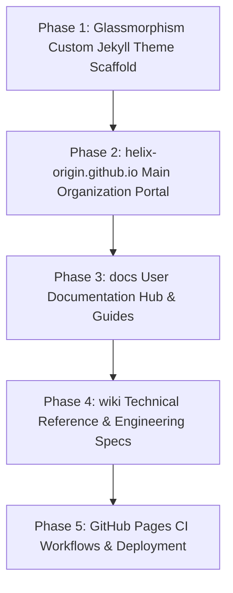
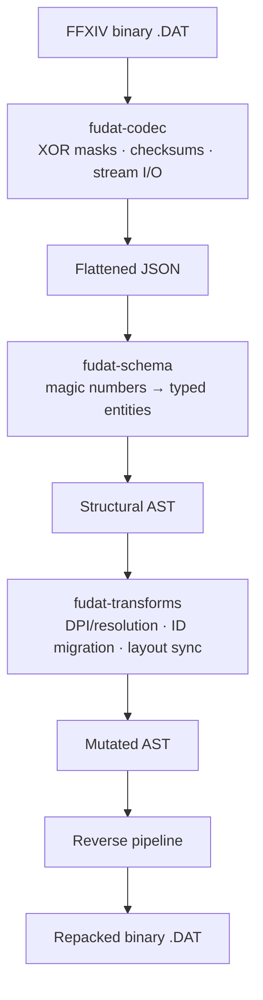

# PLAN.md — Agents Ecosystem Master Plan & Sprints

> 🎯 **Master Plan**: Active sprint planning, execution architecture, and completed sprint history for the **Agents Ecosystem** (`projects/agents`).
>
> Pair with [`ROADMAP.md`](./ROADMAP.md) (ecosystem direction), [`TODO.md`](./TODO.md) (executable tasks), and [`BUGS.md`](./BUGS.md) (known issues).
> Project-specific sprint plans and execution tasks live exclusively in each respective repository (`projects/<repo>/PLAN.md`).
> Historical delivered milestones and changes live in [`CHANGELOG.md`](./CHANGELOG.md).
> Last updated: 2026-10-26

---

## 📜 Tracking Rules

- **Ecosystem Scope Only**: This document tracks sprint planning, execution architecture, and verification exclusively for the generic AI agents framework, rules, skills, templates, and the headless CLI (`scripts/agents-kb/`). Project-scoped sprint plans live strictly inside each project's own repository (`projects/<repo>/PLAN.md`).
- **100% Active Direction Accuracy**: Active sprints and architecture descriptions must always reflect the current, active state of the agents ecosystem with zero contradictions.
- **Active Sprints Only in Top Section**: `## 🎯 Active Sprints` contains ONLY currently active ecosystem sprints. Completed sprints move immediately to `## ✅ Completed Sprints` (newest first).

---

## 🧭 Project Tracking Index

> Entry point to per-project **PLAN** tracking: one line per project (short title + link). Detail lives only in each repository. Regenerate with `npm --prefix scripts run index`; do not edit between the markers.

<!-- project-index:start -->
- **[nh-reader]** — [No active item recorded](./projects/nh-reader/PLAN.md) · _Native C++ Windows desktop reader_
- **[windows-game-explorer]** — [Sprint 38 — M18 Windows 10 vs 11 Compatibility Research (planned)](./projects/windows-game-explorer/PLAN.md) · _Native C++ Windows Game Explorer (File Explorer shell extension & game library)_
- **[theme-toolkit]** — [Sprint 1 — Native Windows C++ Architecture & Rebrand to Theme Studio (v1.0.0, W.01)](./projects/theme-toolkit/PLAN.md) · _Native C++ Windows theme studio & applicator for Windows 2000 to 11+ (Theme Studio)_
- **[depressurizer]** — [Sprint 5 — Native Windows C++ Modernization & UI Polish (v1.0.0, W.05)](./projects/depressurizer/PLAN.md) · _Native C++ Windows Steam categorizer & AutoCat manager (revival fork)_
- **[windhawk-themes]** — [Milestone M.02b: Command Center Suite Polish & Geometry Alignment](./projects/windhawk-themes/PLAN.md) · _Windhawk styler mod themes_
- **[ffxiv-config]** — [Sprint 1 — 8.x Configuration Sync, Media Asset & Governance Alignment](./projects/ffxiv-config/PLAN.md) · _FFXIV HUD, hotbar and macro configuration_
- **[ffxiv-dat-toolkit]** — [PLAN.md](./projects/ffxiv-dat-toolkit/PLAN.md) _(repository not cloned locally)_ · _FFXIV DAT toolkit (decode, transform and repack character/config .DAT files)_
<!-- project-index:end -->

---

## 🎯 Active Sprints

### 🚀 Sprint 36: [Ecosystem] — OpenCode Configuration Layer & Windows Game Explorer 2.4.0 Ledger Sync (W.66)
- **Project Identifier:** `[Ecosystem]` (`projects/agents`)
- **Target Objective:** Give the workspace a first-class, self-contained OpenCode layer — Big Pickle-only model enforcement, context-budget management, git-mutation prompts, and operating protocols — in the workspace root **and** in all six active project repositories, then bring the Windows Game Explorer ledgers fully up to date with the delivered-but-uncommitted v2.4.0 workstream and the reinstated owned-games direction.

#### 📝 Execution Tasks

1. **[Ecosystem] W.66a — Root OpenCode Layer**:
   - `opencode.jsonc` (model pin + provider policies + compaction/tool-output/media limits + git-ask permissions), `plugins/big-pickle-only.ts`, `plugins/context-budget.ts`, `instructions/opencode-protocols.md`, and `README.md`.
2. **[Ecosystem] W.66b — Per-Project OpenCode Layers**:
   - Mirror a standalone, agents-ecosystem-free variant into `depressurizer`, `ffxiv-config`, `nh-reader`, `theme-toolkit`, `windhawk-themes`, and `windows-game-explorer`.
3. **[Ecosystem] W.66c — Enforcement Verification**:
   - Confirm the model catalog exposes exactly one entry (`opencode/big-pickle`) and both plugins load with zero errors and zero warnings.
4. **[Ecosystem] W.66d — Windows Game Explorer 2.4.0 Ledger Sync**:
   - Record the 2.4.0 workstream (FFXIV official source, secondary launcher methods, store-artwork exclusivity, rich synopsis, background achievement sync, footprint fix) plus the reinstated owned-games direction (`M17` / `CAT-01`) and `SVC-01` in the project ledgers, then regenerate the root tracking index.

---

## ⏳ Queued Sprints

### 🚀 Sprint 37: [Web & Docs] — Documentation Hubs & Glassmorphism Jekyll Theme Rebuild (v1.3.0, W.66)
- **Target Objective:** Recreate `helix-origin.github.io`, `docs`, and `wiki` repositories from scratch.
- **Architecture & Styling:**
  - Build a custom glassmorphism styled Jekyll theme (`helix-jekyll-theme` rebuilt from scratch) utilizing modern SCSS-first design (frosted glass blur, glowing borders, high-contrast typography, responsive layout).
  - Feature-rich homepage portals for each hub (`helix-origin.github.io` organization landing, `docs` user documentation hub, `wiki` technical reference hub).
  - Extensive, detailed, and theme-neutral documentation covering all active HELIX-Origin projects.



#### 📝 Execution Tasks
1. **[Web & Docs] Phase 1 — Glassmorphism Jekyll Theme Engine**:
   - Rebuild custom Jekyll theme from scratch with Dart Sass SCSS tokens, frosted glass components, responsive portal navigation, and code syntax highlighting.
2. **[Web & Docs] Phase 2 — Organization Portal (`helix-origin.github.io`)**:
   - Recreate repository with homepage portal showcasing all HELIX-Origin projects, direct links, and project badges.
3. **[Web & Docs] Phase 3 — User Documentation Hub (`docs`)**:
   - Recreate repository with homepage portal, quick-start guides, and user manuals for each application.
4. **[Web & Docs] Phase 4 — Technical Wiki Hub (`wiki`)**:
   - Recreate repository with technical architecture specs, schemas, and developer references.
5. **[Web & Docs] Phase 5 — CI/CD & GitHub Pages Deployment**:
   - Setup GitHub Actions workflows for building and deploying each site to GitHub Pages with zero warnings.

---

### 🚀 Sprint 38: [ffxiv-dat-toolkit] (projects/ffxiv-dat-toolkit) — FFXIV DAT Toolkit (`fudat`): Codec, Schema Mapping & Transformation Pipeline (v0.1.0, W.01)
- **Project Identifier:** `[ffxiv-dat-toolkit]` (`projects/ffxiv-dat-toolkit`)
- **Status:** ⏳ Queued — no repository scaffolded yet.
- **Target Objective:** A FFXIV-only utility suite that decodes, parses, transforms and repacks the game's character and client configuration `.DAT` files, built as three strictly decoupled tiers so binary handling never mixes with game semantics.

#### 🏛️ Architecture



#### 📝 Execution Tasks

1. **[ffxiv-dat-toolkit] Phase 1 — Foundations & Codec (`fudat-codec`)**:
   - Scaffold the repository with the three modules as separate workspace members and a CLI entry point.
   - Binary stream wrapper (read/write) with explicit endianness and bounds checking.
   - Header validation: magic bytes, format version, metadata block.
   - De-obfuscation: XOR mask keys and byte-shift tables, plus the symmetric re-application on pack.
   - Checksum verification and recomputation (CRC32 / byte-sum) — halt before writing on mismatch.
   - Round-trip CI: decode → encode must reproduce pristine client `.DAT` files byte-for-byte.
2. **[ffxiv-dat-toolkit] Phase 2 — Schema Definitions & Serialization (`fudat-schema`)**:
   - Map and document byte offsets for `MACRO.DAT` and `KEYBIND.DAT`.
   - Define `HOTBAR.DAT` bindings including the 8.x Command Panel array layout.
   - Index `ADDON.DAT` coordinate boundaries for job gauges and action bars.
   - UTF-8 payload parsing for localized macros, layout profiles and identifiers without truncation.
   - Validation ruleset (hotbar slot caps, macro string length bounds) rejecting corrupt structures early.
   - Deterministic, human-readable, Git-diffable JSON serialization.
3. **[ffxiv-dat-toolkit] Phase 3 — Transformation Pipeline (`fudat-transforms`)**:
   - CLI commands `dump`, `pack`, `transform` with a stable argument contract.
   - Resolution/DPI translator: shift positional anchors and layout scale by pre-computed differentials.
   - Asset injector/swapper: rewrite isolated nodes (e.g. legacy action IDs → 8.x IDs) without touching sibling blocks.
   - Global layout sync: merge a template layout across character IDs while preserving each macro bank.
4. **[ffxiv-dat-toolkit] Phase 4 — Write Safety, Verification & Polish**:
   - Atomic write path: never overwrite a character `.DAT` in place — stage, verify, then swap.
   - Automatic `.bak` footprints before any mutation.
   - Retail-variant compatibility matrix so generated files parse on every supported client.
   - Repository hygiene: license, community-health files, CI workflows and zero-warning gates.

#### ⚠️ Domain Risks & Mitigations

- **Client corruption hard halt**: FFXIV verifies structural length offsets and trailing checksums; skip either and character selection or runtime fails. Mitigation: byte-parity CI on every round-trip.
- **Asset lifetime volatility**: expansion releases reshape arrays (e.g. Command Panel). Mitigation: flexible schema mapping insulated from pipelines.
- **String encoding profiles**: non-ASCII macro/layout payloads must be processed as explicit multibyte UTF-8 so regional clients do not break.

---

## ✅ Completed Sprints (Ecosystem Milestones)

### ✅ Sprint 35: [Ecosystem] — Per-Project Ecosystem Enhancement, Universal Commands & Skill Expansion (W.65)
- **Project Identifier:** `[Ecosystem]` (`projects/agents`)
- ✅ `[Ecosystem]` **W.65a — Entry-Point Tracking Index**: Automated project tracking index generation (`kb-index.ts`) writing the marked block in the root `ROADMAP.md`, `PLAN.md`, `TODO.md`, `BUGS.md`, and `HANDOFF.md`.
- ✅ `[Ecosystem]` **W.65b — Universal Workflow Commands**: `.agents/commands/` established with tool-agnostic runbooks (`onboard`, `verify`, `fix-bug`, `implement-feature`, `review-change`, `update-docs`, `cut-release`).
- ✅ `[Ecosystem]` **W.65c — Skill Library Expansion**: Added `svelte5-runes.md`, `rust-patterns.md`, `typescript-esm-scripts.md`, `sqlite-in-app.md`, `sveltekit-frontend.md`, `github-actions-ci.md`.
- ✅ `[Ecosystem]` **W.65d — Per-Project Agents Alignment**: All six active repositories carry tailored `.agents/` rules, skills, agents, and commands.
- ✅ `[Ecosystem]` **W.65e — Archive Retirement & Changelog**: `.github/*-ARCHIVE.md` retired; living ledgers kept as concise entry points with `CHANGELOG.md` as the permanent record.
- ⚠️ **Superseded** in Sprint 36: the "remove all `.opencode/` folders" directive no longer applies — `.opencode/` returns as the OpenCode-specific layer.

### ✅ Sprint 33: [Ecosystem] — Community Health Scaffolding, SQLite Metadata KB, Permanent Handoff & Headless CLI
- **Project Identifier:** `[Ecosystem]` (`projects/agents`)
- ✅ `[Ecosystem]` **W.56 — Community Health Standards & Domain-Neutral Scaffolding**: Authored `.agents/rules/community-health-files.md`, reusable community templates, domain-neutral links (`--docs-url`, `--wiki-url`, `--portal-url`, etc.), and leak protection asserting no foreign/broken URLs across generated files.
- ✅ `[Ecosystem]` **W.57 — SQLite Metadata Knowledge Base (`knowledge.db`)**: Schema migrations `v001`/`v002` (metadata-only artifacts and entries), Query API (`kb-read.ts`), synchronization engine (`kb-sync.ts`), deterministic export (`kb-export.ts`), and invariant validation (`kb-write.ts`). Local-only lifecycle under `scripts/agents-kb/data/`.
- ✅ `[Ecosystem]` **W.58 — Permanent Session Handoff Protocol (`HANDOFF.md`)**: Permanent git-tracked session-state ledger (`.agents/rules/session-handoff.md`), self-monitoring scoreboard, and incremental updates.
- ✅ `[Ecosystem]` **W.59 — Headless CLI Standards & Structured Logging**: Standardized modular TypeScript ESM CLI (`scripts/agents-kb/`), dual extension mechanism (first-class modules vs body files), structured per-run logging to gitignored `logs/`, and automated test runner (`test.ts`).
- ✅ `[Ecosystem]` **W.60 — Project-Local Agents Interoperability & Project-Type Scaffolding**: Binding rule `.agents/rules/project-agents-interoperability.md`, CLI scaffold engine (`kb-scaffold.ts`), and project-type starter suites (`tauri-desktop`, `jekyll-theme`, `node-ts-cli`, `rust-library`, `docs-site`).

---

## 🛠️ Ecosystem Verification Commands

```powershell
# Headless CLI test suite
npm --prefix scripts test

# TypeScript typecheck
npm --prefix scripts run typecheck

# Knowledge base sync & invariant validation
npm --prefix scripts run sync
npm --prefix scripts run validate
```
