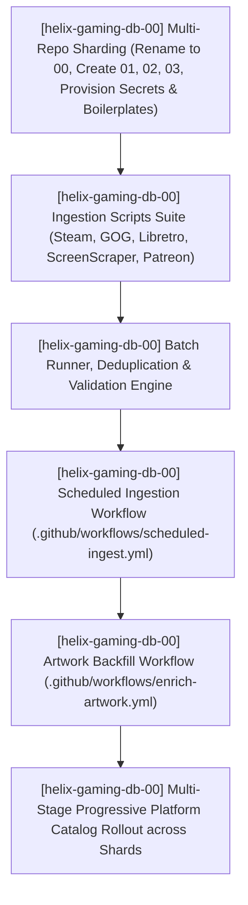
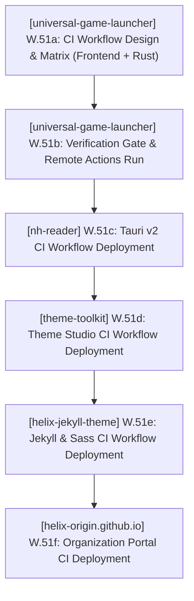

# PLAN.md — HELIX Origin Master Plan & Sprints

> 🎯 **Master Plan**: Active sprint planning, execution architecture, and completed sprint history across all active repositories in the **HELIX Origin** organization.
>
> Pair with [`ROADMAP.md`](./ROADMAP.md) (strategic direction), [`TODO.md`](./TODO.md) (executable tasks), and [`BUGS.md`](./BUGS.md) (known issues).
> Historical delivered milestones and task archives live in [`.github/`](./.github/).
> Last updated: 2026-10-16

---

## 📜 Organizational Tracking Contract

- **Single Pane of Glass:** All repository sprint plans are consolidated here at workspace root.
- **100% Active Direction Accuracy:** Active sprints and architectural descriptions must always reflect the current, active direction of all projects with zero contradictions. Superseded tasks or decisions must be updated in place rather than appended as conflicting statements.
- **Zero Non-Organization Mentions:** Only reference active repositories belonging to the `HELIX-Origin` GitHub organization (`helix-jekyll-theme`, `helix-origin.github.io`, `docs`, `wiki`, `nh-reader`, `universal-game-launcher`, `theme-toolkit`, `windhawk-themes`, `helix-gaming-db-00` through `03`, `ffxiv-config`). Never directly mention external, third-party, or deleted projects/repositories by name.
- **Active Sprints Only in Top Section:** `## 🎯 Active Sprints` contains ONLY currently active sprints. Completed sprints move immediately to `## ✅ Completed Sprints` (newest first).
- **Mandatory Project Tagging Invariant:** Every sprint, workstream, task, and verification command **must explicitly state its current project name and repository path** (`[<project-name>] (<project-path>)`). Unscoped items are strictly prohibited so agents never conflate repositories.

---

## 🎯 Active Sprints

### 🚀 Sprint 31: [helix-gaming-db-00] (projects/helix-gaming-db-00) — Multi-Platform Metadata Ingestion Automation, Volume-Sharded Federation (01, 02, 03), Platform Scrapers & Scheduled Enrichment Pipeline (v1.2.0)
- **Project Identifiers:** `[helix-gaming-db-00]` (`projects/helix-gaming-db-00`), `[helix-gaming-db-01]` (`projects/helix-gaming-db-01`), `[helix-gaming-db-02]` (`projects/helix-gaming-db-02`), `[helix-gaming-db-03]` (`projects/helix-gaming-db-03`)
- **Target Objective:** Develop an automated ingestion suite, multi-repository volume sharding, and scheduled GitHub Actions workflows to progressively expand HELIX Gaming DB to cover every game across all supported platforms (PC storefronts: Steam, GOG, Epic, Itch.io, EA, Ubisoft, Battle.net, Standalone/Patreon; Emulation/Retro: NES, SNES, N64, GB/GBC/GBA, DS, 3DS, GameCube, Wii, Wii U, Switch, PS1, PS2, PS3, PSP, PS Vita, Genesis, Saturn, Dreamcast, Xbox, Arcade/MAME). Rename the core repo to `helix-gaming-db-00`, provision new volume shards `helix-gaming-db-01`, `helix-gaming-db-02`, and `helix-gaming-db-03` with identical autonomous boilerplates and shared `PAT_TOKEN` secrets, and implement multi-repo cycling across client APIs.



#### 📝 Execution Tasks

0. **[helix-gaming-db-00] W.54_shard — Volume-Sharded Multi-Repository Federation, Centralized Docs/Wiki Split & Cloudflare Worker Gateway (00, 01, 02, 03, docs, wiki, api)**:
   - `[docs]` Created dedicated public repository `HELIX-Origin/docs`, provisioned `PAT_TOKEN`, configured GitHub Pages (`docs.helix-origin.club`), migrated multi-project documentation, and set up `remote_theme: HELIX-Origin/helix-jekyll-theme`.
   - `[wiki]` Created dedicated public repository `HELIX-Origin/wiki`, provisioned `PAT_TOKEN`, configured GitHub Pages (`wiki.helix-origin.club`), migrated multi-project technical wikis, and set up `remote_theme: HELIX-Origin/helix-jekyll-theme`.
   - `[helix-gaming-db-00]` Renamed existing GitHub repository `helix-gaming-db` to `helix-gaming-db-00` and updated local directory to `projects/helix-gaming-db-00`.
   - `[helix-gaming-db-00]` Migrated docs to `docs` and wiki to `wiki`, leaving `helix-gaming-db-00` as a pure REST metadata API repository.
   - `[helix-gaming-db-01]` Created public repository `HELIX-Origin/helix-gaming-db-01`, provisioned `PAT_TOKEN`, seeded with boilerplate, schemas, validation scripts, workflows, and i18n locales.
   - `[helix-gaming-db-02]` Created public repository `HELIX-Origin/helix-gaming-db-02`, provisioned `PAT_TOKEN`, seeded with boilerplate, schemas, validation scripts, workflows, and i18n locales.
   - `[helix-gaming-db-03]` Created public repository `HELIX-Origin/helix-gaming-db-03`, provisioned `PAT_TOKEN`, seeded with boilerplate, schemas, validation scripts, workflows, and i18n locales.
   - `[helix-gaming-db-00]` Implemented cross-shard deduplication & ownership verification in `scripts/verify-pr.mjs` across all 4 shard repositories and open PRs (failing PR if metadata already exists in a sibling shard).
   - `[helix-gaming-api]` Deployed Cloudflare Worker Gateway (`helix-gaming-api` v2.0) on `api.helix-origin.club` supporting Mode 2 Unified Gateway (`/api/v{1,2,3}/...`) and Mode 1 Direct Shard Proxy (`/helix-gaming-db-{NN}/...`).
   - `[universal-game-launcher]` Updated `src/lib/plugins/metadata/helix-db.ts` to seamlessly query the Unified Gateway and cycle through shards (`helix-gaming-db-00`, `01`, `02`, `03`).
   - `[Ecosystem]` Purged `docs/` folders and disabled GitHub Pages across `universal-game-launcher`, `nh-reader`, `windhawk-themes`, and `ffxiv-config`.
0b. **[Ecosystem] W.54_badges — Universal HTML Badge Standards Migration**:
   - `[Ecosystem]` Established binding HTML Badge Standard across `.agents/rules/documentation-standards.md`, `.agents/skills/gfm-content.md`, `AGENTS.md`, and `.github/copilot-instructions.md`, requiring raw HTML `<a></a>` with explicit `height="20"` to prevent badge stretching and layout shift.
   - `[Ecosystem]` Converted badges across all project READMEs (`docs`, `wiki`, `helix-origin.github.io`, `helix-jekyll-theme`, `universal-game-launcher`, `nh-reader`, `theme-toolkit`, `windhawk-themes`, `ffxiv-config`, `helix-gaming-db-00` through `03`, and workspace root) to compliant HTML badges.
1. **[helix-gaming-db-00] (projects/helix-gaming-db-00) W.54a — Platform Ingestion Scripts Suite (`scripts/ingest/`) (Delivered)**:
   - `[helix-gaming-db-00]` Created `scripts/ingest/ingest-steam.mjs`: Steam App Details & Store API scraper extracting title, synopsis, creators, tags, release dates, screenshots, videos, and 600×900 capsule artwork with cross-shard sibling developer deduplication.
   - `[helix-gaming-db-00]` Created `scripts/ingest/ingest-gog.mjs`: GOG Catalog v1 & Product Details scraper extracting DRM-free metadata and cover art.
   - `[helix-gaming-db-00]` Created `scripts/ingest/ingest-libretro-rdb.mjs`: Libretro OpenVGDB database parser mapping canonical titles to Libretro Thumbnails CDN assets (Named_Boxarts, Named_Snaps, Named_Titles).
   - `[helix-gaming-db-00]` Created `scripts/ingest/ingest-patreon-itch.mjs`: Scraper for independent, Patreon, and itch.io creations with automatic mature tag detection and routing to v2 and v3 tiers.
2. **[helix-gaming-db-00] (projects/helix-gaming-db-00) W.54b — Batch Runner, Deduplication & Validation Pipeline (`scripts/ingest/run-batch.mjs`) (Delivered)**:
   - `[helix-gaming-db-00]` Authored `run-batch.mjs` orchestrating multi-platform batch ingestion with CLI args (`--platform=<id>`, `--limit=<n>`, `--shard=<00|01|02|03>`), cross-shard slug deduplication, and automated `build-search-index.mjs` compilation.
   - `[helix-gaming-db-00]` Enforced strict schema validation and automated PR verification (`npm test`) on all newly emitted payloads across all shards.
3. **[helix-gaming-db-00] (projects/helix-gaming-db-00) W.54c — Scheduled Ingestion GitHub Actions Workflow (`.github/workflows/scheduled-ingest.yml`) (Delivered)**:
   - `[helix-gaming-db-00]` Deployed scheduled weekly cron workflow across all 4 database shards running platform ingestion batches, rebuilding search indices, verifying schemas, and committing updates.
4. **[helix-gaming-db-00] (projects/helix-gaming-db-00) W.54d — Artwork Backfill & Health Check Workflow (`.github/workflows/enrich-artwork.yml`) (Delivered)**:
   - `[helix-gaming-db-00]` Authored `scripts/enrich-artwork.mjs` and deployed bi-weekly scheduled workflow across all 4 database shards verifying artwork health and backfilling missing assets.
5. **[helix-gaming-db-00] (projects/helix-gaming-db-00) W.54e — Multi-Stage Progressive Platform Catalog Rollout (Active)**:
   - `[helix-gaming-db-01]` Delivered Phase 1 Expansion: Top PC Indie & Digital Hits (46 games & 42 developers in `v2`, 100% verified).
   - `[helix-gaming-db-02]` Delivered Phase 2 Expansion & 6th/7th Gen 3D Classics: SNES, Genesis, PS1, N64, GBA, PS2, GameCube, Dreamcast, Wii, PSP, DS (42 games & 20 developers in `v2`, 100% verified).
   - `[helix-gaming-db-03]` Delivered Phase 3 Expansion: Acclaimed Visual Novels & Independent Adult Creations (15 games & 11 developers across `v2` and `v3`, 100% verified).
   - `[helix-gaming-db-00]` Core Catalog & Shard Ingestion: 80 flagship AAA & PC titles, achieving 183 unique verified games & 119 developers across shards.
   - `[helix-gaming-db-00]` Phase 5 Expansion: Long-Tail Storefronts & Retro Arcade (Epic, EA, Ubisoft, Battle.net, Arcade) (~1,000+ games).
6. **[helix-gaming-db-00] (projects/helix-gaming-db-00) W.54f — Outdated Information & Artwork Refresh Pipeline (`check-drift.mjs` & `.github/workflows/update-metadata-drift.yml`)**:
   - `[helix-gaming-db-00]` Create `scripts/ingest/check-drift.mjs` detecting outdated synopses, changed release dates, updated Steam capsules/heroes, and 404 image URLs.
   - `[helix-gaming-db-00]` Deploy `.github/workflows/update-metadata-drift.yml` running bi-weekly drift scans and opening automated refresh PRs for actively updated games.
7. **[helix-gaming-db-00] & [universal-game-launcher] W.54g — Library-Driven Internationalization (i18next) & App Localization Integration (Delivered)**:
   - `[helix-gaming-db-00]` Integrate `i18next` library (`scripts/i18n/index.mjs`) for dynamic taxonomy resolution, language negotiation, and ISO 639-1 / BCP 47 fallback chains.
   - `[helix-gaming-db-00]` Author complete taxonomy dictionaries across 12 primary languages (`locales/{lang}/genres.json`, `categories.json`, `platforms.json`, `common.json`, and `app.json` for `en`, `ja`, `zh-CN`, `zh-TW`, `es`, `fr`, `de`, `it`, `pt-BR`, `ru`, `ko`, `pl`).
   - `[helix-gaming-db-00]` Update `scripts/build-search-index.mjs` to bundle `app` UI strings into `/api/v2/i18n/{code}/bundle.json` and emit `/api/v2/i18n/{code}/app.json`.
   - `[helix-gaming-db-01, 02, 03]` Symmetrically sync `locales/` and i18n scripts across all volume shards.
   - `[universal-game-launcher]` Replace hand-rolled hard-coded `LOCALES` system with `i18next` library, dynamically loading UI strings and taxonomy from `helix-gaming-db` API with offline caching.
8. **[helix-gaming-db-00] (projects/helix-gaming-db-00) W.54h — Multi-Repository Volume Sharding, Cross-Shard PR Deduplication & Shard Cycling Framework (Delivered)**:
   - `[helix-gaming-db-00]` Architect multi-repo volume sharding and cycling framework (`/api/v2/federation/index.json` and `shards.json`) to prevent GitHub free user storage and file count ceilings.
   - `[helix-gaming-db-00]` Purge Jekyll documentation and wiki out of `helix-gaming-db-00` into dedicated `docs` and `wiki` repositories, maintaining `00` as a pure REST API.
   - `[helix-gaming-db-00]` Implement cross-shard deduplication & ownership verification in `scripts/lib/cross-shard-dedup.mjs`, `scripts/validate.mjs`, and `scripts/verify-pr.mjs` checking both committed code and open PRs across all 4 shard repositories.
   - `[helix-gaming-db-00]` Implement shard cycling PR router (`scripts/lib/shard-router.mjs` and `api/v2/contribute/router.json`) to target owner repos for updates and cycle new metadata PRs to the first shard without code or PR collisions.
   - `[helix-gaming-db-01, 02, 03]` Seed public repositories `helix-gaming-db-01`, `02`, `03` with identical pure API boilerplate, schemas, validation scripts, workflows, and i18n locales.
   - `[universal-game-launcher]` Update client `src/lib/plugins/metadata/helix-db.ts` to seamlessly cycle through all four active metadata repositories (`helix-gaming-db-00`, `01`, `02`, `03`).
9. **[Ecosystem] (projects/agents) W.54i — Automated Secret & PAT Replication Across Projects (Delivered)**:
   - `[Ecosystem]` Replicate shared legacy `PAT_TOKEN` secret across all organization repositories via `gh secret set`.
   - `[agents]` Protect `.env` in root `.gitignore` and save `PAT_TOKEN` / `GITHUB_TOKEN` to local untracked `.env` file for agent automation.
   - `[agents]` Create `provision-repo-secrets.ps1` helper script to instantly provision new repositories as they are created.
10. **[helix-gaming-db-00] & [Ecosystem] W.54j — Cloudflare Edge Protection, Automated GitHub Webhooks (`/_webhook/github`) & Unified Client / Documentation Synchronization (Delivered)**:
   - `[helix-gaming-api]` Configured Cloudflare rate-limiting rules (100 req/min for general endpoints, 20 req/min for bulk endpoints).
   - `[helix-gaming-db-00..03]` Created and verified GitHub push webhooks (`https://api.helix-origin.club/_webhook/github`) on all 4 database shards (`helix-gaming-db-00`, `01`, `02`, `03`) with automated cache purging.
   - `[universal-game-launcher]` Updated client `src/lib/plugins/metadata/helix-db.ts` to aggregate multi-shard search indices, prioritize direct shard proxies, and cache data persistently in SQLite KV storage.
   - `[docs] & [wiki]` Updated centralized documentation (`docs`) and technical wiki (`wiki`) to detail rate limiting rules, webhooks, multi-shard search aggregation, and the dynamic `i18next` architecture.

---

### 🚀 Sprint 28: [universal-game-launcher] (projects/universal-game-launcher) & [Ecosystem] — Organization CI Workflow Standards & Continuous Verification Deployment
- **Project Identifiers:** `[universal-game-launcher]` (`projects/universal-game-launcher`), `[nh-reader]` (`projects/nh-reader`), `[theme-toolkit]` (`projects/theme-toolkit`), `[helix-jekyll-theme]` (`projects/helix-jekyll-theme`), `[helix-origin.github.io]` (`projects/helix-origin.github.io`)
- **Target Objective:** Establish continuous integration (CI) workflows as an organization standard across all active repositories in `HELIX-Origin`. Deploy repo-tailored CI workflows executing frontend type-checks (`svelte-check` / TypeScript), Rust backend compiler checks (`cargo check`, `cargo test --lib`), schema validations, and Jekyll build verification on push and pull requests to prevent regressions. Start with `universal-game-launcher` and progress sequentially across projects.



#### 📝 Execution Tasks

1. **[universal-game-launcher] (projects/universal-game-launcher) W.51a — Tauri v2 CI Workflow Creation (`.github/workflows/ci.yml`) (Done)**:
   - `[universal-game-launcher]` Create `.github/workflows/ci.yml` with dual-stage verification:
     - `frontend`: Node 22, `npm ci`, SvelteKit sync & type-check (`npm run check`).
     - `backend`: Rust stable toolchain on `windows-latest` & `ubuntu-22.04` with GTK/WebKit dependencies, `swatinem/rust-cache`, `cargo check` & `cargo test --lib`.
2. **[universal-game-launcher] (projects/universal-game-launcher) W.51b — Verification Gate & Push to Remote (Done)**:
   - `[universal-game-launcher]` Run local test suites (`npm test`: check, rust, frontend).
   - `[universal-game-launcher]` Commit and push to `main`, verify GitHub Actions run passes cleanly (Run `39016342557` passed 100%).
3. **[nh-reader] (projects/nh-reader) W.51c — Tauri v2 CI Workflow Deployment**:
   - `[nh-reader]` Create `.github/workflows/ci.yml` tailored for nh-reader (`cargo check`, `cargo test`, `npm test`).
4. **[theme-toolkit] (projects/theme-toolkit) W.51d — Theme Studio CI Workflow Deployment**:
   - `[theme-toolkit]` Create `.github/workflows/ci.yml` tailored for theme-toolkit.
5. **[helix-jekyll-theme] (projects/helix-jekyll-theme) W.51e — Jekyll Theme CI Workflow Deployment**:
   - `[helix-jekyll-theme]` Create `.github/workflows/ci.yml` with Ruby / Bundler Jekyll build validation and dart-sass check.
6. **[helix-origin.github.io] (projects/helix-origin.github.io) W.51f — Portal CI Workflow Deployment**:
   - `[helix-origin.github.io]` Create `.github/workflows/ci.yml` with Jekyll portal build validation.

---

## 🔮 Planned Sprints

### ⏳ [nh-reader] (projects/nh-reader) — Post-v0.7.5 / Milestone M13
- **Project Identifier:** `[nh-reader]` (`projects/nh-reader`)
- `[nh-reader]` Tag frequency analytics and local recommendation engine based on reading history.
- `[nh-reader]` Multi-profile library partitions (isolated blacklist/favorite spaces).
- `[nh-reader]` Background auto-update checker and GitHub release notification toasts.

### ⏳ [helix-jekyll-theme] (projects/helix-jekyll-theme) — v1.1.0 Feature Cycle
- **Project Identifier:** `[helix-jekyll-theme]` (`projects/helix-jekyll-theme`)
- `[helix-jekyll-theme]` Native Mermaid diagram client rendering macro (`components/mermaid.html`).
- `[helix-jekyll-theme]` In-page Table of Contents sidebar module resolving `BUG-14`.
- `[helix-jekyll-theme]` Dynamic catalogue filtering scripts for software and theme showcases.

### ⏳ [helix-origin.github.io] (projects/helix-origin.github.io) — Portal v3 Enhancement
- **Project Identifier:** `[helix-origin.github.io]` (`projects/helix-origin.github.io`)
- `[helix-origin.github.io]` Live release status widgets dynamically queried via Jekyll GitHub metadata.
- `[helix-origin.github.io]` Interactive showcase component consuming the `catalogue` layout.

### ⏳ [theme-toolkit] (projects/theme-toolkit) — Milestone M2 Native Packaging Implementation
- **Project Identifier:** `[theme-toolkit]` (`projects/theme-toolkit`)
- `[theme-toolkit]` Implement `makecab.exe` Diamond Directive File (`.ddf`) engine, Sound Scheme Manager, Wallpaper & Slideshow Studio, Cursor Scheme Inspector, and Color & Visual Style Editor.

---

## ✅ Completed Sprints

### ✅ Sprint 30: [universal-game-launcher] (projects/universal-game-launcher) — Three-Tier REST API Client Integration & Hand-Rolled Catalog Deprecation (v1.4.1)
- **Project Identifiers:** `[universal-game-launcher]` (`projects/universal-game-launcher`)
- ✅ `[universal-game-launcher]` **Three-Tier REST Client Architecture (`metadata-helix`)**: Upgraded `src/lib/plugins/metadata/helix-db.ts` to fully leverage the three-tier REST API (`/api/manifest.json`, `/api/v2/` relational discovery, and `/api/v3/` dedicated adult tier) with dual-tier search index caching (`cachedV2Index`, `cachedV3Index`), rich payload mapping (soundtracks, trailers, user scores), and `include_adult_content` / `api_tier` settings.
- ✅ `[universal-game-launcher]` **Persistent Serverless KV Offline Fallback**: Integrated `api.kvSetJson` and `api.kvGetJson` for multi-day local caching of search indices and game payloads, guaranteeing instant sub-millisecond retrieval and complete offline resilience without network dependencies.
- ✅ `[universal-game-launcher]` **Hand-Rolled Metadata Purge**: Deprecated and deleted all 28 hardcoded per-developer data files (`src/lib/plugins/metadata/developers/*.ts`, 3,000+ lines of static code) in favor of dynamic API resolution; streamlined `developers/index.ts` to retain high-precision studio matching (`detectKnownDeveloper`) and algorithmic candidate validation (`validateMetadataCandidate`, `titlesMatchStrict`).
- ✅ **Verification**: Passed `svelte-check` (0 errors, 0 warnings), `npm run check` (0 errors), and `node scripts/test.mjs frontend` (100% passing).

### ✅ Sprint 29: [helix-gaming-db] (projects/helix-gaming-db) — REST Metadata API Expansion: Three-Tier Endpoints, Contributor Fork/PR Suite, Dedicated Adult (18+) API, Expanded 80-Game Catalog & GitHub Issue Templates (v1.1.0)
- **Project Identifiers:** `[helix-gaming-db]` (`projects/helix-gaming-db`)
- ✅ `[helix-gaming-db]` **Three-Tier Automated Endpoint & Index Generator**: Expanded `scripts/build-search-index.mjs` to generate `/api/manifest.json` (root gateway), `/api/v1/` (flat client tier), `/api/v2/` (relational genres, platforms, tags, developers, publishers, stats, starter templates), and `/api/v3/` (dedicated adult 18+ gaming catalog, search index, developers, and tags).
- ✅ `[helix-gaming-db]` **Contributor Fork/PR Suite & Starter Schemas**: Provided developer starter templates (`api/v2/contribute/templates/game.json`, `developer.json`) and schemas to streamline forking and community pull request submissions.
- ✅ `[helix-gaming-db]` **Curated Catalog Expansion & Validation**: Expanded verified database to 80 games and 42 developers across PC indie gems, adult visual novels, and emulation classics; multi-tier validation (`npm test`) passing with 100% compliance.
- ✅ `[helix-gaming-db]` **GitHub Issue Forms & PR Template Suite**: Authored `.github/ISSUE_TEMPLATE/01_new_game_request.yml`, `02_metadata_correction.yml`, `03_new_developer_request.yml`, `config.yml`, and `pull_request_template.md`.
- ✅ `[helix-gaming-db]` **Automated PR Verification & Issue Triage Workflows**: Authored `scripts/verify-pr.mjs` scanning changed files for schema compliance, slug matching, and HTTPS artwork; deployed `.github/workflows/pr-automation.yml` (automated review verdicts and label management) and `issue-triage.yml`.
- ✅ `[helix-jekyll-theme]` **Documentation & Technical Wiki Sync**: Updated `_docs/endpoints.md`, `_docs/contributing.md`, `_docs/index.md`, and `_wiki/architecture.md` with complete 3-tier REST architecture and diagrams.
- **Project Identifiers:** `[helix-gaming-db]` (`projects/helix-gaming-db`), `[universal-game-launcher]` (`projects/universal-game-launcher`)
- ✅ `[helix-gaming-db]` **Dedicated Gaming Metadata Repository & REST API Architecture**: Scaffolded repository with Draft 2020-12 JSON schemas (`manifest.schema.json`, `game.schema.json`, `developer.schema.json`), automated validation (`scripts/validate.mjs`), and search index generator (`scripts/build-search-index.mjs`).
- ✅ `[helix-gaming-db]` **Static REST v1 Endpoints & Seed Datasets**: Authored 62 curated game payloads (`api/v1/games/*.json`), 28 studio profiles (`api/v1/developers/*.json`), `api/v1/search/index.json`, and `api/v1/manifest.json`.
- ✅ `[helix-gaming-db]` **Jekyll Remote Theme Docs & Technical Wiki**: Deployed documentation portal and wiki powered by `remote_theme: HELIX-Origin/helix-jekyll-theme` with theme-neutral API explorer and contribution guides.
- ✅ `[universal-game-launcher]` **Client Metadata Provider Integration (`metadata-helix`)**: Implemented high-priority client plugin querying `helix-origin.club` with cascade fallback to `helix-origin.github.io` and local offline catalog.
- ✅ **Verification**: Passed schema validation (62 games, 28 developers, 0 errors), `cargo check`, `cargo test` (35 passing), `svelte-check` (0 errors, 0 warnings), and live GitHub Actions CI run `39015195011`.


### ✅ Sprint 26: [universal-game-launcher] (projects/universal-game-launcher) — Universal Core Plugins & Global Helpers Architecture, Authentic Vector SVG Platform Icons, Automatic Metadata Engine & Per-Game Customization (Release v1.4.0)
- **Project Identifiers:** `[universal-game-launcher]` (`projects/universal-game-launcher`)
- ✅ `[universal-game-launcher]` **Universal Core Plugins & Global Helpers Framework (`W.49a–W.49d`)**: Consolidated fragmented platform and metadata plugins into `platform-universal`, `metadata-universal`, `utility-title-normalizer`, and `media-universal` paired with global helper functions (`getAllPlatformSpecs`, `detectPlatformLauncher`, `normalizeGameTitle`, etc.).
- ✅ `[universal-game-launcher]` **Authentic Vector SVG Platform Icons (`PlatformIcon.svelte`) (`W.49e`)**: Rendered custom vector SVG icon variants for all PC game providers and emulation consoles, eliminating generic Unicode glyphs across all views.
- ✅ `[universal-game-launcher]` **Automatic Metadata Cascade & Settings-Only Cache (`W.49c`, `W.49f`)**: Automatic multi-source resolution across Local Inspector, Libretro Thumbnails CDN, Steam Store, GOG Catalog v1 API, Wikipedia/Wikidata MediaWiki API, and PCGamingWiki Cargo; confined refresh/purge controls strictly to `/settings` (`Storage & Cache`).
- ✅ `[universal-game-launcher]` **Per-Game Customization Modal (`⚙ Manage`) (`W.49f`)**: Full per-game editing of Title, Short Description, Developers, Publishers, Release Date, Genres, and Custom Artwork in `/library` with `userEnhanced: true` protection.
- ✅ `[universal-game-launcher]` **Local Client Discovery & Hand-Rolled Developer Catalog (`W.49i`, `W.49j`)**: Native discovery for GOG Galaxy, itch.io Butler, Epic Games, EA Desktop, Ubisoft Connect, Xbox/MS Store, and Battle.net; modular hand-rolled catalog covering 21 studios and indie/Patreon creators with cross-studio mismatch validation.
- ✅ **Verification**: Passed `cargo check`, `cargo test` (35 passing), `svelte-check` (0 errors, 0 warnings), and `npm run build`.
- ✅ `[Universal-Game-Launcher]` **Product Rebranding & Visual Suite (`W.48a–W.48f`)**: Renamed package (`universal-game-launcher`), Rust library (`universal_game_launcher_lib`), and bundle identifier (`org.helixorigin.universal-game-launcher`); authored 16:9 vector banner (`universal-game-launcher.svg`), 256×256 squircle logo, multi-resolution icons, 164×314 BMP3 NSIS `sidebar.bmp`, and 850ms animated splash screen in `+layout.svelte`.
- ✅ `[Universal-Game-Launcher]` **Generic SQLite (`database.sqlite`) & In-Memory KV (`mem_kv`) (`W.48k–W.48t`)**: Standardized on generic `database.sqlite`, purged discontinued offline catalogue tables and binary seeds, tuned SQLite WAL PRAGMAs, decoupled the app from writing to external launcher files, and implemented zero-blur dark purple surfaces (`_tokens.scss`).
- ✅ `[Universal-Game-Launcher]` **Titlebar Navigation, Library-Only Sidebar & Single-Game Showcase (`W.48v–W.48am`)**: Built frameless titlebar navigation (`Dashboard`, `Library`, `Store`, `Social`, `Storage`, `Settings`), confined the collapsible platform/console accordion sidebar strictly to `/library`, and replaced the legacy multi-card grid with a single-game showcase view (hero banner, capsule cover, 10-image screenshot gallery, video trailers, and ambient audio player).
- ✅ `[Universal-Game-Launcher]` **In-App Plugins Framework, Storefront Hub (`/store`) & Social Hub (`/social`) (`W.48ao–W.48az`)**: Consolidated plugins in-app under `src/lib/plugins/`, implemented unified `utility-gamerpower` alerts/deals/patch notes, built the zero-payment Storefront discovery hub (`/store`), and built the cross-platform Social friends & presence hub (`/social`).
- ✅ `[Universal-Game-Launcher]` **EmulationStation Scaffolding & Archived ROM Auto-Extraction (`W.48bb`, `W.48bm`)**: Implemented `scaffold_emulation_folders` (`systeminfo.txt` + `systems.txt`), multi-drive ROM discovery, and automatic `.zip`/`.7z`/`.rar` extraction into `<system_dir>/<CleanTitle>/` with isolated `saves/` and `rom.ini` manifests.
- ✅ `[Universal-Game-Launcher]` **Launcher Client Exclusion, Background Worker (`worker.ts`) & Headless CLI (`--cli`) (`W.48bn–W.48bq`)**: Excluded launcher clients (`Ubisoft Game Launcher`, `upc.exe`, etc.) from game ingestion, offloaded heavy scans to `spawn_blocking` threads and `GlobalBackgroundWorker`, and built `src-tauri/src/cli.rs` (`--cli scan`, `scan-roms`, `scaffold-roms`, `normalize-title`, `inspect-local`, `launchers`).
- ✅ **Verification**: Passed `cargo check`, `cargo test`, `svelte-check` (0 errors, 0 warnings), and `npm run build`.

### ✅ Sprint 24: [Universal-Game-Launcher] (projects/Universal-Game-Launcher) — Project Script Standards, Manifest Schema 1.12.0 & IDE Untracking (Hotfix v1.3.3)
- **Project Identifier:** `[Universal-Game-Launcher]` (`projects/Universal-Game-Launcher`)
- ✅ `[Universal-Game-Launcher]` Aligned package scripts to `main:sub:option` format, untracked `.vscode/` from git index, bumped version to `1.3.3`, and authored release notes `.github/releases/v1.3.3.md`.
- ✅ **Verification**: All 4 test suites passed (`check`, `rust`, `frontend`, `i18n`).

### ✅ Sprint 23: [Universal-Game-Launcher] (projects/Universal-Game-Launcher) — Cross-Platform Compiler Diagnostic Elimination & Release Pipeline Hardening (Hotfix v1.3.2)
- **Project Identifier:** `[Universal-Game-Launcher]` (`projects/Universal-Game-Launcher`)
- ✅ `[Universal-Game-Launcher]` Eliminated POSIX/Windows compiler warnings in `windows.rs` and `detectors.rs`, hardened release workflow semver outputs, and bumped version to `1.3.2`.
- ✅ **Verification**: All 4 test suites passed (`check`, `rust` 43/43, `frontend` 0 errors / 0 warnings, `i18n` 30/30).

### ✅ Sprint 22: [Universal-Game-Launcher] (projects/Universal-Game-Launcher) — Modular Multi-Platform Free Game Checker, Store Deals Engine, Library Patch Notes & Settings Ergonomics (Patch v1.3.1)
- **Project Identifier:** `[Universal-Game-Launcher]` (`projects/Universal-Game-Launcher`)
- ✅ `[Universal-Game-Launcher]` Created modular promotions checkers (`epic.rs`, `steam.rs`, `gog.rs`, `gamerpower.rs`), fixed 100% free discount validation (`discountPrice == 0`), implemented `get_store_deals` and `get_library_patch_notes`, built the 3-tab Dashboard notifications subpage, and added Epic Legendary / EOS overlay management.
- ✅ **Verification**: All 4 test suites passed (`check`, `rust`, `frontend`, `i18n`).

### ✅ Sprint 21: [Universal-Game-Launcher] (projects/Universal-Game-Launcher) — Two-Tier Data Architecture: In-Memory Serverless Redis-Compatible KV Tier & SQLite Global Persistence Layer (v1.3.0)
- **Project Identifier:** `[Universal-Game-Launcher]` (`projects/Universal-Game-Launcher`)
- ✅ `[Universal-Game-Launcher]` Implemented fast in-memory KV engine (`mem_kv`) with TTL expiration and pattern queries backing SQLite `app_kv`, added `src/lib/redis.ts`, resolved Chromium/WebView2 Window Teardown Error 1412 via `IS_QUITTING` and explicit `window.destroy()`, reworked `/storage` into multi-platform storage analytics, and reworked `/` into the Executive Gaming Dashboard.
- ✅ **Verification**: 43/43 Rust unit tests passed, `svelte-check` 0 errors / 0 warnings.

### ✅ Sprint 20: [Ecosystem-Wide] — Multi-Platform Clean Uninstaller Architecture, Windows Uninstall Registry Invariant & Process Termination Standards
- **Project Identifiers:** `[Ecosystem-Wide]`, `[Universal-Game-Launcher]` (`projects/Universal-Game-Launcher`), `[NH-Reader]` (`projects/NH-Reader`), `[Theme-Toolkit]` (`projects/Theme-Toolkit`)
- ✅ `[Ecosystem-Wide]` Refactored `NSIS_HOOK_PREINSTALL` and `NSIS_HOOK_PREUNINSTALL` across `.agents/templates/nsis-hooks-template.nsh` and all Tauri v2 apps, created canonical macOS (`uninstall-macos-template.sh`) and Linux (`uninstall-linux-template.sh`) uninstaller templates, and codified standards in `.agents/skills/tauri-desktop-engineering.md`.

### ✅ Sprint 19: [Universal-Game-Launcher] (projects/Universal-Game-Launcher) — Multi-Platform Launcher Detection, Settings Toggle Guards & Built-in Legendary CLI Integration
- **Project Identifier:** `[Universal-Game-Launcher]` (`projects/Universal-Game-Launcher`)
- ✅ `[Universal-Game-Launcher]` Implemented OS-specific launcher detection, portable/AppData `managed_tools_dir()`, built-in standalone `legendary` CLI downloader and OAuth flow, and `PlatformsSection.svelte` launcher guards.

### ✅ Sprint 18: [Universal-Game-Launcher] (projects/Universal-Game-Launcher) — Universal Local Metadata & Artwork Caching, In-Memory Fast Lookup, CSP Domain Expansion, and Settings Cache Reset
- **Project Identifier:** `[Universal-Game-Launcher]` (`projects/Universal-Game-Launcher`)
- ✅ `[Universal-Game-Launcher]` Expanded CSP `img-src` in `tauri.conf.json` for store CDNs, implemented persistent artwork disk caching in `art_cache/`, and added `clear_metadata_cache` command and Settings UI reset controls.

### ✅ Sprint 16–17: [Theme-Toolkit] (projects/Theme-Toolkit) & [Ecosystem-Wide] — Theme Toolkit Repository Creation, Base Framework Scaffolding, and Reusable Script Standards
- **Project Identifiers:** `[Theme-Toolkit]` (`projects/Theme-Toolkit`), `[Ecosystem-Wide]`
- ✅ `[Theme-Toolkit]` Created `HELIX-Origin/Theme-Toolkit`, scaffolded Tauri v2 + SvelteKit studio layout, implemented Rust Per-Platform Lib Architecture (`windows.rs`, `macos.rs`, `linux.rs`), and created dedicated theme engineering skills and subagent playbooks.
- ✅ `[Ecosystem-Wide]` Codified Invariant 4 in `.agents/rules/script-standards.md` mandating reusable modular script extensions across all repositories.

### ✅ Sprint 15: [Ecosystem-Wide] & [Theme-Toolkit] (projects/Theme-Toolkit) — GTK Theming Removal, Desktop Theme Engineer Repurposing & Windows Deskthemepack Engineering Suite Planning
- **Project Identifiers:** `[Ecosystem-Wide]`, `[Windhawk-Themes]` (`projects/Windhawk-Themes`), `[Theme-Toolkit]` (`projects/Theme-Toolkit`)
- ✅ `[Ecosystem-Wide]` Purged GTK theming artifacts, created `.agents/skills/windows-deskthemepack-engineering.md`, and planned the cross-platform Theme Toolkit Tauri v2 application.

### ✅ Sprint 13: [Ecosystem-Wide] & [Universal-Game-Launcher] (projects/Universal-Game-Launcher) & [NH-Reader] (projects/NH-Reader) — Ecosystem Scripts Standard, Platform Module Isolation, and Opt-In Code Signing
- **Project Identifiers:** `[Ecosystem-Wide]`, `[Universal-Game-Launcher]` (`projects/Universal-Game-Launcher`), `[NH-Reader]` (`projects/NH-Reader`)
- ✅ `[Ecosystem-Wide]` Created `.agents/rules/script-standards.md` and `.agents/templates/cleanup-failed-runs-workflow-template.yml`, isolated platform detectors into `windows.rs`, `macos.rs`, `linux.rs`, and implemented opt-in local code signing (`scripts/sign.mjs`).

### ✅ Sprint 1–12: [Universal-Game-Launcher] (projects/Universal-Game-Launcher) — Milestones M1–M9 (Foundation through v1.2.0)
- **Project Identifier:** `[Universal-Game-Launcher]` (`projects/Universal-Game-Launcher`)
- ✅ `[Universal-Game-Launcher]` Delivered Tauri v2 + SvelteKit foundation, multi-platform game discovery (Steam, GOG, Epic, Xbox/AppModel, itch, EA, Ubisoft, Battle.net, Amazon, Rockstar), SCSS design token architecture (`src/styles/`), custom NSIS installer hooks and 164×314 sidebar bitmap, system tray integration, storage manager, custom artwork slots, and two-stage multi-platform GitHub Actions release workflows.

### ✅ [Windhawk-Themes] (projects/Windhawk-Themes) — Sprints 1–3 (Milestones M.01 – M.02b)
- **Project Identifier:** `[Windhawk-Themes]` (`projects/Windhawk-Themes`)
- ✅ `[Windhawk-Themes]` Established static validation gate `tools/Test-WindhawkStyles.ps1` (0 errors, 0 warnings), authored Notification Center styler (`M.02`), refined Start Menu and Taskbar geometry alignments (`M.02b`), and enforced theme-neutral documentation standards (`W.15` / `W.16`).

### ✅ [NH-Reader] (projects/NH-Reader) — Sprints 1–16 (Releases v0.1.0 through v0.7.5)
- **Project Identifier:** `[NH-Reader]` (`projects/NH-Reader`)
- ✅ `[NH-Reader]` Delivered foundation, browse, advanced search query builder, global blacklist stream buffering, SQLite cache, responsive reader, storage budgets & LRU pruning, 18-language localization core, custom title bar, NSIS installer polish, and unified `npm run sign` script.

### ✅ [helix-jekyll-theme] (projects/helix-jekyll-theme) — Phases 1–5 & v1.0.0 Initial Release
- **Project Identifier:** `[helix-jekyll-theme]` (`projects/helix-jekyll-theme`)
- ✅ `[helix-jekyll-theme]` Reorganized layered `_sass/` architecture, precompiled `assets/css/site.css` with Dart Sass, built 100% frontmatter-driven navigation engine, extracted universal navbar (`_includes/components/navbar.html`), unified `remote_theme: HELIX-Origin/helix-jekyll-theme` across all consuming sites, and released `v1.0.0`.

### ✅ [helix-origin.github.io] (projects/helix-origin.github.io) — Portal Modernization & Artwork Suite
- **Project Identifier:** `[helix-origin.github.io]` (`projects/helix-origin.github.io`)
- ✅ `[helix-origin.github.io]` Standardized portal landing structure on `helix-jekyll-theme` remote theme and authored custom 16:9 vector showcase artwork suite (`windhawk-themes.svg`, `nh-reader.svg`, `helix-jekyll-theme.svg`, `universal-game-launcher.svg`).

---

## 🛠️ Verification Commands

```powershell
# [universal-game-launcher] (projects/universal-game-launcher)
cargo check --manifest-path "projects/universal-game-launcher/src-tauri/Cargo.toml"
cargo test --manifest-path "projects/universal-game-launcher/src-tauri/Cargo.toml"
node "projects/universal-game-launcher/scripts/test.mjs" frontend build

# [nh-reader] (projects/nh-reader)
node "projects/nh-reader/scripts/test.mjs" all

# [windhawk-themes] (projects/windhawk-themes)
pwsh -NoProfile -File "projects/windhawk-themes/tools/Test-WindhawkStyles.ps1"
```
