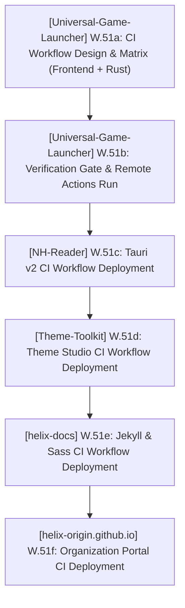

# PLAN.md — HELIX Origin Master Plan & Sprints

> 🎯 **Master Plan**: Active sprint planning, execution architecture, and completed sprint history across all active repositories in the **HELIX Origin** organization.
>
> Pair with [`ROADMAP.md`](./ROADMAP.md) (strategic direction), [`TODO.md`](./TODO.md) (executable tasks), and [`BUGS.md`](./BUGS.md) (known issues).
> Historical delivered milestones and task archives live in [`.github/`](./.github/).
> Last updated: 2026-10-16

---

## 📜 Organizational Tracking Contract

- **Single Pane of Glass:** All repository sprint plans are consolidated here at workspace root.
- **100% Active Direction Accuracy:** Active sprints and architectural descriptions must always reflect the current, active direction of all projects with zero contradictions. Superseded tasks or decisions must be updated in place rather than appended as conflicting statements.
- **Zero Non-Organization Mentions:** Only reference active repositories belonging to the `HELIX-Origin` GitHub organization (`helix-docs`, `helix-origin.github.io`, `NH-Reader`, `Universal-Game-Launcher`, `Theme-Toolkit`, `Windhawk-Themes`). Never directly mention external, third-party, or deleted projects/repositories by name.
- **Active Sprints Only in Top Section:** `## 🎯 Active Sprints` contains ONLY currently active sprints. Completed sprints move immediately to `## ✅ Completed Sprints` (newest first).
- **Mandatory Project Tagging Invariant:** Every sprint, workstream, task, and verification command **must explicitly state its current project name and repository path** (`[<project-name>] (<project-path>)`). Unscoped items are strictly prohibited so agents never conflate repositories.

---

## 🎯 Active Sprints

### 🚀 Sprint 28: [Universal-Game-Launcher] (projects/Universal-Game-Launcher) & [Ecosystem] — Organization CI Workflow Standards & Continuous Verification Deployment
- **Project Identifiers:** `[Universal-Game-Launcher]` (`projects/Universal-Game-Launcher`), `[NH-Reader]` (`projects/NH-Reader`), `[Theme-Toolkit]` (`projects/Theme-Toolkit`), `[helix-docs]` (`projects/helix-docs`), `[helix-origin.github.io]` (`projects/helix-origin.github.io`)
- **Target Objective:** Establish continuous integration (CI) workflows as an organization standard across all active repositories in `HELIX-Origin`. Deploy repo-tailored CI workflows executing frontend type-checks (`svelte-check` / TypeScript), Rust backend compiler checks (`cargo check`, `cargo test --lib`), schema validations, and Jekyll build verification on push and pull requests to prevent regressions. Start with `Universal-Game-Launcher` and progress sequentially across projects.



#### 📝 Execution Tasks

1. **[Universal-Game-Launcher] (projects/Universal-Game-Launcher) W.51a — Tauri v2 CI Workflow Creation (`.github/workflows/ci.yml`) (In Progress)**:
   - `[Universal-Game-Launcher]` Create `.github/workflows/ci.yml` with dual-stage verification:
     - `frontend`: Node 22, `npm ci`, SvelteKit sync & type-check (`npm run check`).
     - `backend`: Rust stable toolchain on `windows-latest` & `ubuntu-22.04` with GTK/WebKit dependencies, `swatinem/rust-cache`, `cargo check` & `cargo test --lib`.
2. **[Universal-Game-Launcher] (projects/Universal-Game-Launcher) W.51b — Verification Gate & Push to Remote**:
   - `[Universal-Game-Launcher]` Run local test suites (`npm test`: check, rust, frontend).
   - `[Universal-Game-Launcher]` Commit and push to `main`, verify GitHub Actions run passes cleanly.
3. **[NH-Reader] (projects/NH-Reader) W.51c — Tauri v2 CI Workflow Deployment**:
   - `[NH-Reader]` Create `.github/workflows/ci.yml` tailored for NH-Reader (`cargo check`, `cargo test`, `npm test`).
4. **[Theme-Toolkit] (projects/Theme-Toolkit) W.51d — Theme Studio CI Workflow Deployment**:
   - `[Theme-Toolkit]` Create `.github/workflows/ci.yml` tailored for Theme-Toolkit.
5. **[helix-docs] (projects/helix-docs) W.51e — Jekyll Theme CI Workflow Deployment**:
   - `[helix-docs]` Create `.github/workflows/ci.yml` with Ruby / Bundler Jekyll build validation and dart-sass check.
6. **[helix-origin.github.io] (projects/helix-origin.github.io) W.51f — Portal CI Workflow Deployment**:
   - `[helix-origin.github.io]` Create `.github/workflows/ci.yml` with Jekyll portal build validation.

---

## 🔮 Planned Sprints

### ⏳ [NH-Reader] (projects/NH-Reader) — Post-v0.7.5 / Milestone M13
- **Project Identifier:** `[NH-Reader]` (`projects/NH-Reader`)
- `[NH-Reader]` Tag frequency analytics and local recommendation engine based on reading history.
- `[NH-Reader]` Multi-profile library partitions (isolated blacklist/favorite spaces).
- `[NH-Reader]` Background auto-update checker and GitHub release notification toasts.

### ⏳ [helix-docs] (projects/helix-docs) — v1.1.0 Feature Cycle
- **Project Identifier:** `[helix-docs]` (`projects/helix-docs`)
- `[helix-docs]` Native Mermaid diagram client rendering macro (`components/mermaid.html`).
- `[helix-docs]` In-page Table of Contents sidebar module resolving `BUG-14`.
- `[helix-docs]` Dynamic catalogue filtering scripts for software and theme showcases.

### ⏳ [helix-origin.github.io] (projects/helix-origin.github.io) — Portal v3 Enhancement
- **Project Identifier:** `[helix-origin.github.io]` (`projects/helix-origin.github.io`)
- `[helix-origin.github.io]` Live release status widgets dynamically queried via Jekyll GitHub metadata.
- `[helix-origin.github.io]` Interactive showcase component consuming the `catalogue` layout.

### ⏳ [Theme-Toolkit] (projects/Theme-Toolkit) — Milestone M2 Native Packaging Implementation
- **Project Identifier:** `[Theme-Toolkit]` (`projects/Theme-Toolkit`)
- `[Theme-Toolkit]` Implement `makecab.exe` Diamond Directive File (`.ddf`) engine, Sound Scheme Manager, Wallpaper & Slideshow Studio, Cursor Scheme Inspector, and Color & Visual Style Editor.

---

## ✅ Completed Sprints

### ✅ Sprint 27: [helix-gaming-db] (projects/helix-gaming-db) & [Universal-Game-Launcher] (projects/Universal-Game-Launcher) — HELIX Gaming DB REST API Foundation, GitHub Pages Deployment, Remote Theme Docs & UGL Client Provider (v1.0.0)
- **Project Identifiers:** `[helix-gaming-db]` (`projects/helix-gaming-db`), `[Universal-Game-Launcher]` (`projects/Universal-Game-Launcher`)
- ✅ `[helix-gaming-db]` **Dedicated Gaming Metadata Repository & REST API Architecture**: Scaffolded repository with Draft 2020-12 JSON schemas (`manifest.schema.json`, `game.schema.json`, `developer.schema.json`), automated validation (`scripts/validate.mjs`), and search index generator (`scripts/build-search-index.mjs`).
- ✅ `[helix-gaming-db]` **Static REST v1 Endpoints & Seed Datasets**: Authored 62 curated game payloads (`api/v1/games/*.json`), 28 studio profiles (`api/v1/developers/*.json`), `api/v1/search/index.json`, and `api/v1/manifest.json`.
- ✅ `[helix-gaming-db]` **Jekyll Remote Theme Docs & Technical Wiki**: Deployed documentation portal and wiki powered by `remote_theme: HELIX-Origin/helix-docs` with theme-neutral API explorer and contribution guides.
- ✅ `[Universal-Game-Launcher]` **Client Metadata Provider Integration (`metadata-helix`)**: Implemented high-priority client plugin querying `helix-origin.club` with cascade fallback to `helix-origin.github.io` and local offline catalog.
- ✅ **Verification**: Passed schema validation (62 games, 28 developers, 0 errors), `cargo check`, `cargo test` (35 passing), `svelte-check` (0 errors, 0 warnings), and live GitHub Actions CI run `39015195011`.


### ✅ Sprint 26: [Universal-Game-Launcher] (projects/Universal-Game-Launcher) — Universal Core Plugins & Global Helpers Architecture, Authentic Vector SVG Platform Icons, Automatic Metadata Engine & Per-Game Customization (Release v1.4.0)
- **Project Identifiers:** `[Universal-Game-Launcher]` (`projects/Universal-Game-Launcher`)
- ✅ `[Universal-Game-Launcher]` **Universal Core Plugins & Global Helpers Framework (`W.49a–W.49d`)**: Consolidated fragmented platform and metadata plugins into `platform-universal`, `metadata-universal`, `utility-title-normalizer`, and `media-universal` paired with global helper functions (`getAllPlatformSpecs`, `detectPlatformLauncher`, `normalizeGameTitle`, etc.).
- ✅ `[Universal-Game-Launcher]` **Authentic Vector SVG Platform Icons (`PlatformIcon.svelte`) (`W.49e`)**: Rendered custom vector SVG icon variants for all PC game providers and emulation consoles, eliminating generic Unicode glyphs across all views.
- ✅ `[Universal-Game-Launcher]` **Automatic Metadata Cascade & Settings-Only Cache (`W.49c`, `W.49f`)**: Automatic multi-source resolution across Local Inspector, Libretro Thumbnails CDN, Steam Store, GOG Catalog v1 API, Wikipedia/Wikidata MediaWiki API, and PCGamingWiki Cargo; confined refresh/purge controls strictly to `/settings` (`Storage & Cache`).
- ✅ `[Universal-Game-Launcher]` **Per-Game Customization Modal (`⚙ Manage`) (`W.49f`)**: Full per-game editing of Title, Short Description, Developers, Publishers, Release Date, Genres, and Custom Artwork in `/library` with `userEnhanced: true` protection.
- ✅ `[Universal-Game-Launcher]` **Local Client Discovery & Hand-Rolled Developer Catalog (`W.49i`, `W.49j`)**: Native discovery for GOG Galaxy, itch.io Butler, Epic Games, EA Desktop, Ubisoft Connect, Xbox/MS Store, and Battle.net; modular hand-rolled catalog covering 21 studios and indie/Patreon creators with cross-studio mismatch validation.
- ✅ **Verification**: Passed `cargo check`, `cargo test` (35 passing), `svelte-check` (0 errors, 0 warnings), and `npm run build`.
- ✅ `[Universal-Game-Launcher]` **Product Rebranding & Visual Suite (`W.48a–W.48f`)**: Renamed package (`universal-game-launcher`), Rust library (`universal_game_launcher_lib`), and bundle identifier (`org.helixorigin.universal-game-launcher`); authored 16:9 vector banner (`universal-game-launcher.svg`), 256×256 squircle logo, multi-resolution icons, 164×314 BMP3 NSIS `sidebar.bmp`, and 850ms animated splash screen in `+layout.svelte`.
- ✅ `[Universal-Game-Launcher]` **Generic SQLite (`database.sqlite`) & In-Memory KV (`mem_kv`) (`W.48k–W.48t`)**: Standardized on generic `database.sqlite`, purged discontinued offline catalogue tables and binary seeds, tuned SQLite WAL PRAGMAs, decoupled the app from writing to external launcher files, and implemented zero-blur dark purple surfaces (`_tokens.scss`).
- ✅ `[Universal-Game-Launcher]` **Titlebar Navigation, Library-Only Sidebar & Single-Game Showcase (`W.48v–W.48am`)**: Built frameless titlebar navigation (`Dashboard`, `Library`, `Store`, `Social`, `Storage`, `Settings`), confined the collapsible platform/console accordion sidebar strictly to `/library`, and replaced the legacy multi-card grid with a single-game showcase view (hero banner, capsule cover, 10-image screenshot gallery, video trailers, and ambient audio player).
- ✅ `[Universal-Game-Launcher]` **In-App Plugins Framework, Storefront Hub (`/store`) & Social Hub (`/social`) (`W.48ao–W.48az`)**: Consolidated plugins in-app under `src/lib/plugins/`, implemented unified `utility-gamerpower` alerts/deals/patch notes, built the zero-payment Storefront discovery hub (`/store`), and built the cross-platform Social friends & presence hub (`/social`).
- ✅ `[Universal-Game-Launcher]` **EmulationStation Scaffolding & Archived ROM Auto-Extraction (`W.48bb`, `W.48bm`)**: Implemented `scaffold_emulation_folders` (`systeminfo.txt` + `systems.txt`), multi-drive ROM discovery, and automatic `.zip`/`.7z`/`.rar` extraction into `<system_dir>/<CleanTitle>/` with isolated `saves/` and `rom.ini` manifests.
- ✅ `[Universal-Game-Launcher]` **Launcher Client Exclusion, Background Worker (`worker.ts`) & Headless CLI (`--cli`) (`W.48bn–W.48bq`)**: Excluded launcher clients (`Ubisoft Game Launcher`, `upc.exe`, etc.) from game ingestion, offloaded heavy scans to `spawn_blocking` threads and `GlobalBackgroundWorker`, and built `src-tauri/src/cli.rs` (`--cli scan`, `scan-roms`, `scaffold-roms`, `normalize-title`, `inspect-local`, `launchers`).
- ✅ **Verification**: Passed `cargo check`, `cargo test`, `svelte-check` (0 errors, 0 warnings), and `npm run build`.

### ✅ Sprint 24: [Universal-Game-Launcher] (projects/Universal-Game-Launcher) — Project Script Standards, Manifest Schema 1.12.0 & IDE Untracking (Hotfix v1.3.3)
- **Project Identifier:** `[Universal-Game-Launcher]` (`projects/Universal-Game-Launcher`)
- ✅ `[Universal-Game-Launcher]` Aligned package scripts to `main:sub:option` format, untracked `.vscode/` from git index, bumped version to `1.3.3`, and authored release notes `.github/releases/v1.3.3.md`.
- ✅ **Verification**: All 4 test suites passed (`check`, `rust`, `frontend`, `i18n`).

### ✅ Sprint 23: [Universal-Game-Launcher] (projects/Universal-Game-Launcher) — Cross-Platform Compiler Diagnostic Elimination & Release Pipeline Hardening (Hotfix v1.3.2)
- **Project Identifier:** `[Universal-Game-Launcher]` (`projects/Universal-Game-Launcher`)
- ✅ `[Universal-Game-Launcher]` Eliminated POSIX/Windows compiler warnings in `windows.rs` and `detectors.rs`, hardened release workflow semver outputs, and bumped version to `1.3.2`.
- ✅ **Verification**: All 4 test suites passed (`check`, `rust` 43/43, `frontend` 0 errors / 0 warnings, `i18n` 30/30).

### ✅ Sprint 22: [Universal-Game-Launcher] (projects/Universal-Game-Launcher) — Modular Multi-Platform Free Game Checker, Store Deals Engine, Library Patch Notes & Settings Ergonomics (Patch v1.3.1)
- **Project Identifier:** `[Universal-Game-Launcher]` (`projects/Universal-Game-Launcher`)
- ✅ `[Universal-Game-Launcher]` Created modular promotions checkers (`epic.rs`, `steam.rs`, `gog.rs`, `gamerpower.rs`), fixed 100% free discount validation (`discountPrice == 0`), implemented `get_store_deals` and `get_library_patch_notes`, built the 3-tab Dashboard notifications subpage, and added Epic Legendary / EOS overlay management.
- ✅ **Verification**: All 4 test suites passed (`check`, `rust`, `frontend`, `i18n`).

### ✅ Sprint 21: [Universal-Game-Launcher] (projects/Universal-Game-Launcher) — Two-Tier Data Architecture: In-Memory Serverless Redis-Compatible KV Tier & SQLite Global Persistence Layer (v1.3.0)
- **Project Identifier:** `[Universal-Game-Launcher]` (`projects/Universal-Game-Launcher`)
- ✅ `[Universal-Game-Launcher]` Implemented fast in-memory KV engine (`mem_kv`) with TTL expiration and pattern queries backing SQLite `app_kv`, added `src/lib/redis.ts`, resolved Chromium/WebView2 Window Teardown Error 1412 via `IS_QUITTING` and explicit `window.destroy()`, reworked `/storage` into multi-platform storage analytics, and reworked `/` into the Executive Gaming Dashboard.
- ✅ **Verification**: 43/43 Rust unit tests passed, `svelte-check` 0 errors / 0 warnings.

### ✅ Sprint 20: [Ecosystem-Wide] — Multi-Platform Clean Uninstaller Architecture, Windows Uninstall Registry Invariant & Process Termination Standards
- **Project Identifiers:** `[Ecosystem-Wide]`, `[Universal-Game-Launcher]` (`projects/Universal-Game-Launcher`), `[NH-Reader]` (`projects/NH-Reader`), `[Theme-Toolkit]` (`projects/Theme-Toolkit`)
- ✅ `[Ecosystem-Wide]` Refactored `NSIS_HOOK_PREINSTALL` and `NSIS_HOOK_PREUNINSTALL` across `.agents/templates/nsis-hooks-template.nsh` and all Tauri v2 apps, created canonical macOS (`uninstall-macos-template.sh`) and Linux (`uninstall-linux-template.sh`) uninstaller templates, and codified standards in `.agents/skills/tauri-desktop-engineering.md`.

### ✅ Sprint 19: [Universal-Game-Launcher] (projects/Universal-Game-Launcher) — Multi-Platform Launcher Detection, Settings Toggle Guards & Built-in Legendary CLI Integration
- **Project Identifier:** `[Universal-Game-Launcher]` (`projects/Universal-Game-Launcher`)
- ✅ `[Universal-Game-Launcher]` Implemented OS-specific launcher detection, portable/AppData `managed_tools_dir()`, built-in standalone `legendary` CLI downloader and OAuth flow, and `PlatformsSection.svelte` launcher guards.

### ✅ Sprint 18: [Universal-Game-Launcher] (projects/Universal-Game-Launcher) — Universal Local Metadata & Artwork Caching, In-Memory Fast Lookup, CSP Domain Expansion, and Settings Cache Reset
- **Project Identifier:** `[Universal-Game-Launcher]` (`projects/Universal-Game-Launcher`)
- ✅ `[Universal-Game-Launcher]` Expanded CSP `img-src` in `tauri.conf.json` for store CDNs, implemented persistent artwork disk caching in `art_cache/`, and added `clear_metadata_cache` command and Settings UI reset controls.

### ✅ Sprint 16–17: [Theme-Toolkit] (projects/Theme-Toolkit) & [Ecosystem-Wide] — Theme Toolkit Repository Creation, Base Framework Scaffolding, and Reusable Script Standards
- **Project Identifiers:** `[Theme-Toolkit]` (`projects/Theme-Toolkit`), `[Ecosystem-Wide]`
- ✅ `[Theme-Toolkit]` Created `HELIX-Origin/Theme-Toolkit`, scaffolded Tauri v2 + SvelteKit studio layout, implemented Rust Per-Platform Lib Architecture (`windows.rs`, `macos.rs`, `linux.rs`), and created dedicated theme engineering skills and subagent playbooks.
- ✅ `[Ecosystem-Wide]` Codified Invariant 4 in `.agents/rules/script-standards.md` mandating reusable modular script extensions across all repositories.

### ✅ Sprint 15: [Ecosystem-Wide] & [Theme-Toolkit] (projects/Theme-Toolkit) — GTK Theming Removal, Desktop Theme Engineer Repurposing & Windows Deskthemepack Engineering Suite Planning
- **Project Identifiers:** `[Ecosystem-Wide]`, `[Windhawk-Themes]` (`projects/Windhawk-Themes`), `[Theme-Toolkit]` (`projects/Theme-Toolkit`)
- ✅ `[Ecosystem-Wide]` Purged GTK theming artifacts, created `.agents/skills/windows-deskthemepack-engineering.md`, and planned the cross-platform Theme Toolkit Tauri v2 application.

### ✅ Sprint 13: [Ecosystem-Wide] & [Universal-Game-Launcher] (projects/Universal-Game-Launcher) & [NH-Reader] (projects/NH-Reader) — Ecosystem Scripts Standard, Platform Module Isolation, and Opt-In Code Signing
- **Project Identifiers:** `[Ecosystem-Wide]`, `[Universal-Game-Launcher]` (`projects/Universal-Game-Launcher`), `[NH-Reader]` (`projects/NH-Reader`)
- ✅ `[Ecosystem-Wide]` Created `.agents/rules/script-standards.md` and `.agents/templates/cleanup-failed-runs-workflow-template.yml`, isolated platform detectors into `windows.rs`, `macos.rs`, `linux.rs`, and implemented opt-in local code signing (`scripts/sign.mjs`).

### ✅ Sprint 1–12: [Universal-Game-Launcher] (projects/Universal-Game-Launcher) — Milestones M1–M9 (Foundation through v1.2.0)
- **Project Identifier:** `[Universal-Game-Launcher]` (`projects/Universal-Game-Launcher`)
- ✅ `[Universal-Game-Launcher]` Delivered Tauri v2 + SvelteKit foundation, multi-platform game discovery (Steam, GOG, Epic, Xbox/AppModel, itch, EA, Ubisoft, Battle.net, Amazon, Rockstar), SCSS design token architecture (`src/styles/`), custom NSIS installer hooks and 164×314 sidebar bitmap, system tray integration, storage manager, custom artwork slots, and two-stage multi-platform GitHub Actions release workflows.

### ✅ [Windhawk-Themes] (projects/Windhawk-Themes) — Sprints 1–3 (Milestones M.01 – M.02b)
- **Project Identifier:** `[Windhawk-Themes]` (`projects/Windhawk-Themes`)
- ✅ `[Windhawk-Themes]` Established static validation gate `tools/Test-WindhawkStyles.ps1` (0 errors, 0 warnings), authored Notification Center styler (`M.02`), refined Start Menu and Taskbar geometry alignments (`M.02b`), and enforced theme-neutral documentation standards (`W.15` / `W.16`).

### ✅ [NH-Reader] (projects/NH-Reader) — Sprints 1–16 (Releases v0.1.0 through v0.7.5)
- **Project Identifier:** `[NH-Reader]` (`projects/NH-Reader`)
- ✅ `[NH-Reader]` Delivered foundation, browse, advanced search query builder, global blacklist stream buffering, SQLite cache, responsive reader, storage budgets & LRU pruning, 18-language localization core, custom title bar, NSIS installer polish, and unified `npm run sign` script.

### ✅ [helix-docs] (projects/helix-docs) — Phases 1–5 & v1.0.0 Initial Release
- **Project Identifier:** `[helix-docs]` (`projects/helix-docs`)
- ✅ `[helix-docs]` Reorganized layered `_sass/` architecture, precompiled `assets/css/site.css` with Dart Sass, built 100% frontmatter-driven navigation engine, extracted universal navbar (`_includes/components/navbar.html`), unified `remote_theme: HELIX-Origin/helix-docs` across all consuming sites, and released `v1.0.0`.

### ✅ [helix-origin.github.io] (projects/helix-origin.github.io) — Portal Modernization & Artwork Suite
- **Project Identifier:** `[helix-origin.github.io]` (`projects/helix-origin.github.io`)
- ✅ `[helix-origin.github.io]` Standardized portal landing structure on `helix-docs` remote theme and authored custom 16:9 vector showcase artwork suite (`windhawk-themes.svg`, `nh-reader.svg`, `helix-docs.svg`, `universal-game-launcher.svg`).

---

## 🛠️ Verification Commands

```powershell
# [Universal-Game-Launcher] (projects/Universal-Game-Launcher)
cargo check --manifest-path "projects/Universal-Game-Launcher/src-tauri/Cargo.toml"
cargo test --manifest-path "projects/Universal-Game-Launcher/src-tauri/Cargo.toml"
node "projects/Universal-Game-Launcher/scripts/test.mjs" frontend build

# [NH-Reader] (projects/NH-Reader)
node "projects/NH-Reader/scripts/test.mjs" all

# [Windhawk-Themes] (projects/Windhawk-Themes)
pwsh -NoProfile -File "projects/Windhawk-Themes/tools/Test-WindhawkStyles.ps1"
```
