# PLAN.md — HELIX Origin Master Plan & Sprints

> 🎯 **Master Plan**: Active sprint planning, execution architecture, and completed sprint history across all repositories in the **HELIX Origin** organization.
>
> Pair with [`ROADMAP.md`](./ROADMAP.md) (strategic direction), [`TODO.md`](./TODO.md) (executable tasks), and [`BUGS.md`](./BUGS.md) (known issues).
> Last updated: 2026-10-14

---

## 📜 Organizational Tracking Contract

- **Single Pane of Glass:** All repository sprint plans are consolidated here at workspace root.
- **Mandatory Project Tagging Invariant:** Every sprint, workstream, task, and verification command **must explicitly state its project name and repository path** (`[<project-name>] (<project-path>)`). Unscoped items are strictly prohibited so agents never conflate repositories.
- **Active Sprints First:** Ongoing sprint tasks precede completed historical phases.
- **Strict Scope Boundaries:** Repositories belong to the `HELIX-Origin` organization. External directories (`ramensoftware`) are strictly forbidden.

---

## 🎯 Active Sprints

### 🚀 [Theme-Toolkit] & [Ecosystem-Wide] Sprint 16: Theme Toolkit Repository Creation, Base Framework Scaffolding, and Dedicated Agent Suite (Completed)
- **Project Identifiers:** `[Theme-Toolkit]` (`projects/Theme-Toolkit`), `[Ecosystem-Wide]`
- **Target Components:** `projects/Theme-Toolkit/*`, `.agents/rules/theme-engineering-standards.md`, `.agents/skills/macos-theme-engineering.md`, `.agents/skills/linux-theme-engineering.md`, `.agents/agents/desktop-theme-engineer/*`, `AGENTS.md`, `.agents/rules/workspace.md`, `ROADMAP.md`

#### 📝 Execution Tasks
1. **[Theme-Toolkit] (projects/Theme-Toolkit) W.39a — GitHub Repository Creation & Local Clone (Completed)**: Created public organization repository `HELIX-Origin/Theme-Toolkit` via GitHub CLI and cloned locally into `projects/Theme-Toolkit`.
2. **[Theme-Toolkit] (projects/Theme-Toolkit) W.39b — Tauri v2 Base Framework Scaffolding (Completed)**: Scaffolding of complete Tauri v2 project structure:
   - SvelteKit / Vite frontend studio layout (`src/app.html`, `src/routes/+layout.svelte`, `src/routes/+page.svelte`).
   - Standardized `package.json` with `main:sub:option` command hierarchy and native `.mjs` scripts runner under `scripts/`.
   - `src-tauri/Cargo.toml` with `theme-toolkit` crate, `tauri.conf.json`, and per-platform targets (`tauri.windows.conf.json`, `tauri.macos.conf.json`, `tauri.linux.conf.json`).
   - Universal `.github/workflows/cleanup-failed-runs.yml` maintenance workflow.
3. **[Theme-Toolkit] (projects/Theme-Toolkit) W.39c — Rust Per-Platform Lib Architecture (Completed)**: Implemented cross-platform packaging engine contracts under `src-tauri/src/platforms/`:
   - `windows.rs`: Blueprint for `makecab.exe` Diamond Directive File (`.ddf`) generation and MSZIP cabinet packaging.
   - `macos.rs`: Dynamic Desktop HEIC container creation and `.soundpack` bundle assembly.
   - `linux.rs`: FreeDesktop Sound Theme v0.8 and XDG `xcursorgen` compilation pipelines.
4. **[Ecosystem-Wide] W.39d — Specialized Subagent Suite & Skills (Completed)**:
   - Created rule `.agents/rules/theme-engineering-standards.md`.
   - Created skills `.agents/skills/macos-theme-engineering.md` and `.agents/skills/linux-theme-engineering.md`.
   - Created subagents `.agents/agents/desktop-theme-engineer/theme-packager.md`, `cursor-packager.md`, and `sound-packager.md`.
   - Updated master agent profile `desktop-theme-engineer.md`.
5. **[Theme-Toolkit] (projects/Theme-Toolkit) W.39f — Documentation Placeholder Setup (Completed)**: Created `projects/Theme-Toolkit/docs/README.md` defining the documentation purpose and explicitly stating its on-hold status until core features mature.
6. **[Ecosystem-Wide] W.39e — Core Architectural Invariants Codification (Completed)**:
   - Codified **Zero Store / Zero Catalogue Invariant** (pure local studio & applicator; export to themepacks for easy re-installation).
   - Codified **Agents Ecosystem Isolation Invariant** (the agents ecosystem is never stored in project repositories and never referenced in them).
   - Committed and pushed initial framework to `origin/main` in `projects/Theme-Toolkit`.

---

### 🚀 [Ecosystem-Wide] & [Theme-Toolkit] Sprint 15: GTK Theming Removal, Desktop Theme Engineer Repurposing & Windows Deskthemepack Engineering Suite Planning (Completed)
- **Project Identifiers:** `[Ecosystem-Wide]`, `[Windhawk-Themes]`, `[Theme-Toolkit]` (`projects/Theme-Toolkit`)
- **Target Components:** `.agents/skills/gtk-desktop-theming.md`, `.agents/skills/windows-deskthemepack-engineering.md`, `.agents/agents/desktop-theme-engineer/desktop-theme-engineer.md`, `.agents/rules/verification.md`, `.agents/rules/workspace.md`, `.agents/rules/project-artwork.md`, `.agents/rules/release-notes.md`, `AGENTS.md`, `ROADMAP.md`

#### 📝 Execution Tasks
1. **[Ecosystem-Wide] W.38a — Complete Purge of GTK Theming Artifacts (Completed)**: Deleted `.agents/skills/gtk-desktop-theming.md`. Purged all references to GTK theming from `.agents/rules/verification.md`, `.agents/rules/workspace.md`, `.agents/rules/project-artwork.md`, `.agents/rules/release-notes.md`, `.agents/templates/release-notes-template.md`, `.agents/skills/project-artwork-generation.md`, `.agents/skills/helix-theme.md`, `.agents/skills/clone-org-repos.md`, and `.agents/agents/docs-site-engineer/frontmatter-fixer.md`.
2. **[Ecosystem-Wide] W.38b — Repurpose Desktop Theme Engineer Profile (Completed)**: Re-anchored `.agents/agents/desktop-theme-engineer/desktop-theme-engineer.md` around Windows 11 Windhawk styler mods, standard-compliant Windows 10/11 `.deskthemepack` packaging via Microsoft `makecab.exe`, and planning for the dedicated Theme Toolkit Tauri v2 application.
3. **[Ecosystem-Wide] W.38c — Windows Deskthemepack Engineering Skill (Completed)**: Created authoritative `.agents/skills/windows-deskthemepack-engineering.md` codifying Diamond Directive Files (`.ddf`), MSZIP cabinet packaging, `.theme` INI syntax, and strict adherence to Microsoft Win32 theming documentation.
4. **[Theme-Toolkit] (projects/Theme-Toolkit) W.38d — Dedicated Theme Toolkit App Planning (Completed)**: Documented detailed feature requirements and architecture for future development as a dedicated **Tauri v2 GUI application** (`Theme Toolkit`):
   - Comprehensive Sound Schemes packaging with Windows Sound Event registry mapping.
   - Wallpapers and multi-monitor dynamic Slideshows (transitions, intervals, shuffle, alignment styles).
   - Cursor Schemes (15 standard Win32 pointer roles, `.cur` & `.ani`).
   - Color editing (Aero glass, accent colorization, Windows 10/11 dark/light modes).
   - Dedicated GUI as primary interface utilizing `makecab.exe` for lossless cabinet packaging adhering to Microsoft Win32 theming docs.
5. **[Ecosystem-Wide] W.38e — Workspace Reference & Roadmap Synchronization (Completed)**: Updated `AGENTS.md` quick reference table and layout tree, updated `ROADMAP.md` milestone matrix and project roadmap.

---

### 🚀 [Hentai-Senpai] & [helix-origin.github.io] Sprint 14: Hentai Senpai Discontinuation, Repository Archival Notice, and Portal Delisting (Completed)
- **Project Identifiers:** `[Hentai-Senpai]` (`projects/Hentai-Senpai-Multi-DE-Theme`), `[helix-origin.github.io]` (`projects/helix-origin.github.io`), `[Ecosystem-Wide]`
- **Target Components:** `projects/Hentai-Senpai-Multi-DE-Theme/README.md`, `projects/Hentai-Senpai-Multi-DE-Theme/docs/`, `projects/helix-origin.github.io/docs/index.md`, `projects/helix-origin.github.io/README.md`, `AGENTS.md`, `.agents/rules/workspace.md`, `ROADMAP.md`

#### 📝 Execution Tasks
1. **[Hentai-Senpai] (projects/Hentai-Senpai-Multi-DE-Theme) W.37a — Repository Archival Notice (Completed)**: Added prominent `DISCONTINUED & ARCHIVED` alert banner to `README.md` explicitly stating that the repository is discontinued, unmaintained, and archived.
2. **[Hentai-Senpai] (projects/Hentai-Senpai-Multi-DE-Theme) W.37b — GitHub Pages Decommissioning (Completed)**: Removed `docs/` folder to disable GitHub Pages deployment.
3. **[helix-origin.github.io] (projects/helix-origin.github.io) W.37c — Portal Delisting (Completed)**: Removed Hentai Senpai project card from `docs/index.md` and repository list item from `README.md`.
4. **[Ecosystem-Wide] W.37d — Organization Architecture & Scope Alignment (Completed)**: Updated `AGENTS.md`, `.agents/rules/workspace.md`, and `ROADMAP.md` marking the project as discontinued and archived.

---

### 🚀 [Ecosystem-Wide] & [Steam-Vault] & [NH-Reader] Sprint 13: Ecosystem Scripts Standard, Platform Module Isolation, Opt-In Code Signing, and WinGet Registration (Completed)
- **Project Identifiers:** `[Ecosystem-Wide]`, `[Steam-Vault]` (`projects/Steam-Vault`), `[NH-Reader]` (`projects/NH-Reader`), `[Steam-Vault-Catalogue]` (`projects/Steam-Vault-Catalogue`)
- **Target Components:** `.agents/rules/script-standards.md`, `.agents/skills/tauri-desktop-engineering.md`, `.agents/templates/cleanup-failed-runs-workflow-template.yml`, `projects/Steam-Vault/scripts/*`, `projects/Steam-Vault/src-tauri/src/platforms/*`, `projects/Steam-Vault/src-tauri/tauri.*.conf.json`, `projects/Steam-Vault/package.json`, `projects/NH-Reader/scripts/*`, `projects/NH-Reader/package.json`

#### 📝 Execution Tasks
1. **[Ecosystem-Wide] W.36a — Authoritative Script Standards & Command Hierarchy (Completed)**: Created `.agents/rules/script-standards.md`, updated `AGENTS.md` and `workspace.md`. Codified Tauri v2 native `.mjs` scripts standard, non-Tauri TypeScript ESM scripts standard, and universal `main:sub:option` command hierarchy across `package.json`.
2. **[Ecosystem-Wide] W.36b — Tauri Engineering Skill & Architecture Standards (Completed)**: Updated `.agents/skills/tauri-desktop-engineering.md` with Per-Platform Lib Architecture (`windows.rs`, `macos.rs`, `linux.rs`), Per-Platform Tauri Configuration Standard (`tauri.<platform>.conf.json` with base `tauri.conf.json`), opt-in local code signing, WinGet registration for non-NSFW apps, and universal `cleanup-failed-runs.yml` workflow template.
3. **[Ecosystem-Wide] W.36c — Universal Failed Runs Cleanup Template (Completed)**: Created `.agents/templates/cleanup-failed-runs-workflow-template.yml` for inclusion across all org repos.
4. **[Steam-Vault] (projects/Steam-Vault) W.36d — Per-Platform Lib Isolation & Rust Compilation (Completed)**: Split platform detection into `windows.rs`, `macos.rs`, `linux.rs`, export `Detection` as `pub(crate)` in `platforms/mod.rs`, resolved all registry field bindings (`id`, `name`, `path`, `exe`), verified `cargo check` passes with 0 errors and 0 warnings.
5. **[Steam-Vault] (projects/Steam-Vault) W.36e — Per-Platform Tauri Configuration & Build Args (Completed)**: Created `tauri.windows.conf.json`, `tauri.macos.conf.json`, `tauri.linux.conf.json`, updated `.github/workflows/release.yml` matrix with per-platform `--config` flags.
6. **[Steam-Vault] (projects/Steam-Vault) W.36f — Opt-In Multi-Platform Code Signing (Completed)**: Implemented `scripts/sign.mjs`, `scripts/setup-signing-secrets.ps1`, added `"sign"` and `"sign:local"` to `package.json`.
7. **[Steam-Vault] (projects/Steam-Vault) W.36g — WinGet Package Registration & Automated Releases (Completed)**: Created `scripts/generate-winget-manifest.mjs`, generated initial manifests under `winget/manifests/h/HELIXOrigin/SteamVault/1.2.0/`, added `publish-winget` job (`vedantmgoyal9/winget-releaser@v2`) to `.github/workflows/release.yml`, documented `winget install HELIXOrigin.SteamVault` in `README.md`.
8. **[NH-Reader] (projects/NH-Reader) W.36h — Unified Modular `.mjs` Scripts & `main:sub:option` Standard (Completed)**: Built `scripts/lib/logger.mjs`, `scripts/lib/runner.mjs`, `scripts/lib/suites.mjs`, `scripts/build.mjs`, `scripts/dev.mjs`, `scripts/run.mjs`, `scripts/test.mjs`, aligned `package.json` with `main:sub:option` hierarchy (`tauri:build:release`, `tauri:build:debug`, `test:rust`, `test:frontend`, `test:i18n`, `test:all`, `sign:local`), verified `node scripts/test.mjs i18n` (PASS, 17/17 community packs).
9. **[NH-Reader] (projects/NH-Reader) W.36i — NSFW WinGet Policy Enforcement (Completed)**: Strictly excluded `NH-Reader` from WinGet repository in compliance with WinGet terms of service, documented as an absolute invariant.

---

### 🚀 [Steam-Vault] & [Steam-Vault-Catalogue] Sprint 12: Multi-Provider Metadata Parity, Lightweight Index Manifest, Settings & Per-Game Refresh Metadata, and Cross-Repo i18n Localization (Completed)
- **Project Identifiers:** `[Steam-Vault]` (`projects/Steam-Vault`), `[Steam-Vault-Catalogue]` (`projects/Steam-Vault-Catalogue`)
- **Target Components:** `projects/Steam-Vault/src-tauri/src/commands.rs`, `projects/Steam-Vault/src-tauri/src/lib.rs`, `projects/Steam-Vault/src/lib/api.ts`, `projects/Steam-Vault/src/lib/types.ts`, `projects/Steam-Vault/src/lib/i18n/*`, `projects/Steam-Vault/src/routes/settings/+page.svelte`, `projects/Steam-Vault/src/routes/library/+page.svelte`; `projects/Steam-Vault-Catalogue/scripts/modules/types.ts`, `projects/Steam-Vault-Catalogue/scripts/modules/config.ts`, `projects/Steam-Vault-Catalogue/scripts/modules/indexer.ts`, `projects/Steam-Vault-Catalogue/scripts/modules/engine.ts`, `projects/Steam-Vault-Catalogue/scripts/modules/providers/*`, `projects/Steam-Vault-Catalogue/index.json`, `projects/Steam-Vault-Catalogue/schema/game.schema.json`

#### 📝 Execution Tasks
1. **[Steam-Vault-Catalogue] (projects/Steam-Vault-Catalogue) W.35a — Lightweight Index Manifest (Completed)**: Refactored `indexer.ts` and `types.ts` to output `CatalogueIndexEntry` in root `index.json`, providing a compact entrypoint (220 KB, >80% reduction) pointing to `games/<slug>.json` without duplicating full descriptions, categories, scores, and image arrays.
2. **[Steam-Vault-Catalogue] (projects/Steam-Vault-Catalogue) W.35b — Expanded Metadata Providers (Completed)**: Implemented `pcgamingwiki.ts` (MediaWiki parsing & box art), `libretro.ts` (emulation box art, snaps, titles across console systems), and enhanced `wikipedia.ts` with direct box art image extraction (`pageimages`); integrated all into `scripts/modules/engine.ts`.
3. **[Steam-Vault] (projects/Steam-Vault) W.35c — Backend Single-Game & Library Metadata Refresh (Completed)**: Implemented `refresh_game_metadata` command querying and merging across Steam Store, Catalogue, PCGamingWiki, Wikipedia, and VNDB; updated `sync_library_metadata` with `force` and `auto_artwork` support in `commands.rs` and registered in `lib.rs`.
4. **[Steam-Vault] (projects/Steam-Vault) W.35d — Settings Library Metadata & Artwork Refresh Action (Completed)**: Added "Fetch & Refresh Library Metadata" UI block in `/settings` under Preferences & Offline Cache with live status indicators, auto-artwork toggle, and online catalogue sync trigger.
5. **[Steam-Vault] (projects/Steam-Vault) W.35e — Per-Game Details & Modal Refresh Metadata Buttons (Completed)**: Added prominent "Refresh Metadata" button on game details topbar and in Manage modal with spin indicator and live feedback toast.
6. **[Steam-Vault] (projects/Steam-Vault) W.35f — Keyword-Based Multi-Provider Artwork Search (Completed)**: Added PCGamingWiki and Libretro Emulation search providers to Artwork Manager modal; updated filter dropdown with all providers; enabled safe search toggle; and enforced client-side `onerror` removal of dead URLs to prevent broken image cards.
7. **[Steam-Vault] (projects/Steam-Vault) W.35g — Comprehensive i18n Localization (Completed)**: Expanded `TranslationDictionary` in `types.ts` and `en.ts` with all strings for metadata refresh, display name customization, artwork search placeholders, and provider filter labels.
8. **[Steam-Vault-Catalogue] & [Steam-Vault] (projects/Steam-Vault-Catalogue, projects/Steam-Vault) W.35h — Multilingual Metadata Schema & Cross-Repo i18n Parity (Completed)**: Added `locales` to `game.schema.json` and `types.ts` in `Steam-Vault-Catalogue`, added `languages.ts` supporting all 30 Valve/Steam languages, added `locales` validation in `validator.ts`, aggregated multilingual titles into `aliases` during index generation in `indexer.ts`, preserved `locales` in `catalogue.db.gz`, added `locales` to `AppMeta` in both Rust (`models.rs`) and TypeScript (`types.ts`), and implemented `getLocalizedTitle` and `getLocalizedDescription` in `projects/Steam-Vault/src/routes/library/+page.svelte` dynamically reacting to active `$locale` and `$activeLanguage`.
9. **[Steam-Vault-Catalogue] (projects/Steam-Vault-Catalogue) W.35j — Manual & Scheduled Population Workflow Overhaul (Completed)**: Updated `.github/workflows/populate-catalogue.yml` with comprehensive `workflow_dispatch` manual inputs (`mode` selection: `missing`, `all`, `crawl`, `seeds`, `query`, `slug`, `index`, `validate`; `provider`, `limit`, `query`, `slug`, `dry_run`), added `--experimental-strip-types` to npm scripts in `package.json` for seamless Node 22+ execution, and verified `populate-catalogue.yml` and `validate.yml`.
10. **[Steam-Vault] & [Steam-Vault-Catalogue] (projects/Steam-Vault, projects/Steam-Vault-Catalogue) W.35i — Verification Suite (Completed)**: Verified with `npm run catalogue:validate` (729/729 games valid), `npm run catalogue:build:index`, `npm run check` (0 errors, 0 warnings), and `npm run build` (clean Vite + SvelteKit bundle).
11. **[Steam-Vault] & [Steam-Vault-Catalogue] (projects/Steam-Vault, projects/Steam-Vault-Catalogue) W.35k — Release Workflows, Manual Asset Attachment & Semantic Releases (Completed)**: Updated `.github/workflows/release.yml` in `Steam-Vault` and `.github/workflows/build-release.yml` in `Steam-Vault-Catalogue` to support `workflow_dispatch` manual inputs for selected release tags and automated asset uploads (`.msi`, `.exe`, `.dmg`, `.deb`, `.AppImage` for Steam Vault; `dist/catalogue.db.gz` and `dist/index.json.gz` for Catalogue). Published semantic releases `v1.2.0` and `v1.1.0` conforming strictly to workspace release notes standards.

---

### 🚀 [Steam-Vault] Sprint 11: Library 500 Repair, Steam-Parity Artwork & Custom Display Name Sub-Window, and Settings Navigation & Layout Consolidation (Completed)
- **Project Identifier:** `[Steam-Vault]` (`projects/Steam-Vault`)
- **Target Components:** `src/lib/stores.ts`, `src-tauri/src/steam/artwork.rs`, `src-tauri/src/metadata/steamgriddb.rs`, `src-tauri/src/commands.rs`, `src/lib/api.ts`, `src/routes/library/+page.svelte`, `src/routes/+layout.svelte`, `src/routes/settings/+page.svelte`, `src/lib/components/settings/*`, `src/styles/*`

#### 📝 Execution Tasks
1. **[Steam-Vault] (projects/Steam-Vault) W.34a — Library 500 Error Repair (Completed)**: Restored missing `loading` writable store in `src/lib/stores.ts`, purged untracked hallucinated grid component, and restored clean reactive state.
2. **[Steam-Vault] (projects/Steam-Vault) W.34b — Steam-Parity Artwork Engine & NSFW Filter (Completed)**: Updated backend artwork sniffing to support PNG, JPEG, WebP, and ICO; added `nsfw: Option<bool>` parameter to SGDB queries (`nsfw=any&humor=any` when Safe Search is disabled); removed client-side CORS HEAD checks and dimension restrictions to match Steam's non-refusal policy.
3. **[Steam-Vault] (projects/Steam-Vault) W.34c — Per-Game Management Modal with Display Name Customization & Tabbed Artwork Manager (Completed)**: Embedded per-game modal with General Settings (user-customizable display name override persisted in `localStorage`) and Artwork Manager replicating Steam's tabbed UI across 5 visual types with live search, visual provider filters, static/animated filters, and safe search toggle.
4. **[Steam-Vault] (projects/Steam-Vault) W.34d — Navigation Streamlining & Settings Tab Consolidation (Completed)**: Removed `/collections`, `/platforms`, and `/organize` from top navigation; consolidated Collections, Platforms & Launchers, and Library Organization into modular, dedicated section tabs within `/settings`.
5. **[Steam-Vault] (projects/Steam-Vault) W.34e — Settings Tab Layout Consolidation & Balanced Grid (Completed)**: Fixed layout inconsistencies in `/settings`, introducing responsive tab bar navigation, balanced 2x2 grid for General & Storage settings, and cleanly scoped section components.
6. **[Steam-Vault] (projects/Steam-Vault) W.34f — Verification & Build Suite (Completed)**: Verified with `npm run check` (0 errors, 0 warnings) and `npm run build` (successful static bundle).

---

### 🚀 [Steam-Vault] & [Steam-Vault-Catalogue] Sprint 10: Multi-Platform Owned Games Detection, Official & Enhanced Metadata Engine, Interactive Library Grid & Per-Game Management Pages, and Catalogue Alignment (Completed)
- **Project Identifiers:** `[Steam-Vault]` (`projects/Steam-Vault`), `[Steam-Vault-Catalogue]` (`projects/Steam-Vault-Catalogue`)
- **Target Components:** `src-tauri/src/platforms/detectors.rs`, `src-tauri/src/platforms/mod.rs`, `src-tauri/src/metadata/*`, `src-tauri/src/commands.rs`, `src-tauri/src/steam/models.rs`, `src/routes/library/+page.svelte`, `src/lib/api.ts`, `src/lib/types.ts`; `projects/Steam-Vault-Catalogue/schema/game.schema.json`, `projects/Steam-Vault-Catalogue/scripts/manage-catalogue.ts`, `projects/Steam-Vault-Catalogue/scripts/modules/*`

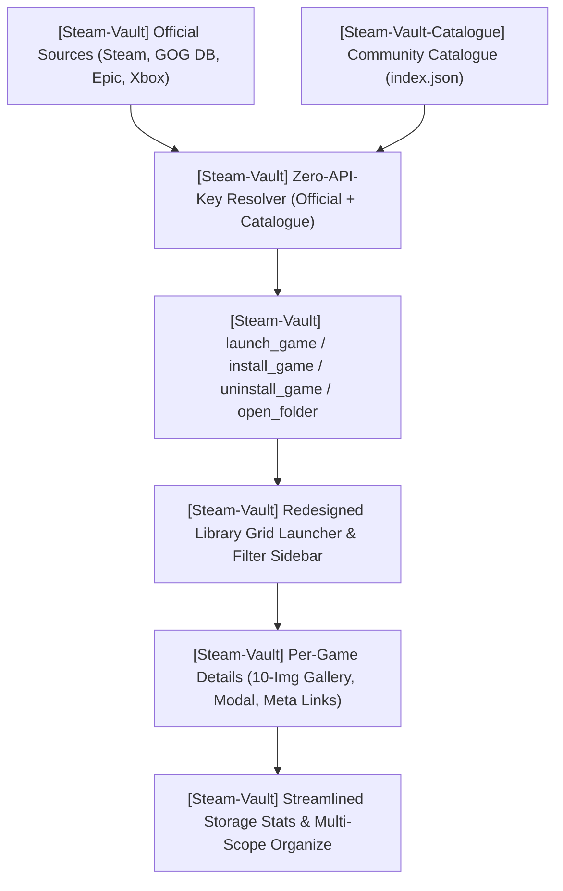

#### 🏛️ Architectural Strategy: Zero-API-Key Migration
- **Strategic Directive**: Gradually and deliberately transition all metadata resolution in Steam Vault solely to **Official Sources** (local storefront manifests, registry entries, official unauthenticated store APIs) and the **Community Game Catalogue** (`Steam-Vault-Catalogue`).
- **User Impact**: Users will never be required to supply third-party API keys (e.g. IGDB Twitch client credentials, SteamGridDB API keys) or fiddle with enabling/disabling metadata providers in Settings. Furthermore, the **Steam Web API key is planned to be completely optional**, as Steam Vault is designed to extract the full list of owned games directly from the user's local authenticated Steam installation (`appinfo.vdf`, `packageinfo.vdf`, `localconfig.vdf`), matching the local manifest-based integration of all other platforms. The app operates 100% keyless and out-of-the-box.

#### 📝 Execution Tasks

1. **[Steam-Vault] (projects/Steam-Vault) W.33a — Multi-platform owned games detection backend (Completed)**: Expanded GOG detector to read `%ProgramData%\GOG.com\Galaxy\storage\galaxy-2.0.db` in read-only mode, extracting owned and installed games, titles, and store images; updated Epic and Xbox/WindowsApps detectors with launch URIs (`goggalaxy://`, `com.epicgames.launcher://`, `shell:AppsFolder`).
2. **[Steam-Vault] (projects/Steam-Vault) W.33b — Official integrations & Community Catalogue metadata architecture (Completed)**: Configured metadata engine prioritizing official integrations (Steam Store API / ACF manifests, GOG Galaxy DB, Epic manifests, Xbox AppxManifest, Itch receipts, PE headers) layered with the offline Community Game Catalogue (`catalog_seed.bin` / `index.json`) for zero-configuration lookups.
3. **[Steam-Vault] (projects/Steam-Vault) W.33c — Per-game management backend commands (Completed)**: Implemented `launch_game` (via `steam://run/{app_id}` with native URI/executable fallback), `install_game` (`steam://install/{app_id}`), `uninstall_game` (`steam://uninstall/{app_id}`), and `open_game_folder` (native file explorer) in `src-tauri/src/commands.rs`.
4. **[Steam-Vault] (projects/Steam-Vault) W.33d — Redesigned Library Grid Launcher & Filter Sidebar (Completed)**: Implemented primary vertical capsule Grid view as the central launcher hub with clean box art (no hover overlay over cover art); bottom-right card actions featuring Play (installed) or Download (uninstalled); built collapsible Right Sidebar with instant sort options (Name, Playtime, Last played, Size) and granular filters (Platform counts, Install state, Collections, Favorites, Hidden).
5. **[Steam-Vault] (projects/Steam-Vault) W.33e — Extensive Per-Game Details & Management Sub-Page with Video Support (Completed)**: Implemented comprehensive game details sub-page featuring an interactive media gallery supporting up to 2 videos first, followed by screenshots and preview artwork, capped strictly at 10 items without artificial padding or duplicate URLs; full-screen lightbox modal with inline video player; meta links card (Store, PCGamingWiki, SteamDB, ProtonDB, Wikipedia, Community Catalogue), comprehensive details cards, playtime tracking, Play/Install button, and dedicated Manage button solely on the per-game details page.
6. **[Steam-Vault] (projects/Steam-Vault) W.33e2 — Streamlined Storage Statistics & Multi-Scope Organize Lists (Completed)**: Streamlined `/storage` into a pure storage analytics dashboard and library folder manager (removed redundant game table); overhauled `/organize` from card buttons to a multi-select scope list with Depressurizer custom rule builder.
7. **[Steam-Vault-Catalogue] (projects/Steam-Vault-Catalogue) W.33f — YAML issue templates (Completed)**: Added `.github/ISSUE_TEMPLATE/` configuration with `config.yml`, `1_bug_report.yml`, `2_metadata_correction.yml`, and `3_feature_proposal.yml` linking to Discord (`https://discord.com/invite/Ww3XBZC2HV`).
8. **[Steam-Vault-Catalogue] (projects/Steam-Vault-Catalogue) W.33g — Jekyll documentation site with helix-docs & vCard home page (Completed)**: Scaffolded `docs/` with `remote_theme: HELIX-Origin/helix-docs`, `docs/_config.yml`, 5-section vCard styled `docs/index.md` home page, user guides in `docs/_docs/`, technical architecture in `docs/_wiki/`, and compliant 256x256 squircle logo `docs/assets/images/logo.svg`.
9. **[helix-origin.github.io] (projects/helix-origin.github.io) W.33h — Portal showcase card & asset integration (Completed)**: Added Steam Vault Catalogue project card and `steam-vault-catalogue.svg` asset to portal homepage grid; disabled GitHub Discussions organization-wide and directed community links to Discord.
10. **[Steam-Vault-Catalogue] (projects/Steam-Vault-Catalogue) W.33i — Modular TypeScript manager, standardized scripts & living index (Completed)**: Refactored catalogue management into modular TypeScript ESM architecture (`scripts/manage-catalogue.ts`, `scripts/modules/*`); standardized `main:sub:option` npm scripts (`catalogue:update:all`, `catalogue:update:missing`, `catalogue:populate:games`, `catalogue:populate:seeds`, `catalogue:validate`, `catalogue:build:index`); committed living root `index.json`.
11. **[Steam-Vault] (projects/Steam-Vault) W.33j — Complete App-Wide SCSS Architecture Migration (Completed)**: Installed `sass`, established `src/styles/` (`_tokens.scss`, `_mixins.scss`, `_platforms.scss`, `app.scss`, `library.scss`, `settings.scss`, `storage.scss`, `organize.scss`, `platforms.scss`, `artwork.scss`, `collections.scss`), configured `$styles` alias in `svelte.config.js`, removed all embedded `<style>` blocks and hardcoded inline styles across all route pages.
12. **[Steam-Vault] (projects/Steam-Vault) W.33k — Manual Emulation, Anti-Piracy Invariant & ES-DE Directory Scaffolding (Completed)**: Enforced anti-piracy invariant disabling automated filesystem/emulator detection; integrated EmulationStation Desktop Edition (`ES-DE`) canonical directory scaffolding (`scaffold_es_de_directories`, `get_es_de_systems`) across 50+ consoles with `systeminfo.txt` guides; added UI in Settings for manual emulator configuration and deterministic console detection from `ROMs/<system>/...` directory paths.
13. **[Steam-Vault] (projects/Steam-Vault) W.33l — Verification & test suite (Completed)**: `cargo test` passes 39 unit tests with 0 failures; `cargo check` exits code 0; `npm run check` passes with 0 Svelte errors and 0 warnings; `npm run build` succeeds cleanly.

---

### 🚀 [Steam-Vault] Sprint 9: Windows Store & Xbox Game Detection, Custom NSIS Installer, and System Tray Support (Completed)
- **Project Identifier:** `[Steam-Vault]` (`projects/Steam-Vault`)
- **Target Components:** `src-tauri/src/platforms/detectors.rs`, `src-tauri/src/platforms/registry.rs`, `src-tauri/src/commands.rs`, `src-tauri/src/lib.rs`, `src-tauri/Cargo.toml`, `src-tauri/tauri.conf.json`, `src-tauri/windows/hooks.nsh`, `src-tauri/windows/sidebar.bmp`, `src-tauri/icons/tray-icon.png`

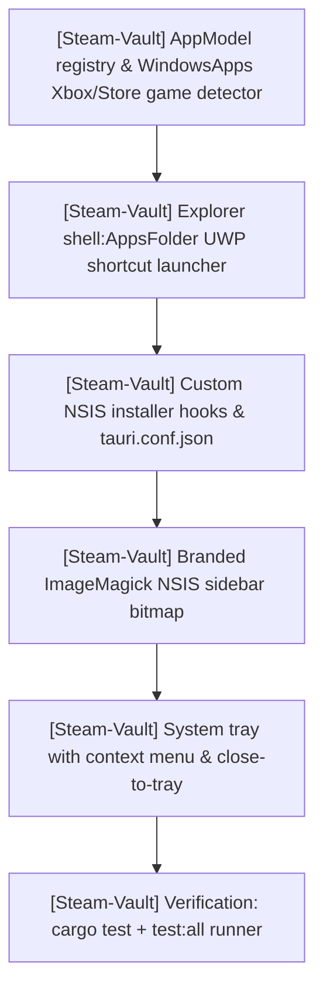

#### 📝 Execution Tasks

1. **[Steam-Vault] W.32a — AppModel registry & WindowsApps game detection**: query Windows AppModel repository registry packages and `WindowsApps` folders for `xboxservices.config`, `MicrosoftGame.config`, Xbox manifest protocols (`xboxliveapp`, `ms-xbl-`), and `shell:AppsFolder` AUMID resolution.
2. **[Steam-Vault] W.32b — Steam shortcut UWP launcher handling**: wire `explorer.exe shell:AppsFolder\...` for UWP / Windows Store games on shortcut import so games launch reliably via Windows AppContainer activation.
3. **[Steam-Vault] W.32c — Custom NSIS script & installer hooks**: create `src-tauri/windows/hooks.nsh` with preinstall process termination for running instances and synchronous uninstaller execution matching NH-Reader pattern.
4. **[Steam-Vault] W.32d — ImageMagick NSIS sidebar bitmap**: generate 164x314 branded obsidian 24-bit BMP with centered squircle mark (`src-tauri/windows/sidebar.bmp`) and add generator script.
5. **[Steam-Vault] W.32e — NSIS configuration in tauri.conf.json**: configure `bundle.windows.nsis` with `installMode: "both"`, multilingual selector, installer icon, hooks, and sidebar bitmap.
6. **[Steam-Vault] W.32f — System tray implementation**: enable `tray-icon` and `image-png` features in Tauri, build tray icon with "Show Steam Vault", "Minimize to Tray", separator, "Quit", left-click toggle, and window close-to-tray event handler in `src-tauri/src/lib.rs`.
7. **[Steam-Vault] W.32g — Verification & test suite**: verify live detection of Microsoft Solitaire Collection, run unit tests, cargo check, cargo test, and full test runner.

---

### 🚀 [Steam-Vault-Catalog] Sprint 8: Community Game Catalog Infrastructure & Provider Crawler
- **Project Identifiers:** `[Steam-Vault-Catalog]` (`projects/Steam-Vault-Catalog`), `[Steam-Vault]` (`projects/Steam-Vault`)
- **Target Components:** `scripts/populate.js`, `scripts/build-index.js`, `schema/game.schema.json`, `package.json`, `README.md`, `.github/workflows/*`; `src-tauri/src/cache.rs`

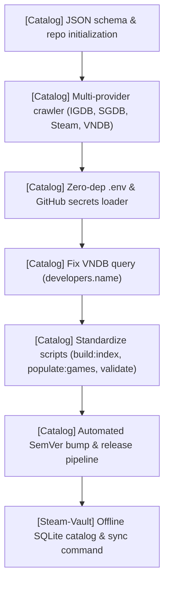

#### 📝 Execution Tasks

1. **[Steam-Vault-Catalog] W.30a — Repo initialization & schema**: formal JSON schema (`schema/game.schema.json`), MIT license, `.gitattributes` (LF), and `.gitignore` (ignoring `dist/` and `node_modules/`).
2. **[Steam-Vault-Catalog] W.30b — Automated multi-provider crawler & .env support**: pagination crawler (`scripts/populate.js` via `npm run populate:games`) querying IGDB, SteamGridDB, Steam Store API, and VNDB Kana API with state persistence in `scripts/.crawler-state.json`; added `loadEnv()` supporting local `.env` files while cleanly preserving GitHub Actions repository secrets in CI.
3. **[Steam-Vault-Catalog] W.30c — Script standardization & de-duplication**: standardized npm scripts to canonical colon-scoped names (`build:index`, `populate:games`, `validate`), dropped duplicate aliases (`generate`, `populate`, `build`, `build-index`, `test`), and deleted obsolete `scripts/generate.js`.
4. **[Steam-Vault-Catalog] W.30d — Repository metadata & documentation**: configured GitHub description and 12 topics via `gh repo edit`; updated `README.md` and `CONTRIBUTING.md` with accurate architecture, `.env` setup, and updated command references (avoiding static game counts as the catalog continuously expands).
5. **[Steam-Vault-Catalog] W.30e — Automated CI SemVer release pipeline**: `.github/workflows/populate-catalog.yml` and `build-release.yml` with automated patch bumping, CHANGELOG/README updating, git push authenticated via `PAT_TOKEN`, git release tagging, and release assets generation (`catalog.db.gz`, `index.json`, `index.json.gz`).
6. **[Steam-Vault] W.30f — Offline SQLite game catalog & platform detector fixes**: local SQLite game catalog in `cache.rs`, Roman numeral normalization, passive Windows uninstall registry metadata ingestion (eliminating duplicates), EA working directory `start_dir` fix, itch.io cache blacklist and multi-engine support, emulator config-based ROM discovery, and Settings UI catalog synchronization.
7. **[Steam-Vault-Catalog] W.30g — Multi-platform & console platforms taxonomy**: expanded `platforms` array across game JSON files to include supported OS platforms (`windows`, `macos`, `linux`) and specific console hardware (`PlayStation`, `PlayStation 2`, `GameCube`, `Wii`, `Nintendo 64`, `Super Nintendo`, `Game Boy Advance`, `Genesis`, `Dreamcast`, etc.), while strictly excluding software categories like `"emulator"`.
8. **[Steam-Vault-Catalog] W.30h — Type consistency & schema validation fix**: resolved type mismatch where visual novel files had string VNDB IDs (`"v239"`) written into `externalIds.igdbId` (which expects an integer or null); preserved VNDB IDs in `externalIds.vndbId` and reset `externalIds.igdbId` to null; updated `scripts/populate.js` and `scripts/validate.js` to strictly enforce type constraints; verified `npm run validate` passes with 0 errors across all catalog game files.
9. **[Steam-Vault] W.30i — Console platform detection, shortcut tags & UI badges**: implemented `determine_console_platform` in `src-tauri/src/platforms/detectors.rs` resolving console platforms from ROM extensions and emulator paths; exposed `console: Option<String>` on `PlatformGame` and surfaced badges in Platforms view; wired console platforms into binary `shortcuts.vdf` `tags` and `shortcuts::load_shortcuts` for automatic Steam categorization.
10. **[Steam-Vault] W.30j — Wikipedia video game & console metadata provider**: implemented keyless MediaWiki wikitext infobox parser in `src-tauri/src/metadata/extra.rs` resolving developer, publisher, genre, release year, console platforms, and summaries; wired into `ensure_game_metadata` for console shortcuts and exposed via `wikipedia_game_lookup` Tauri command.
11. **[Steam-Vault] W.30k — Catalog seed database synchronization**: compiled `dist/catalog.db.gz` from the game files in `Steam-Vault-Catalog` and synchronized it to `projects/Steam-Vault/src-tauri/src/catalog_seed.bin`.
12. **[Steam-Vault & Catalog] W.30l — Online catalog sync JSON deserialization & metadata case normalization**: resolved `JSON error: invalid type: sequence` when syncing online catalog archives; added untagged `StringOrSeq` enum in `cache.rs` supporting both stringified and sequence arrays for `platforms` and `known_exes`, and `Option<serde_json::Value>` for `meta_json` / `meta`; added serde aliases (`app_id`, `release_year`, etc.) and defaults to `AppMeta` in `models.rs`; recomputed normalized titles and lookups during import; updated `build-index.js` to emit both camelCase and snake_case properties in catalog metadata; verified with dedicated unit tests and full 7-suite runner.

> **Status:** Complete & verified — All catalog game entries validated with 0 errors, multi-platform & console platforms populated, Wikipedia provider and console detector wired, catalog seed embedded, online catalog sync deserialization verified across array/object variants, and full 7-suite test runner green. Ready for commit & push authorization.

---

### 🚀 [Multi-Project] Sprint 7: Multi-Platform Tauri v2 CI Release Workflows (Steam-Vault & NH-Reader)
- **Project Identifiers:** `[Steam-Vault]` (`projects/Steam-Vault`), `[NH-Reader]` (`projects/NH-Reader`)
- **Target Components:** `.github/workflows/release.yml`, `.github/releases/*.md`, `.agents/rules/release-notes.md`

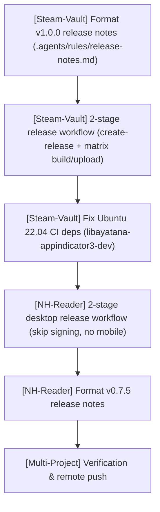

#### 📝 Execution Tasks

1. **[Steam-Vault] W.29a — Release notes formatting**: create `.github/releases/v1.0.0.md` strictly following `.agents/rules/release-notes.md` standard structure (Highlights, Key Improvements, Changed, Fixed, Compatibility Matrix, Verification, Changes & Commits).
2. **[Steam-Vault] W.29b — Two-stage release workflow & dependency fix**: re-architect `.github/workflows/release.yml` with `create-release` (creates/updates release with full notes via `PAT_TOKEN`) and `build-and-upload` (matrix: Windows, macOS universal, Ubuntu 22.04); replace missing `libappindicator3-dev` with `libayatana-appindicator3-dev` and `libwebkit2gtk-4.1-dev`.
3. **[NH-Reader] W.29c — Two-stage release workflow (desktop only, unsigned)**: create `.github/workflows/release.yml` supporting Windows (`.exe`/`.msi`), macOS (universal `.dmg`), and Linux (`.deb`/`.AppImage`), skipping optional local signing step and omitting Android/iOS.
4. **[NH-Reader] W.29d — Release notes formatting**: create `.github/releases/v0.7.5.md` strictly conforming to release notes standards.
5. **[Workspace] W.29e — Update release notes taxonomy**: update `.agents/rules/release-notes.md` table to document prebuilt desktop installer assets for Steam-Vault and NH-Reader.

> **Status:** In progress — Workflows, release notes, and taxonomy rules authored; local builds and verification in progress.

---

### 🚀 [Steam-Vault] Sprint 6: v1.0 Completion — Platform, Dynamic Collections, SQLite Cache, M5 UI & Release
- **Project Identifier:** `[Steam-Vault]`
- **Repository Path:** `projects/Steam-Vault`
- **Target Component:** `src-tauri/src/platforms/*`, `src-tauri/src/steam/{shortcuts,filters}.rs`, `src-tauri/src/filter.rs`, `src-tauri/src/metadata/*`, `src-tauri/Cargo.toml`, `src-tauri/src/commands.rs`, `src-tauri/src/lib.rs`; `src/app.css`, all `src/routes/**`, `src/lib/{api,types}.ts`; `static/`, `src-tauri/icons/`, `.github/`; `README.md`, `CHANGELOG.md`, `docs/*`

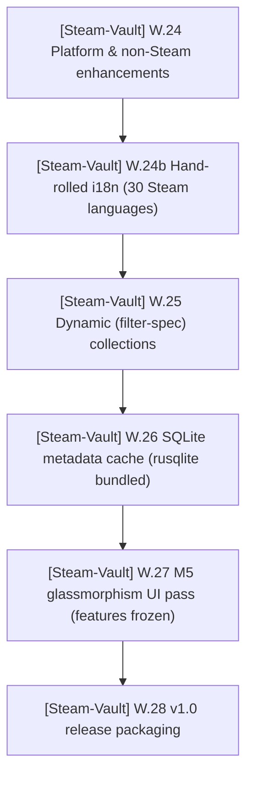

#### 📝 Execution Tasks

1. **[Steam-Vault] W.24 — Platform & non-Steam enhancements**: storefront launch URIs for Epic/itch written as shortcut launch options; per-game platform override command + UI; Microsoft Store / Xbox Game Pass detection; automated log file cleanup in `logger.mjs`; multi-provider game metadata resolver (VNDB, Steam Store search, PCGamingWiki, local engine inspection); organization multi-entity splitting and shortcut metadata wiring; automatic artwork fetching for shortcuts on scan/import; emulator & ROM detection (Dolphin, Mupen64, etc.); high-performance scanner with `sysinfo::Disks` volume resolution, pre-located emulators, and opt-in full-drive scanning.
2. **[Steam-Vault] W.24b — Hand-rolled i18n localization engine**: zero-dependency hand-rolled TypeScript + Svelte reactive `$t` store; full native coverage for all 30 Valve/Steam officially supported languages; parameter interpolation; English fallback; RTL layout support for Arabic; Settings language selector dropdown; view integration across UI.
3. **[Steam-Vault] W.25 — Dynamic (filter-spec) collections**: persist named Allowed/Required/Excluded specs; save/apply/re-apply as smart collections; Organize + Collections UI.
4. **[Steam-Vault] W.26 — SQLite metadata cache**: add `rusqlite` (`bundled`); schema + get/set/migrate; replace the JSON metadata cache with a one-time JSON import.
5. **[Steam-Vault] W.27 — M5 glassmorphism UI pass**: design tokens and a full modern dark glass treatment across every view (done once, after features freeze).
6. **[Steam-Vault] W.28 — v1.0 release packaging**: HELIX squircle branding artwork (app icon + repo social preview), GitHub issue templates, release notes, CHANGELOG v1.0.0, first SemVer tag/release.

> **Ordering rationale:** UI-touching features first so the glassmorphism pass is applied once; the SQLite refactor is backend-only; packaging is last because it depends on frozen features and final docs.

> **Status:** Complete — Sprint 6 fully delivered (W.24 Platform & non-Steam, W.24b Hand-rolled 30-language i18n, W.25 Dynamic smart collections, W.26 SQLite metadata cache, W.27 M5 glassmorphism UI pass, and W.28 v1.0 release packaging). Steam Vault v1.0.0 is complete and verified!

---

### 🚀 [Steam-Vault] Sprint 5: Milestone M4 — Custom Artwork Manager
- **Project Identifier:** `[Steam-Vault]`
- **Repository Path:** `projects/Steam-Vault`
- **Target Component:** `src-tauri/src/steam/artwork.rs` (new), `src-tauri/src/commands.rs`, `src-tauri/src/lib.rs`, `src-tauri/src/steam/mod.rs`, `src-tauri/src/metadata/steamgriddb.rs`; `src/routes/artwork/+page.svelte` (new), `src/routes/+layout.svelte`, `src/lib/{api,types}.ts`; `docs/_docs/Artwork-Management.md` (new), `README.md`, `CHANGELOG.md`

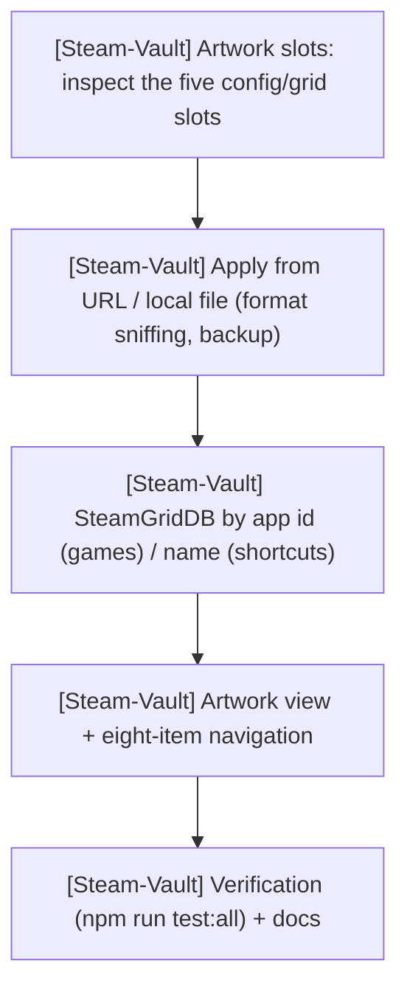

#### 📝 Execution Tasks

1. **[Steam-Vault] Artwork backend** (`steam/artwork.rs`, new):
   - Inspect, apply, and remove Steam's five custom-artwork slots (portrait grid `<appid>p`, landscape
     grid `<appid>`, hero `<appid>_hero`, logo `<appid>_logo`, icon `<appid>_icon`) in
     `userdata/<id3>/config/grid/`.
   - Sniff PNG/JPEG from magic bytes so the correct extension is written; dependency-free base64
     `data:` URL previews; archive the previous image before every overwrite/removal; 7 unit tests.
2. **[Steam-Vault] Commands + wiring**:
   - `get_artwork`, `read_artwork`, `apply_artwork_from_url`, `apply_artwork_from_file`,
     `remove_artwork`, `steamgriddb_for_game`; `lib.rs` registration and `api.ts` / `types.ts` wrappers.
   - Artwork writes are **exempt** from the Steam-must-be-closed guard (Steam repaints `config/grid` live).
3. **[Steam-Vault] SteamGridDB resolution**:
   - Real Steam games resolve by **exact app id** (no search ambiguity); non-Steam shortcuts resolve by
     **name** with an exact-title preference.
4. **[Steam-Vault] Artwork view**:
   - New `src/routes/artwork/+page.svelte` (game list, per-slot cards, SteamGridDB browse, local-file
     import, remove) added to the navigation (**eight items**).
5. **[Steam-Vault] Verification & docs**:
   - `npm run test:all` green: fmt, clippy (`-D warnings`), cargo check, cargo test (**21 tests**),
     svelte-check (0/0), vite build.
   - New `docs/_docs/Artwork-Management.md`; README, CHANGELOG, `_docs`, and `_wiki` accuracy updates.

> **Status (2026-10-14):** Complete — code, tests (21 Rust tests), and docs done; full verification green; **committed and pushed** as `4d49d25` (rustfmt/clippy hygiene) and `4bc8001` (M4).

---

### 🚀 [Steam-Vault] Sprint 4: Milestone M3 — Filter Builder, Non-Steam Sources, Branding & Storage Manager
- **Project Identifier:** `[Steam-Vault]`
- **Repository Path:** `projects/Steam-Vault`
- **Target Component:** `src-tauri/src/steam/storage.rs` (new), `src-tauri/src/commands.rs`, `src-tauri/src/lib.rs`, `src-tauri/src/metadata/steam_store.rs`, `src-tauri/src/platforms/`, `src-tauri/src/settings.rs`; `src/routes/storage/+page.svelte` (new), `src/routes/organize/+page.svelte`, `src/routes/settings/+page.svelte`, `src/routes/+layout.svelte`, `src/lib/{api,types}.ts`; `scripts/test.mjs` + `scripts/lib/suites.mjs` (new), `scripts/lib/{logger,runner}.mjs`, `package.json`

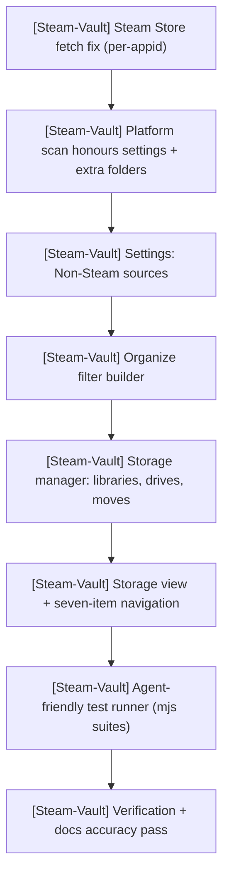

#### 📝 Execution Tasks

1. **[Steam-Vault] Metadata + platform fixes**:
   - Steam Store fetch is per-app id with bounded concurrency (fixes the HTTP 400 from comma-joined `appids`).
   - Platform scan honours per-platform enable flags, extra folders, and all mounted drives (`ScanConfig`).
2. **[Steam-Vault] Settings & Organize UI**:
   - Settings gains **Non-Steam sources** (per-launcher toggles + extra folders).
   - Organize gains the Depressurizer-style **Allowed / Required / Excluded** filter builder with a live match count.
3. **[Steam-Vault] Storage manager (end-to-end)**:
   - New `steam/storage.rs`: report disks, libraries, and game placement/sizes; register/unregister
     libraries; move a game or a whole library between drives, rewriting **every** `libraryfolders.vdf`
     with backups and a Steam-closed guard; throttled `storage-progress` events.
   - Seven Tauri commands, `api.ts` / `types.ts` wrappers, and a new **Storage** view (drive overview,
     per-library cards, searchable game list, move previews) added to the navigation.
4. **[Steam-Vault] Agent-friendly test runner**:
   - `scripts/test.mjs` + `scripts/lib/suites.mjs` run named suites (`fmt`, `clippy`, `check`, `rust`,
     `frontend`, `build`, `all`) directly, with stdin closed, a per-step timeout, transcripts, and a
     PASS/FAIL summary; wired to `npm test`, `test:rust`, `test:frontend`, `test:all`, `verify`.
5. **[Steam-Vault] Verification & docs**:
   - `npm test` PASS (cargo check, cargo test — 12 tests, svelte-check 0/0); `vite build` PASS.
   - Docs accuracy pass across README, CONTRIBUTING, `docs/_docs`, and `docs/_wiki`.

> **Status (2026-10-14):** Implementation, tests, and docs complete; full verification green; **committed and pushed** as four M3 commits (`d6b9c84`, `ba67c23`, `292ca5d`, `992be3c`).

---

### 🚀 [Ecosystem] Sprint: Agent Workflow Skills & Rules Expansion
- **Project Identifier:** `[Ecosystem]`
- **Repository Path:** Workspace Root (`D:\Projects\GitHub\HELIX Origin`)
- **Target Component:** `.agents/skills/`, `.agents/rules/`, `AGENTS.md`

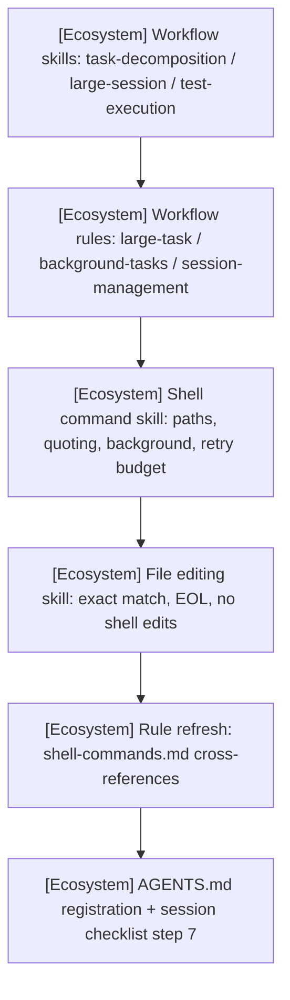

#### 📝 Execution Tasks

1. **[Ecosystem] Workflow skills & rules**
   - Skills: `task-decomposition.md`, `large-session-management.md`, `test-execution.md`.
   - Rules: `large-task-handling.md`, `background-tasks.md`, `session-management.md`.
2. **[Ecosystem] Shell command management skill** — `shell-command-management.md`:
   - PowerShell contract, path quoting, `workdir` over `cd`, Unix→PowerShell table, no `&&`,
     `git -C`, background execution, output discipline, and a 2-retry budget.
3. **[Ecosystem] File editing skill** — `file-editing.md`:
   - Read-before-edit, exact/unique `oldString`, `replaceAll`, EOL preservation, no shell edits,
     and a 2-retry escalation (re-read → narrow anchor → `write`).
4. **[Ecosystem] Registration & rule refresh**
   - Expand `shell-commands.md`; update `AGENTS.md` quick-reference + session checklist step 7.
5. **[Ecosystem] Remaining**
   - None — committed and pushed (`76feb66`).

> **Status (2026-10-14):** Authored, registered, committed, and pushed (`76feb66`).

---

### 🚀 [Steam-Vault] Sprint 3: Developer Tooling — Logged Command Scripts & Metadata Cache Warming
- **Project Identifier:** `[Steam-Vault]`
- **Repository Path:** `projects/Steam-Vault`
- **Target Component:** `scripts/` (`lib/logger.mjs`, `lib/runner.mjs`, `dev.mjs`, `build.mjs`, `run.mjs`), `logs/`, `package.json`; `src-tauri/src/commands.rs`, `src-tauri/src/metadata/steam_store.rs`, `src/routes/organize/+page.svelte`

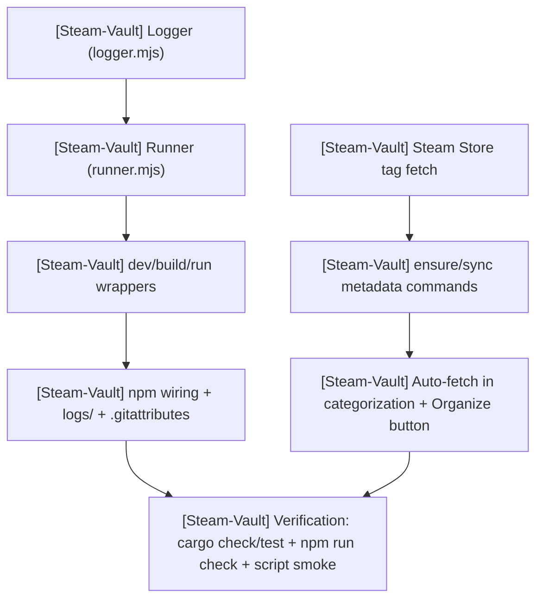

#### 📝 Execution Tasks

1. **[Steam-Vault] Logged command scripts**:
   - `scripts/lib/logger.mjs` writes a timestamped, ANSI-stripped transcript to `logs/` while the
     runner streams live coloured output to the console.
   - `scripts/lib/runner.mjs` spawns `tauri dev` / `tauri build` (portable CLI path) and arbitrary
     commands, forwards signals, and never overwrites a previous log.
2. **[Steam-Vault] npm integration**:
   - `tauri:dev` / `tauri:build` route through the wrappers; `*:raw` scripts and `npm run log` provide
     escape hatches.
3. **[Steam-Vault] On-demand metadata cache warming**:
   - Fetch Steam Store tags; batch `appdetails`; reuse cached entries; expose `sync_library_metadata`.
   - Auto-fetch during categorization when an enabled rule or kind needs metadata or tags.
4. **[Steam-Vault] Verification**:
   - `npm run check` (0/0), `npm run build`, `cargo check`, `cargo test` (7 passed), and a logging
     smoke test (transcript written, no `DEP0190`).

---

### 🚀 [Steam-Vault] Sprint 2: Milestone M2 — Whole-Library Organizing, Platform Import & Custom Title Bar
- **Project Identifier:** `[Steam-Vault]`
- **Repository Path:** `projects/Steam-Vault`
- **Target Component:** `src-tauri/src/platforms/`, `src-tauri/src/steam/owned.rs`, `src-tauri/src/steam/shortcuts.rs`, `src-tauri/src/autocat.rs`, `src-tauri/src/commands.rs`, `src/` (title bar, Platforms + Organize views)

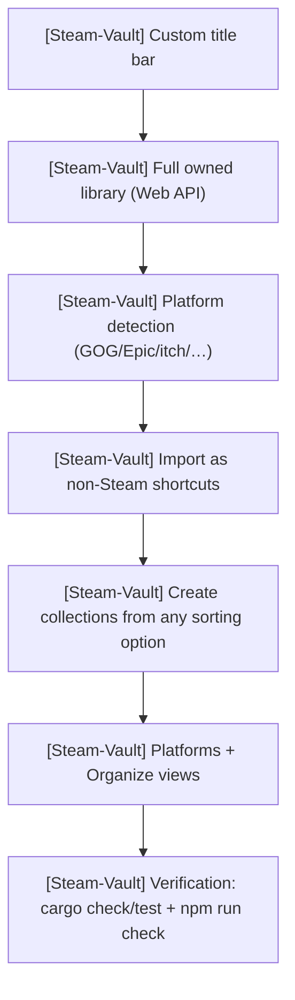

#### 📝 Execution Tasks

1. **[Steam-Vault] Whole-library model**:
   - Cache the Steam Web API's `GetOwnedGames` result and merge it into `load_library`, so
     owned-but-not-installed games are targets for organizing.
   - Annotate shortcuts with their source platform via a persisted appid → platform map.
2. **[Steam-Vault] External platform detection and import**:
   - Detect GOG, Epic Games, itch.io, Amazon Games, Ubisoft Connect, EA, Battle.net, Rockstar, and
     other publishers from local sources only (no scraping, no launcher login).
   - Import selected games into `shortcuts.vdf` with Steam-compatible appids, quoted fields, and
     de-duplication.
3. **[Steam-Vault] Create collections from a sorting option**:
   - Compute a plan (dry run) for any kind — genre, developer, publisher, flag, tag, release year,
     user score, platform, installed state, playtime, name.
   - Apply the plan atomically with one backup; support prefix, installed-only, and
     replace-membership options.
4. **[Steam-Vault] Shell + views**:
   - Frameless custom title bar with platform-aware window controls.
   - New Platforms and Organize views; Library badges for platform and installed state; six-item
     navigation.
5. **[Steam-Vault] Verification**:
   - `npm run check` (0/0), `npm run build`, `cargo check`, `cargo test` (7 passed).

---

### 🚀 [Windhawk-Themes] Sprint 3: Command Center Stability — High-Contrast & explorer.exe Crash Fixes (Rolled Back / External Root Cause)
- **Project Identifier:** `[Windhawk-Themes]`
- **Repository Path:** `projects/Windhawk-Themes`
- **Target Component:** Command Center Suite (`windows-11-start-menu-styler.yml`, `windows-11-taskbar-styler.yml`)

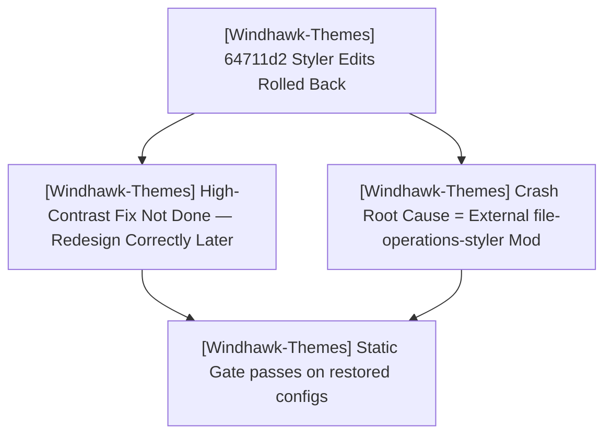

#### 📝 Execution Tasks

1. **[Windhawk-Themes] High-Contrast Neutrality (Start Menu) — not done, pending**:
   - The `64711d2` removal of the `Border#MainMenuHighContrastBorder` / `Border#RightCompanionHighContrastBorder` `Visibility=Collapsed` override was rolled back: it damaged the Start Menu styling (the borders affect normal-mode rendering).
   - Redesign the fix at a later time so the theme never styles high-contrast UI without altering normal glass styling.
2. **[Windhawk-Themes] Random `explorer.exe` Crash During File/Folder Actions — root cause external (confirmed)**:
   - Reproduced via the companion **`file-operations-styler`** Windhawk mod: deleting a folder → "provide administrator permission" prompt → explorer freeze → crash.
   - Not fixable in-repo. Mitigation: disable the mod; user files the report with the Windhawk mods team.
   - The taskbar hypothesis edits from `64711d2` (bare-type flyout/menu target removal + two `RenderTransform` removals) were reverted — not the crash source, and they undid intended styling.
3. **[Windhawk-Themes] Verification**:
   - `tools/Test-WindhawkStyles.ps1` → 0 errors, 0 warnings on the restored configs (met).
   - Target catalog `docs/_wiki/start-menu-styler/targets/elements.md` restored to match the actual config.

> **Post-sprint update (2026-10-13, `f9f228b`):** the user shipped a major Start Menu + Taskbar refactor that (a) renames the token vocabulary (Start: `CornerRadius`/`SearchBoxRadius`/`HoverCornerRadius`/`ElementCornerRadius`/`FlyoutCornerRadius`; Taskbar: `R1`/`R2`/`Height`/`Width` + `ActiveColor`), (b) removes the `*HighContrastBorder` overrides (superseding the Sprint-3 rollback), and (c) makes the taskbar overflow grid transparent. **Follow-up work:** the static gate's 8 duplicate-selector warnings were deduplicated back to **0 errors / 0 warnings**; the docs were **corrected to stay theme-neutral** (the catalogue is the only suite-specific surface — see the new global rule W.16), and `projects/command-center/README.md` was synced to the current configs. See TODO W.15 / W.16 and BUGS.

---

### 🚀 [Windhawk-Themes] Sprint 2: Suite Refinements & Shell Geometry Alignment
- **Project Identifier:** `[Windhawk-Themes]`
- **Repository Path:** `projects/Windhawk-Themes`
- **Target Component:** Command Center Suite (`windows-11-start-menu-styler.yml`, `windows-11-notification-center-styler.yml`, `windows-11-taskbar-styler.yml`)

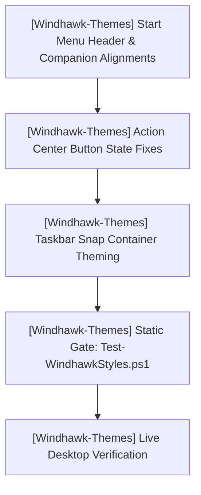

#### 📝 Execution Tasks

1. **[Windhawk-Themes] Start Menu Search & Phone Link Geometry Alignment**:
   - **Top Card Vertical Alignment**: Move Phone Link companion cards up flush with the top of the menu, bringing the search box into horizontal alignment to their left.
   - **Inter-Panel Gap Reduction**: Reduce horizontal spacing between the main content and companion pane.
   - **Search Box & Toggle Sizing**: Align search box left edge flush with pinned apps section; align companion toggle button (`ToggleButton#ShowHideCompanion`) right edge flush with pinned apps section.
2. **[Windhawk-Themes] Notification / Action Center Button Color & Split Button Refinement**:
   - Fix Quick Settings toggle buttons and split buttons (`SplitL2Button`, chevron button, toggle button) where colors are inconsistently applied across states (ref `media_1791431699608_c575da8b.png`).
   - Resolve split-button mismatch where one half displays accent color and the chevron half displays bright high-contrast blue.
   - Ensure unified `$ElementBackground`, `$BorderBrush`, and `$AccentColor` styling across all quick action tiles.
3. **[Windhawk-Themes] Taskbar Snap Layout Containers Theming**:
   - Inspect and theme internal elements of the Snap Layout container (`SnapLayoutControl`, `LayoutBorder`, `LayoutGrid`) with Command Center glass without breaking coordinate calculations.
4. **[Windhawk-Themes] Taskbar System Tray Overflow Grid Glass Background**:
   - Restore frosted glass background (`$Background`), top-lit border (`$BorderBrush`), and matching corner radius to the system tray overflow flyout (`Grid#OverflowRootGrid > Border` and `Border#OverflowFlyoutBackgroundBorder`).

---

## 🔮 Planned Sprints

### 1. [NH-Reader] Post-v0.7.5 / M13 Preparation
- **Project Identifier:** `[NH-Reader]`
- **Repository Path:** `projects/NH-Reader`
- **Scope:**
  - `[NH-Reader]` Tag frequency analytics and local recommendation engine based on reading history.
  - `[NH-Reader]` Multi-profile library partitions (isolated blacklist/favorite spaces).
  - `[NH-Reader]` Background auto-update checker and GitHub release notification toasts.

### 2. [helix-docs] v1.1.0 Feature Cycle
- **Project Identifier:** `[helix-docs]`
- **Repository Path:** `projects/helix-docs`
- **Scope:**
  - `[helix-docs]` Native Mermaid diagram client rendering macro (`components/mermaid.html`).
  - `[helix-docs]` In-page Table of Contents sidebar module resolving `BUG-14`.
  - `[helix-docs]` Dynamic catalogue filtering scripts for software and theme showcases.

### 3. [helix-origin.github.io] Portal v3 Enhancement
- **Project Identifier:** `[helix-origin.github.io]`
- **Repository Path:** `projects/helix-origin.github.io`
- **Scope:**
  - `[helix-origin.github.io]` Live release status widgets dynamically queried via Jekyll GitHub metadata.
  - `[helix-origin.github.io]` Interactive showcase component consuming the `catalogue` layout.

---

## ✅ Completed Sprints & Phases

### ✅ [Steam-Vault] Sprint 1: Milestone M1 — Foundation
- **Project Identifier:** `[Steam-Vault]` · **Path:** `projects/Steam-Vault`
- `[Steam-Vault]` Scaffolded Tauri v2 + SvelteKit (Svelte 5 / strict TS / Vite) with identifiers, window, and CSP.
- `[Steam-Vault]` Text + binary KeyValues parsers with round-trip tests; Steam discovery, library aggregation, and modern collection read/write with backups and a Steam-must-be-closed guard.
- `[Steam-Vault]` Metadata provider layer (Steam Store, Steam Web API, SteamGridDB, IGDB, PCGamingWiki, Wikipedia); RAWG excluded; JSON metadata cache; local settings.
- `[Steam-Vault]` AutoCats engine + Allowed/Required/Excluded filter model; glassmorphism app shell (Dashboard/Library/Collections/Settings).
- `[Steam-Vault]` `docs/` GitHub Pages site on the `helix-docs` remote theme (vCard home, 10 user guides, 8-page wiki, squircle branding) — live at https://helix-origin.github.io/Steam-Vault/ (commit `0475ed9`).

### ✅ [Ecosystem] Stale Agents-Ecosystem Reference Cleanup (Windhawk-Themes, NH-Reader, helix-origin.github.io)
- **Project Identifier:** `[Ecosystem]` · **Path:** Workspace Root + project repos
- `[Ecosystem]` Purged removed local agent ecosystems (`AGENTS.md`, `.agents/`, `check:agents`) and agent-managed folders (`.backups/`, `scratch/`) from Windhawk-Themes and NH-Reader.
- `[Ecosystem]` Removed per-repo ROADMAP/PLAN/TODO/BUGS claims from NH-Reader and Windhawk-Themes docs; tracking stays at workspace root.
- `[Ecosystem]` Cleaned `.agents`/`scratch` Jekyll excludes in Windhawk-Themes, NH-Reader, and helix-origin.github.io and rewrote dead ROADMAP links.

### ✅ [helix-docs] Phases 1–5 & v1.0.0 Initial Release
- **Project Identifier:** `[helix-docs]` · **Path:** `projects/helix-docs` · **Commits:** `90c608b`, `1056904` · **Release:** `v1.0.0`
- `[helix-docs]` **Phase 1: SCSS Architecture**: Reorganized `_sass/` into `support/`, `modules/`, `color_schemes/`, `vendor/`, `custom/`. Precompiled `assets/css/site.css` with Dart Sass (`sass-embedded` 1.105.1; 432 original rules preserved + 5 nested-nav rules).
- `[helix-docs]` **Phase 2: Includes & Layouts**: Mirrored just-the-docs component structure (`header`, `sidebar`, `nav`, `breadcrumbs`, `children_nav`, `footer`, `scripts`). Navigation 100% frontmatter-driven (`parent`, `grand_parent`, `nav_order`, `published`, `nav_exclude`). Deleted obsolete `_data/navigation.yml`.
- `[helix-docs]` **Phase 3: Robustness & Universal Navbar**: Hardcoded 18-language fallback in `translate-control.html`. Fixed Faraday retry (`BUG-5`), title override (`BUG-6`), Liquid subscript filter trap (`BUG-8`). Extracted universal site-wide top navbar (`_includes/components/navbar.html`).
- `[helix-docs]` **Phase 4: Consuming Sites**: Unified `remote_theme: HELIX-Origin/helix-docs` with canonical scopes `{path: "", type: ...}` across all four consuming sites.
- `[helix-docs]` **Phase 5: Release v1.0.0**: Tagged `v1.0.0` with standardized SemVer release notes.

### ✅ [NH-Reader] Sprints 1–16 & Releases v0.1.0 through v0.7.5
- **Project Identifier:** `[NH-Reader]` · **Path:** `projects/NH-Reader` · **Latest Release:** `v0.7.5`
- `[NH-Reader]` **Sprints 1–4 (v0.1.0 – v0.2.1)**: Foundation, Browse, Advanced Search Query Builder, Global Blacklist engine.
- `[NH-Reader]` **Sprints 5–8 (v0.3.0 – v0.5.0)**: SQLite Cache, Responsive Reader, Throttled Background Workers, Native NSIS/WiX installers and isolated `.portable` mode.
- `[NH-Reader]` **Sprints 9–12 (v0.6.0 – v0.7.3)**: 18-Language Localization Core, Storage Budgets & LRU Pruning, Official Archive Downloads, Complete 17 Language Packs, Custom Title Bar with OS glyphs, RTL layout polish.
- `[NH-Reader]` **Sprint 13–16 (v0.7.4 – v0.7.5)**: Blacklist pagination backfill, NSIS installer text legibility fix, unified `npm run sign` script (`scripts/sign.mjs`), squircle website assets (`logo.svg`, `favicon.ico`, `icon.png`).

### ✅ [Windhawk-Themes] Sprints 1 & 1.5
- **Project Identifier:** `[Windhawk-Themes]` · **Path:** `projects/Windhawk-Themes` · **Milestones:** `M.01`, `M.02`
- `[Windhawk-Themes]` **Sprint 1: Governance & Static Gate**: Multi-agent ecosystem rules (Rules 00–09), domain skills, templates, automated validation gate `tools/Test-WindhawkStyles.ps1`.
- `[Windhawk-Themes]` **Sprint 1.5: Notification Center Styler Generation**: Generated `windows-11-notification-center-styler.yml` applying frosted glass, specular rim borders, compact media layouts, and calendar styling.

### ✅ [helix-origin.github.io] Portal Modernization & Artwork Suite
- **Project Identifier:** `[helix-origin.github.io]` · **Path:** `projects/helix-origin.github.io`
- `[helix-origin.github.io]` Standardized portal landing structure on `helix-docs` remote theme.
- `[helix-origin.github.io]` Authored custom 16:9 vector artwork suite (`windhawk-themes.svg`, `nh-reader.svg`, `hentai-senpai-theme.svg`, `helix-docs.svg`).
- `[helix-origin.github.io]` Integrated `helix-docs.svg` into `docs/index.md` project card.

### ✅ [Hentai-Senpai-Multi-DE-Theme] GTK Theme & Remote Docs
- **Project Identifier:** `[Hentai-Senpai-Multi-DE-Theme]` · **Path:** `projects/Hentai-Senpai-Multi-DE-Theme` · **Release:** `v1.0.0`
- `[Hentai-Senpai-Multi-DE-Theme]` Multi-desktop GTK theme installer for GNOME, Cinnamon, XFCE, Budgie, and MATE.
- `[Hentai-Senpai-Multi-DE-Theme]` Authored squircle vector icon assets (`icon.svg`, `logo.ico`, `my-avatar.png`).
- `[Hentai-Senpai-Multi-DE-Theme]` Aligned documentation with `helix-docs` remote theme and frontmatter navigation.
