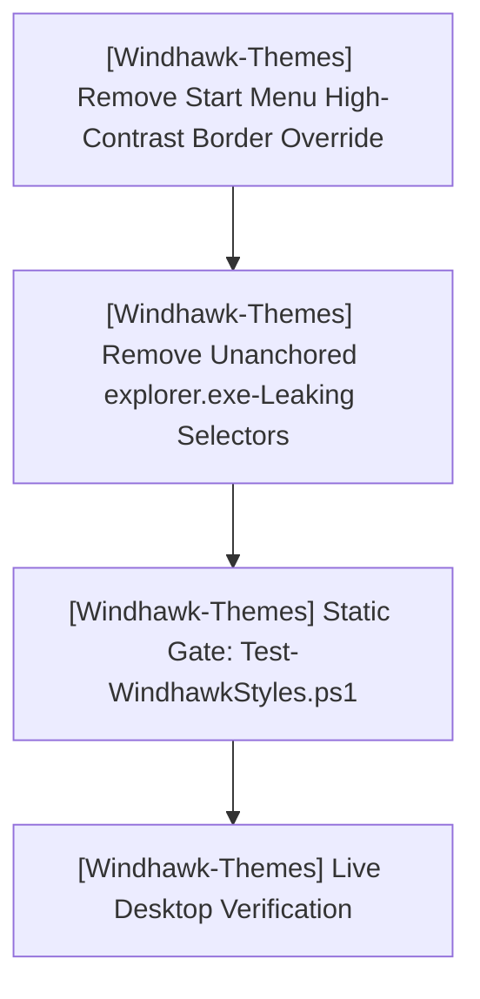
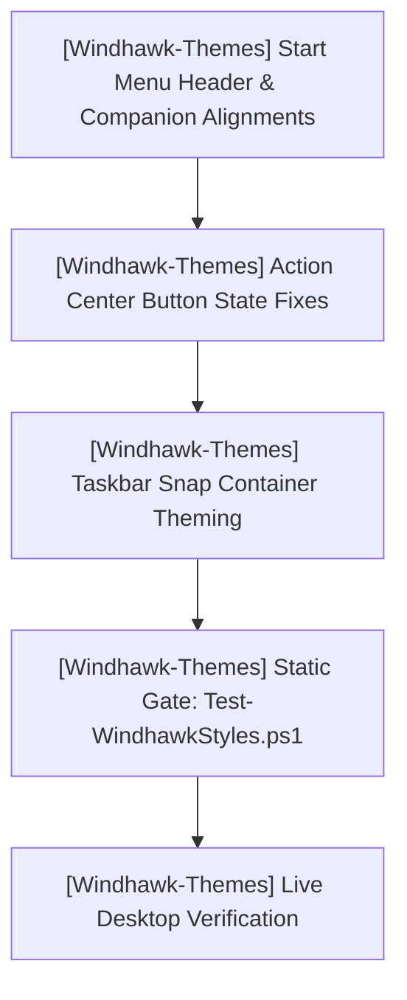

# PLAN.md — HELIX Origin Master Plan & Sprints

> 🎯 **Master Plan**: Active sprint planning, execution architecture, and completed sprint history across all repositories in the **HELIX Origin** organization.
>
> Pair with [`ROADMAP.md`](./ROADMAP.md) (strategic direction), [`TODO.md`](./TODO.md) (executable tasks), and [`BUGS.md`](./BUGS.md) (known issues).
> Last updated: 2026-10-10

---

## 📜 Organizational Tracking Contract

- **Single Pane of Glass:** All repository sprint plans are consolidated here at workspace root.
- **Mandatory Project Tagging Invariant:** Every sprint, workstream, task, and verification command **must explicitly state its project name and repository path** (`[<project-name>] (<project-path>)`). Unscoped items are strictly prohibited so agents never conflate repositories.
- **Active Sprints First:** Ongoing sprint tasks precede completed historical phases.
- **Strict Scope Boundaries:** Repositories belong to the `HELIX-Origin` organization. External directories (`ramensoftware`) are strictly forbidden.

---

## 🎯 Active Sprints

### 🚀 [Windhawk-Themes] Sprint 3: Command Center Stability — High-Contrast & explorer.exe Crash Fixes
- **Project Identifier:** `[Windhawk-Themes]`
- **Repository Path:** `projects/Windhawk-Themes`
- **Target Component:** Command Center Suite (`windows-11-start-menu-styler.yml`, `windows-11-taskbar-styler.yml`)

#### 📝 Execution Tasks

1. **[Windhawk-Themes] High-Contrast Neutrality (Start Menu)**:
   - Remove the `Border#MainMenuHighContrastBorder` / `Border#RightCompanionHighContrastBorder` `Visibility=Collapsed` override so the theme never styles Windows high-contrast UI.
   - Sync `docs/_wiki/start-menu-styler/targets/elements.md`.
2. **[Windhawk-Themes] Random `explorer.exe` Crash During File/Folder Actions (Taskbar)**:
   - Remove the bare-type, unanchored flyout/menu targets (`FlyoutPresenter`, `MenuFlyoutPresenter > Border`, `MenuFlyoutSubItem`) that leaked a `WindhawkBlur` into every `explorer.exe`, including File Explorer context menus/flyouts (Selector Hygiene Rule §2.1).
   - Remove the two no-op `RenderTransform` overrides (`Taskbar.TaskbarExtensionElement`, `Taskbar.TaskListButtonPanel#ExperienceToggleButtonRootPanel`).
3. **[Windhawk-Themes] Verification**:
   - `tools/Test-WindhawkStyles.ps1` → 0 errors, 0 warnings (met).
   - Live desktop verification for both fixes (pending).

---

### 🚀 [Windhawk-Themes] Sprint 2: Suite Refinements & Shell Geometry Alignment
- **Project Identifier:** `[Windhawk-Themes]`
- **Repository Path:** `projects/Windhawk-Themes`
- **Target Component:** Command Center Suite (`windows-11-start-menu-styler.yml`, `windows-11-notification-center-styler.yml`, `windows-11-taskbar-styler.yml`)

#### 📝 Execution Tasks

1. **[Windhawk-Themes] Start Menu Search & Phone Link Geometry Alignment**:
   - **Top Card Vertical Alignment**: Move Phone Link companion cards up flush with the top of the menu, bringing the search box into horizontal alignment to their left.
   - **Inter-Panel Gap Reduction**: Reduce horizontal spacing between the main content and companion pane.
   - **Search Box & Toggle Sizing**: Align search box left edge flush with pinned apps section; align companion toggle button (`ToggleButton#ShowHideCompanion`) right edge flush with pinned apps section.
2. **[Windhawk-Themes] Notification / Action Center Button Color & Split Button Refinement**:
   - Fix Quick Settings toggle buttons and split buttons (`SplitL2Button`, chevron button, toggle button) where colors are inconsistently applied across states (ref `media_1791431699608_c575da8b.png`).
   - Resolve split-button mismatch where one half displays accent color and the chevron half displays bright high-contrast blue.
   - Ensure unified `$ElementBackground`, `$BorderBrush`, and `$AccentColor` styling across all quick action tiles.
3. **[Windhawk-Themes] Taskbar Snap Layout Containers Theming**:
   - Inspect and theme internal elements of the Snap Layout container (`SnapLayoutControl`, `LayoutBorder`, `LayoutGrid`) with Command Center glass without breaking coordinate calculations.
4. **[Windhawk-Themes] Taskbar System Tray Overflow Grid Glass Background**:
   - Restore frosted glass background (`$Background`), top-lit border (`$BorderBrush`), and matching corner radius to the system tray overflow flyout (`Grid#OverflowRootGrid > Border` and `Border#OverflowFlyoutBackgroundBorder`).

---

## 🔮 Planned Sprints

### 1. [NH-Reader] Post-v0.7.5 / M13 Preparation
- **Project Identifier:** `[NH-Reader]`
- **Repository Path:** `projects/NH-Reader`
- **Scope:**
  - `[NH-Reader]` Tag frequency analytics and local recommendation engine based on reading history.
  - `[NH-Reader]` Multi-profile library partitions (isolated blacklist/favorite spaces).
  - `[NH-Reader]` Background auto-update checker and GitHub release notification toasts.

### 2. [helix-docs] v1.1.0 Feature Cycle
- **Project Identifier:** `[helix-docs]`
- **Repository Path:** `projects/helix-docs`
- **Scope:**
  - `[helix-docs]` Native Mermaid diagram client rendering macro (`components/mermaid.html`).
  - `[helix-docs]` In-page Table of Contents sidebar module resolving `BUG-14`.
  - `[helix-docs]` Dynamic catalogue filtering scripts for software and theme showcases.

### 3. [helix-origin.github.io] Portal v3 Enhancement
- **Project Identifier:** `[helix-origin.github.io]`
- **Repository Path:** `projects/helix-origin.github.io`
- **Scope:**
  - `[helix-origin.github.io]` Live release status widgets dynamically queried via Jekyll GitHub metadata.
  - `[helix-origin.github.io]` Interactive showcase component consuming the `catalogue` layout.

---

## ✅ Completed Sprints & Phases

### ✅ [helix-docs] Phases 1–5 & v1.0.0 Initial Release
- **Project Identifier:** `[helix-docs]` · **Path:** `projects/helix-docs` · **Commits:** `90c608b`, `1056904` · **Release:** `v1.0.0`
- `[helix-docs]` **Phase 1: SCSS Architecture**: Reorganized `_sass/` into `support/`, `modules/`, `color_schemes/`, `vendor/`, `custom/`. Precompiled `assets/css/site.css` with Dart Sass (`sass-embedded` 1.105.1; 432 original rules preserved + 5 nested-nav rules).
- `[helix-docs]` **Phase 2: Includes & Layouts**: Mirrored just-the-docs component structure (`header`, `sidebar`, `nav`, `breadcrumbs`, `children_nav`, `footer`, `scripts`). Navigation 100% frontmatter-driven (`parent`, `grand_parent`, `nav_order`, `published`, `nav_exclude`). Deleted obsolete `_data/navigation.yml`.
- `[helix-docs]` **Phase 3: Robustness & Universal Navbar**: Hardcoded 18-language fallback in `translate-control.html`. Fixed Faraday retry (`BUG-5`), title override (`BUG-6`), Liquid subscript filter trap (`BUG-8`). Extracted universal site-wide top navbar (`_includes/components/navbar.html`).
- `[helix-docs]` **Phase 4: Consuming Sites**: Unified `remote_theme: HELIX-Origin/helix-docs` with canonical scopes `{path: "", type: ...}` across all four consuming sites.
- `[helix-docs]` **Phase 5: Release v1.0.0**: Tagged `v1.0.0` with standardized SemVer release notes.

### ✅ [NH-Reader] Sprints 1–16 & Releases v0.1.0 through v0.7.5
- **Project Identifier:** `[NH-Reader]` · **Path:** `projects/NH-Reader` · **Latest Release:** `v0.7.5`
- `[NH-Reader]` **Sprints 1–4 (v0.1.0 – v0.2.1)**: Foundation, Browse, Advanced Search Query Builder, Global Blacklist engine.
- `[NH-Reader]` **Sprints 5–8 (v0.3.0 – v0.5.0)**: SQLite Cache, Responsive Reader, Throttled Background Workers, Native NSIS/WiX installers and isolated `.portable` mode.
- `[NH-Reader]` **Sprints 9–12 (v0.6.0 – v0.7.3)**: 18-Language Localization Core, Storage Budgets & LRU Pruning, Official Archive Downloads, Complete 17 Language Packs, Custom Title Bar with OS glyphs, RTL layout polish.
- `[NH-Reader]` **Sprint 13–16 (v0.7.4 – v0.7.5)**: Blacklist pagination backfill, NSIS installer text legibility fix, unified `npm run sign` script (`scripts/sign.mjs`), squircle website assets (`logo.svg`, `favicon.ico`, `icon.png`).

### ✅ [Windhawk-Themes] Sprints 1 & 1.5
- **Project Identifier:** `[Windhawk-Themes]` · **Path:** `projects/Windhawk-Themes` · **Milestones:** `M.01`, `M.02`
- `[Windhawk-Themes]` **Sprint 1: Governance & Static Gate**: Multi-agent ecosystem rules (Rules 00–09), domain skills, templates, automated validation gate `tools/Test-WindhawkStyles.ps1`.
- `[Windhawk-Themes]` **Sprint 1.5: Notification Center Styler Generation**: Generated `windows-11-notification-center-styler.yml` applying frosted glass, specular rim borders, compact media layouts, and calendar styling.

### ✅ [helix-origin.github.io] Portal Modernization & Artwork Suite
- **Project Identifier:** `[helix-origin.github.io]` · **Path:** `projects/helix-origin.github.io`
- `[helix-origin.github.io]` Standardized portal landing structure on `helix-docs` remote theme.
- `[helix-origin.github.io]` Authored custom 16:9 vector artwork suite (`windhawk-themes.svg`, `nh-reader.svg`, `hentai-senpai-theme.svg`, `helix-docs.svg`).
- `[helix-origin.github.io]` Integrated `helix-docs.svg` into `docs/index.md` project card.

### ✅ [Hentai-Senpai-Multi-DE-Theme] GTK Theme & Remote Docs
- **Project Identifier:** `[Hentai-Senpai-Multi-DE-Theme]` · **Path:** `projects/Hentai-Senpai-Multi-DE-Theme` · **Release:** `v1.0.0`
- `[Hentai-Senpai-Multi-DE-Theme]` Multi-desktop GTK theme installer for GNOME, Cinnamon, XFCE, Budgie, and MATE.
- `[Hentai-Senpai-Multi-DE-Theme]` Authored squircle vector icon assets (`icon.svg`, `logo.ico`, `my-avatar.png`).
- `[Hentai-Senpai-Multi-DE-Theme]` Aligned documentation with `helix-docs` remote theme and frontmatter navigation.
