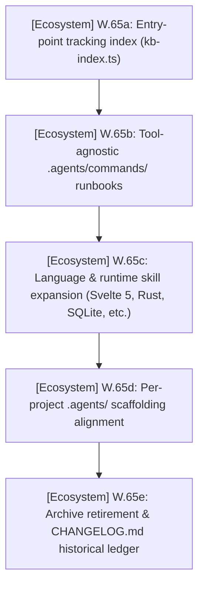
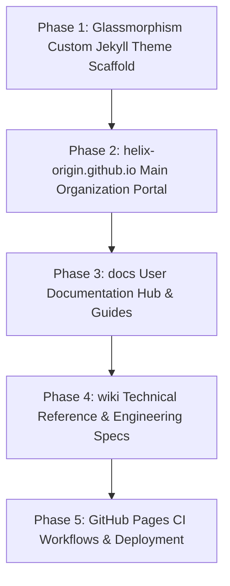

# PLAN.md — Agents Ecosystem Master Plan & Sprints

> 🎯 **Master Plan**: Active sprint planning, execution architecture, and completed sprint history for the **Agents Ecosystem** (`projects/agents`).
>
> Pair with [`ROADMAP.md`](./ROADMAP.md) (ecosystem direction), [`TODO.md`](./TODO.md) (executable tasks), and [`BUGS.md`](./BUGS.md) (known issues).
> Project-specific sprint plans and execution tasks live exclusively in each respective repository (`projects/<repo>/PLAN.md`).
> Historical delivered milestones and changes live in [`CHANGELOG.md`](./CHANGELOG.md).
> Last updated: 2026-10-23

---

## 📜 Tracking Rules

- **Ecosystem Scope Only**: This document tracks sprint planning, execution architecture, and verification exclusively for the generic AI agents framework, rules, skills, templates, and the headless CLI (`scripts/agents-kb/`). Project-scoped sprint plans live strictly inside each project's own repository (`projects/<repo>/PLAN.md`).
- **100% Active Direction Accuracy**: Active sprints and architecture descriptions must always reflect the current, active state of the agents ecosystem with zero contradictions.
- **Active Sprints Only in Top Section**: `## 🎯 Active Sprints` contains ONLY currently active ecosystem sprints. Completed sprints move immediately to `## ✅ Completed Sprints` (newest first).

---

## 🧭 Project Tracking Index

> Entry point to per-project **PLAN** tracking: one line per project (short title + link). Detail lives only in each repository. Regenerate with `npm --prefix scripts run index`; do not edit between the markers.

<!-- project-index:start -->
- **[nh-reader]** — [No active item recorded](./projects/nh-reader/PLAN.md) · _Native C++ Windows desktop reader_
- **[windows-game-explorer]** — [No active item recorded](./projects/windows-game-explorer/PLAN.md) · _Native C++ Windows Game Explorer (File Explorer shell extension & game library)_
- **[theme-toolkit]** — [Sprint 1 — Native Windows C++ Architecture & Rebrand to Theme Studio (v1.0.0, W.01)](./projects/theme-toolkit/PLAN.md) · _Native C++ Windows theme studio & applicator for Windows 2000 to 11+ (Theme Studio)_
- **[depressurizer]** — [Sprint 5 — Native Windows C++ Modernization & UI Polish (v1.0.0, W.05)](./projects/depressurizer/PLAN.md) · _Native C++ Windows Steam categorizer & AutoCat manager (revival fork)_
- **[windhawk-themes]** — [Milestone M.02b: Command Center Suite Polish & Geometry Alignment](./projects/windhawk-themes/PLAN.md) · _Windhawk styler mod themes_
- **[ffxiv-config]** — [Sprint 1 — 8.x Configuration Sync, Media Asset & Governance Alignment](./projects/ffxiv-config/PLAN.md) · _FFXIV HUD, hotbar and macro configuration_
<!-- project-index:end -->

---

## 🎯 Active Sprints

### 🚀 Sprint 35: [Ecosystem] — Per-Project Ecosystem Enhancement, Universal Commands & Skill Expansion (W.65)
- **Project Identifier:** `[Ecosystem]` (`projects/agents`)
- **Target Objective:** Enhance per-project `.agents/` ecosystems to work alongside the global workspace ecosystem; establish tool-agnostic `.agents/commands/` workflow runbooks; expand language and tool skills; transition root tracking ledgers to entry points pointing to per-project files; remove legacy `.opencode/` configurations and `*-ARCHIVE.md` files in favor of living ledgers and `CHANGELOG.md`.



#### 📝 Execution Tasks

1. **[Ecosystem] W.65a — Entry-Point Tracking Index**:
   - Automated project tracking index generation (`kb-index.ts`) in root ledgers (`ROADMAP.md`, `PLAN.md`, `TODO.md`, `BUGS.md`, `HANDOFF.md`).
2. **[Ecosystem] W.65b — Universal Workflow Commands**:
   - Establish `.agents/commands/` containing tool-agnostic runbooks (`onboard.md`, `verify.md`, `fix-bug.md`, `implement-feature.md`, `review-change.md`, `update-docs.md`, `cut-release.md`).
3. **[Ecosystem] W.65c — Skill Library Expansion**:
   - Author domain-specific skills: `svelte5-runes.md`, `rust-patterns.md`, `typescript-esm-scripts.md`, `sqlite-in-app.md`, `sveltekit-frontend.md`, `github-actions-ci.md`.
4. **[Ecosystem] W.65d — Per-Project Agents Alignment**:
   - Ensure per-project `.agents/` directories contain tailored rules, skills, agents, and commands.
5. **[Ecosystem] W.65e — Clean Archive Retirement & Changelog**:
   - Retire `.github/*-ARCHIVE.md` files; maintain living ledgers as concise entry points with `CHANGELOG.md` as the permanent chronological record.

---

## ⏳ Queued Sprints

### 🚀 Sprint 36: [Web & Docs] — Documentation Hubs & Glassmorphism Jekyll Theme Rebuild (v1.3.0, W.66)
- **Target Objective:** Recreate `helix-origin.github.io`, `docs`, and `wiki` repositories from scratch.
- **Architecture & Styling:**
  - Build a custom glassmorphism styled Jekyll theme (`helix-jekyll-theme` rebuilt from scratch) utilizing modern SCSS-first design (frosted glass blur, glowing borders, high-contrast typography, responsive layout).
  - Feature-rich homepage portals for each hub (`helix-origin.github.io` organization landing, `docs` user documentation hub, `wiki` technical reference hub).
  - Extensive, detailed, and theme-neutral documentation covering all active HELIX-Origin projects.



#### 📝 Execution Tasks
1. **[Web & Docs] Phase 1 — Glassmorphism Jekyll Theme Engine**:
   - Rebuild custom Jekyll theme from scratch with Dart Sass SCSS tokens, frosted glass components, responsive portal navigation, and code syntax highlighting.
2. **[Web & Docs] Phase 2 — Organization Portal (`helix-origin.github.io`)**:
   - Recreate repository with homepage portal showcasing all HELIX-Origin projects, direct links, and project badges.
3. **[Web & Docs] Phase 3 — User Documentation Hub (`docs`)**:
   - Recreate repository with homepage portal, quick-start guides, and user manuals for each application.
4. **[Web & Docs] Phase 4 — Technical Wiki Hub (`wiki`)**:
   - Recreate repository with technical architecture specs, schemas, and developer references.
5. **[Web & Docs] Phase 5 — CI/CD & GitHub Pages Deployment**:
   - Setup GitHub Actions workflows for building and deploying each site to GitHub Pages with zero warnings.

---

## ✅ Completed Sprints (Ecosystem Milestones)

### ✅ Sprint 33: [Ecosystem] — Community Health Scaffolding, SQLite Metadata KB, Permanent Handoff & Headless CLI
- **Project Identifier:** `[Ecosystem]` (`projects/agents`)
- ✅ `[Ecosystem]` **W.56 — Community Health Standards & Domain-Neutral Scaffolding**: Authored `.agents/rules/community-health-files.md`, reusable community templates, domain-neutral links (`--docs-url`, `--wiki-url`, `--portal-url`, etc.), and leak protection asserting no foreign/broken URLs across generated files.
- ✅ `[Ecosystem]` **W.57 — SQLite Metadata Knowledge Base (`knowledge.db`)**: Schema migrations `v001`/`v002` (metadata-only artifacts and entries), Query API (`kb-read.ts`), synchronization engine (`kb-sync.ts`), deterministic export (`kb-export.ts`), and invariant validation (`kb-write.ts`). Local-only lifecycle under `scripts/agents-kb/data/`.
- ✅ `[Ecosystem]` **W.58 — Permanent Session Handoff Protocol (`HANDOFF.md`)**: Permanent git-tracked session-state ledger (`.agents/rules/session-handoff.md`), self-monitoring scoreboard, and incremental updates.
- ✅ `[Ecosystem]` **W.59 — Headless CLI Standards & Structured Logging**: Standardized modular TypeScript ESM CLI (`scripts/agents-kb/`), dual extension mechanism (first-class modules vs body files), structured per-run logging to gitignored `logs/`, and automated test runner (`test.ts`).
- ✅ `[Ecosystem]` **W.60 — Project-Local Agents Interoperability & Project-Type Scaffolding**: Binding rule `.agents/rules/project-agents-interoperability.md`, CLI scaffold engine (`kb-scaffold.ts`), and project-type starter suites (`tauri-desktop`, `jekyll-theme`, `node-ts-cli`, `rust-library`, `docs-site`).

---

## 🛠️ Ecosystem Verification Commands

```powershell
# Headless CLI test suite
npm --prefix scripts test

# TypeScript typecheck
npm --prefix scripts run typecheck

# Knowledge base sync & invariant validation
npm --prefix scripts run sync
npm --prefix scripts run validate
```
