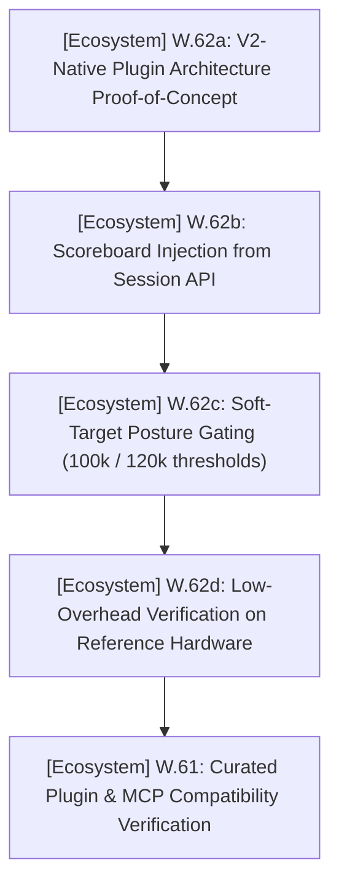
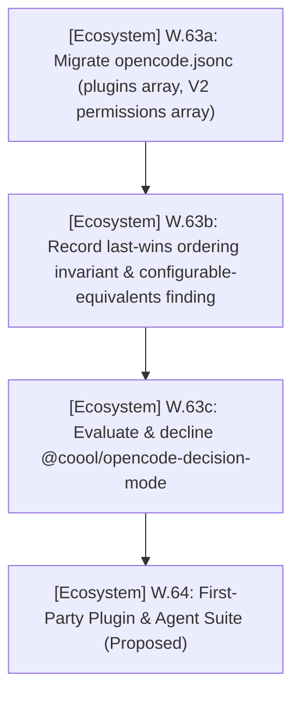

# PLAN.md — Agents Ecosystem Master Plan & Sprints

> 🎯 **Master Plan**: Active sprint planning, execution architecture, and completed sprint history for the **Agents Ecosystem** (`projects/agents`).
>
> Pair with [`ROADMAP.md`](./ROADMAP.md) (ecosystem direction), [`TODO.md`](./TODO.md) (executable tasks), and [`BUGS.md`](./BUGS.md) (known issues).
> Project-specific sprint plans and execution tasks live exclusively in each respective repository (`projects/<repo>/PLAN.md`).
> Historical delivered milestones and archives live in [`.github/`](./.github/).
> Last updated: 2026-10-19

---

## 📜 Tracking Rules

- **Ecosystem Scope Only**: This document tracks sprint planning, execution architecture, and verification exclusively for the generic AI agents framework, rules, skills, templates, and the headless CLI (`scripts/agents-kb/`). Project-scoped sprint plans live strictly inside each project's own repository (`projects/<repo>/PLAN.md`).
- **100% Active Direction Accuracy**: Active sprints and architecture descriptions must always reflect the current, active state of the agents ecosystem with zero contradictions.
- **Active Sprints Only in Top Section**: `## 🎯 Active Sprints` contains ONLY currently active ecosystem sprints. Completed sprints move immediately to `## ✅ Completed Sprints` (newest first).

---

## 🎯 Active Sprints

### 🚀 Sprint 35: [Ecosystem] — OpenCode Context-Pressure Self-Monitoring Plugin (W.62) & Ecosystem Watch (W.61)
- **Project Identifier:** `[Ecosystem]` (`projects/agents`)
- **Target Objective:** Deliver a lightweight, V2-native OpenCode plugin (`.opencode/plugins/` or `scripts/opencode-plugin/`) that auto-injects the context-pressure scoreboard at every checkpoint and gates work at soft-target posture, preventing context overflows. Maintain recurring compatibility watch for OpenCode V2-compatible releases of curated plugins/MCP tools.



#### 📝 Execution Tasks

1. **[Ecosystem] W.62a — V2 Plugin Architecture Proof-of-Concept**:
   - Scaffold minimal V2-native plugin module (`{ id, effect | setup }`).
   - Validate plugin load status in `~/.local/share/opencode/log/opencode.log` with zero runtime errors.
2. **[Ecosystem] W.62b — Scoreboard Injection**:
   - Wire plugin to read token usage, DCP compress count, and substantive turn count.
   - Inject the session-handoff scoreboard automatically at every checkpoint.
3. **[Ecosystem] W.62c — Soft-Target Posture Gating**:
   - At soft posture (100k tokens / 60% of window), restrict allowed agent actions to verification, ledger sync, and `HANDOFF.md` rewrite.
   - Emit clear user-visible notice prompting session transition.
4. **[Ecosystem] W.62d — Performance & Overhead Verification**:
   - Verify minimal memory/CPU footprint (potato-class hardware budget).
5. **[Ecosystem] W.61 — Curated Plugin & MCP Watch**:
   - Periodically re-check `@franlol/opencode-md-table-formatter`, `opencode-agent-skills`, and `opencode-websearch-cited` for V2 releases.
   - Survey new lightweight plugins and MCP servers under strict no-clutter curation rules.

---

### 🚀 Sprint 36: [Ecosystem] — OpenCode Config Modernization & First-Party Plugin Suite (W.63 / W.64)
- **Project Identifier:** `[Ecosystem]` (`projects/agents`)
- **Target Objective:** Modernize the `.opencode` configuration onto current V2 shapes and lock in granular, human-confirmed git gating; then establish a home for the first-party OpenCode plugin & agent suite. Record a declined third-party candidate so it is not re-proposed.



#### 📝 Execution Tasks

1. **[Ecosystem] W.63a — Config Migration (DONE)**:
   - Replace singular `plugin` with the `plugins` array; replace V1 object `permissions` with a V2 `permissions` ARRAY of 51 `{action, resource, effect}` rules.
   - Broad allows FIRST, gated `ask` rules LAST (**last matching rule wins**); verify JSON parses, 2 plugins, 51 rules, 0 CRLF, no legacy `plugin` key.
2. **[Ecosystem] W.63b — Findings & Posture Decision (DONE)**:
   - Record that "auto-expand tool output" does NOT exist in OpenCode (TUI-interactive only); configurable equivalents are `permissions` auto-approve and `session.permissions: "autoaccept"`.
   - Decision: granular `ask` rules, NOT autoaccept (autoaccept/`--auto` would auto-approve the git `ask` rules and undermine invariant #1).
3. **[Ecosystem] W.63c — Candidate Decline (DONE)**:
   - `@coool/opencode-decision-mode`: NOT RECOMMENDED (version skew 0.1.6↔0.1.7, created 2026-10-19, 0 stars/forks/issues/releases, MIT, pre-1.0, off-machine per-record state to third-party runtimes, plugin-API target ^2.0.32 vs client 1.18.29 unverified, orthogonal to the context-bloat problem); nothing added to config.
4. **[Ecosystem] W.64 — First-Party Plugin & Agent Suite (Proposed)**:
   - Handoff-protocol plugin (cross-reference W.58 / W.62; first entry of the suite).
   - Custom reviewer plugin (native HELIX review workflow).
   - SQLite metadata database management & integration plugin (query/maintain the HELIX metadata KB from OpenCode).
   - Open-ended: further first-party plugins/agents that measurably enhance OpenCode capabilities.
   - Framing: the agents ecosystem repo should be a great starting point for anyone needing a unified ecosystem, with per-repo ecosystem scaffolding.

---

## 🧭 Project-Local Sprint Plans Index

> Per-repository active sprints, execution tasks, and backlog items have been completely migrated to each repository's own tracking ledgers under `projects/<repo>/PLAN.md`. See each repository for project-scoped sprint planning:

- **[universal-game-launcher]**: [`projects/universal-game-launcher/PLAN.md`](file:///d:/Projects/GitHub/HELIX%20Origin/projects/universal-game-launcher/PLAN.md)
- **[nh-reader]**: [`projects/nh-reader/PLAN.md`](file:///d:/Projects/GitHub/HELIX%20Origin/projects/nh-reader/PLAN.md)
- **[helix-jekyll-theme]**: [`projects/helix-jekyll-theme/PLAN.md`](file:///d:/Projects/GitHub/HELIX%20Origin/projects/helix-jekyll-theme/PLAN.md)
- **[windhawk-themes]**: [`projects/windhawk-themes/PLAN.md`](file:///d:/Projects/GitHub/HELIX%20Origin/projects/windhawk-themes/PLAN.md)
- **[theme-toolkit]**: [`projects/theme-toolkit/PLAN.md`](file:///d:/Projects/GitHub/HELIX%20Origin/projects/theme-toolkit/PLAN.md)
- **[depressurizer]**: [`projects/depressurizer/PLAN.md`](file:///d:/Projects/GitHub/HELIX%20Origin/projects/depressurizer/PLAN.md)
- **[ffxiv-config]**: [`projects/ffxiv-config/PLAN.md`](file:///d:/Projects/GitHub/HELIX%20Origin/projects/ffxiv-config/PLAN.md)
- **[docs]**: [`projects/docs/PLAN.md`](file:///d:/Projects/GitHub/HELIX%20Origin/projects/docs/PLAN.md)
- **[wiki]**: [`projects/wiki/PLAN.md`](file:///d:/Projects/GitHub/HELIX%20Origin/projects/wiki/PLAN.md)
- **[helix-origin.github.io]**: [`projects/helix-origin.github.io/PLAN.md`](file:///d:/Projects/GitHub/HELIX%20Origin/projects/helix-origin.github.io/PLAN.md)
- **[ugl-db-00]**: [`projects/ugl-db-00/PLAN.md`](file:///d:/Projects/GitHub/HELIX%20Origin/projects/ugl-db-00/PLAN.md)
- **[ugl-db-01..03]**: [`projects/ugl-db-01/PLAN.md`](file:///d:/Projects/GitHub/HELIX%20Origin/projects/ugl-db-01/PLAN.md)
- **[ugl-db-ingest]**: [`projects/ugl-db-ingest/PLAN.md`](file:///d:/Projects/GitHub/HELIX%20Origin/projects/ugl-db-ingest/PLAN.md)

---

## ✅ Completed Sprints (Ecosystem Milestones)

### ✅ Sprint 33: [Ecosystem] — Community Health Scaffolding, SQLite Metadata KB, Permanent Handoff & Headless CLI
- **Project Identifier:** `[Ecosystem]` (`projects/agents`)
- ✅ `[Ecosystem]` **W.56 — Community Health Standards & Domain-Neutral Scaffolding**: Authored `.agents/rules/community-health-files.md`, reusable community templates, domain-neutral links (`--docs-url`, `--wiki-url`, `--portal-url`, etc.), and leak protection asserting no foreign/broken URLs across generated files.
- ✅ `[Ecosystem]` **W.57 — SQLite Metadata Knowledge Base (`knowledge.db`)**: Schema migrations `v001`/`v002` (metadata-only artifacts and entries), Query API (`kb-read.ts`), synchronization engine (`kb-sync.ts`), deterministic export (`kb-export.ts`), and invariant validation (`kb-write.ts`). Local-only lifecycle under `scripts/agents-kb/data/`.
- ✅ `[Ecosystem]` **W.58 — Permanent Session Handoff Protocol (`HANDOFF.md`)**: Permanent git-tracked session-state ledger (`.agents/rules/session-handoff.md`), self-monitoring scoreboard, incremental updates, and DCP compression coexistence.
- ✅ `[Ecosystem]` **W.59 — Headless CLI Standards & Structured Logging**: Standardized modular TypeScript ESM CLI (`scripts/agents-kb/`), dual extension mechanism (first-class modules vs body files), structured per-run logging to gitignored `logs/`, and automated test runner (`test.ts`).
- ✅ `[Ecosystem]` **W.60 — Project-Local Agents Interoperability & Project-Type Scaffolding**: Binding rule `.agents/rules/project-agents-interoperability.md`, CLI scaffold engine (`kb-scaffold.ts`), and project-type starter suites (`tauri-desktop`, `jekyll-theme`, `node-ts-cli`, `rust-library`, `docs-site`).

---

## 🛠️ Ecosystem Verification Commands

```powershell
# Headless CLI test suite
npm --prefix scripts test

# TypeScript typecheck
npm --prefix scripts run typecheck

# Knowledge base sync & invariant validation
npm --prefix scripts run sync
npm --prefix scripts run validate
```
