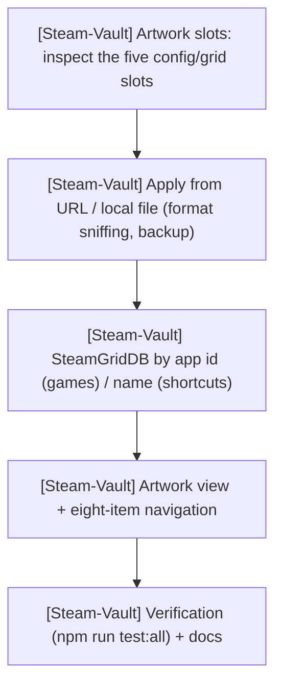
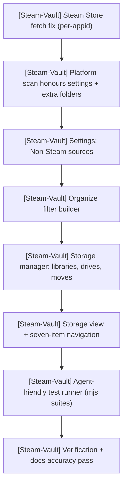
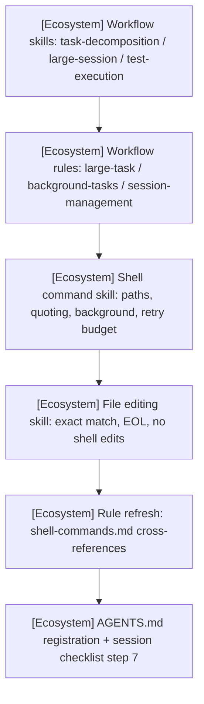
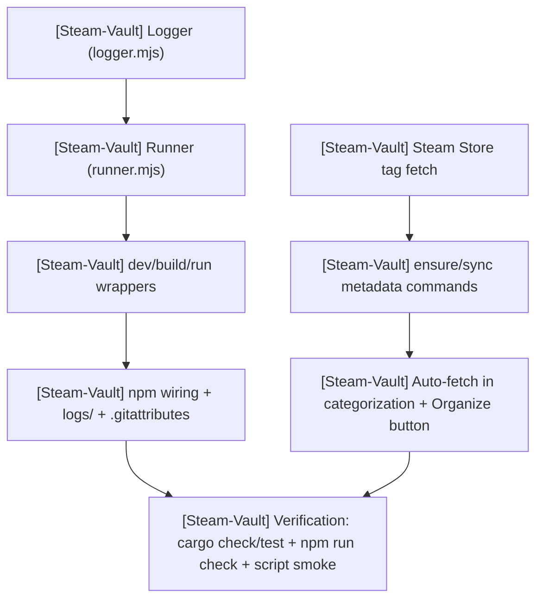
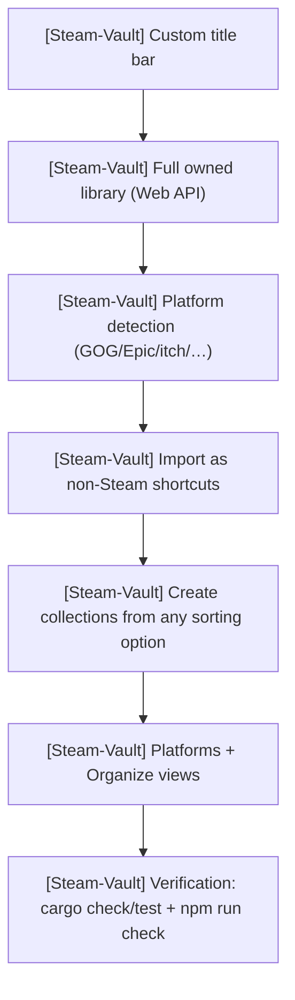
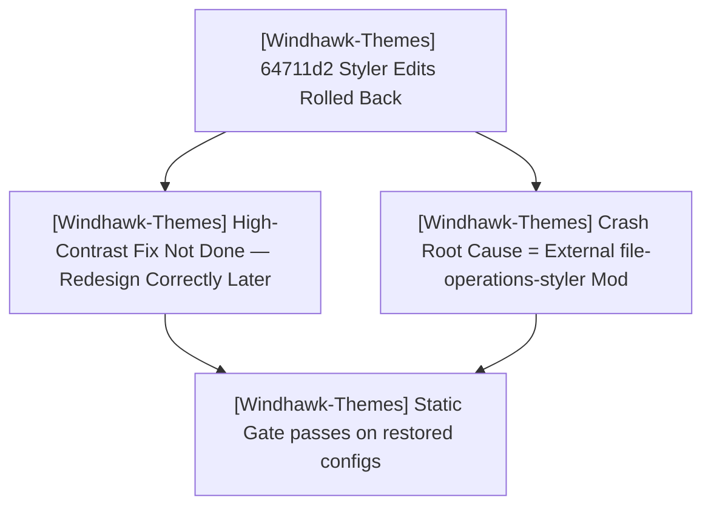
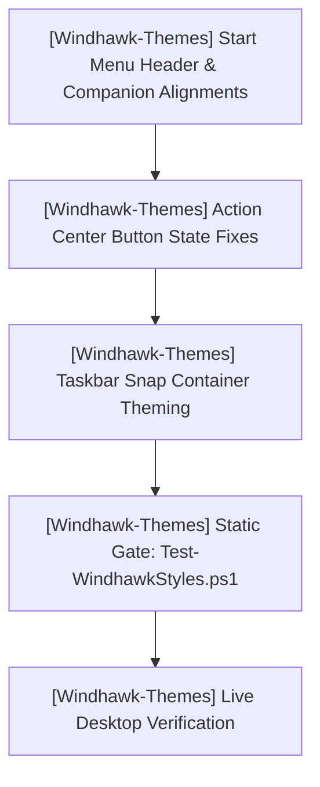

# PLAN.md — HELIX Origin Master Plan & Sprints

> 🎯 **Master Plan**: Active sprint planning, execution architecture, and completed sprint history across all repositories in the **HELIX Origin** organization.
>
> Pair with [`ROADMAP.md`](./ROADMAP.md) (strategic direction), [`TODO.md`](./TODO.md) (executable tasks), and [`BUGS.md`](./BUGS.md) (known issues).
> Last updated: 2026-10-14

---

## 📜 Organizational Tracking Contract

- **Single Pane of Glass:** All repository sprint plans are consolidated here at workspace root.
- **Mandatory Project Tagging Invariant:** Every sprint, workstream, task, and verification command **must explicitly state its project name and repository path** (`[<project-name>] (<project-path>)`). Unscoped items are strictly prohibited so agents never conflate repositories.
- **Active Sprints First:** Ongoing sprint tasks precede completed historical phases.
- **Strict Scope Boundaries:** Repositories belong to the `HELIX-Origin` organization. External directories (`ramensoftware`) are strictly forbidden.

---

## 🎯 Active Sprints

### 🚀 [Steam-Vault] Sprint 5: Milestone M4 — Custom Artwork Manager
- **Project Identifier:** `[Steam-Vault]`
- **Repository Path:** `projects/Steam-Vault`
- **Target Component:** `src-tauri/src/steam/artwork.rs` (new), `src-tauri/src/commands.rs`, `src-tauri/src/lib.rs`, `src-tauri/src/steam/mod.rs`, `src-tauri/src/metadata/steamgriddb.rs`; `src/routes/artwork/+page.svelte` (new), `src/routes/+layout.svelte`, `src/lib/{api,types}.ts`; `docs/_docs/Artwork-Management.md` (new), `README.md`, `CHANGELOG.md`

#### 📝 Execution Tasks

1. **[Steam-Vault] Artwork backend** (`steam/artwork.rs`, new):
   - Inspect, apply, and remove Steam's five custom-artwork slots (portrait grid `<appid>p`, landscape
     grid `<appid>`, hero `<appid>_hero`, logo `<appid>_logo`, icon `<appid>_icon`) in
     `userdata/<id3>/config/grid/`.
   - Sniff PNG/JPEG from magic bytes so the correct extension is written; dependency-free base64
     `data:` URL previews; archive the previous image before every overwrite/removal; 7 unit tests.
2. **[Steam-Vault] Commands + wiring**:
   - `get_artwork`, `read_artwork`, `apply_artwork_from_url`, `apply_artwork_from_file`,
     `remove_artwork`, `steamgriddb_for_game`; `lib.rs` registration and `api.ts` / `types.ts` wrappers.
   - Artwork writes are **exempt** from the Steam-must-be-closed guard (Steam repaints `config/grid` live).
3. **[Steam-Vault] SteamGridDB resolution**:
   - Real Steam games resolve by **exact app id** (no search ambiguity); non-Steam shortcuts resolve by
     **name** with an exact-title preference.
4. **[Steam-Vault] Artwork view**:
   - New `src/routes/artwork/+page.svelte` (game list, per-slot cards, SteamGridDB browse, local-file
     import, remove) added to the navigation (**eight items**).
5. **[Steam-Vault] Verification & docs**:
   - `npm run test:all` green: fmt, clippy (`-D warnings`), cargo check, cargo test (**21 tests**),
     svelte-check (0/0), vite build.
   - New `docs/_docs/Artwork-Management.md`; README, CHANGELOG, `_docs`, and `_wiki` accuracy updates.

> **Status (2026-10-14):** Complete — code, tests (21 Rust tests), and docs done; full verification green; **committed and pushed** as `4d49d25` (rustfmt/clippy hygiene) and `4bc8001` (M4).

---

### 🚀 [Steam-Vault] Sprint 4: Milestone M3 — Filter Builder, Non-Steam Sources, Branding & Storage Manager
- **Project Identifier:** `[Steam-Vault]`
- **Repository Path:** `projects/Steam-Vault`
- **Target Component:** `src-tauri/src/steam/storage.rs` (new), `src-tauri/src/commands.rs`, `src-tauri/src/lib.rs`, `src-tauri/src/metadata/steam_store.rs`, `src-tauri/src/platforms/`, `src-tauri/src/settings.rs`; `src/routes/storage/+page.svelte` (new), `src/routes/organize/+page.svelte`, `src/routes/settings/+page.svelte`, `src/routes/+layout.svelte`, `src/lib/{api,types}.ts`; `scripts/test.mjs` + `scripts/lib/suites.mjs` (new), `scripts/lib/{logger,runner}.mjs`, `package.json`

#### 📝 Execution Tasks

1. **[Steam-Vault] Metadata + platform fixes**:
   - Steam Store fetch is per-app id with bounded concurrency (fixes the HTTP 400 from comma-joined `appids`).
   - Platform scan honours per-platform enable flags, extra folders, and all mounted drives (`ScanConfig`).
2. **[Steam-Vault] Settings & Organize UI**:
   - Settings gains **Non-Steam sources** (per-launcher toggles + extra folders).
   - Organize gains the Depressurizer-style **Allowed / Required / Excluded** filter builder with a live match count.
3. **[Steam-Vault] Storage manager (end-to-end)**:
   - New `steam/storage.rs`: report disks, libraries, and game placement/sizes; register/unregister
     libraries; move a game or a whole library between drives, rewriting **every** `libraryfolders.vdf`
     with backups and a Steam-closed guard; throttled `storage-progress` events.
   - Seven Tauri commands, `api.ts` / `types.ts` wrappers, and a new **Storage** view (drive overview,
     per-library cards, searchable game list, move previews) added to the navigation.
4. **[Steam-Vault] Agent-friendly test runner**:
   - `scripts/test.mjs` + `scripts/lib/suites.mjs` run named suites (`fmt`, `clippy`, `check`, `rust`,
     `frontend`, `build`, `all`) directly, with stdin closed, a per-step timeout, transcripts, and a
     PASS/FAIL summary; wired to `npm test`, `test:rust`, `test:frontend`, `test:all`, `verify`.
5. **[Steam-Vault] Verification & docs**:
   - `npm test` PASS (cargo check, cargo test — 12 tests, svelte-check 0/0); `vite build` PASS.
   - Docs accuracy pass across README, CONTRIBUTING, `docs/_docs`, and `docs/_wiki`.

> **Status (2026-10-14):** Implementation, tests, and docs complete; full verification green; **committed and pushed** as four M3 commits (`d6b9c84`, `ba67c23`, `292ca5d`, `992be3c`).

---

### 🚀 [Ecosystem] Sprint: Agent Workflow Skills & Rules Expansion
- **Project Identifier:** `[Ecosystem]`
- **Repository Path:** Workspace Root (`D:\Projects\GitHub\HELIX Origin`)
- **Target Component:** `.agents/skills/`, `.agents/rules/`, `AGENTS.md`

#### 📝 Execution Tasks

1. **[Ecosystem] Workflow skills & rules**
   - Skills: `task-decomposition.md`, `large-session-management.md`, `test-execution.md`.
   - Rules: `large-task-handling.md`, `background-tasks.md`, `session-management.md`.
2. **[Ecosystem] Shell command management skill** — `shell-command-management.md`:
   - PowerShell contract, path quoting, `workdir` over `cd`, Unix→PowerShell table, no `&&`,
     `git -C`, background execution, output discipline, and a 2-retry budget.
3. **[Ecosystem] File editing skill** — `file-editing.md`:
   - Read-before-edit, exact/unique `oldString`, `replaceAll`, EOL preservation, no shell edits,
     and a 2-retry escalation (re-read → narrow anchor → `write`).
4. **[Ecosystem] Registration & rule refresh**
   - Expand `shell-commands.md`; update `AGENTS.md` quick-reference + session checklist step 7.
5. **[Ecosystem] Remaining**
   - None — committed and pushed (`76feb66`).

> **Status (2026-10-14):** Authored, registered, committed, and pushed (`76feb66`).

---

### 🚀 [Steam-Vault] Sprint 3: Developer Tooling — Logged Command Scripts & Metadata Cache Warming
- **Project Identifier:** `[Steam-Vault]`
- **Repository Path:** `projects/Steam-Vault`
- **Target Component:** `scripts/` (`lib/logger.mjs`, `lib/runner.mjs`, `dev.mjs`, `build.mjs`, `run.mjs`), `logs/`, `package.json`; `src-tauri/src/commands.rs`, `src-tauri/src/metadata/steam_store.rs`, `src/routes/organize/+page.svelte`

#### 📝 Execution Tasks

1. **[Steam-Vault] Logged command scripts**:
   - `scripts/lib/logger.mjs` writes a timestamped, ANSI-stripped transcript to `logs/` while the
     runner streams live coloured output to the console.
   - `scripts/lib/runner.mjs` spawns `tauri dev` / `tauri build` (portable CLI path) and arbitrary
     commands, forwards signals, and never overwrites a previous log.
2. **[Steam-Vault] npm integration**:
   - `tauri:dev` / `tauri:build` route through the wrappers; `*:raw` scripts and `npm run log` provide
     escape hatches.
3. **[Steam-Vault] On-demand metadata cache warming**:
   - Fetch Steam Store tags; batch `appdetails`; reuse cached entries; expose `sync_library_metadata`.
   - Auto-fetch during categorization when an enabled rule or kind needs metadata or tags.
4. **[Steam-Vault] Verification**:
   - `npm run check` (0/0), `npm run build`, `cargo check`, `cargo test` (7 passed), and a logging
     smoke test (transcript written, no `DEP0190`).

---

### 🚀 [Steam-Vault] Sprint 2: Milestone M2 — Whole-Library Organizing, Platform Import & Custom Title Bar
- **Project Identifier:** `[Steam-Vault]`
- **Repository Path:** `projects/Steam-Vault`
- **Target Component:** `src-tauri/src/platforms/`, `src-tauri/src/steam/owned.rs`, `src-tauri/src/steam/shortcuts.rs`, `src-tauri/src/autocat.rs`, `src-tauri/src/commands.rs`, `src/` (title bar, Platforms + Organize views)

#### 📝 Execution Tasks

1. **[Steam-Vault] Whole-library model**:
   - Cache the Steam Web API's `GetOwnedGames` result and merge it into `load_library`, so
     owned-but-not-installed games are targets for organizing.
   - Annotate shortcuts with their source platform via a persisted appid → platform map.
2. **[Steam-Vault] External platform detection and import**:
   - Detect GOG, Epic Games, itch.io, Amazon Games, Ubisoft Connect, EA, Battle.net, Rockstar, and
     other publishers from local sources only (no scraping, no launcher login).
   - Import selected games into `shortcuts.vdf` with Steam-compatible appids, quoted fields, and
     de-duplication.
3. **[Steam-Vault] Create collections from a sorting option**:
   - Compute a plan (dry run) for any kind — genre, developer, publisher, flag, tag, release year,
     user score, platform, installed state, playtime, name.
   - Apply the plan atomically with one backup; support prefix, installed-only, and
     replace-membership options.
4. **[Steam-Vault] Shell + views**:
   - Frameless custom title bar with platform-aware window controls.
   - New Platforms and Organize views; Library badges for platform and installed state; six-item
     navigation.
5. **[Steam-Vault] Verification**:
   - `npm run check` (0/0), `npm run build`, `cargo check`, `cargo test` (7 passed).

---

### 🚀 [Windhawk-Themes] Sprint 3: Command Center Stability — High-Contrast & explorer.exe Crash Fixes (Rolled Back / External Root Cause)
- **Project Identifier:** `[Windhawk-Themes]`
- **Repository Path:** `projects/Windhawk-Themes`
- **Target Component:** Command Center Suite (`windows-11-start-menu-styler.yml`, `windows-11-taskbar-styler.yml`)

#### 📝 Execution Tasks

1. **[Windhawk-Themes] High-Contrast Neutrality (Start Menu) — not done, pending**:
   - The `64711d2` removal of the `Border#MainMenuHighContrastBorder` / `Border#RightCompanionHighContrastBorder` `Visibility=Collapsed` override was rolled back: it damaged the Start Menu styling (the borders affect normal-mode rendering).
   - Redesign the fix at a later time so the theme never styles high-contrast UI without altering normal glass styling.
2. **[Windhawk-Themes] Random `explorer.exe` Crash During File/Folder Actions — root cause external (confirmed)**:
   - Reproduced via the companion **`file-operations-styler`** Windhawk mod: deleting a folder → "provide administrator permission" prompt → explorer freeze → crash.
   - Not fixable in-repo. Mitigation: disable the mod; user files the report with the Windhawk mods team.
   - The taskbar hypothesis edits from `64711d2` (bare-type flyout/menu target removal + two `RenderTransform` removals) were reverted — not the crash source, and they undid intended styling.
3. **[Windhawk-Themes] Verification**:
   - `tools/Test-WindhawkStyles.ps1` → 0 errors, 0 warnings on the restored configs (met).
   - Target catalog `docs/_wiki/start-menu-styler/targets/elements.md` restored to match the actual config.

> **Post-sprint update (2026-10-13, `f9f228b`):** the user shipped a major Start Menu + Taskbar refactor that (a) renames the token vocabulary (Start: `CornerRadius`/`SearchBoxRadius`/`HoverCornerRadius`/`ElementCornerRadius`/`FlyoutCornerRadius`; Taskbar: `R1`/`R2`/`Height`/`Width` + `ActiveColor`), (b) removes the `*HighContrastBorder` overrides (superseding the Sprint-3 rollback), and (c) makes the taskbar overflow grid transparent. **Follow-up work:** the static gate's 8 duplicate-selector warnings were deduplicated back to **0 errors / 0 warnings**; the docs were **corrected to stay theme-neutral** (the catalogue is the only suite-specific surface — see the new global rule W.16), and `projects/command-center/README.md` was synced to the current configs. See TODO W.15 / W.16 and BUGS.

---

### 🚀 [Windhawk-Themes] Sprint 2: Suite Refinements & Shell Geometry Alignment
- **Project Identifier:** `[Windhawk-Themes]`
- **Repository Path:** `projects/Windhawk-Themes`
- **Target Component:** Command Center Suite (`windows-11-start-menu-styler.yml`, `windows-11-notification-center-styler.yml`, `windows-11-taskbar-styler.yml`)

#### 📝 Execution Tasks

1. **[Windhawk-Themes] Start Menu Search & Phone Link Geometry Alignment**:
   - **Top Card Vertical Alignment**: Move Phone Link companion cards up flush with the top of the menu, bringing the search box into horizontal alignment to their left.
   - **Inter-Panel Gap Reduction**: Reduce horizontal spacing between the main content and companion pane.
   - **Search Box & Toggle Sizing**: Align search box left edge flush with pinned apps section; align companion toggle button (`ToggleButton#ShowHideCompanion`) right edge flush with pinned apps section.
2. **[Windhawk-Themes] Notification / Action Center Button Color & Split Button Refinement**:
   - Fix Quick Settings toggle buttons and split buttons (`SplitL2Button`, chevron button, toggle button) where colors are inconsistently applied across states (ref `media_1791431699608_c575da8b.png`).
   - Resolve split-button mismatch where one half displays accent color and the chevron half displays bright high-contrast blue.
   - Ensure unified `$ElementBackground`, `$BorderBrush`, and `$AccentColor` styling across all quick action tiles.
3. **[Windhawk-Themes] Taskbar Snap Layout Containers Theming**:
   - Inspect and theme internal elements of the Snap Layout container (`SnapLayoutControl`, `LayoutBorder`, `LayoutGrid`) with Command Center glass without breaking coordinate calculations.
4. **[Windhawk-Themes] Taskbar System Tray Overflow Grid Glass Background**:
   - Restore frosted glass background (`$Background`), top-lit border (`$BorderBrush`), and matching corner radius to the system tray overflow flyout (`Grid#OverflowRootGrid > Border` and `Border#OverflowFlyoutBackgroundBorder`).

---

## 🔮 Planned Sprints

### 1. [NH-Reader] Post-v0.7.5 / M13 Preparation
- **Project Identifier:** `[NH-Reader]`
- **Repository Path:** `projects/NH-Reader`
- **Scope:**
  - `[NH-Reader]` Tag frequency analytics and local recommendation engine based on reading history.
  - `[NH-Reader]` Multi-profile library partitions (isolated blacklist/favorite spaces).
  - `[NH-Reader]` Background auto-update checker and GitHub release notification toasts.

### 2. [helix-docs] v1.1.0 Feature Cycle
- **Project Identifier:** `[helix-docs]`
- **Repository Path:** `projects/helix-docs`
- **Scope:**
  - `[helix-docs]` Native Mermaid diagram client rendering macro (`components/mermaid.html`).
  - `[helix-docs]` In-page Table of Contents sidebar module resolving `BUG-14`.
  - `[helix-docs]` Dynamic catalogue filtering scripts for software and theme showcases.

### 3. [helix-origin.github.io] Portal v3 Enhancement
- **Project Identifier:** `[helix-origin.github.io]`
- **Repository Path:** `projects/helix-origin.github.io`
- **Scope:**
  - `[helix-origin.github.io]` Live release status widgets dynamically queried via Jekyll GitHub metadata.
  - `[helix-origin.github.io]` Interactive showcase component consuming the `catalogue` layout.

---

## ✅ Completed Sprints & Phases

### ✅ [Steam-Vault] Sprint 1: Milestone M1 — Foundation
- **Project Identifier:** `[Steam-Vault]` · **Path:** `projects/Steam-Vault`
- `[Steam-Vault]` Scaffolded Tauri v2 + SvelteKit (Svelte 5 / strict TS / Vite) with identifiers, window, and CSP.
- `[Steam-Vault]` Text + binary KeyValues parsers with round-trip tests; Steam discovery, library aggregation, and modern collection read/write with backups and a Steam-must-be-closed guard.
- `[Steam-Vault]` Metadata provider layer (Steam Store, Steam Web API, SteamGridDB, IGDB, PCGamingWiki, Wikipedia); RAWG excluded; JSON metadata cache; local settings.
- `[Steam-Vault]` AutoCats engine + Allowed/Required/Excluded filter model; glassmorphism app shell (Dashboard/Library/Collections/Settings).
- `[Steam-Vault]` `docs/` GitHub Pages site on the `helix-docs` remote theme (vCard home, 10 user guides, 8-page wiki, squircle branding) — live at https://helix-origin.github.io/Steam-Vault/ (commit `0475ed9`).

### ✅ [Ecosystem] Stale Agents-Ecosystem Reference Cleanup (Windhawk-Themes, NH-Reader, helix-origin.github.io)
- **Project Identifier:** `[Ecosystem]` · **Path:** Workspace Root + project repos
- `[Ecosystem]` Purged removed local agent ecosystems (`AGENTS.md`, `.agents/`, `check:agents`) and agent-managed folders (`.backups/`, `scratch/`) from Windhawk-Themes and NH-Reader.
- `[Ecosystem]` Removed per-repo ROADMAP/PLAN/TODO/BUGS claims from NH-Reader and Windhawk-Themes docs; tracking stays at workspace root.
- `[Ecosystem]` Cleaned `.agents`/`scratch` Jekyll excludes in Windhawk-Themes, NH-Reader, and helix-origin.github.io and rewrote dead ROADMAP links.

### ✅ [helix-docs] Phases 1–5 & v1.0.0 Initial Release
- **Project Identifier:** `[helix-docs]` · **Path:** `projects/helix-docs` · **Commits:** `90c608b`, `1056904` · **Release:** `v1.0.0`
- `[helix-docs]` **Phase 1: SCSS Architecture**: Reorganized `_sass/` into `support/`, `modules/`, `color_schemes/`, `vendor/`, `custom/`. Precompiled `assets/css/site.css` with Dart Sass (`sass-embedded` 1.105.1; 432 original rules preserved + 5 nested-nav rules).
- `[helix-docs]` **Phase 2: Includes & Layouts**: Mirrored just-the-docs component structure (`header`, `sidebar`, `nav`, `breadcrumbs`, `children_nav`, `footer`, `scripts`). Navigation 100% frontmatter-driven (`parent`, `grand_parent`, `nav_order`, `published`, `nav_exclude`). Deleted obsolete `_data/navigation.yml`.
- `[helix-docs]` **Phase 3: Robustness & Universal Navbar**: Hardcoded 18-language fallback in `translate-control.html`. Fixed Faraday retry (`BUG-5`), title override (`BUG-6`), Liquid subscript filter trap (`BUG-8`). Extracted universal site-wide top navbar (`_includes/components/navbar.html`).
- `[helix-docs]` **Phase 4: Consuming Sites**: Unified `remote_theme: HELIX-Origin/helix-docs` with canonical scopes `{path: "", type: ...}` across all four consuming sites.
- `[helix-docs]` **Phase 5: Release v1.0.0**: Tagged `v1.0.0` with standardized SemVer release notes.

### ✅ [NH-Reader] Sprints 1–16 & Releases v0.1.0 through v0.7.5
- **Project Identifier:** `[NH-Reader]` · **Path:** `projects/NH-Reader` · **Latest Release:** `v0.7.5`
- `[NH-Reader]` **Sprints 1–4 (v0.1.0 – v0.2.1)**: Foundation, Browse, Advanced Search Query Builder, Global Blacklist engine.
- `[NH-Reader]` **Sprints 5–8 (v0.3.0 – v0.5.0)**: SQLite Cache, Responsive Reader, Throttled Background Workers, Native NSIS/WiX installers and isolated `.portable` mode.
- `[NH-Reader]` **Sprints 9–12 (v0.6.0 – v0.7.3)**: 18-Language Localization Core, Storage Budgets & LRU Pruning, Official Archive Downloads, Complete 17 Language Packs, Custom Title Bar with OS glyphs, RTL layout polish.
- `[NH-Reader]` **Sprint 13–16 (v0.7.4 – v0.7.5)**: Blacklist pagination backfill, NSIS installer text legibility fix, unified `npm run sign` script (`scripts/sign.mjs`), squircle website assets (`logo.svg`, `favicon.ico`, `icon.png`).

### ✅ [Windhawk-Themes] Sprints 1 & 1.5
- **Project Identifier:** `[Windhawk-Themes]` · **Path:** `projects/Windhawk-Themes` · **Milestones:** `M.01`, `M.02`
- `[Windhawk-Themes]` **Sprint 1: Governance & Static Gate**: Multi-agent ecosystem rules (Rules 00–09), domain skills, templates, automated validation gate `tools/Test-WindhawkStyles.ps1`.
- `[Windhawk-Themes]` **Sprint 1.5: Notification Center Styler Generation**: Generated `windows-11-notification-center-styler.yml` applying frosted glass, specular rim borders, compact media layouts, and calendar styling.

### ✅ [helix-origin.github.io] Portal Modernization & Artwork Suite
- **Project Identifier:** `[helix-origin.github.io]` · **Path:** `projects/helix-origin.github.io`
- `[helix-origin.github.io]` Standardized portal landing structure on `helix-docs` remote theme.
- `[helix-origin.github.io]` Authored custom 16:9 vector artwork suite (`windhawk-themes.svg`, `nh-reader.svg`, `hentai-senpai-theme.svg`, `helix-docs.svg`).
- `[helix-origin.github.io]` Integrated `helix-docs.svg` into `docs/index.md` project card.

### ✅ [Hentai-Senpai-Multi-DE-Theme] GTK Theme & Remote Docs
- **Project Identifier:** `[Hentai-Senpai-Multi-DE-Theme]` · **Path:** `projects/Hentai-Senpai-Multi-DE-Theme` · **Release:** `v1.0.0`
- `[Hentai-Senpai-Multi-DE-Theme]` Multi-desktop GTK theme installer for GNOME, Cinnamon, XFCE, Budgie, and MATE.
- `[Hentai-Senpai-Multi-DE-Theme]` Authored squircle vector icon assets (`icon.svg`, `logo.ico`, `my-avatar.png`).
- `[Hentai-Senpai-Multi-DE-Theme]` Aligned documentation with `helix-docs` remote theme and frontmatter navigation.
