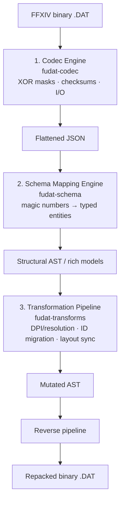
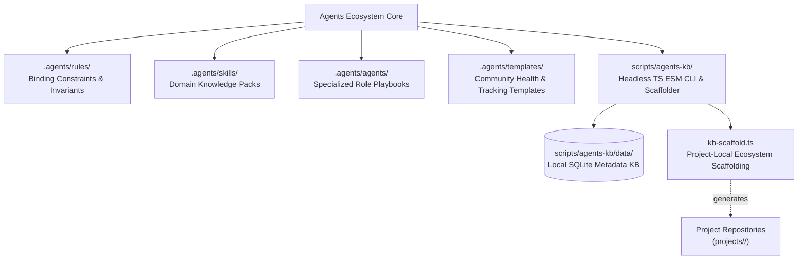

# Agents Ecosystem — Strategic Roadmap & Milestones

> 🗺️ **Living Source of Truth**: Architecture, milestone matrix, and strategic direction for the **Agents Ecosystem** (`projects/agents`).
>
> Pair with [`PLAN.md`](./PLAN.md) (sprint execution), [`TODO.md`](./TODO.md) (executable tasks), and [`BUGS.md`](./BUGS.md) (known issues).
> Project-specific roadmaps and milestones live exclusively within each project's own repository (`projects/<repo>/ROADMAP.md`).
> Historical delivered milestones and changes live in [`CHANGELOG.md`](./CHANGELOG.md).
> Last updated: 2026-10-26

---

## 📜 Tracking Rules

- **Ecosystem Scope Only**: This document tracks the strategic direction, architectural tiers, and milestone releases of the generic AI agents framework, rules, skills, templates, and CLI toolchain. Projects developed with this framework maintain their own independent `ROADMAP.md` inside their repository root.
- **100% Active Direction Accuracy**: Reflect the current, active architecture of the agents ecosystem with zero contradictions.
- **Universal Semantic Versioning Invariant**: The ecosystem strictly adheres to Semantic Versioning (`vMAJOR.MINOR.PATCH`).

---

## 🧭 Project Tracking Index

> Entry point to per-project **ROADMAP** tracking: one line per project (short title + link). Detail lives only in each repository. Regenerate with `npm --prefix scripts run index`; do not edit between the markers.

<!-- project-index:start -->
- **[nh-reader]** — [No active item recorded](./projects/nh-reader/ROADMAP.md) · _nhentai.net desktop reader (Tauri v2 today; native Win32 + Direct2D v1.0.0 rewrite planned)_
- **[windows-game-explorer]** — [Milestone M20: Catalogue Details Pane, Per-Game Update Checker, Notification Flyout & Studio Overhaul (v2.7.0 released)](./projects/windows-game-explorer/ROADMAP.md) · _Native C++ Windows Game Explorer (File Explorer shell extension & game library)_
- **[theme-toolkit]** — [Milestone M1: Native Windows C++ Architecture & Rebrand to Theme Studio (v1.0.0)](./projects/theme-toolkit/ROADMAP.md) · _Native C++ Windows theme studio & applicator for Windows 2000 to 11+ (Theme Studio)_
- **[depressurizer]** — [Milestone M5: Native Windows C++ Modernization & UI Polish (v1.0.0)](./projects/depressurizer/ROADMAP.md) · _Native C++ Windows Steam categorizer & AutoCat manager (revival fork)_
- **[windhawk-themes]** — [Milestone M1: Foundation & Scaffolding](./projects/windhawk-themes/ROADMAP.md) · _Windhawk styler mod themes_
- **[ffxiv-config]** — [Milestone M2: Dawntrail 8.x Config & Governance](./projects/ffxiv-config/ROADMAP.md) · _FFXIV HUD, hotbar and macro configuration_
- **[ffxiv-dat-toolkit]** — [ROADMAP.md](./projects/ffxiv-dat-toolkit/ROADMAP.md) _(repository not cloned locally)_ · _FFXIV DAT toolkit (decode, transform and repack character/config .DAT files)_
<!-- project-index:end -->

---

## 🆕 Planned Org Projects

> Projects that have a locked direction but no repository yet. The full specification lives in
> [`PLAN.md`](./PLAN.md) (queued sprint) and [`TODO.md`](./TODO.md) (executable checklist); the
> section below records only the architecture and scope boundaries. A repository is scaffolded
> before any code is written, after which the project's own ledgers become authoritative.

### [ffxiv-dat-toolkit] (projects/ffxiv-dat-toolkit) — FFXIV DAT Toolkit (`fudat`)

A Final Fantasy XIV–only utility suite that decodes, parses, programmatically transforms and
repacks the game's character and client configuration `.DAT` files (macros, keybinds, hotbars,
addon layout). It is scoped to FFXIV's file formats and is **not** a generic game-file toolkit.



- **Decoupling invariant**: raw binary handling (codec) never knows game semantics; semantics live
  only in the schema engine; user-facing operations live only in the transformation engine. Each
  stage round-trips through a Git-diffable JSON document.
- **Scope boundary**: character and client configuration files only (MACRO, KEYBIND, HOTBAR,
  ADDON). No game-content, model, texture, or network-protocol editing.
- **Delivery phases**: (1) codec + byte-parity round-trip tests, (2) schema definitions and
  serialization, (3) CLI `dump` / `pack` / `transform` pipelines, (4) write safety, backups and
  retail-variant verification.
- **Hard constraints**: FFXIV rejects modified blocks whose length offsets or trailing checksums are
  not recalculated, so byte-parity CI is mandatory; schema binding must tolerate expansion-era
  structural changes; all string payloads are UTF-8 and must never be truncated.

---

## 🔭 Agents Ecosystem Vision & Architecture

The **Agents Ecosystem** is a standalone, open-source AI governance, paired-programming framework, and project scaffolding engine. It provides autonomous and paired coding assistants with strict binding constraints, domain expertise, project starter suites, and execution tracking tools.



### Core Architecture Pillars

1. 🛡️ **Absolute Invariants & Safety**: Strict rules against unauthorized repository mutations (`git-operations.md`), unverified code releases, lingering compiler warnings, and security leaks.
2. 🧠 **Continuous Session Memory**: Permanent session-state ledgers (`HANDOFF.md`) and living tracking files (`ROADMAP.md`, `PLAN.md`, `TODO.md`, `BUGS.md`) ensuring seamless multi-session continuity and zero context drift.
3. 🛠️ **Headless CLI & Scaffolding Engine**: Modular, extensible TypeScript CLI (`scripts/agents-kb/`) supporting dual extension mechanisms (first-class TS modules and pluggable body files), local SQLite metadata caching, and engine-tailored project scaffolding (`tauri-desktop`, `jekyll-theme`, `node-ts-cli`, `rust-library`, `docs-site`).
4. 🌐 **Zero Project Pollution**: Complete isolation between the generic global agents framework and individual project codebases. Project-specific roadmaps, tasks, and bugs live solely in per-project repositories.

---

## 🗺️ Ecosystem Milestone Matrix

| Release Milestone | Focus Area | Status | Deliverables & Scope |
|---|---|---|---|
| **v1.0.0** | Core Governance & Roles | ✅ Shipped | Baseline rules, skills, templates, role playbooks, and multi-session tracking protocols. |
| **v1.1.0** | Headless CLI & Scaffolding Engine | ✅ Shipped | Modular TypeScript ESM CLI, dual extension mechanism, SQLite metadata knowledge base (`knowledge.db`), domain-neutral scaffolding engine (`kb-scaffold.ts`), and project-type starter suites. |
| **v1.2.0** | Universal Agents & Tool-Agnostic Workflows | 🚀 Active | Tool-agnostic workflow runbooks (`.agents/commands/`), expanded language/tool skill library, per-project `.agents/` scaffolding across all org projects, entry-point tracking index generator, and living ledger hygiene. |
| **v1.3.0** | Documentation & Web Hubs Rebuild | ⏳ Planned | Create `helix-jekyll-theme` first to host the custom glassmorphism styled Jekyll theme, followed by rebuilding `helix-origin.github.io`, `docs`, and `wiki` repositories from scratch with homepage portals for each site and extensive, detailed documentation and technical wiki. |
| **v1.4.0** | Multi-Model & Toolchain Federation | 🔮 Backlog | Pluggable LLM tool adapters, schema validation pipelines, and automated multi-repo secret synchronization helpers. |
| **v1.5.0** | Automated Ecosystem Synchronization | 🔮 Backlog | Automated cross-repository consistency linters, schema validators, and ecosystem health checks in GitHub Actions CI. |

---

## 🚀 Active Ecosystem Tracks

- **Web Ecosystem & Documentation Rebuild**: Building `helix-jekyll-theme` first to host the custom glassmorphism Jekyll theme, then recreating `helix-origin.github.io`, `docs`, and `wiki` from scratch featuring homepage portals for each hub and comprehensive documentation.
- **Scaffolding & Templates Engine**: Continuous refinement of engine starter templates (`bodies/scaffold/`) with domain-neutral links, GitHub-flavored mermaid diagrams, and configurable licensing.
- **Tool-Agnostic Workflow Runbooks**: Standardizing executable runbooks under `.agents/commands/` (`onboard`, `verify`, `fix-bug`, `implement-feature`, `review-change`, `update-docs`, `cut-release`) ensuring every AI assistant operates consistently.
- **Local SQLite Metadata Knowledge Base**: Maintenance of the local-only `knowledge.db` registry for artifact indexing, fast reference lookup, and invariant assertion.
- **OpenCode Configuration Layer**: Keeping the root and per-project `.opencode/` folders behaviourally identical — Big Pickle as the only permitted model (`model` + `policies` + catalog-filtering plugin), context-budget management (compaction, tool-output and media caps), git-mutation prompts, and OpenCode operating protocols that never relax an `.agents/` rule.

---

## 📁 Project-Local Roadmaps

When managing individual projects with this framework, each project repository contains its own self-contained `ROADMAP.md` generated by the scaffolder:

```powershell
npm --prefix scripts/agents-kb run scaffold -- --type <tauri-desktop|jekyll-theme|node-ts-cli|rust-library|docs-site> --path projects/<project-name>
```

Refer to each project repository for project-scoped product direction, feature roadmaps, and release milestones.
