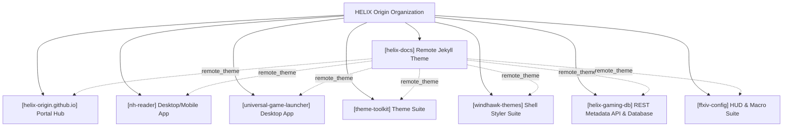
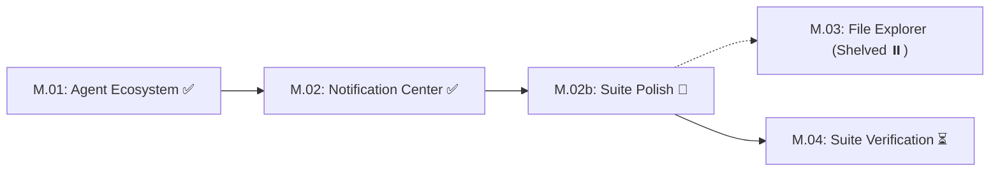

# HELIX Origin — Organization Roadmap & Milestones

> 🗺️ **Living Source of Truth**: Unified organizational roadmap, multi-project milestone matrix, and long-term product direction across all repositories under **HELIX Origin**.
>
> Pair with [`PLAN.md`](./PLAN.md) (sprint execution), [`TODO.md`](./TODO.md) (task ledger), and [`BUGS.md`](./BUGS.md) (open issues and quirks).
> Delivered historical milestone records live in [`.github/ROADMAP-ARCHIVE.md`](./.github/ROADMAP-ARCHIVE.md).
> Last updated: 2026-10-16

---

## 📜 Organizational Tracking Contract

- **Single Pane of Glass:** All repository roadmaps, sprints, tasks, and bugs are synchronized here at workspace root.
- **Mandatory Project Tagging Invariant:** Every tracked milestone, sprint, task, bug, and backlog candidate **must explicitly state its project name and repository path** (`[<project-name>] (<project-path>)`). Unscoped items are strictly prohibited so agents never conflate repositories.
- **Active Milestones First:** Active workstreams and upcoming milestones must always precede completed historical records.
- **Strict Typing:** Differentiate explicitly between **SemVer repositories** (`helix-docs`, `NH-Reader`, `Universal-Game-Launcher`, `Theme-Toolkit`) and **Milestone/Sprint-tracked repositories** (`Windhawk-Themes`, `helix-origin.github.io`).
- **No Stale Ledgers:** Updates to roadmap milestones must occur before or alongside code and configuration changes.

---

## 🔭 Organization Vision & Architecture

1. 🎨 **Unified Design Tokens**: A cohesive dark obsidian aesthetic (`#07111f` / `#0d1b2d`) with cyan (`#48d8f2`) and purple (`#b06cff`) accents across documentation, desktop apps, and OS styling suites.
2. 🚀 **Zero-Install Remote Documentation**: All organizational web properties consume `HELIX-Origin/helix-docs` via GitHub Pages without local build duplication or hardcoded navigation data.
3. 🔒 **Privacy & Local Independence**: User-facing clients operate 100% on-device (local SQLite, zero forced telemetry, self-contained runtimes).

---

## 🗺️ Master Milestone & Project Status Matrix

| Project Identifier | Target Repository Path | Tracking Model | Current Milestone / Release | Status | Primary Focus |
|---|---|---|---|---|---|
| **[helix-docs]** | `projects/helix-docs` | SemVer | [v1.0.0](https://github.com/HELIX-Origin/helix-docs/releases/tag/v1.0.0) | ✅ Shipped | Frontmatter nav engine, modular cards, universal navbar |
| **[helix-origin.github.io]** | `projects/helix-origin.github.io` | Rolling Sprints | Portal v2 | 🚀 Active | 16:9 vector artwork integration, project showcase cards |
| **[nh-reader]** | `projects/nh-reader` | SemVer | [v0.7.5](https://github.com/HELIX-Origin/nh-reader/releases/tag/v0.7.5) | 🚀 Active | M13: Unified `.mjs` scripts architecture, main:sub:option command hierarchy, local code signing |
| **[windhawk-themes]** | `projects/windhawk-themes` | Milestones | Milestone M.02b | 🚀 Active | Suite polish: Start Menu alignments, Quick Settings split buttons |
| **[universal-game-launcher]** | `projects/universal-game-launcher` | SemVer | [v1.4.0](https://github.com/HELIX-Origin/universal-game-launcher) | 🚀 Active | M14: Universal Game Launcher Rebranding, Steam/GOG UI, Native In-App Modular Plugins Framework, Generic SQLite Persistence & Modern Visual Identity |
| **[theme-toolkit]** | `projects/theme-toolkit` | SemVer | [v0.1.0-alpha](https://github.com/HELIX-Origin/theme-toolkit) | 🚀 Active | M1: Framework scaffolded, Per-Platform Lib isolation, native packaging blueprints |
| **[helix-gaming-db]** | `projects/helix-gaming-db` | SemVer | [v1.0.0](https://github.com/HELIX-Origin/helix-gaming-db) | 🚀 Active | M1: REST API v1 endpoints (`manifest`, `search`, `games`, `developers`), GitHub Pages deployment, `helix-docs` portal & wiki |
| **[ffxiv-config]** | `projects/ffxiv-config` | Rolling Releases | [v1.0.0](https://github.com/HELIX-Origin/ffxiv-config) | 🚀 Active | Information-dense HUD, hotbars, job macros, and FFC integration |

---

## 🚀 Active Project Roadmaps

### 1. [windhawk-themes] — Command Center Suite
*Target Path: `projects/windhawk-themes` · Windows 11 Shell Theming Framework*

- **[windhawk-themes] Milestone M.02b: Suite Polish & Geometry Alignment (ACTIVE):**
  - **Start Menu Geometry**: Phone Link companion cards aligned flush with menu top; search box left edge flush with pinned apps card; companion toggle button right edge flush with pinned apps card.
  - **Action Center Quick Settings**: Harmonize split-button toggle and chevron backgrounds (`SplitL2Button`); eliminate high-contrast blue fallback states.
  - **Taskbar Snap Layout Containers**: Theme internal snap containers (`SnapLayoutControl`, `LayoutBorder`) with Command Center glass without breaking layout bounds.
  - **Taskbar Overflow Grid**: Restore frosted glass background and specular border to system tray overflow flyout.
  - **Docs Neutrality & Config Hygiene** (2026-10-13): corrected the documentation site to stay theme-neutral (mod mechanism only — the catalogue is the sole suite-specific surface, now codified as a global agents rule); synced `projects/command-center/README.md` to the current configs; deduplicated the static gate to **0 errors / 0 warnings**.
- **[windhawk-themes] Milestone M.03: Windows 11 File Explorer Styler (SHELVED / DEFERRED):**
  - Shelved per maintainer decision (2026-10-07) to avoid unstable system-wide translucency injectors or breaking Win32 DirectUI controls.
- **[windhawk-themes] Milestone M.04: Unified Suite Verification & Catalog Showcase (PLANNED):**
  - Full multi-mod Windows 11 desktop verification and Jekyll showcase catalogue generation in `docs/_catalogue/`.

---

### 2. [nh-reader] — Desktop & Android Reader
*Target Path: `projects/nh-reader` · Tauri / Rust / SvelteKit Native Client*

- **[nh-reader] Milestone History (M1–M12 Delivered)**: Foundation, Browse, Advanced Query Search, Blacklist Engine, SQLite Cache, Responsive Reader, Storage Budgets, 18-Language Localization Core, Custom Title Bar, and Multi-Platform Sign Script (v0.1.0 – v0.7.5). Full technical summaries live in [`.github/ROADMAP-ARCHIVE.md`](./.github/ROADMAP-ARCHIVE.md#nh-reader).
- **[nh-reader] Milestone M13 (UPCOMING / PLANNED):**
  - Tag frequency analytics and recommended read suggestions based on local history.
  - Multi-profile library partitions (e.g. separate blacklist/favorites sets).
  - Background auto-update inspection and release notification toasts.

---

### 3. [helix-docs] — Remote Jekyll Theme
*Target Path: `projects/helix-docs` · Organization Documentation & Wiki Engine*

- **[helix-docs] v1.0.0 Delivery (SHIPPED)**: Layered SCSS architecture, precompiled Dart Sass `site.css`, frontmatter tree navigation, modular card layouts, and universal navbar. Full technical summaries live in [`.github/ROADMAP-ARCHIVE.md`](./.github/ROADMAP-ARCHIVE.md#helix-docs).
- **[helix-docs] v1.1.0 Roadmap (PLANNED):**
  - Dedicated client-side Mermaid diagram rendering helper (`components/mermaid.html`).
  - Dynamic in-page Table of Contents sidebar module (solving `BUG-14`).
  - Native catalogue filtering scripts for software and theme showrooms.

---

### 4. [helix-origin.github.io] — Organization Portal
*Target Path: `projects/helix-origin.github.io` · Central Discovery Hub*

- **[helix-origin.github.io] Portal v2 Delivery (ACTIVE):**
  - Standardized on `remote_theme: HELIX-Origin/helix-docs`.
  - 16:9 standalone vector artwork system (`docs/assets/images/*.svg`) replacing remote bitmaps.
  - Added dedicated project card and custom artwork for `helix-docs`.
- **[helix-origin.github.io] Portal v3 Roadmap (PLANNED):**
  - Live GitHub release status badge widgets fetched via Octokit / Jekyll GitHub metadata.
  - Interactive software catalogue showcase consuming the `catalogue` layout.

---

### 5. [universal-game-launcher] — Universal Game Launcher
*Target Path: `projects/universal-game-launcher` · Tauri v2 / Rust / SvelteKit Desktop App*

```mermaid
flowchart LR
    M1["M1: Foundation ✅"] --> M2["M2: Library Organizing ✅"]
    M2 --> M3["M3: Storage Manager ✅"]
    M3 --> M4["M4: Artwork Manager ✅"]
    M4 --> M5["M5: Platforms & i18n ✅"]
    M5 --> M7["M7: SQLite Cache ✅"]
    M7 --> M9["M9: v1.0 Release ✅"]
    M9 --> M12["M12: Deals & News ✅"]
    M12 --> M13["M13: Multi-Platform & WinGet ✅"]
    M13 --> M14["M14: Universal Core Plugins, Store & Social Hub ✅"]
    M14 -.-> M15["M15: Cloud Gaming (Planned) ⏳"]
```

- **[universal-game-launcher] Milestone History (M1–M12 Delivered)**: Multi-platform library aggregation, storage manager, custom artwork manager, localization engine, dynamic smart collections, SQLite metadata persistence, obsidian UI, Redis KV in-memory tier, and deals/free games engines (v1.0.0 – v1.3.1). Full architectural histories live in [`.github/ROADMAP-ARCHIVE.md`](./.github/ROADMAP-ARCHIVE.md).
- **[universal-game-launcher] Milestone M13: Multi-Platform Hardening, WinGet Packaging & Hygiene v1.3.2 - v1.3.3 (DELIVERED):**
  - Elimination of all cross-platform compiler warnings across POSIX (Linux/macOS) and Windows targets.
  - Full adherence to organizational `main:sub:option` script hierarchy and IDE untracking hygiene.
- **[universal-game-launcher] Milestone M14: Native Universal Core Plugins & Global Helpers Framework, Automatic Metadata Enhancement, Per-Game Customization Modal, Store & Social Hub v1.4.0 (ACTIVE):**
  - **Complete Product Rebranding**: Renamed package to `universal-game-launcher`, product to `Universal Game Launcher`, crate to `universal_game_launcher_lib`, and bundle identifier to `org.helixorigin.universal-game-launcher`.
  - **Native In-App Universal Core Plugins & Global Helpers Framework (`src/lib/plugins/` & `src-tauri/src/`)**: Consolidated platform integrations, metadata providers, title normalization, and media playback into cohesive **Universal Core Plugins** paired with **Global Helper Modules/Functions**:
    - `platform-universal` (`src/lib/plugins/platforms/universal.ts`): Unified support and global helpers (`getAllPlatformSpecs`, `detectPlatformLauncher`, `installPlatformLauncher`, `getPlatformLaunchSpec`, `getPlatformUris`) across all 12 game providers (`steam`, `gog`, `epic`, `itch`, `xbox`, `ea`, `ubisoft`, `battlenet`, `amazon`, `rockstar`, `emulationstation`, `standalone`).
    - `metadata-universal` (`src/lib/plugins/metadata/universal.ts` + `src-tauri/src/metadata/universal.rs`): Automatic multi-source metadata and artwork engine with field-by-field cascade resolution, combining Local Engine/Receipt Inspector, Steam Store, GOG Catalog v1 API, Wikipedia + Wikidata MediaWiki API (`P178` developer, `P123` publisher, `P136` genre, `P577` release date), Libretro Thumbnails CDN (`Named_Boxarts`, `Named_Titles`, `Named_Snaps`, `Named_Logos`), PCGamingWiki, ProtonDB, and optional authenticated providers (SteamGridDB, IGDB, TheGamesDB, ScreenScraper) via native Rust `reqwest` (`fetch_external_json`).
    - `utility-title-normalizer` (`src/lib/plugins/utility/title-normalizer.ts` + `src-tauri/src/plugins/title_normalizer.rs`): Dedicated title normalization utility plugin and global helpers (`normalizeGameTitle`, `normalizeRomTitle`, `canonicalTitleKey`) handling article inversion, subtitle separator unification, dump tag stripping, promotional/version noise removal (`Relicts of Aeson`), and compound word splitting (`My Futa Family`).
    - `media-universal` (`src/lib/plugins/media/universal.ts`): Unified HD video trailer streaming and ambient soundtrack audio playback engine.
    - `utility-gamerpower` & `utility-storage`: Free games/deals/patch notes feeds and multi-drive storage analyzer.
  - **Automatic Metadata Enhancement & Settings-Only Cache Refresh/Purge**: Metadata providers automatically fetch and enhance game metadata and artwork on library scan and game selection. Manual refresh/enhance buttons are removed from `/library`; cache refresh and cache purge buttons reside exclusively in `/settings` (`Storage & Cache`).
  - **Per-Game Customization Modal (`⚙ Manage` in `/library`)**: Each game's `⚙ Manage` modal provides full customization of its Title (Display Name), Short Description, Developers, Publishers, Release Date, Genres, and Custom Artwork URLs/paths (Portrait Capsule Cover, Hero Wallpaper Banner, Transparent Logo).
  - **Navigation & Showcase UI Architecture**:
    - **Custom Frameless Title Bar (`+layout.svelte`)**: Brand logo + title on the left, primary navigation links (`Dashboard`, `Library`, `Store`, `Social`, `Storage`, `Settings`) in the center, and window controls on the right (no right quick-filter bar).
    - **Conditional Left Games List Sidebar (Active on `/library` Only)**: Filter search input (`+` Add Game, `↻` Scan), quick filter pills (`All`, `Installed`, `★`), and collapsible Platform & Emulation Console accordions (grouping emulated games by console such as `Nintendo GameCube`).
    - **Authentic Vector SVG Platform & Console Icons (`PlatformIcon.svelte`)**: Replaced generic Unicode shapes (`♨`, `◈`, `▲`, `●`, etc.) with custom vector SVG variants representing each actual provider and console logo across the Library sidebar, Showcase, Dashboard, Store, Social, Storage, and Settings views.
    - **Single-Game Showcase View (`/library`)**: Top action bar (`▶ Play`, `⚙ Manage`, `★`, `➕ Add Game`), 16:9 Hero Banner with 2:3 Portrait Capsule, Media Gallery with fullscreen lightbox, Video Trailers player, Game Audio & Soundtracks player, Meta & Reference Links, Game Information, Installation & Storage, and Playtime Tracking cards.
  - **Unified Social Hub (`/social`) & Storefront Catalog (`/store`)**: Cross-platform friends roster with native protocol shortcuts and zero-payment storefront discovery hub.
  - **Generic SQLite Database (`database.sqlite`) & In-Memory KV (`mem_kv`)**: Sub-millisecond (<1ms) retrieval with WAL mode and non-blocking background worker (`src/lib/worker.ts`) + headless CLI (`--cli`).

---

### 6. [theme-toolkit] — Dedicated Cross-Platform Theme Engineering Suite (ACTIVE / SCAFFOLDED)
*Target Path: `projects/theme-toolkit` · Tauri v2 / Rust / SvelteKit Desktop App · v0.1.0-alpha*

- **Core Vision & Invariants:**
  - Dedicated cross-platform desktop theme authoring and packaging application named **Theme Toolkit**, built as a **Tauri v2 application** that utilizes a modern GUI as its primary interface to replace Microsoft's broken settings export integration and provide native theme authoring across all major desktop operating systems.
  - **Zero Store / Zero Catalogue Invariant:** Unlike previous attempts, Theme Toolkit contains **strictly NO remote store or catalogue**. It is designed purely for creating, customizing, and applying desktop themes locally on the user's machine.
  - **Themepack Exporting:** Exporting to standard themepack formats (`.deskthemepack`, `.soundpack`, FreeDesktop archives) is supported as a primary mechanism for users to save and package their themes for easy backup, sharing, and re-installation at a later time.
  - Strict adherence to official platform specifications: Microsoft Win32 desktop theming and Visual Styles, macOS Dynamic Desktop and Soundset architectures, and FreeDesktop/XDG specifications for Linux.
- **Detailed Feature Scope:**
  - **Windows Native Packaging:** Utilizes Microsoft `makecab.exe` Diamond Directive Files (`.ddf`) with MSZIP compression, guaranteeing valid cabinet headers, accurate relative paths, and zero asset stripping for `.deskthemepack` archives.
  - **macOS Native Tooling:** Packages Dynamic Desktop timed/solar HEIC wallpapers, system alert soundsets (`.soundpack`), custom cursor bundles, and system accent/highlight preferences.
  - **Linux Native Tooling:** Packages FreeDesktop Sound Theme compliant audio sets, XDG cursor and icon themes, and desktop environment background XML manifests (GNOME, KDE Plasma, XFCE, Cinnamon).
  - **Sound Schemes:** Complete `.wav` audio asset bundling and registration with Windows Sound Event keys (`HKEY_CURRENT_USER\AppEvents\Schemes\Apps\.Default`) and POSIX sound specifications.
  - **Wallpapers & Slideshows:** Single static wallpapers or multi-image slideshows with configurable intervals (in milliseconds), shuffle modes, and multi-monitor alignment options (Fill, Fit, Stretch, Tile, Center, Span).
  - **Cursor Schemes:** Full packaging for all 15 Win32 standard cursor roles with support for static (`.cur`) and animated (`.ani`) pointers, as well as native macOS and X11/Wayland cursor sets.
  - **Color Editing:** Live DWM accent colorization control (`ColorizationColor` ARGB hex), Windows 10/11 system/app dark and light modes (`SystemMode`, `AppMode`), and Control Panel color palette overrides.
  - **Delivery Form Factor:** Dedicated **Tauri v2 GUI application** (`Theme Toolkit`) with interactive asset previews (wallpaper viewport, audio player, animated cursor canvas, real-time color pickers) backed by a native Rust Per-Platform Lib Architecture (`windows.rs`, `macos.rs`, `linux.rs`), alongside optional headless CLI automation (`theme-toolkit pack:theme:release`).
- **Scaffolded State:**
  - Repository created at `HELIX-Origin/theme-toolkit`, cloned into `projects/theme-toolkit`, and initial base framework committed and pushed to `origin/main`.
  - Feature implementation will be scheduled for a subsequent sprint.

---

### 7. [helix-gaming-db] — Open REST Metadata API & Community Gaming Database (ACTIVE / SCAFFOLDED)
*Target Path: `projects/helix-gaming-db` · REST API / GitHub Pages / Jekyll Remote Theme · v1.0.0*

- **Core Vision & Invariants:**
  - Dedicated, open, community-extensible gaming metadata repository and REST API named **HELIX Gaming DB** (`helix-gaming-db`), hosted directly via GitHub Pages (`https://www.helix-origin.club/helix-gaming-db/`).
  - Provides reliable, verified metadata and high-resolution official CDN artwork for indie, Patreon, obscure, and emulation titles that are missing from or mismatched by mainstream storefronts.
  - Serves static, cacheable JSON endpoints under `/api/v1/` allowing both `universal-game-launcher` and external clients to query manifest data, search indices, game metadata, and developer studio profiles.
  - Pairs with a dedicated documentation portal and technical wiki powered by `helix-docs` (`remote_theme: HELIX-Origin/helix-docs`), following strict documentation theme-neutrality rules.
- **Detailed Feature Scope:**
  - **REST API v1 Endpoints (`api/v1/`)**:
    - `api/v1/manifest.json`: Database version, game count, developer count, schema version, and updated timestamp.
    - `api/v1/search/index.json`: Lightweight index mapping normalized title slugs and aliases to metadata payloads for instant client-side search.
    - `api/v1/games/{slug}.json`: Complete metadata payload for each game (title, aliases, developers, publishers, releaseDate, releaseYear, genres, categories, tags, ageRating, userScore, capsuleImage, heroImage, logoImage, headerImage, screenshots, movies, soundtracks, detailedDescription).
    - `api/v1/developers/{slug}.json`: Developer studio profiles, aliases, websites, and associated game slugs.
  - **JSON Schema Validation & Testing**:
    - Strict JSON schemas (`schemas/game.schema.json`, `schemas/developer.schema.json`, `schemas/manifest.schema.json`) with automated build validation (`node scripts/validate.mjs`).
  - **Documentation & Wiki (`docs/`)**:
    - REST API reference, endpoints specification, payload examples, and client integration guide.
    - Community contribution guide for submitting new game and developer records via GitHub Pull Requests.
  - **Client Integration**:
    - Directly integrated into `universal-game-launcher` as the primary authoritative metadata provider with offline hand-rolled fallback.

---

### 8. [ffxiv-config] — Final Fantasy XIV HUD, Hotbar & Macro Configuration Setup (ACTIVE)
*Target Path: `projects/ffxiv-config` · HUD & Macro Suite · v1.0.0*

- **Core Vision & Invariants:**
  - Ready-to-use, information-dense HUD, hotbar, and macro configuration setup for Final Fantasy XIV built on Fr4nsson's FFC and extended for current 8.x jobs.
  - Provides pre-arranged combat, crafting, and gathering hotbars with on-screen macro navigation for instant job switching.
  - Documentation site hosted via GitHub Pages and powered by `remote_theme: HELIX-Origin/helix-docs`.

