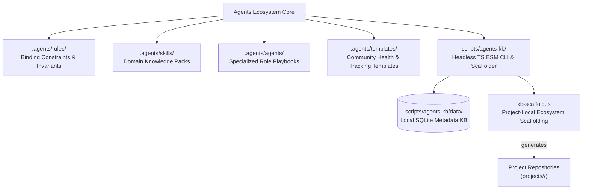

# Agents Ecosystem — Strategic Roadmap & Milestones

> 🗺️ **Living Source of Truth**: Architecture, milestone matrix, and strategic direction for the **Agents Ecosystem** (`projects/agents`).
>
> Pair with [`PLAN.md`](./PLAN.md) (sprint execution), [`TODO.md`](./TODO.md) (executable tasks), and [`BUGS.md`](./BUGS.md) (known issues).
> Project-specific roadmaps and milestones live exclusively within each project's own repository (`projects/<repo>/ROADMAP.md`).
> Historical delivered milestones live in [`.github/ROADMAP-ARCHIVE.md`](./.github/ROADMAP-ARCHIVE.md).
> Last updated: 2026-10-19

---

## 📜 Tracking Rules

- **Ecosystem Scope Only**: This document tracks the strategic direction, architectural tiers, and milestone releases of the generic AI agents framework, rules, skills, templates, and CLI toolchain. Projects developed with this framework maintain their own independent `ROADMAP.md` inside their repository root.
- **100% Active Direction Accuracy**: Reflect the current, active architecture of the agents ecosystem with zero contradictions.
- **Universal Semantic Versioning Invariant**: The ecosystem strictly adheres to Semantic Versioning (`vMAJOR.MINOR.PATCH`).

---

## 🔭 Agents Ecosystem Vision & Architecture

The **Agents Ecosystem** is a standalone, open-source AI governance, paired-programming framework, and project scaffolding engine. It provides autonomous and paired coding assistants with strict binding constraints, domain expertise, project starter suites, and execution tracking tools.



### Core Architecture Pillars

1. 🛡️ **Absolute Invariants & Safety**: Strict rules against unauthorized repository mutations (`git-operations.md`), unverified code releases, lingering compiler warnings, and security leaks.
2. 🧠 **Continuous Session Memory**: Permanent session-state ledgers (`HANDOFF.md`) and living tracking files (`ROADMAP.md`, `PLAN.md`, `TODO.md`, `BUGS.md`) ensuring seamless multi-session continuity and zero context drift.
3. 🛠️ **Headless CLI & Scaffolding Engine**: Modular, extensible TypeScript CLI (`scripts/agents-kb/`) supporting dual extension mechanisms (first-class TS modules and pluggable body files), local SQLite metadata caching, and engine-tailored project scaffolding (`tauri-desktop`, `jekyll-theme`, `node-ts-cli`, `rust-library`, `docs-site`).
4. 🌐 **Zero Project Pollution**: Complete isolation between the generic global agents framework and individual project codebases. Project-specific roadmaps, tasks, and bugs live solely in per-project repositories.

---

## 🗺️ Ecosystem Milestone Matrix

| Release Milestone | Focus Area | Status | Deliverables & Scope |
|---|---|---|---|
| **v1.0.0** | Core Governance & Roles | ✅ Shipped | Baseline rules, skills, templates, role playbooks, and multi-session tracking protocols. |
| **v1.1.0** | Headless CLI & Scaffolding Engine | ✅ Shipped | Modular TypeScript ESM CLI, dual extension mechanism, SQLite metadata knowledge base (`knowledge.db`), domain-neutral scaffolding engine (`kb-scaffold.ts`), and project-type starter suites. |
| **v1.2.0** | Context Self-Monitoring & Plugins | 🚀 Active | OpenCode V2-native context-pressure self-monitoring plugin (W.62), curated plugin/MCP compatibility watch (W.61), and potato-hardware resource budgets. |
| **v1.3.0** | Multi-Model & Toolchain Federation | 🔮 Backlog | Pluggable LLM tool adapters, schema validation pipelines, and automated multi-repo secret synchronization helpers. |

---

## 🚀 Active Ecosystem Tracks

- **Scaffolding & Templates Engine**: Continuous refinement of engine starter templates (`bodies/scaffold/`) with domain-neutral links, GitHub-flavored mermaid diagrams, and configurable licensing.
- **Context Pressure Self-Monitoring**: Implementation of OpenCode V2-native plugin to automatically observe session token thresholds (100k soft / 120k hard) and enforce handoff refresh checkpoints.
- **Local SQLite Metadata Knowledge Base**: Maintenance of the local-only `knowledge.db` registry for artifact indexing, fast reference lookup, and invariant assertion.

---

## 📁 Project-Local Roadmaps

When managing individual projects with this framework, each project repository contains its own self-contained `ROADMAP.md` generated by the scaffolder:

```powershell
npm --prefix scripts/agents-kb run scaffold -- --type <tauri-desktop|jekyll-theme|node-ts-cli|rust-library|docs-site> --path projects/<project-name>
```

Refer to each project repository for project-scoped product direction, feature roadmaps, and release milestones.
