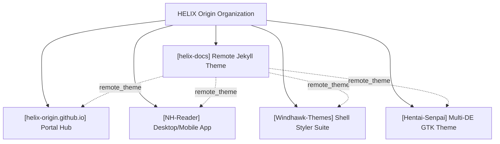
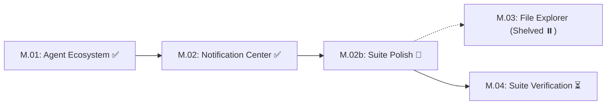
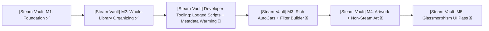

# HELIX Origin — Organization Roadmap & Milestones

> 🗺️ **Living Source of Truth**: Unified organizational roadmap, multi-project milestone matrix, and long-term product direction across all repositories under **HELIX Origin**.
>
> Pair with [`PLAN.md`](./PLAN.md) (sprint execution), [`TODO.md`](./TODO.md) (task ledger), and [`BUGS.md`](./BUGS.md) (open issues and quirks).
> Last updated: 2026-10-14

---

## 📜 Organizational Tracking Contract

- **Single Pane of Glass:** All repository roadmaps, sprints, tasks, and bugs are synchronized here at workspace root.
- **Mandatory Project Tagging Invariant:** Every tracked milestone, sprint, task, bug, and backlog candidate **must explicitly state its project name and repository path** (`[<project-name>] (<project-path>)`). Unscoped items are strictly prohibited so agents never conflate repositories.
- **Active Milestones First:** Active workstreams and upcoming milestones must always precede completed historical records.
- **Strict Typing:** Differentiate explicitly between **SemVer repositories** (`helix-docs`, `NH-Reader`, `Hentai-Senpai-Multi-DE-Theme`) and **Milestone/Sprint-tracked repositories** (`Windhawk-Themes`, `helix-origin.github.io`).
- **No Stale Ledgers:** Updates to roadmap milestones must occur before or alongside code and configuration changes.

---

## 🔭 Organization Vision & Architecture

1. 🎨 **Unified Design Tokens**: A cohesive dark obsidian aesthetic (`#07111f` / `#0d1b2d`) with cyan (`#48d8f2`) and purple (`#b06cff`) accents across documentation, desktop apps, and OS styling suites.
2. 🚀 **Zero-Install Remote Documentation**: All organizational web properties consume `HELIX-Origin/helix-docs` via GitHub Pages without local build duplication or hardcoded navigation data.
3. 🔒 **Privacy & Local Independence**: User-facing clients operate 100% on-device (local SQLite, zero forced telemetry, self-contained runtimes).

---

## 🗺️ Master Milestone & Project Status Matrix

| Project Identifier | Target Repository Path | Tracking Model | Current Milestone / Release | Status | Primary Focus |
|---|---|---|---|---|---|
| **[helix-docs]** | `projects/helix-docs` | SemVer | [v1.0.0](https://github.com/HELIX-Origin/helix-docs/releases/tag/v1.0.0) | ✅ Shipped | Frontmatter nav engine, modular cards, universal navbar |
| **[helix-origin.github.io]** | `projects/helix-origin.github.io` | Rolling Sprints | Portal v2 | 🚀 Active | 16:9 vector artwork integration, project showcase cards |
| **[NH-Reader]** | `projects/NH-Reader` | SemVer | [v0.7.5](https://github.com/HELIX-Origin/NH-Reader/releases/tag/v0.7.5) | ✅ Shipped (M12) | M13 Planning: unified sign script, multi-platform toolchain |
| **[Windhawk-Themes]** | `projects/Windhawk-Themes` | Milestones | Milestone M.02b | 🚀 Active | Suite polish: Start Menu alignments, Quick Settings split buttons |
| **[Hentai-Senpai-Multi-DE-Theme]** | `projects/Hentai-Senpai-Multi-DE-Theme` | SemVer | [v1.0.0](https://github.com/HELIX-Origin/Hentai-Senpai-Multi-DE-Theme/releases/tag/v1.0.0) | ✅ Complete | Nord GTK multi-desktop theme installer & remote docs |
| **[Steam-Vault]** | `projects/Steam-Vault` | SemVer | M2 (Whole-Library Organizing) | ✅ Delivered (M2) | Cross-platform Steam library organizer (Depressurizer revival) in Tauri v2 |

---

## 🚀 Active Project Roadmaps

### 1. [Windhawk-Themes] — Command Center Suite
*Target Path: `projects/Windhawk-Themes` · Windows 11 Shell Theming Framework*

- **[Windhawk-Themes] Milestone M.02b: Suite Polish & Geometry Alignment (ACTIVE):**
  - **Start Menu Geometry**: Phone Link companion cards aligned flush with menu top; search box left edge flush with pinned apps card; companion toggle button right edge flush with pinned apps card.
  - **Action Center Quick Settings**: Harmonize split-button toggle and chevron backgrounds (`SplitL2Button`); eliminate high-contrast blue fallback states.
  - **Taskbar Snap Layout Containers**: Theme internal snap containers (`SnapLayoutControl`, `LayoutBorder`) with Command Center glass without breaking layout bounds.
  - **Taskbar Overflow Grid**: Restore frosted glass background and specular border to system tray overflow flyout.
  - **Docs Neutrality & Config Hygiene** (2026-10-13): corrected the documentation site to stay theme-neutral (mod mechanism only — the catalogue is the sole suite-specific surface, now codified as a global agents rule); synced `projects/command-center/README.md` to the current configs; deduplicated the static gate to **0 errors / 0 warnings**.
- **[Windhawk-Themes] Milestone M.03: Windows 11 File Explorer Styler (SHELVED / DEFERRED):**
  - Shelved per maintainer decision (2026-10-07) to avoid unstable system-wide translucency injectors or breaking Win32 DirectUI controls.
- **[Windhawk-Themes] Milestone M.04: Unified Suite Verification & Catalog Showcase (PLANNED):**
  - Full multi-mod Windows 11 desktop verification and Jekyll showcase catalogue generation in `docs/_catalogue/`.

---

### 2. [NH-Reader] — Desktop & Android Reader
*Target Path: `projects/NH-Reader` · Tauri / Rust / SvelteKit Native Client*

- **[NH-Reader] Milestone History (M1–M12 Shipped):**
  - **M1–M4**: Foundation, Browse, Advanced Query Search & Filter Drawer, Global Blacklist engine.
  - **M5–M8**: SQLite Cache, Responsive Reader, Throttled Background Workers, Portable Packaging.
  - **M9–M11**: 18-Language Localization Core, Disk Storage Budgets & LRU Pruning, Official Archive Downloads & Library Hub.
  - **M12 (v0.7.3 – v0.7.5)**: Complete 17 community language packs, custom title bar with per-OS window controls, RTL polish, multi-platform portable archives, unified `npm run sign` (`scripts/sign.mjs`), squircle website assets (`logo.svg`, `favicon.ico`, `icon.png`).
- **[NH-Reader] Milestone M13 (UPCOMING / PLANNED):**
  - Tag frequency analytics and recommended read suggestions based on local history.
  - Multi-profile library partitions (e.g. separate blacklist/favorites sets).
  - Background auto-update inspection and release notification toasts.

---

### 3. [helix-docs] — Remote Jekyll Theme
*Target Path: `projects/helix-docs` · Organization Documentation & Wiki Engine*

- **[helix-docs] v1.0.0 Delivery (SHIPPED):**
  - Layered SCSS architecture (`support/`, `modules/`, `color_schemes/`, `vendor/`, `custom/`).
  - Precompiled Dart Sass `assets/css/site.css` (zero build-time SCSS compilation on GitHub Pages).
  - Pure frontmatter-driven 3-level tree navigation (`_includes/components/nav.html`).
  - Modular `<section class="doc-section">` landing cards with zero Kramdown indentation bugs.
  - Wiki layout delegation for docs collections (`layout: wiki`).
  - Extracted universal site-wide top navbar partial (`_includes/components/navbar.html`).
  - Expanded catalogue column min-width to 400px.
- **[helix-docs] v1.1.0 Roadmap (PLANNED):**
  - Dedicated client-side Mermaid diagram rendering helper (`components/mermaid.html`).
  - Dynamic in-page Table of Contents sidebar module (solving `BUG-14`).
  - Native catalogue filtering scripts for software and theme showrooms.

---

### 4. [helix-origin.github.io] — Organization Portal
*Target Path: `projects/helix-origin.github.io` · Central Discovery Hub*

- **[helix-origin.github.io] Portal v2 Delivery (ACTIVE):**
  - Standardized on `remote_theme: HELIX-Origin/helix-docs`.
  - 16:9 standalone vector artwork system (`docs/assets/images/*.svg`) replacing remote bitmaps.
  - Added dedicated project card and custom artwork for `helix-docs`.
- **[helix-origin.github.io] Portal v3 Roadmap (PLANNED):**
  - Live GitHub release status badge widgets fetched via Octokit / Jekyll GitHub metadata.
  - Interactive software catalogue showcase consuming the `catalogue` layout.

---

### 5. [Hentai-Senpai-Multi-DE-Theme] — Nord GTK Theme
*Target Path: `projects/Hentai-Senpai-Multi-DE-Theme` · Linux Desktop Customization*

- **[Hentai-Senpai-Multi-DE-Theme] v1.0.0 Delivery (SHIPPED):**
  - Unified installer script supporting GNOME, Cinnamon, XFCE, Budgie, and MATE.
  - Vector icon asset suite (`icon.svg`, `logo.ico`, `my-avatar.png`).
  - Documentation migrated to `helix-docs` remote theme with frontmatter navigation.
- **[Hentai-Senpai-Multi-DE-Theme] Future Roadmap:**
  - Automated libadwaita / GTK4 user override configuration scripts.
  - Optional custom accent color generator presets.

---

### 6. [Steam-Vault] — Steam Library Organizer
*Target Path: `projects/Steam-Vault` · Tauri v2 / Rust / SvelteKit Desktop App*

- **[Steam-Vault] Milestone M1: Foundation (DELIVERED):**
  - Clean-room, cross-platform revival of **Depressurizer** as a Tauri v2 app.
  - Steam discovery (registry + cross-platform fallbacks), library/account aggregation from
    `libraryfolders.vdf`, `appmanifest_*.acf`, `localconfig.vdf`, and non-Steam `shortcuts.vdf`.
  - Modern Steam collection read/write against the cloud namespace store, with backups and a
    Steam-must-be-closed guard.
  - Metadata provider layer: Steam Store (`appdetails`), Steam Web API, SteamGridDB, IGDB (Twitch),
    PCGamingWiki, Wikipedia. **RAWG intentionally excluded (service defunct).** Steam Web API,
    SteamGridDB, and IGDB are the only keyed providers.
  - AutoCats engine + Allowed/Required/Excluded filter model; JSON metadata cache; local settings.
  - `docs/` GitHub Pages site on the `helix-docs` remote theme, live at
    **https://helix-origin.github.io/Steam-Vault/** (source `main` / `docs`).
- **[Steam-Vault] Milestone M2: Whole-Library Organizing (DELIVERED):**
  - **Custom title bar** — frameless window (`decorations: false`), a draggable app header, and
    platform-aware window controls (macOS traffic lights, Windows-style buttons elsewhere).
  - **Whole owned library** — the Steam Web API's `GetOwnedGames` result is cached to
    `owned-games.json` and merged into the Library view, so owned-but-not-installed games can be
    organized too.
  - **External platform detection** — GOG, Epic Games, itch.io, Amazon Games, Ubisoft Connect, EA,
    Battle.net, Rockstar, and other publishers, read from local launcher manifests, the GOG registry,
    the itch app library, and the Windows Uninstall registry (no scraping, no launcher login).
  - **Import as non-Steam shortcuts** — appids derived exactly as Steam does
    (`crc32(exe + name) | 0x80000000`), quoted `Exe` / `StartDir`, de-duplication, and a persisted
    appid → platform map.
  - **Collection creation from any sorting option** — genre, developer, publisher, Steam feature,
    tag, release year, user score, platform, installed state, playtime, and name — previewed, then
    written in a single backed-up operation.
  - New **Platforms** and **Organize** views; navigation extended to six items.
- **[Steam-Vault] Developer Tooling: Logged Command Scripts + Metadata Cache Warming (COMPLETE):**
  - **Logged command scripts** — `scripts/*.mjs` wrap `tauri dev` / `tauri build` (and any command via
    `npm run log`) so each run streams live and leaves a timestamped, ANSI-stripped transcript in
    `logs/` (`<type>-<YYYY-MM-DD_HH-MM-SS>.log`, never overwritten).
  - **On-demand metadata cache warming** — the Steam Store provider also fetches store **tags**
    (`actions/ajaxgetstoretags`); `ensure_steam_metadata` de-duplicates ids, batches `appdetails`
    50/request, and reuses cached entries; a `sync_library_metadata` command warms the whole owned
    library; collection creation can fetch metadata on demand (`fetchMetadata`, default on).
- **[Steam-Vault] Backlog (deferred):**
  - Full **modern dark glassmorphism** visual design pass across every view.
  - HELIX squircle branding artwork for the app/repo; GitHub issue templates; release notes.
  - SQLite metadata cache (replacing the JSON cache); dynamic (filter-spec) collection authoring.
  - Platform storefront launch URIs (Epic / itch) as shortcut launch options; per-game platform
    override UI; Microsoft Store / Xbox Game Pass detection.
  - Release notes, issue templates, and first SemVer release.
