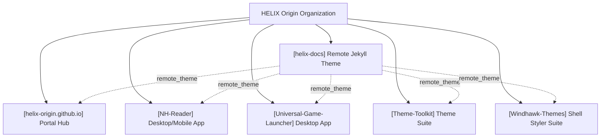
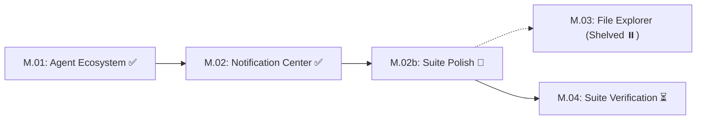

# HELIX Origin — Organization Roadmap & Milestones

> 🗺️ **Living Source of Truth**: Unified organizational roadmap, multi-project milestone matrix, and long-term product direction across all repositories under **HELIX Origin**.
>
> Pair with [`PLAN.md`](./PLAN.md) (sprint execution), [`TODO.md`](./TODO.md) (task ledger), and [`BUGS.md`](./BUGS.md) (open issues and quirks).
> Delivered historical milestone records live in [`.github/ROADMAP-ARCHIVE.md`](./.github/ROADMAP-ARCHIVE.md).
> Last updated: 2026-10-16

---

## 📜 Organizational Tracking Contract

- **Single Pane of Glass:** All repository roadmaps, sprints, tasks, and bugs are synchronized here at workspace root.
- **Mandatory Project Tagging Invariant:** Every tracked milestone, sprint, task, bug, and backlog candidate **must explicitly state its project name and repository path** (`[<project-name>] (<project-path>)`). Unscoped items are strictly prohibited so agents never conflate repositories.
- **Active Milestones First:** Active workstreams and upcoming milestones must always precede completed historical records.
- **Strict Typing:** Differentiate explicitly between **SemVer repositories** (`helix-docs`, `NH-Reader`, `Universal-Game-Launcher`, `Theme-Toolkit`) and **Milestone/Sprint-tracked repositories** (`Windhawk-Themes`, `helix-origin.github.io`).
- **No Stale Ledgers:** Updates to roadmap milestones must occur before or alongside code and configuration changes.

---

## 🔭 Organization Vision & Architecture

1. 🎨 **Unified Design Tokens**: A cohesive dark obsidian aesthetic (`#07111f` / `#0d1b2d`) with cyan (`#48d8f2`) and purple (`#b06cff`) accents across documentation, desktop apps, and OS styling suites.
2. 🚀 **Zero-Install Remote Documentation**: All organizational web properties consume `HELIX-Origin/helix-docs` via GitHub Pages without local build duplication or hardcoded navigation data.
3. 🔒 **Privacy & Local Independence**: User-facing clients operate 100% on-device (local SQLite, zero forced telemetry, self-contained runtimes).

---

## 🗺️ Master Milestone & Project Status Matrix

| Project Identifier | Target Repository Path | Tracking Model | Current Milestone / Release | Status | Primary Focus |
|---|---|---|---|---|---|
| **[helix-docs]** | `projects/helix-docs` | SemVer | [v1.0.0](https://github.com/HELIX-Origin/helix-docs/releases/tag/v1.0.0) | ✅ Shipped | Frontmatter nav engine, modular cards, universal navbar |
| **[helix-origin.github.io]** | `projects/helix-origin.github.io` | Rolling Sprints | Portal v2 | 🚀 Active | 16:9 vector artwork integration, project showcase cards |
| **[NH-Reader]** | `projects/NH-Reader` | SemVer | [v0.7.5](https://github.com/HELIX-Origin/NH-Reader/releases/tag/v0.7.5) | 🚀 Active | M13: Unified `.mjs` scripts architecture, main:sub:option command hierarchy, local code signing |
| **[Windhawk-Themes]** | `projects/Windhawk-Themes` | Milestones | Milestone M.02b | 🚀 Active | Suite polish: Start Menu alignments, Quick Settings split buttons |
| **[Universal-Game-Launcher]** | `projects/Steam-Vault` | SemVer | [v1.4.0](https://github.com/HELIX-Origin/Steam-Vault) | 🚀 Active | M14: Universal Game Launcher Rebranding, Zero Emulation Purge for WinGet, Generic SQLite Persistence & Modern Visual Identity |
| **[Universal-Game-Launcher-Plugins]** | `projects/Universal-Game-Launcher-Plugins` | SemVer | [v1.0.0](https://github.com/HELIX-Origin/Universal-Game-Launcher-Plugins) | 🚀 Active | Official drop-in plugin catalog, 11 platform plugins, 17 rich metadata providers, JSON schema & validator |
| **[Theme-Toolkit]** | `projects/Theme-Toolkit` | SemVer | [v0.1.0-alpha](https://github.com/HELIX-Origin/Theme-Toolkit) | 🚀 Active | M1: Framework scaffolded, Per-Platform Lib isolation, native packaging blueprints |

---

## 🚀 Active Project Roadmaps

### 1. [Windhawk-Themes] — Command Center Suite
*Target Path: `projects/Windhawk-Themes` · Windows 11 Shell Theming Framework*

- **[Windhawk-Themes] Milestone M.02b: Suite Polish & Geometry Alignment (ACTIVE):**
  - **Start Menu Geometry**: Phone Link companion cards aligned flush with menu top; search box left edge flush with pinned apps card; companion toggle button right edge flush with pinned apps card.
  - **Action Center Quick Settings**: Harmonize split-button toggle and chevron backgrounds (`SplitL2Button`); eliminate high-contrast blue fallback states.
  - **Taskbar Snap Layout Containers**: Theme internal snap containers (`SnapLayoutControl`, `LayoutBorder`) with Command Center glass without breaking layout bounds.
  - **Taskbar Overflow Grid**: Restore frosted glass background and specular border to system tray overflow flyout.
  - **Docs Neutrality & Config Hygiene** (2026-10-13): corrected the documentation site to stay theme-neutral (mod mechanism only — the catalogue is the sole suite-specific surface, now codified as a global agents rule); synced `projects/command-center/README.md` to the current configs; deduplicated the static gate to **0 errors / 0 warnings**.
- **[Windhawk-Themes] Milestone M.03: Windows 11 File Explorer Styler (SHELVED / DEFERRED):**
  - Shelved per maintainer decision (2026-10-07) to avoid unstable system-wide translucency injectors or breaking Win32 DirectUI controls.
- **[Windhawk-Themes] Milestone M.04: Unified Suite Verification & Catalog Showcase (PLANNED):**
  - Full multi-mod Windows 11 desktop verification and Jekyll showcase catalogue generation in `docs/_catalogue/`.

---

### 2. [NH-Reader] — Desktop & Android Reader
*Target Path: `projects/NH-Reader` · Tauri / Rust / SvelteKit Native Client*

- **[NH-Reader] Milestone History (M1–M12 Delivered)**: Foundation, Browse, Advanced Query Search, Blacklist Engine, SQLite Cache, Responsive Reader, Storage Budgets, 18-Language Localization Core, Custom Title Bar, and Multi-Platform Sign Script (v0.1.0 – v0.7.5). Full technical summaries live in [`.github/ROADMAP-ARCHIVE.md`](./.github/ROADMAP-ARCHIVE.md#nh-reader).
- **[NH-Reader] Milestone M13 (UPCOMING / PLANNED):**
  - Tag frequency analytics and recommended read suggestions based on local history.
  - Multi-profile library partitions (e.g. separate blacklist/favorites sets).
  - Background auto-update inspection and release notification toasts.

---

### 3. [helix-docs] — Remote Jekyll Theme
*Target Path: `projects/helix-docs` · Organization Documentation & Wiki Engine*

- **[helix-docs] v1.0.0 Delivery (SHIPPED)**: Layered SCSS architecture, precompiled Dart Sass `site.css`, frontmatter tree navigation, modular card layouts, and universal navbar. Full technical summaries live in [`.github/ROADMAP-ARCHIVE.md`](./.github/ROADMAP-ARCHIVE.md#helix-docs).
- **[helix-docs] v1.1.0 Roadmap (PLANNED):**
  - Dedicated client-side Mermaid diagram rendering helper (`components/mermaid.html`).
  - Dynamic in-page Table of Contents sidebar module (solving `BUG-14`).
  - Native catalogue filtering scripts for software and theme showrooms.

---

### 4. [helix-origin.github.io] — Organization Portal
*Target Path: `projects/helix-origin.github.io` · Central Discovery Hub*

- **[helix-origin.github.io] Portal v2 Delivery (ACTIVE):**
  - Standardized on `remote_theme: HELIX-Origin/helix-docs`.
  - 16:9 standalone vector artwork system (`docs/assets/images/*.svg`) replacing remote bitmaps.
  - Added dedicated project card and custom artwork for `helix-docs`.
- **[helix-origin.github.io] Portal v3 Roadmap (PLANNED):**
  - Live GitHub release status badge widgets fetched via Octokit / Jekyll GitHub metadata.
  - Interactive software catalogue showcase consuming the `catalogue` layout.

---

### 5. [Universal-Game-Launcher] (formerly Steam-Vault) — Universal Game Launcher
*Target Path: `projects/Steam-Vault` · Tauri v2 / Rust / SvelteKit Desktop App*

```mermaid
flowchart LR
    M1["M1: Foundation ✅"] --> M2["M2: Library Organizing ✅"]
    M2 --> M3["M3: Storage Manager ✅"]
    M3 --> M4["M4: Artwork Manager ✅"]
    M4 --> M5["M5: Platforms & i18n ✅"]
    M5 --> M7["M7: SQLite Cache ✅"]
    M7 --> M9["M9: v1.0 Release ✅"]
    M9 --> M12["M12: Deals & News ✅"]
    M12 --> M13["M13: Multi-Platform & WinGet ✅"]
    M13 --> M14["M14: Rebrand & Zero-Emulation 🚀"]
    M14 -.-> M15["M15: Store Checkout (Planned) ⏳"]
    M15 -.-> M16["M16: Cloud Gaming (Planned) ⏳"]
```

- **[Universal-Game-Launcher] Milestone History (M1–M12 Delivered)**: Clean-room Depressurizer revival, whole-library aggregation, storage manager, custom artwork manager, 30-language localization engine, dynamic smart collections, SQLite metadata persistence, obsidian glassmorphism UI, Redis KV in-memory tier, and deals/free games engines (v1.0.0 – v1.3.1). Full architectural histories live in [`.github/ROADMAP-ARCHIVE.md`](./.github/ROADMAP-ARCHIVE.md#universal-game-launcher-formerly-steam-vault).
- **[Universal-Game-Launcher] Milestone M13: Multi-Platform Hardening, WinGet Packaging & Hygiene v1.3.2 - v1.3.3 (DELIVERED):**
  - Elimination of all cross-platform compiler warnings across POSIX (Linux/macOS) and Windows targets.
  - Dedicated standalone WinGet package workflow (`publish-winget.yml`) and official initial package submission to `microsoft/winget-pkgs` (PR #453830).
  - Automated Microsoft Contributor License Agreement (CLA) bot signature.
  - Upgraded WinGet manifest generation to Microsoft Schema 1.12.0 with local validation tooling.
  - Full adherence to organizational `main:sub:option` script hierarchy (`winget:manifest:generate`, `winget:manifest:verify`, `winget:manifest:install`).
  - IDE untracking and hygiene enforcement (`.vscode/` removal and comprehensive `.gitignore` rules).
- **[Universal-Game-Launcher] Milestone M14: Self-Contained Drop-In Plugin Engine, Steam/GOG Launcher UI, System Locale & Modern Visual Identity v1.4.0 (ACTIVE):**
  - **Complete Product Rebranding**: Renamed package to `universal-game-launcher`, product to `Universal Game Launcher`, crate to `universal_game_launcher_lib`, and bundle identifier to `org.helixorigin.universal-game-launcher`.
  - **Self-Contained Drop-In Plugin Engine**: Extensible architecture where all platform providers (Steam, GOG, Epic, Itch, Xbox, EA, Ubisoft, Battle.net, etc.), metadata engines, and utilities run as self-contained drop-in plugins loaded dynamically from manifest files (`index.json`). Includes support for installing community-hosted plugins directly from GitHub repository entry points without touching core app code.
  - **Dedicated Official Plugins Repository (`Universal-Game-Launcher-Plugins`)**: Established public repository `HELIX-Origin/Universal-Game-Launcher-Plugins` hosting 28 official drop-in plugins (11 platform discovery & launch plugins, 17 rich metadata providers including VNDB, IndieDB/ModDB, IGDB, SteamGridDB, PCGamingWiki, Wikipedia, MobyGames, RAWG, Giant Bomb, ProtonDB, HowLongToBeat, Metacritic, OpenCritic), canonical JSON Schema (`schemas/plugin.schema.json`) supporting user-configurable settings & API keys, automated validation suite (`scripts/validate.mjs`), and comprehensive developer documentation.
  - **Steam & GOG Galaxy Launcher UI**:
    - **Title Bar Navigation Menu**: Primary application tabs (`Dashboard`, `Library`, `Platforms`, `Storage`, `Settings`) moved directly into the title bar right beside the brand logo, mirroring Steam's top bar navigation.
    - **Steam/GOG Left Game List Sidebar**: Global interactive game list with instant name/platform search filter, quick filter pills (`All`, `Installed`, `★ Favorites`), manual asynchronous platform scan button (`↻ Scan`), and live selection tree.
    - **Single-Game Dedicated Showcase View**: Completely eliminated the heavy multi-card grid layout in `/library` to eliminate UI hangs and missing artwork. Directly showcases the selected title with hero banner, capsule cover, 10-image screenshot media gallery with fullscreen lightbox, meta reference links, game details, storage footprint, and display name manager.
  - **Generic SQLite Database Schema (`database.sqlite`)**: Decoupled database file naming from branding lock-in; standardizes on `database.sqlite` / `database.db` with automated seamless migration from legacy `steam-vault/metadata.db`.
  - **Native Launcher Integration & Auth Architecture**: Rely on official native desktop clients (`steam://`, `com.epicgames.launcher://`, `goggalaxy://`, `uplay://`) for game discovery, installation, launch, uninstallation, and update triggers. Zero user password storage or scraping while preserving official client overlays, cloud synchronization, friend lists, playtime, and achievements.
  - **Dropped WinGet Publication Plans**: Dropped the WinGet package submission and workflow pipeline; removed `publish-winget.yml`, `scripts/generate-winget-manifest.mjs`, and `winget/` directory.
  - **System Locale Out-of-the-Box**: Dropped complex 30-language hand-rolled dictionary files and localization test scripts. Defaults cleanly to the host system locale (`navigator.language`) out of the box; community developers can provide hand-rolled or custom localization dictionaries via drop-in plugins.
  - **Modern Visual Identity**:
    - Branded 16:9 vector artwork (`universal-game-launcher.svg`, 1920×1080) with dark futuristic purple controller on futuristic dark purple background.
    - Vector squircle logo (`static/logo.svg`, 256×256) and multi-resolution icon suite.
    - Standard Tauri v2 NSIS installer sidebar bitmap (`src-tauri/windows/sidebar.bmp`, strictly 164×314 pixels, BMP3).
    - Animated pulsing controller splash screen transition at application startup (minimum 850ms duration with smooth 450ms fade/scale exit).
  - **Discontinued Offline Catalogue Database Purge**: Completely purged deprecated `game_catalog` and `catalog_lookups` tables from SQLite, dropped `catalog_seed.bin` embedded asset (saving ~363 KB binary overhead), eliminated dead network calls to defunct `Steam-Vault-Catalogue`, and wiped catalog endpoints.
  - **Native App Isolation & Zero Steam Writes Invariant**: Universal Game Launcher operates as an independent launcher and library manager. All game records, collections, categories, display names, and user modifications persist exclusively in our local SQLite database and in-memory KV tier. All writes to Steam files (`shortcuts.vdf`, `cloud-storage-namespace-1.json`) and `ensure_steam_closed` requirements are permanently eliminated.
  - **Data & Performance Optimization Pass (True Instant Loading)**: Native `games` and `collections` tables in `database.sqlite` preloaded at startup into the in-memory serverless Redis-compatible KV tier (`mem_kv`), coupled with SQLite WAL mode and aggressive memory pragma tuning (`cache_size = -64000`, `temp_store = MEMORY`, `synchronous = NORMAL`, `mmap_size = 256MB`) ensuring sub-millisecond (<1ms) retrieval and instantaneous navigation without disk blocking or TTL dropouts.

---

### 6. [Theme-Toolkit] — Dedicated Cross-Platform Theme Engineering Suite (ACTIVE / SCAFFOLDED)
*Target Path: `projects/Theme-Toolkit` · Tauri v2 / Rust / SvelteKit Desktop App · v0.1.0-alpha*

- **Core Vision & Invariants:**
  - Dedicated cross-platform desktop theme authoring and packaging application named **Theme Toolkit**, built as a **Tauri v2 application** that utilizes a modern GUI as its primary interface to replace Microsoft's broken settings export integration and provide native theme authoring across all major desktop operating systems.
  - **Zero Store / Zero Catalogue Invariant:** Unlike previous attempts, Theme Toolkit contains **strictly NO remote store or catalogue**. It is designed purely for creating, customizing, and applying desktop themes locally on the user's machine.
  - **Themepack Exporting:** Exporting to standard themepack formats (`.deskthemepack`, `.soundpack`, FreeDesktop archives) is supported as a primary mechanism for users to save and package their themes for easy backup, sharing, and re-installation at a later time.
  - Strict adherence to official platform specifications: Microsoft Win32 desktop theming and Visual Styles, macOS Dynamic Desktop and Soundset architectures, and FreeDesktop/XDG specifications for Linux.
- **Detailed Feature Scope:**
  - **Windows Native Packaging:** Utilizes Microsoft `makecab.exe` Diamond Directive Files (`.ddf`) with MSZIP compression, guaranteeing valid cabinet headers, accurate relative paths, and zero asset stripping for `.deskthemepack` archives.
  - **macOS Native Tooling:** Packages Dynamic Desktop timed/solar HEIC wallpapers, system alert soundsets (`.soundpack`), custom cursor bundles, and system accent/highlight preferences.
  - **Linux Native Tooling:** Packages FreeDesktop Sound Theme compliant audio sets, XDG cursor and icon themes, and desktop environment background XML manifests (GNOME, KDE Plasma, XFCE, Cinnamon).
  - **Sound Schemes:** Complete `.wav` audio asset bundling and registration with Windows Sound Event keys (`HKEY_CURRENT_USER\AppEvents\Schemes\Apps\.Default`) and POSIX sound specifications.
  - **Wallpapers & Slideshows:** Single static wallpapers or multi-image slideshows with configurable intervals (in milliseconds), shuffle modes, and multi-monitor alignment options (Fill, Fit, Stretch, Tile, Center, Span).
  - **Cursor Schemes:** Full packaging for all 15 Win32 standard cursor roles with support for static (`.cur`) and animated (`.ani`) pointers, as well as native macOS and X11/Wayland cursor sets.
  - **Color Editing:** Live DWM accent colorization control (`ColorizationColor` ARGB hex), Windows 10/11 system/app dark and light modes (`SystemMode`, `AppMode`), and Control Panel color palette overrides.
  - **Delivery Form Factor:** Dedicated **Tauri v2 GUI application** (`Theme Toolkit`) with interactive asset previews (wallpaper viewport, audio player, animated cursor canvas, real-time color pickers) backed by a native Rust Per-Platform Lib Architecture (`windows.rs`, `macos.rs`, `linux.rs`), alongside optional headless CLI automation (`theme-toolkit pack:theme:release`).
- **Scaffolded State:**
  - Repository created at `HELIX-Origin/Theme-Toolkit`, cloned into `projects/Theme-Toolkit`, and initial base framework committed and pushed to `origin/main`.
  - Feature implementation will be scheduled for a subsequent sprint.

