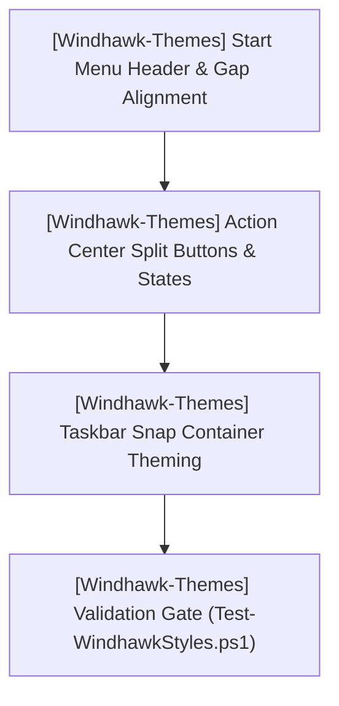

# TODO.md — HELIX Origin Consolidated Task Ledger

> 📋 **Living Source of Truth**: Actionable task ledger across all projects in the **HELIX Origin** organization.
> Statuses: ⬜ backlog · 🚧 in progress · ✅ done (tracked as `- [ ]` and `- [x]` checkboxes).
> High-level direction lives in [`ROADMAP.md`](./ROADMAP.md), active sprint planning in [`PLAN.md`](./PLAN.md), issues in [`BUGS.md`](./BUGS.md).
> Last updated: 2026-10-10

---

## 📜 Tracking Rules

- **No Typo Duplication**: When recording user reports, clean and fix all typos to preserve professional quality.
- **Consistent Formatting**: Maintain consistent formatting and style throughout all documentation to ensure readability and professionalism.
- **Clear Sectioning**: Use clear and descriptive headers for each section to improve navigation and readability.
- **Mandatory Project Tagging**: **Every single task, workstream, and backlog item must explicitly include its project tag** (`[<project-name>]`). Agents must never guess which repository a task belongs to.
- **Active Items First**: The currently active milestone, sprint, task, or workstream must always be placed at the top of the content sections.
- **Regular Updates**: Ensure that this file is regularly updated to reflect the latest developments and changes in the project.
- **Improve User Directives**: Continuously refine and clarify user directives to ensure they are easily understood and actionable.
- **Same-Change Updates**: When a task changes behavior or scope, update this file in the same change.
- **Done Moves Down**: When a task is done, check it off and archive completed sections under Completed Workstreams.
- **Tracking Docs Stay True**: Update `ROADMAP.md`, `TODO.md`, `BUGS.md`, and `PLAN.md` first or in lockstep with code changes.
- **Always Track Everything**: Every new feature request, enhancement, or bug report must be logged before execution.

---

## 🔥 Active Workstreams

### 🎯 [Windhawk-Themes] Workstream W.08: Site Branding Artwork (logo / icon / favicon)
- **Project Identifier:** `[Windhawk-Themes]`
- **Repository Path:** `projects/Windhawk-Themes`
- **Target Component:** `docs/assets/images/` (`logo.svg`, `icon.png`, `favicon.ico`), `docs/_config.yml` branding keys

Derive matching squircle branding artwork for the Windhawk Themes wiki from the existing `windhawk.jpg` source with ImageMagick.

**Locked user directives:**
- "The Windhawk Themes repo has a windhawk.jpg image that we can use as the source to generate the new svg, ico, and png images from."

**Implementation checklist:**
- [x] `[Windhawk-Themes]` Extract the white Windhawk glyph from the 600×600 grayscale `windhawk.jpg` (level 40%→100%, masked to alpha).
- [x] `[Windhawk-Themes]` Author `docs/assets/images/logo.svg` (256×256 squircle, dark tile + cyan→purple accent, embedded glyph).
- [x] `[Windhawk-Themes]` Export `docs/assets/images/icon.png` (256×256) and multi-size `docs/assets/images/favicon.ico` (256/48/32/16).
- [x] `[Windhawk-Themes]` Set `logo:`, `favicon:`, `icon:` in `docs/_config.yml`.
- [x] `[Windhawk-Themes]` Live verification after commit + Pages rebuild (logo/favicon/apple-touch-icon confirmed live on `eb4b2a6`).

---

### 🎯 [helix-docs] Workstream W.07: Site Branding Artwork (logo / icon / favicon)
- **Project Identifier:** `[helix-docs]`
- **Repository Path:** `projects/helix-docs`
- **Target Component:** `assets/images/` (`logo.svg`, `icon.png`, `favicon.ico`), `_config.yml` branding keys, `_includes/head.html`, `_includes/components/header.html`, `_includes/components/sidebar.html`

Generate matching HELIX Docs squircle branding artwork with ImageMagick and wire it as the preview site logo and favicon.

**Locked user directives:**
- "let's use imagemagick to generate custom matching logo.svg, icon.png, and favicon.ico images... under assets/images."
- "We have a squircle shape we use in all of our sites." (256×256 canvas, `rect x=8 y=8 w=240 h=240 rx=56`.)
- "favicon is able to be set via the _config.yml... so we should make sure your change isn't breaking that."

**Implementation checklist:**
- [x] `[helix-docs]` Author `assets/images/logo.svg` (256×256 squircle, cyan→purple accent matching the theme).
- [x] `[helix-docs]` Export `assets/images/icon.png` (256×256) and multi-size `assets/images/favicon.ico` (256/48/32/16) via ImageMagick.
- [x] `[helix-docs]` Set `logo:`, `favicon:`, `icon:` in `_config.yml`.
- [x] `[helix-docs]` **Robust path resolution** (`BUG-18`): resolve non-absolute `logo`/`favicon` paths from the site root in `head.html` + `header.html` (+ `sidebar.html`), passing absolute and protocol-relative URLs through untouched; add `apple-touch-icon`.
- [x] `[helix-docs]` Validate SVG/PNG/ICO with `magick` (zero RSVG errors) and verify emitted markup on nested routes (baseline, absolute, protocol-relative, root-relative).
- [x] `[helix-docs]` Live verification after commit + Pages rebuild (brand mark, favicon, Apple touch icon on nested pages) — confirmed live on `05b9943`.

---

### 🎯 [helix-docs] Workstream W.06: Sidebar & Mermaid Rendering Fixes
- **Project Identifier:** `[helix-docs]`
- **Repository Path:** `projects/helix-docs`
- **Target Component:** Sidebar navigation/footer (`_includes/components/nav.html`, `nav-icon.html`, `sidebar.html`), mermaid loader (`_includes/components/mermaid.html`), styles (`_sass/modules/navigation.scss`, `_sass/modules/sidebar.scss`)

Make the shared theme render Mermaid fences on every consuming site, and give the sidebar a left-aligned, structured navigation tree (category emoji + sub-page bullets) whose icons are configurable via YAML.

**Locked user directives:**
- "several sites have an ugly centered version with emoji in place of bullets. we need to left align it so it is properly structured and replace the emoji with proper emoji for the head category pages and bullets for the sub pages."
- "as an added measure to give users more control over category icons, we can make it so the categories and their icons are set via the yaml front matter."
- "We should also left align the sidebar footer links too."

**Implementation checklist:**
- [x] `[helix-docs]` **Mermaid default-on** (`BUG-15`): invert the `components/mermaid.html` gate to opt-out; verify the loader emits without config and is suppressed by `mermaid: false`.
- [x] `[helix-docs]` **Sidebar category icons + sub-page bullets** (`BUG-16`): emoji for level-1 categories, indented bullet dots for nested pages, left-aligned marker column in both docs and wiki trees.
- [x] `[helix-docs]` **Front-matter icon control**: resolve icons page `nav_icon:` → `_config.yml` `nav_icons:` map (title/path/url) → keyword heuristic → folder fallback via shared `components/nav-icon.html`.
- [x] `[helix-docs]` **Left-align sidebar footer links** (`BUG-17`): `justify-items`/`text-align` start; footer Docs/Wiki icons follow the category index front matter.
- [x] `[helix-docs]` Recompile `assets/css/site.css` with Dart Sass.
- [x] `[helix-docs]` Live verification on consuming sites (Windhawk-Themes, NH-Reader, Hentai-Senpai, helix-origin.github.io) after commit + Pages rebuild — `mermaid@11.12.0` loader, `nav-bullet`/`nav-icon` markers, and left-aligned footer confirmed live on `05b9943`.
- [ ] `[helix-docs]` Refresh docs that still reference the removed `assets/js/mermaid-init.js` (`README.md`, `_wiki/javascript-modules.md`).

---

### 🎯 [Windhawk-Themes] Workstream W.04: Suite Refinements & Geometry Alignment
- **Project Identifier:** `[Windhawk-Themes]`
- **Repository Path:** `projects/Windhawk-Themes`
- **Target Component:** Command Center Suite (`windows-11-start-menu-styler.yml`, `windows-11-notification-center-styler.yml`, `windows-11-taskbar-styler.yml`)



Refine spatial alignment in the Start Menu and companion pane, resolve color mismatches on Action Center Quick Settings split buttons, and theme internal Snap Layout elements.

**Locked user directives:**
- "The phone link cards should be moved up so they align with the top of the menu (this way the search box is perfectly aligned to the left of them as well)."
- "The extra space between the start menu sections and phone link sections needs to be reduced for improved visuals."
- "The search box needs to have its width shrunk so the toggle button is evenly lined up with the pinned app section under it."
- "Basically the left edge of the search box needs to align with the left edge of the pinned apps section while the right edge of the phone link toggle button should align with the right edge of the pinned apps section."
- "The notification/action center needs a bit of fixing. some areas are not applied correctly... section buttons are not getting the correct colors due to how things are applied."
- "Snap containers internal elements still aren't themed... we need to get that styled to match our styling."

**Implementation checklist:**
- [ ] **[Windhawk-Themes] Start Menu Search & Companion Alignment & Layering**:
  - [x] `[Windhawk-Themes]` Restore compact panel width (470px MainMenu, 3-column pins, 2-column categories) per user preference.
  - [x] `[Windhawk-Themes]` Eliminate right drift and center pinned apps within card with balanced padding.
  - [x] `[Windhawk-Themes]` Align search box width and spacing to avoid clipping into Phone Link toggle button.
  - [x] `[Windhawk-Themes]` Adjust overall height (`MaxHeight=790`) so panel is slightly taller than wide.
  - [x] `[Windhawk-Themes]` Preserve all custom styling, cards, and status icons intact.
- [ ] **[Windhawk-Themes] Notification / Action Center Split Buttons & Colors**:
  - [x] `[Windhawk-Themes]` Reset outer button backgrounds to `Transparent` and route states through `ContentPresenter@CommonStates`.
  - [ ] `[Windhawk-Themes]` Verify fix eliminating high-contrast blue fallback on split buttons (Wi-Fi, Bluetooth chevrons) on user desktop.
  - [ ] `[Windhawk-Themes]` Confirm canonical `$ElementBackground` and `$BorderBrush` on unselected quick action tiles.
- [ ] **[Windhawk-Themes] Taskbar Snap Layout Containers Theming**:
  - [ ] `[Windhawk-Themes]` Style internal snap containers (`SnapLayoutControl`, `LayoutBorder`, `Grid#LayoutGrid > Button`) with frosted glass and subtle borders without altering layout coordinate calculations.
- [ ] **[Windhawk-Themes] Taskbar System Tray Overflow Grid Glass Background**:
  - [ ] `[Windhawk-Themes]` Restore frosted glass background (`$Background`), top-lit border (`$BorderBrush`), and matching corner radius to the system tray overflow flyout (`Grid#OverflowRootGrid > Border` and `Border#OverflowFlyoutBackgroundBorder`).
- [ ] **[Windhawk-Themes] Validation & Quality Gate**:
  - [ ] `[Windhawk-Themes]` Pass `tools/Test-WindhawkStyles.ps1` with 0 errors and 0 warnings.
  - [ ] `[Windhawk-Themes]` Conduct live verification on user desktop.

---

### 🎯 [Ecosystem / HELIX-Origin] Workstream W.05: Organization Tracking Consolidation & Template Architecture
- **Project Identifier:** `[Ecosystem]`
- **Repository Path:** Workspace Root (`D:\Projects\GitHub\HELIX Origin`)

- [x] `[Ecosystem]` Survey root tracking files across all sub-projects (`NH-Reader`, `Windhawk-Themes`, `Hentai-Senpai`, `helix-docs`).
- [x] `[Ecosystem]` Create centralized [`ROADMAP.md`](./ROADMAP.md) detailing master milestone matrix and per-project direction.
- [x] `[Ecosystem]` Author canonical tracking templates with mandatory project tagging in `.agents/templates/`:
  - [x] `[Ecosystem]` [`roadmap-template.md`](.agents/templates/roadmap-template.md)
  - [x] `[Ecosystem]` [`plan-template.md`](.agents/templates/plan-template.md)
  - [x] `[Ecosystem]` [`todo-template.md`](.agents/templates/todo-template.md)
  - [x] `[Ecosystem]` [`bugs-template.md`](.agents/templates/bugs-template.md)
- [x] `[Ecosystem]` Consolidate all project sprint execution into master [`PLAN.md`](./PLAN.md) with explicit project tags.
- [x] `[Ecosystem]` Consolidate all task checklists into master [`TODO.md`](./TODO.md) with explicit project tags.
- [x] `[Ecosystem]` Consolidate all open and resolved issues into master [`BUGS.md`](./BUGS.md) with explicit project tags.
- [x] `[Ecosystem]` Update [`AGENTS.md`](./AGENTS.md) index table to register new tracking templates.

---

## ⬜ Backlog / Candidate Tasks

### [NH-Reader] (projects/NH-Reader) — Post-v0.7.5 / M13 Candidates
- [ ] `[NH-Reader]` **Tag Frequency Analytics**: Local reading history analytics showing top consumed tags, artists, and languages.
- [ ] `[NH-Reader]` **Multi-Profile Partitioning**: Allow switching between isolated library/blacklist profile stores.
- [ ] `[NH-Reader]` **Background Update Inspection**: Non-intrusive GitHub release notification check on app launch.

### [helix-docs] (projects/helix-docs) — v1.1.0 Candidates
- [ ] `[helix-docs]` **Mermaid Helper Component**: Client-side rendering helper for legible ` ```mermaid ` fences.
- [ ] `[helix-docs]` **In-Page TOC Module**: Robust sidebar TOC parser resolving `BUG-14`.
- [ ] `[helix-docs]` **Dynamic Catalogue Filters**: Interactive category filtering for software and theme showrooms.

### [Windhawk-Themes] (projects/Windhawk-Themes) — M.04 Candidates
- [ ] `[Windhawk-Themes]` **Theme Catalogue Integration**: Generate Jekyll showcase documentation in `docs/_catalogue/`.
- [ ] `[Windhawk-Themes]` **Full Multi-Mod Windows 11 Verification**: Validate cohesive visual language across 22H2, 23H2, and 24H2.

### [Hentai-Senpai-Multi-DE-Theme] (projects/Hentai-Senpai-Multi-DE-Theme) — Candidates
- [ ] `[Hentai-Senpai]` **GTK4/libadwaita Script Synchronization**: Scripted color overrides for libadwaita desktop environments.

---

## ✅ Completed Workstreams & Archive

### ✅ [Ecosystem] Workspace Scaffolding & Agent Governance
- [x] `[Ecosystem]` `AGENTS.md` at workspace root defining binding invariants (read-only git by default, org scope, tracking docs contract).
- [x] `[Ecosystem]` `.agents/rules/`: `git-operations.md`, `workspace.md`, `release-notes.md`, `verification.md`, `security-hygiene.md`, `project-artwork.md`.
- [x] `[Ecosystem]` `.agents/skills/`: `clone-org-repos.md`, `sass-compile.md`, `helix-theme.md`, `gfm-content.md`, `jekyll-remote-theme.md`, `project-artwork-generation.md`, `windhawk-styler-engineering.md`, `tauri-desktop-engineering.md`, `gtk-desktop-theming.md`.
- [x] `[Ecosystem]` `.agents/templates/`: `release-notes-template.md`, `pull-request-template.md`, `milestone-summary-template.md`, `project-artwork-template.svg`, `roadmap-template.md`, `plan-template.md`, `todo-template.md`, `bugs-template.md`.

### ✅ [helix-docs] Theme Phases 1–5 & v1.0.0 Release (`projects/helix-docs`)
- [x] `[helix-docs]` Reorganized `_sass/` into layered architecture (`support/`, `modules/`, `color_schemes/`, `vendor/`, `custom/`).
- [x] `[helix-docs]` Precompiled `assets/css/site.css` via Dart Sass (`sass-embedded` 1.105.1; 432 rules preserved + 5 nested-nav rules).
- [x] `[helix-docs]` Mirrored just-the-docs includes: `header`, `sidebar`, `nav`, `breadcrumbs`, `children_nav`, `footer`, `scripts`.
- [x] `[helix-docs]` Eliminated `_data/navigation.yml`; implemented frontmatter-driven tree navigation (`parent`, `nav_order`, `published`).
- [x] `[helix-docs]` Extracted universal site-wide top navbar partial (`_includes/components/navbar.html`).
- [x] `[helix-docs]` Expanded `.catalogue-grid` min column width to 400px in SCSS and regenerated CSS.
- [x] `[helix-docs]` Replaced standalone `docs.html` with delegation to `layout: wiki`.
- [x] `[helix-docs]` Standardized `{path: "", type: ...}` scope form across all configs.
- [x] `[helix-docs]` Published initial release `v1.0.0` with annotated git tag and SemVer release notes.

### ✅ [NH-Reader] Core Milestones M1–M12 & Web Assets (`projects/NH-Reader`)
- [x] `[NH-Reader]` Completed Milestones M1 through M12.
- [x] `[NH-Reader]` Built unified cross-platform sign script (`scripts/sign.mjs`) replacing five individual npm scripts.
- [x] `[NH-Reader]` Resolved blacklist pagination backfill via stream buffering (`streamBackfilledList`).
- [x] `[NH-Reader]` Fixed NSIS installer finish page contrast and synchronous uninstaller wait.
- [x] `[NH-Reader]` Shipped v0.7.5 release notes, tag, and GitHub Discussions announcement.
- [x] `[NH-Reader]` Generated squircle-shaped (`rx="56"`) website assets (`logo.svg`, `favicon.ico`, `icon.png`) from `assets/appicon.jpg`.
- [x] `[NH-Reader]` Updated `docs/_config.yml` logo/favicon and cleaned redundant `docs/assets/images/appicon.jpg`.

### ✅ [Windhawk-Themes] Milestones M.01 & M.02 Foundation (`projects/Windhawk-Themes`)
- [x] `[Windhawk-Themes]` Established complete agent governance ecosystem (Rules 00–09, skills, templates, validation gate).
- [x] `[Windhawk-Themes]` Generated `windows-11-notification-center-styler.yml` applying frosted glass and specular rim highlights.
- [x] `[Windhawk-Themes]` Evaluated and shelved Windows 11 File Explorer Styler (M.03) to avoid invasive translucency hooks.
- [x] `[Windhawk-Themes]` Migrated theme catalogue documentation to `_catalogue/index.md` and configured `{path: "", type: catalogue}` defaults.

### ✅ [Hentai-Senpai-Multi-DE-Theme] v1.0.0 Release & Icon Suite (`projects/Hentai-Senpai-Multi-DE-Theme`)
- [x] `[Hentai-Senpai]` Multi-desktop GTK theme installer for GNOME, Cinnamon, XFCE, Budgie, and MATE.
- [x] `[Hentai-Senpai]` Authored squircle vector icon assets (`icon.svg`, `logo.ico`, `my-avatar.png`).
- [x] `[Hentai-Senpai]` Aligned documentation with `helix-docs` remote theme and frontmatter navigation.

### ✅ [helix-origin.github.io] Portal Modernization (`projects/helix-origin.github.io`)
- [x] `[helix-origin.github.io]` Standardized on `remote_theme: HELIX-Origin/helix-docs`.
- [x] `[helix-origin.github.io]` Authored 16:9 vector project showcase artwork suite (`windhawk-themes.svg`, `nh-reader.svg`, `hentai-senpai-theme.svg`, `helix-docs.svg`).
- [x] `[helix-origin.github.io]` Integrated `helix-docs.svg` into `docs/index.md` project card.
