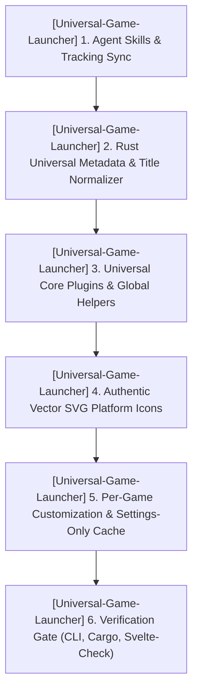

# TODO.md — HELIX Origin Consolidated Task Ledger

> 📋 **Living Source of Truth**: Actionable task ledger across all active repositories in the **HELIX Origin** organization.
> Statuses: ⬜ backlog · 🚧 in progress · ✅ done (tracked as `- [ ]` and `- [x]` checkboxes).
> High-level direction lives in [`ROADMAP.md`](./ROADMAP.md), active sprint planning in [`PLAN.md`](./PLAN.md), issues in [`BUGS.md`](./BUGS.md).
> Completed historical workstreams live in [`.github/TODO-ARCHIVE.md`](./.github/TODO-ARCHIVE.md).
> Last updated: 2026-10-16

---

## 📜 Tracking Rules

- **100% Active Direction Accuracy**: This file and its companion ledgers (`ROADMAP.md`, `PLAN.md`, `BUGS.md`) must always reflect the current, active direction of all projects with zero contradictions. Whenever a requirement changes or supersedes an earlier decision, immediately replace or remove the superseded statements in place.
- **Normalized & Categorized Locked User Directives**: Never paste raw chronological chat logs or contradictory historical quotes. Rewrite user directives into clean, typo-free engineering specifications grouped under explicit bold domain sub-headers so it is immediately clear what goes to what.
- **Zero Non-Organization Mentions**: Only reference active repositories belonging to the `HELIX-Origin` GitHub organization (`helix-docs`, `helix-origin.github.io`, `NH-Reader`, `Universal-Game-Launcher`, `Theme-Toolkit`, `Windhawk-Themes`). Never directly mention external, third-party, or deleted projects/repositories by name.
- **Atomic Checklist Groups & Archival**: Group checklist items by functional component (`- [ ] **[<project-name>] Component Group**:` followed by atomic `- [ ]` sub-tasks). Never stuff multiple distinct deliverables into a single run-on paragraph. Move completed workstreams to [`.github/TODO-ARCHIVE.md`](./.github/TODO-ARCHIVE.md) and leave a concise single-line summary under `## ✅ Completed Workstreams`.
- **Mandatory Project Tagging**: Every workstream, checklist group, task, and backlog item must explicitly include its current project tag (`[<project-name>] (<project-path>)`).
- **Active Items First**: The currently active workstream must always be placed at the top of the content sections.

---

## 🔥 Active Workstreams

### 🎯 [Universal-Game-Launcher] Workstream W.49: Universal Core Plugins & Global Helpers Architecture, Authentic Vector SVG Platform Icons, Automatic Metadata Engine & Per-Game Customization (Release v1.4.0)
- **Project Identifiers:** `[Universal-Game-Launcher]` (`projects/Universal-Game-Launcher`)
- **Target Components:**
  - **Rust Backend (`src-tauri/src/`)**: `metadata/universal.rs`, `metadata/local.rs`, `metadata/mod.rs`, `plugins/title_normalizer.rs`, `plugins/engine.rs`, `plugins/defaults.rs`, `platforms/emulation.rs`, `commands.rs`, `lib.rs`
  - **Frontend Plugins & Helpers (`src/lib/plugins/`)**: `platforms/universal.ts`, `metadata/universal.ts`, `utility/title-normalizer.ts`, `media/universal.ts`, `catalog.ts`, `engine.ts`, `index.ts`, `src/lib/worker.ts`, `src/lib/api.ts`
  - **Frontend UI & Icons (`src/`)**: `lib/components/PlatformIcon.svelte`, `routes/+layout.svelte`, `routes/library/+page.svelte`, `routes/+page.svelte`, `routes/store/+page.svelte`, `routes/social/+page.svelte`, `routes/storage/+page.svelte`, `routes/settings/+page.svelte`, `lib/components/settings/PlatformsSection.svelte`



**Locked user directives (normalized by domain):**
- **1. Universal Core Plugins & Global Helper Modules (`src/lib/plugins/` & `src-tauri/src/`)**:
  - Consolidate fragmented per-platform and per-service plugin files into unified **Universal Core Plugins** (`platform-universal`, `metadata-universal`, `utility-title-normalizer`, `media-universal`) that provide core domain functionality across all supported game providers and metadata sources, and delete the old separate per-platform/per-service files.
  - Pair each Universal Core Plugin with **Global Helper Modules/Functions** (`getAllPlatformSpecs`, `detectPlatformLauncher`, `installPlatformLauncher`, `getPlatformLaunchSpec`, `getPlatformUris`, `normalizeGameTitle`, `normalizeRomTitle`, `canonicalTitleKey`, etc.) for improved maintainability and shared functionality across the app.
- **2. Dedicated Title Normalizer Plugin (`utility-title-normalizer`)**:
  - Extract title normalization out of `emulation.rs` into its own dedicated utility plugin (`src/lib/plugins/utility/title-normalizer.ts` and `src-tauri/src/plugins/title_normalizer.rs`) so title normalization is managed cleanly in one place across all PC, local, and emulated platforms.
  - Accurately normalize RPG Maker and itch.io titles (prioritizing `System.json` `gameTitle` and stripping promotional/version suffixes so `relicts-auf-aeson` resolves to **`Relicts of Aeson`**), concatenated lowercase slugs (`myfutafamily` → **`My Futa Family`**), and inverted-article ROM titles (`Legend of Zelda, The - The Wind Waker` → **`The Legend of Zelda: The Wind Waker`**) while deduplicating `library:custom_games`.
- **3. Automatic Metadata Enhancement & Settings-Only Cache Management**:
  - Metadata providers (`metadata-universal`) must **automatically** fetch and enhance metadata and artwork for all games (PC, itch.io, standalone, and emulated console ROMs) via native Rust `reqwest` cascades (Local Inspector, Libretro Thumbnails CDN, Steam Store, GOG Catalog v1 API, Wikipedia + Wikidata MediaWiki API, PCGamingWiki Cargo, ProtonDB, and optional authenticated APIs) without dummy placeholder strings blocking enrichment.
  - Remove manual "Refresh Metadata" and "Enhance Metadata" buttons from the `/library` view; cache refresh and cache purge buttons belong **exclusively in `/settings`** (`Storage & Cache` tab) for refreshing or purging the application's data cache.
- **4. Per-Game Management & Customization (`⚙ Manage` Modal in `/library`)**:
  - Equip each game's per-game management modal (`⚙ Manage` in `/library`) with full customization controls allowing users to edit the game's **Title (Display Name)**, **Short Description**, **Developers**, **Publishers**, **Release Date**, **Genres**, and **Custom Artwork** (Portrait Capsule Cover, Hero Wallpaper Banner, and Transparent Logo via URL or local file picker).
- **5. UI Layout Synchronization & Authentic Vector SVG Platform Icons (`PlatformIcon.svelte`)**:
  - Keep `.agents/skills/universal-game-launcher.md` 100% synchronized with the actual UI being built (custom frameless title bar with `Dashboard`, `Library`, `Store`, `Social`, `Storage`, `Settings` and no right quick-filter bar; `/library`-only conditional left sidebar with PC platform and Emulation Console accordions).
  - Replace generic Unicode shapes (`♨`, `◈`, `▲`, `●`, `🎲`, etc.) across the Library sidebar, Showcase, Dashboard, Store, Social, Storage, and Settings views with **authentic vector SVG variants** (`src/lib/components/PlatformIcon.svelte`) representing each actual provider and console logo.

**Implementation checklist:**
- [x] **[Universal-Game-Launcher] 1. Agent Ecosystem & Tracking Ledger Synchronization**:
  - [x] `[Universal-Game-Launcher]` Update `.agents/skills/universal-game-launcher.md` and `.agents/skills/game-metadata-providers.md` to match the exact UI layout, `_tokens.scss` palette, Universal Core Plugins + Global Helpers architecture, and Authentic Vector SVG Platform Icons specification.
  - [x] `[Universal-Game-Launcher]` Reorganize `ROADMAP.md`, `PLAN.md`, `TODO.md`, `BUGS.md`, and `.agents/rules/workspace.md` with categorized, contradiction-free directives and zero non-organization project mentions.
- [x] **[Universal-Game-Launcher] 2. Dedicated Title Normalizer & Local Inspector Backend (`src-tauri/src/`)**:
  - [x] `[Universal-Game-Launcher]` Create `src-tauri/src/plugins/title_normalizer.rs` (`normalize_game_title`, `normalize_rom_title`, `canonical_title_key`) handling article inversion, unified `: ` subtitle separators, promotional/version noise stripping (`Relicts of Aeson`), and compound word splitting (`My Futa Family`).
  - [x] `[Universal-Game-Launcher]` Update `src-tauri/src/metadata/local.rs` and `src-tauri/src/plugins/engine.rs` to inspect 1-level child folders for RPG Maker `System.json` (`"gameTitle"`), parse `snake_case` itch.io receipt fields, and exclude `Launcher`, `Legendary`, `broth`, and `downloads` folders.
  - [x] `[Universal-Game-Launcher]` Create `src-tauri/src/metadata/universal.rs` implementing multi-source automatic metadata & artwork resolution (Local Inspector + Libretro Thumbnails CDN + Steam Store + GOG Catalog v1 + Wikipedia/Wikidata MediaWiki API + PCGamingWiki Cargo).
- [x] **[Universal-Game-Launcher] 3. Rust IPC Commands & Placeholder Filtering (`src-tauri/src/commands.rs` & `lib.rs`)**:
  - [x] `[Universal-Game-Launcher]` Update `get_cached_game_metadata` and `import_platform_games` in `src-tauri/src/commands.rs` to strip legacy dummy placeholder descriptions (`"Emulated title for..."`) and inspect local manifests on import.
  - [x] `[Universal-Game-Launcher]` Add native `fetch_external_json` Tauri command in `src-tauri/src/commands.rs`, register in `src-tauri/src/lib.rs`, and expose `api.fetchExternalJson` in `src/lib/api.ts`.
- [ ] **[Universal-Game-Launcher] 4. Frontend Universal Core Plugins & Global Helper Modules (`src/lib/plugins/`)**:
  - [ ] `[Universal-Game-Launcher]` Create `src/lib/plugins/platforms/universal.ts` (`platform-universal`) with `PLATFORM_SPECS` and global platform helper functions (`getAllPlatformSpecs`, `detectPlatformLauncher`, `installPlatformLauncher`, `getPlatformLaunchSpec`, `getPlatformUris`), and delete the 12 obsolete separate platform plugin files.
  - [ ] `[Universal-Game-Launcher]` Create `src/lib/plugins/metadata/universal.ts` (`metadata-universal`) with automatic multi-provider cascade and global metadata helpers, and delete the 11 obsolete separate metadata plugin files.
  - [ ] `[Universal-Game-Launcher]` Create `src/lib/plugins/utility/title-normalizer.ts` (`utility-title-normalizer`) and `src/lib/plugins/media/universal.ts` (`media-universal`), delete obsolete `trailers.ts` and `ambient.ts`, and synchronize `catalog.ts`, `engine.ts`, `index.ts`, `defaults.rs`, and `worker.ts`.
- [ ] **[Universal-Game-Launcher] 5. Authentic Vector SVG Platform & Console Icons (`src/lib/components/PlatformIcon.svelte`)**:
  - [ ] `[Universal-Game-Launcher]` Create `src/lib/components/PlatformIcon.svelte` rendering custom vector SVG icon variants for all PC game providers (`steam`, `gog`, `epic`, `itch`, `xbox`, `ea`, `ubisoft`, `battlenet`, `amazon`, `rockstar`, `standalone`) and emulation consoles (`Nintendo GameCube`, `PlayStation`, `Nintendo 64`, `Super Nintendo`, `Game Boy Advance`, `Nintendo Switch`, `Sega Dreamcast`, etc.).
  - [ ] `[Universal-Game-Launcher]` Replace generic Unicode platform shapes with `<PlatformIcon />` across `src/routes/+layout.svelte`, `src/routes/library/+page.svelte`, `src/routes/+page.svelte`, `src/routes/store/+page.svelte`, `src/routes/social/+page.svelte`, `src/routes/storage/+page.svelte`, and `src/lib/components/settings/PlatformsSection.svelte`.
- [ ] **[Universal-Game-Launcher] 6. Per-Game Customization Modal & Settings-Only Cache Controls (`src/routes/library/+page.svelte` & `settings/+page.svelte`)**:
  - [ ] `[Universal-Game-Launcher]` Remove manual "Refresh Metadata" and "Enhance Metadata" buttons from `src/routes/library/+page.svelte` so cache refresh and purge actions live exclusively in `/settings` (`Storage & Cache` tab).
  - [ ] `[Universal-Game-Launcher]` Upgrade the `⚙ Manage` modal in `src/routes/library/+page.svelte` to allow customizing each game's Title, Short Description, Developers, Publishers, Release Date, Genres, and Custom Artwork (Portrait Capsule URL/file, Hero Banner URL/file, Transparent Logo URL/file).
- [ ] **[Universal-Game-Launcher] 7. Quality Gate & End-to-End Verification**:
  - [ ] `[Universal-Game-Launcher]` Verify `--cli scan` output confirms clean titles (`Relicts of Aeson`, `My Futa Family`, `The Legend of Zelda: The Wind Waker`) and zero duplicate entries.
  - [ ] `[Universal-Game-Launcher]` Pass `cargo check`, `cargo test`, `svelte-check` (0 errors, 0 warnings), and `npm run build`.

---

## ⬜ Backlog / Candidate Tasks

### [NH-Reader] (projects/NH-Reader) — Post-v0.7.5 / M13 Candidates
- [ ] `[NH-Reader]` **Tag Frequency Analytics**: Local reading history analytics showing top consumed tags, artists, and languages.
- [ ] `[NH-Reader]` **Multi-Profile Partitioning**: Allow switching between isolated library/blacklist profile stores.
- [ ] `[NH-Reader]` **Background Update Inspection**: Non-intrusive GitHub release notification check on app launch.

### [helix-docs] (projects/helix-docs) — v1.1.0 Candidates
- [ ] `[helix-docs]` **Mermaid Helper Component**: Client-side rendering helper for legible ` ```mermaid ` fences.
- [ ] `[helix-docs]` **In-Page TOC Module**: Robust sidebar TOC parser resolving `BUG-14`.
- [ ] `[helix-docs]` **Dynamic Catalogue Filters**: Interactive category filtering for software and theme showrooms.

### [Windhawk-Themes] (projects/Windhawk-Themes) — M.04 Candidates
- [ ] `[Windhawk-Themes]` **Theme Catalogue Integration**: Generate Jekyll showcase documentation in `docs/_catalogue/`.
- [ ] `[Windhawk-Themes]` **Full Multi-Mod Windows 11 Verification**: Validate cohesive visual language across 22H2, 23H2, and 24H2.

### [Theme-Toolkit] (projects/Theme-Toolkit) — Candidates (Planned)
- [ ] `[Theme-Toolkit]` **Core Tauri v2 Scaffolding**: Setup Tauri v2 app with SvelteKit frontend and Rust backend.
- [ ] `[Theme-Toolkit]` **Makecab & DDF Packaging Engine**: Rust engine generating Diamond Directive Files (`.ddf`) and executing `makecab.exe`.
- [ ] `[Theme-Toolkit]` **Sound Scheme Manager**: Win32 Sound Event mapping and `.wav` audio preview / bundling.
- [ ] `[Theme-Toolkit]` **Wallpaper & Slideshow Studio**: Desktop background viewport, slideshow interval / shuffle controls, and alignment settings.
- [ ] `[Theme-Toolkit]` **Cursor Scheme Inspector**: 15 standard Win32 cursor role configuration with `.ani` and `.cur` frame previews.
- [ ] `[Theme-Toolkit]` **Color & Visual Style Editor**: Real-time DWM accent colorization and dark/light system mode toggles.

---

## ✅ Completed Workstreams (Bare-Minimal Index)

> 📖 **Full Archive Details**: For complete task checklists, locked user directives, and technical scope notes, see [`.github/TODO-ARCHIVE.md`](./.github/TODO-ARCHIVE.md).

### [Universal-Game-Launcher] (projects/Universal-Game-Launcher)
- **[Universal-Game-Launcher] W.48 — Universal Game Launcher Rebranding, Generic SQLite Persistence, EmulationStation Scaffolding, Background Worker & Headless CLI Foundation (v1.4.0 Phase 1)**: Complete rebranding, `database.sqlite` + `mem_kv`, Steam/GOG-style titlebar & `/library` showcase UI, `/store` & `/social` hubs, archived ROM auto-extraction with `rom.ini`, `GlobalBackgroundWorker`, and `--cli` engine. See [`.github/TODO-ARCHIVE.md`](./.github/TODO-ARCHIVE.md).
- **[Universal-Game-Launcher] W.47 — Project Script Standards, Manifest Schema 1.12.0 & IDE Untracking (Hotfix v1.3.3)**: Canonical `main:sub:option` scripts, schema 1.12.0 validation, `.vscode` untracking, release CI. See [`.github/TODO-ARCHIVE.md`](./.github/TODO-ARCHIVE.md).
- **[Universal-Game-Launcher] W.46 — Cross-Platform Compiler Warning Elimination & Release Pipeline Hardening (Hotfix v1.3.2)**: POSIX/Windows compiler warnings resolved, release v1.3.2. See [`.github/TODO-ARCHIVE.md`](./.github/TODO-ARCHIVE.md).
- **[Universal-Game-Launcher] W.45 — Modular Multi-Platform Free Game Checker, Store Deals Engine, Library Patch Notes & Settings Ergonomics (Patch v1.3.1)**: Per-platform checkers, deals engine, patch notes feed, sidebar cog. See [`.github/TODO-ARCHIVE.md`](./.github/TODO-ARCHIVE.md).
- **[Universal-Game-Launcher] W.44 — Two-Tier Data Architecture: In-Memory Serverless Redis-Compatible KV Tier & SQLite Global Persistence Layer**: In-memory KV tier and SQLite persistence. See [`.github/TODO-ARCHIVE.md`](./.github/TODO-ARCHIVE.md).
- **[Universal-Game-Launcher] W.42 — Multi-Platform Launcher Detection, Settings Toggle Guards & Built-in Legendary CLI**: Detection guards, Legendary OAuth authentication. See [`.github/TODO-ARCHIVE.md`](./.github/TODO-ARCHIVE.md).
- **[Universal-Game-Launcher] W.41 — Persistent Local Artwork Cache, In-Memory Fast Lookup, CSP Alignment & Settings Cache Reset**: `art_cache/` local disk cache, CSP `img-src` expansion. See [`.github/TODO-ARCHIVE.md`](./.github/TODO-ARCHIVE.md).
- **[Universal-Game-Launcher] W.35 — Multi-Provider Metadata Parity, Settings & Per-Game Refresh**: Full metadata synchronization and localization. See [`.github/TODO-ARCHIVE.md`](./.github/TODO-ARCHIVE.md).
- **[Universal-Game-Launcher] W.34 — Library 500 Repair, Artwork & Custom Display Name Sub-Window, Settings Consolidation**: Restored store export, artwork slot manager. See [`.github/TODO-ARCHIVE.md`](./.github/TODO-ARCHIVE.md).
- **[Universal-Game-Launcher] W.33 — Multi-Platform Owned Games Detection, Official & Enhanced Metadata Engine, Interactive Library**: Multi-platform aggregation and per-game management. See [`.github/TODO-ARCHIVE.md`](./.github/TODO-ARCHIVE.md).
- **[Universal-Game-Launcher] W.32 — Windows Store & Xbox Game Detection, Custom NSIS Installer, and System Tray Support**: AppModel scan, NSIS mutex hooks, tray minimize. See [`.github/TODO-ARCHIVE.md`](./.github/TODO-ARCHIVE.md).
- **[Universal-Game-Launcher] W.18–W.28 — Milestones M1–M9 (Foundation through v1.0.0 Packaging)**: Whole library, filter builder, storage manager, custom artwork, smart collections, SQLite cache, obsidian UI, v1.0.0 release. See [`.github/TODO-ARCHIVE.md`](./.github/TODO-ARCHIVE.md).

### [Windhawk-Themes] (projects/Windhawk-Themes)
- **[Windhawk-Themes] W.15 — Command Center Suite Docs Sync (2026-10-13 Refactor)**: Cleaned stale references, synchronized README, static gate 0 errors / 0 warnings. See [`.github/TODO-ARCHIVE.md`](./.github/TODO-ARCHIVE.md).
- **[Windhawk-Themes] W.12 — Command Center — High-Contrast & explorer.exe Crash Fixes**: Confirmed crash caused by external mod; resolved high contrast fallback issues. See [`.github/TODO-ARCHIVE.md`](./.github/TODO-ARCHIVE.md).
- **[Windhawk-Themes] W.11 — Command Center Catalogue — Companion Extras Documentation**: Documented Phone Link and companion integration in docs catalogue. See [`.github/TODO-ARCHIVE.md`](./.github/TODO-ARCHIVE.md).
- **[Windhawk-Themes] W.08 — Site Branding Artwork (logo / icon / favicon)**: Squircle SVG logo, multi-size favicon suite. See [`.github/TODO-ARCHIVE.md`](./.github/TODO-ARCHIVE.md).
- **[Windhawk-Themes] W.04 — Suite Refinements & Geometry Alignment**: Start menu pin centering, companion card alignment. See [`.github/TODO-ARCHIVE.md`](./.github/TODO-ARCHIVE.md).
- **[Windhawk-Themes] Milestones M.01 & M.02 Foundation**: Initial agent ecosystem rules, Notification Center styler with frosted glass and rim highlights. See [`.github/TODO-ARCHIVE.md`](./.github/TODO-ARCHIVE.md).

### [NH-Reader] (projects/NH-Reader)
- **[NH-Reader] Milestones M1–M12 & Web Assets (v0.1.0 – v0.7.5)**: Core foundation, browse, search filter drawer, blacklist stream buffering, responsive reader, 18-language localization core, NSIS installer polish, squircle website assets, unified `npm run sign` script. See [`.github/TODO-ARCHIVE.md`](./.github/TODO-ARCHIVE.md).

### [helix-docs] (projects/helix-docs)
- **[helix-docs] W.14 — Doc Site Refinements — Catalogue Width & ShareX Copy**: Expanded catalogue min column width to 400px, ShareX workflow docs. See [`.github/TODO-ARCHIVE.md`](./.github/TODO-ARCHIVE.md).
- **[helix-docs] W.10 — Home Page (vCard Pattern) Documentation**: Modular card authoring guide for landing pages. See [`.github/TODO-ARCHIVE.md`](./.github/TODO-ARCHIVE.md).
- **[helix-docs] W.06 & W.07 — Sidebar, Mermaid Rendering & Branding Artwork**: Fixed mermaid rendering, SVG squircle logo and multi-size favicon. See [`.github/TODO-ARCHIVE.md`](./.github/TODO-ARCHIVE.md).
- **[helix-docs] Theme Phases 1–5 & v1.0.0 Release**: Layered SCSS architecture, precompiled Dart Sass CSS, pure frontmatter nav engine, modular cards, universal navbar. See [`.github/TODO-ARCHIVE.md`](./.github/TODO-ARCHIVE.md).

### [Theme-Toolkit] (projects/Theme-Toolkit)
- **[Theme-Toolkit] W.39 — Theme Toolkit Repository Creation, Base Framework Scaffolding, and Dedicated Agent Suite**: Tauri v2 app scaffolding, Per-Platform Lib isolation, dedicated agents and rules. See [`.github/TODO-ARCHIVE.md`](./.github/TODO-ARCHIVE.md).
- **[Ecosystem-Wide] & [Theme-Toolkit] W.38 — GTK Theming Removal, Desktop Theme Engineer Repurposing & Windows Deskthemepack Engineering Suite Planning**: Purged GTK theming; pivoted to cross-platform Theme Toolkit and Microsoft `makecab.exe` DDF standards. See [`.github/TODO-ARCHIVE.md`](./.github/TODO-ARCHIVE.md).

### [helix-origin.github.io] (projects/helix-origin.github.io)
- **[helix-origin.github.io] W.09 & Portal Modernization**: Remote theme standardization, 16:9 vector showcase artwork integration (`universal-game-launcher.svg`, `nh-reader.svg`, `windhawk-themes.svg`, `helix-docs.svg`). See [`.github/TODO-ARCHIVE.md`](./.github/TODO-ARCHIVE.md).

### [Ecosystem & Infrastructure] (workspace root)
- **[Ecosystem-Wide] W.43 — Multi-Platform Clean Uninstaller Architecture, Windows Uninstall Registry Invariant & Process Termination Standards**: NSIS mutex termination hooks, registry hygiene, macOS/Linux uninstaller templates. See [`.github/TODO-ARCHIVE.md`](./.github/TODO-ARCHIVE.md).
- **[Ecosystem-Wide] W.36 — Ecosystem Scripts Standard, Platform Module Isolation, Opt-In Code Signing, and Package Registration**: Canonical `main:sub:option` standard, local code signing. See [`.github/TODO-ARCHIVE.md`](./.github/TODO-ARCHIVE.md).
- **[Ecosystem] W.21 & W.05 — Agent Governance, Workflow Skills & Template Architecture**: Workspace rules, task decomposition, file editing, shell command management, and tracking ledger templates. See [`.github/TODO-ARCHIVE.md`](./.github/TODO-ARCHIVE.md).
- **[Ecosystem] W.16 — Global Documentation Theme-Neutrality Invariant**: Enforced mod-agnostic and theme-neutral documentation standards across all projects. See [`.github/TODO-ARCHIVE.md`](./.github/TODO-ARCHIVE.md).
- **[Ecosystem] W.13 — Stale Agents-Ecosystem Reference Cleanup**: Removed internal workspace references from all standalone public repositories. See [`.github/TODO-ARCHIVE.md`](./.github/TODO-ARCHIVE.md).
