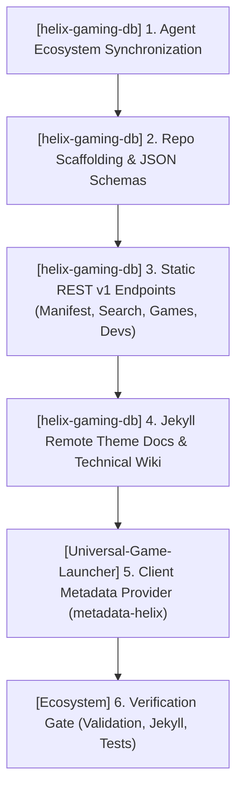

# TODO.md — HELIX Origin Consolidated Task Ledger

> 📋 **Living Source of Truth**: Actionable task ledger across all active repositories in the **HELIX Origin** organization.
> Statuses: ⬜ backlog · 🚧 in progress · ✅ done (tracked as `- [ ]` and `- [x]` checkboxes).
> High-level direction lives in [`ROADMAP.md`](./ROADMAP.md), active sprint planning in [`PLAN.md`](./PLAN.md), issues in [`BUGS.md`](./BUGS.md).
> Completed historical workstreams live in [`.github/TODO-ARCHIVE.md`](./.github/TODO-ARCHIVE.md).
> Last updated: 2026-10-16

---

## 📜 Tracking Rules

- **100% Active Direction Accuracy**: This file and its companion ledgers (`ROADMAP.md`, `PLAN.md`, `BUGS.md`) must always reflect the current, active direction of all projects with zero contradictions. Whenever a requirement changes or supersedes an earlier decision, immediately replace or remove the superseded statements in place.
- **Normalized & Categorized Locked User Directives**: Never paste raw chronological chat logs or contradictory historical quotes. Rewrite user directives into clean, typo-free engineering specifications grouped under explicit bold domain sub-headers so it is immediately clear what goes to what.
- **Zero Non-Organization Mentions**: Only reference active repositories belonging to the `HELIX-Origin` GitHub organization (`helix-docs`, `helix-origin.github.io`, `NH-Reader`, `Universal-Game-Launcher`, `Theme-Toolkit`, `Windhawk-Themes`). Never directly mention external, third-party, or deleted projects/repositories by name.
- **Atomic Checklist Groups & Archival**: Group checklist items by functional component (`- [ ] **[<project-name>] Component Group**:` followed by atomic `- [ ]` sub-tasks). Never stuff multiple distinct deliverables into a single run-on paragraph. Move completed workstreams to [`.github/TODO-ARCHIVE.md`](./.github/TODO-ARCHIVE.md) and leave a concise single-line summary under `## ✅ Completed Workstreams`.
- **Mandatory Project Tagging**: Every workstream, checklist group, task, and backlog item must explicitly include its current project tag (`[<project-name>] (<project-path>)`).
- **Active Items First**: The currently active workstream must always be placed at the top of the content sections.

---

## 🔥 Active Workstreams

### 🎯 [helix-gaming-db] & [Universal-Game-Launcher] Workstream W.50: HELIX Gaming DB REST API Foundation, Static v1 Endpoints, JSON Schemas, Remote Theme Docs / Wiki & UGL Integration (Release v1.0.0)
- **Project Identifiers:** `[helix-gaming-db]` (`projects/helix-gaming-db`), `[Universal-Game-Launcher]` (`projects/Universal-Game-Launcher`)
- **Target Components:**
  - **Gaming DB API & Schemas (`projects/helix-gaming-db/`)**: `api/v1/manifest.json`, `api/v1/search/index.json`, `api/v1/games/`, `api/v1/developers/`, `schemas/game.schema.json`, `schemas/developer.schema.json`, `schemas/manifest.schema.json`, `scripts/validate.mjs`, `scripts/build-search-index.mjs`, `package.json`
  - **Gaming DB Documentation & Wiki (`projects/helix-gaming-db/`)**: `_config.yml`, `index.md`, `_docs/`, `_wiki/`, `_data/nav.yml`
  - **UGL Client Provider (`projects/Universal-Game-Launcher/`)**: `src/lib/plugins/metadata/helix-db.ts`, `src/lib/plugins/metadata/universal.ts`, `src-tauri/src/metadata/universal.rs`, `src/routes/settings/+page.svelte`



**Locked user directives (normalized by domain):**
- **1. Dedicated Gaming Metadata Repository & REST API Architecture (`helix-gaming-db`)**:
  - Establish `helix-gaming-db` as a dedicated repository in the `HELIX-Origin` GitHub organization (`https://github.com/HELIX-Origin/helix-gaming-db`) hosted via GitHub Pages (`https://helix-origin.github.io/helix-gaming-db/`).
  - Serve static, cacheable JSON endpoints under `/api/v1/` mimicking a production REST API:
    - `/api/v1/manifest.json`: Database metadata, total game count, total developer count, schema version, and updated timestamp.
    - `/api/v1/search/index.json`: Lightweight index mapping normalized title slugs and aliases to metadata payloads for instant client-side search.
    - `/api/v1/games/{slug}.json`: Complete metadata payload for each game (title, aliases, developers, publishers, releaseDate, releaseYear, genres, categories, tags, ageRating, userScore, capsuleImage, heroImage, logoImage, headerImage, screenshots, movies, soundtracks, detailedDescription).
    - `/api/v1/developers/{slug}.json`: Developer studio profiles, aliases, websites, and associated game slugs.
- **2. Documentation & Technical Wiki Powered by `helix-docs`**:
  - Build a rich documentation portal and wiki using `remote_theme: HELIX-Origin/helix-docs`.
  - Maintain strict documentation theme-neutrality: the docs explain the REST API specifications, endpoints, schema definitions, and contribution workflows without coupling to any theme styling.
- **3. Curation Standards & Initial Seed Datasets**:
  - Populate initial high-fidelity seed datasets from our curated hand-rolled catalog (Square Enix, Falcom, Nintendo, Neyor, Sierra Lee, NLT Media, Dr PinkCake, Proxxie, Caribdis, Kompas Productions) with verified Steam CDN and itch artwork.
  - Implement automated JSON schema validation (`scripts/validate.mjs`) ensuring zero schema drift.
- **4. Client Integration in Universal Game Launcher**:
  - Integrate `helix-gaming-db` as a primary high-priority metadata provider (`metadata-helix`) in `Universal-Game-Launcher`, querying the REST API endpoints and falling back gracefully to local offline datasets when disconnected.

**Implementation checklist:**
- [x] **[helix-gaming-db] 1. Agent Ecosystem & Tracking Ledger Synchronization**:
  - [x] `[helix-gaming-db]` Register `helix-gaming-db` in `AGENTS.md`, `.agents/rules/workspace.md`, and `.github/copilot-instructions.md`.
  - [x] `[helix-gaming-db]` Update `ROADMAP.md`, `PLAN.md`, `TODO.md`, and `BUGS.md` with normalized directives, milestone definitions, and atomic execution tasks.
- [x] **[helix-gaming-db] 2. Repository Scaffolding, Package Manifest & JSON Schemas**:
  - [x] `[helix-gaming-db]` Initialize `projects/helix-gaming-db` with `.gitignore`, `.gitattributes` (`eol=lf`), `package.json`, and `README.md`.
  - [x] `[helix-gaming-db]` Create JSON schemas: `schemas/manifest.schema.json`, `schemas/game.schema.json`, `schemas/developer.schema.json`.
  - [x] `[helix-gaming-db]` Implement `scripts/validate.mjs` and `scripts/build-search-index.mjs` for automated schema testing and index generation.
- [x] **[helix-gaming-db] 3. Static REST v1 Endpoints & Seed Datasets (`api/v1/`)**:
  - [x] `[helix-gaming-db]` Author initial developer profiles under `api/v1/developers/` (`square-enix.json`, `falcom.json`, `nintendo.json`, `neyor.json`, `sierra-lee.json`, `nlt-media.json`, `dr-pink-cake.json`, `proxxie.json`, `caribdis.json`, `kompas.json`).
  - [x] `[helix-gaming-db]` Author initial comprehensive game payloads under `api/v1/games/` (`final-fantasy-xiv-a-realm-reborn.json`, `ys-viii-lacrimosa-of-dana.json`, `crossdressing-in-camelot.json`, `the-last-sovereign.json`, `third-crisis.json`, `the-genesis-order.json`, `treasure-of-nadia.json`, `being-a-dik.json`, `relicts-of-aeson.json`, `eternum.json`, `my-futa-family.json`, etc.).
  - [x] `[helix-gaming-db]` Generate `api/v1/search/index.json` and `api/v1/manifest.json`.
- [x] **[helix-gaming-db] 4. Jekyll Remote Theme Docs & Technical Wiki**:
  - [x] `[helix-gaming-db]` Create `_config.yml` (`remote_theme: HELIX-Origin/helix-docs`), `index.md` (portal homepage and interactive API explorer).
  - [x] `[helix-gaming-db]` Create documentation pages under `_docs/` (`index.md`, `endpoints.md`, `schemas.md`, `contributing.md`).
  - [x] `[helix-gaming-db]` Create technical wiki under `_wiki/` (`index.md`, `architecture.md`, `metadata-standards.md`, `artwork-standards.md`).
- [x] **[Universal-Game-Launcher] 5. Client Metadata Provider Integration (`metadata-helix`)**:
  - [x] `[Universal-Game-Launcher]` Add `src/lib/plugins/metadata/helix-db.ts` querying `api/v1/search/index.json` and `api/v1/games/{slug}.json` via `api.fetchExternalJson`.
  - [x] `[Universal-Game-Launcher]` Wire provider into `src/lib/plugins/metadata/universal.ts` as primary authoritative source with multi-domain fallback (`helix-origin.club` -> `helix-origin.github.io`) and local offline catalog backup.
- [x] **[Ecosystem] 6. Verification Gate & Quality Assurance**:
  - [x] `[helix-gaming-db]` Run `node scripts/validate.mjs` (0 errors, 100% schemas valid for 62 games and 28 developers).
  - [x] `[Universal-Game-Launcher]` Run `cargo check`, `cargo test` (35 passing), `svelte-check` (0 errors, 0 warnings).

---

## ⬜ Backlog / Candidate Tasks

### [NH-Reader] (projects/NH-Reader) — Post-v0.7.5 / M13 Candidates
- [ ] `[NH-Reader]` **Tag Frequency Analytics**: Local reading history analytics showing top consumed tags, artists, and languages.
- [ ] `[NH-Reader]` **Multi-Profile Partitioning**: Allow switching between isolated library/blacklist profile stores.
- [ ] `[NH-Reader]` **Background Update Inspection**: Non-intrusive GitHub release notification check on app launch.

### [helix-docs] (projects/helix-docs) — v1.1.0 Candidates
- [ ] `[helix-docs]` **Mermaid Helper Component**: Client-side rendering helper for legible ` ```mermaid ` fences.
- [ ] `[helix-docs]` **In-Page TOC Module**: Robust sidebar TOC parser resolving `BUG-14`.
- [ ] `[helix-docs]` **Dynamic Catalogue Filters**: Interactive category filtering for software and theme showrooms.

### [Windhawk-Themes] (projects/Windhawk-Themes) — M.04 Candidates
- [ ] `[Windhawk-Themes]` **Theme Catalogue Integration**: Generate Jekyll showcase documentation in `docs/_catalogue/`.
- [ ] `[Windhawk-Themes]` **Full Multi-Mod Windows 11 Verification**: Validate cohesive visual language across 22H2, 23H2, and 24H2.

### [Theme-Toolkit] (projects/Theme-Toolkit) — Candidates (Planned)
- [ ] `[Theme-Toolkit]` **Core Tauri v2 Scaffolding**: Setup Tauri v2 app with SvelteKit frontend and Rust backend.
- [ ] `[Theme-Toolkit]` **Makecab & DDF Packaging Engine**: Rust engine generating Diamond Directive Files (`.ddf`) and executing `makecab.exe`.
- [ ] `[Theme-Toolkit]` **Sound Scheme Manager**: Win32 Sound Event mapping and `.wav` audio preview / bundling.
- [ ] `[Theme-Toolkit]` **Wallpaper & Slideshow Studio**: Desktop background viewport, slideshow interval / shuffle controls, and alignment settings.
- [ ] `[Theme-Toolkit]` **Cursor Scheme Inspector**: 15 standard Win32 cursor role configuration with `.ani` and `.cur` frame previews.
- [ ] `[Theme-Toolkit]` **Color & Visual Style Editor**: Real-time DWM accent colorization and dark/light system mode toggles.

---

## ✅ Completed Workstreams (Bare-Minimal Index)

> 📖 **Full Archive Details**: For complete task checklists, locked user directives, and technical scope notes, see [`.github/TODO-ARCHIVE.md`](./.github/TODO-ARCHIVE.md).

### [Universal-Game-Launcher] (projects/Universal-Game-Launcher)
- **[Universal-Game-Launcher] W.49 — Universal Core Plugins & Global Helpers Architecture, Authentic Vector SVG Platform Icons, Automatic Metadata Engine & Per-Game Customization (v1.4.0)**: Consolidated Universal Core Plugins, Authentic Vector SVG Platform Icons (`PlatformIcon.svelte`), multi-source automatic metadata cascade, `⚙ Manage` per-game customization modal, client discovery across all 7 desktop platforms outside Steam, and modular hand-rolled developer catalog. See [`.github/TODO-ARCHIVE.md`](./.github/TODO-ARCHIVE.md).
- **[Universal-Game-Launcher] W.47 — Project Script Standards, Manifest Schema 1.12.0 & IDE Untracking (Hotfix v1.3.3)**: Canonical `main:sub:option` scripts, schema 1.12.0 validation, `.vscode` untracking, release CI. See [`.github/TODO-ARCHIVE.md`](./.github/TODO-ARCHIVE.md).
- **[Universal-Game-Launcher] W.46 — Cross-Platform Compiler Warning Elimination & Release Pipeline Hardening (Hotfix v1.3.2)**: POSIX/Windows compiler warnings resolved, release v1.3.2. See [`.github/TODO-ARCHIVE.md`](./.github/TODO-ARCHIVE.md).
- **[Universal-Game-Launcher] W.45 — Modular Multi-Platform Free Game Checker, Store Deals Engine, Library Patch Notes & Settings Ergonomics (Patch v1.3.1)**: Per-platform checkers, deals engine, patch notes feed, sidebar cog. See [`.github/TODO-ARCHIVE.md`](./.github/TODO-ARCHIVE.md).
- **[Universal-Game-Launcher] W.44 — Two-Tier Data Architecture: In-Memory Serverless Redis-Compatible KV Tier & SQLite Global Persistence Layer**: In-memory KV tier and SQLite persistence. See [`.github/TODO-ARCHIVE.md`](./.github/TODO-ARCHIVE.md).
- **[Universal-Game-Launcher] W.42 — Multi-Platform Launcher Detection, Settings Toggle Guards & Built-in Legendary CLI**: Detection guards, Legendary OAuth authentication. See [`.github/TODO-ARCHIVE.md`](./.github/TODO-ARCHIVE.md).
- **[Universal-Game-Launcher] W.41 — Persistent Local Artwork Cache, In-Memory Fast Lookup, CSP Alignment & Settings Cache Reset**: `art_cache/` local disk cache, CSP `img-src` expansion. See [`.github/TODO-ARCHIVE.md`](./.github/TODO-ARCHIVE.md).
- **[Universal-Game-Launcher] W.35 — Multi-Provider Metadata Parity, Settings & Per-Game Refresh**: Full metadata synchronization and localization. See [`.github/TODO-ARCHIVE.md`](./.github/TODO-ARCHIVE.md).
- **[Universal-Game-Launcher] W.34 — Library 500 Repair, Artwork & Custom Display Name Sub-Window, Settings Consolidation**: Restored store export, artwork slot manager. See [`.github/TODO-ARCHIVE.md`](./.github/TODO-ARCHIVE.md).
- **[Universal-Game-Launcher] W.33 — Multi-Platform Owned Games Detection, Official & Enhanced Metadata Engine, Interactive Library**: Multi-platform aggregation and per-game management. See [`.github/TODO-ARCHIVE.md`](./.github/TODO-ARCHIVE.md).
- **[Universal-Game-Launcher] W.32 — Windows Store & Xbox Game Detection, Custom NSIS Installer, and System Tray Support**: AppModel scan, NSIS mutex hooks, tray minimize. See [`.github/TODO-ARCHIVE.md`](./.github/TODO-ARCHIVE.md).
- **[Universal-Game-Launcher] W.18–W.28 — Milestones M1–M9 (Foundation through v1.0.0 Packaging)**: Whole library, filter builder, storage manager, custom artwork, smart collections, SQLite cache, obsidian UI, v1.0.0 release. See [`.github/TODO-ARCHIVE.md`](./.github/TODO-ARCHIVE.md).

### [Windhawk-Themes] (projects/Windhawk-Themes)
- **[Windhawk-Themes] W.15 — Command Center Suite Docs Sync (2026-10-13 Refactor)**: Cleaned stale references, synchronized README, static gate 0 errors / 0 warnings. See [`.github/TODO-ARCHIVE.md`](./.github/TODO-ARCHIVE.md).
- **[Windhawk-Themes] W.12 — Command Center — High-Contrast & explorer.exe Crash Fixes**: Confirmed crash caused by external mod; resolved high contrast fallback issues. See [`.github/TODO-ARCHIVE.md`](./.github/TODO-ARCHIVE.md).
- **[Windhawk-Themes] W.11 — Command Center Catalogue — Companion Extras Documentation**: Documented Phone Link and companion integration in docs catalogue. See [`.github/TODO-ARCHIVE.md`](./.github/TODO-ARCHIVE.md).
- **[Windhawk-Themes] W.08 — Site Branding Artwork (logo / icon / favicon)**: Squircle SVG logo, multi-size favicon suite. See [`.github/TODO-ARCHIVE.md`](./.github/TODO-ARCHIVE.md).
- **[Windhawk-Themes] W.04 — Suite Refinements & Geometry Alignment**: Start menu pin centering, companion card alignment. See [`.github/TODO-ARCHIVE.md`](./.github/TODO-ARCHIVE.md).
- **[Windhawk-Themes] Milestones M.01 & M.02 Foundation**: Initial agent ecosystem rules, Notification Center styler with frosted glass and rim highlights. See [`.github/TODO-ARCHIVE.md`](./.github/TODO-ARCHIVE.md).

### [NH-Reader] (projects/NH-Reader)
- **[NH-Reader] Milestones M1–M12 & Web Assets (v0.1.0 – v0.7.5)**: Core foundation, browse, search filter drawer, blacklist stream buffering, responsive reader, 18-language localization core, NSIS installer polish, squircle website assets, unified `npm run sign` script. See [`.github/TODO-ARCHIVE.md`](./.github/TODO-ARCHIVE.md).

### [helix-docs] (projects/helix-docs)
- **[helix-docs] W.14 — Doc Site Refinements — Catalogue Width & ShareX Copy**: Expanded catalogue min column width to 400px, ShareX workflow docs. See [`.github/TODO-ARCHIVE.md`](./.github/TODO-ARCHIVE.md).
- **[helix-docs] W.10 — Home Page (vCard Pattern) Documentation**: Modular card authoring guide for landing pages. See [`.github/TODO-ARCHIVE.md`](./.github/TODO-ARCHIVE.md).
- **[helix-docs] W.06 & W.07 — Sidebar, Mermaid Rendering & Branding Artwork**: Fixed mermaid rendering, SVG squircle logo and multi-size favicon. See [`.github/TODO-ARCHIVE.md`](./.github/TODO-ARCHIVE.md).
- **[helix-docs] Theme Phases 1–5 & v1.0.0 Release**: Layered SCSS architecture, precompiled Dart Sass CSS, pure frontmatter nav engine, modular cards, universal navbar. See [`.github/TODO-ARCHIVE.md`](./.github/TODO-ARCHIVE.md).

### [Theme-Toolkit] (projects/Theme-Toolkit)
- **[Theme-Toolkit] W.39 — Theme Toolkit Repository Creation, Base Framework Scaffolding, and Dedicated Agent Suite**: Tauri v2 app scaffolding, Per-Platform Lib isolation, dedicated agents and rules. See [`.github/TODO-ARCHIVE.md`](./.github/TODO-ARCHIVE.md).
- **[Ecosystem-Wide] & [Theme-Toolkit] W.38 — GTK Theming Removal, Desktop Theme Engineer Repurposing & Windows Deskthemepack Engineering Suite Planning**: Purged GTK theming; pivoted to cross-platform Theme Toolkit and Microsoft `makecab.exe` DDF standards. See [`.github/TODO-ARCHIVE.md`](./.github/TODO-ARCHIVE.md).

### [helix-origin.github.io] (projects/helix-origin.github.io)
- **[helix-origin.github.io] W.09 & Portal Modernization**: Remote theme standardization, 16:9 vector showcase artwork integration (`universal-game-launcher.svg`, `nh-reader.svg`, `windhawk-themes.svg`, `helix-docs.svg`). See [`.github/TODO-ARCHIVE.md`](./.github/TODO-ARCHIVE.md).

### [Ecosystem & Infrastructure] (workspace root)
- **[Ecosystem-Wide] W.43 — Multi-Platform Clean Uninstaller Architecture, Windows Uninstall Registry Invariant & Process Termination Standards**: NSIS mutex termination hooks, registry hygiene, macOS/Linux uninstaller templates. See [`.github/TODO-ARCHIVE.md`](./.github/TODO-ARCHIVE.md).
- **[Ecosystem-Wide] W.36 — Ecosystem Scripts Standard, Platform Module Isolation, Opt-In Code Signing, and Package Registration**: Canonical `main:sub:option` standard, local code signing. See [`.github/TODO-ARCHIVE.md`](./.github/TODO-ARCHIVE.md).
- **[Ecosystem] W.21 & W.05 — Agent Governance, Workflow Skills & Template Architecture**: Workspace rules, task decomposition, file editing, shell command management, and tracking ledger templates. See [`.github/TODO-ARCHIVE.md`](./.github/TODO-ARCHIVE.md).
- **[Ecosystem] W.16 — Global Documentation Theme-Neutrality Invariant**: Enforced mod-agnostic and theme-neutral documentation standards across all projects. See [`.github/TODO-ARCHIVE.md`](./.github/TODO-ARCHIVE.md).
- **[Ecosystem] W.13 — Stale Agents-Ecosystem Reference Cleanup**: Removed internal workspace references from all standalone public repositories. See [`.github/TODO-ARCHIVE.md`](./.github/TODO-ARCHIVE.md).
