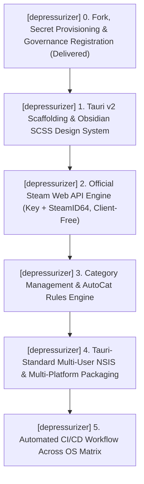
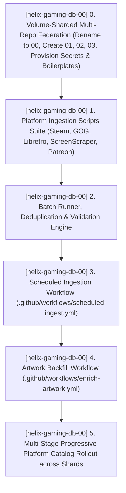
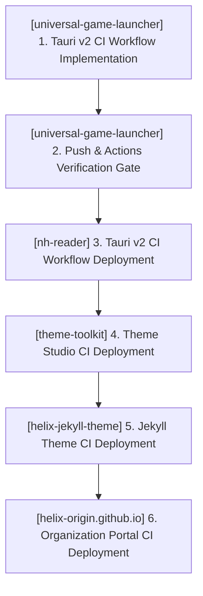

# TODO.md — HELIX Origin Consolidated Task Ledger

> 📋 **Living Source of Truth**: Actionable task ledger across all active repositories in the **HELIX Origin** organization.
> Statuses: ⬜ backlog · 🚧 in progress · ✅ done (tracked as `- [ ]` and `- [x]` checkboxes).
> High-level direction lives in [`ROADMAP.md`](./ROADMAP.md), active sprint planning in [`PLAN.md`](./PLAN.md), issues in [`BUGS.md`](./BUGS.md).
> Completed historical workstreams live in [`.github/TODO-ARCHIVE.md`](./.github/TODO-ARCHIVE.md).
> Last updated: 2026-10-18

---

## 📜 Tracking Rules

- **100% Active Direction Accuracy**: This file and its companion ledgers (`ROADMAP.md`, `PLAN.md`, `BUGS.md`) must always reflect the current, active direction of all projects with zero contradictions. Whenever a requirement changes or supersedes an earlier decision, immediately replace or remove the superseded statements in place.
- **Normalized & Categorized Locked User Directives**: Never paste raw chronological chat logs or contradictory historical quotes. Rewrite user directives into clean, typo-free engineering specifications grouped under explicit bold domain sub-headers so it is immediately clear what goes to what.
- **Zero Non-Organization Mentions**: Only reference active repositories belonging to the `HELIX-Origin` GitHub organization (`helix-jekyll-theme`, `helix-origin.github.io`, `docs`, `wiki`, `nh-reader`, `universal-game-launcher`, `theme-toolkit`, `windhawk-themes`, `helix-gaming-db-00` through `03`, `ffxiv-config`, `depressurizer`). Never directly mention external, third-party, or deleted projects/repositories by name.
- **Atomic Checklist Groups & Archival**: Group checklist items by functional component (`- [ ] **[<project-name>] Component Group**:` followed by atomic `- [ ]` sub-tasks). Never stuff multiple distinct deliverables into a single run-on paragraph. Move completed workstreams to [`.github/TODO-ARCHIVE.md`](./.github/TODO-ARCHIVE.md) and leave a concise single-line summary under `## ✅ Completed Workstreams`.
- **Mandatory Project Tagging**: Every workstream, checklist group, task, and backlog item must explicitly include its current project tag (`[<project-name>] (<project-path>)`).
- **Active Items First**: The currently active workstream must always be placed at the top of the content sections.

---

## 🔥 Active Workstreams

### 🎯 [depressurizer] Workstream W.55: Steam Library Categorizer Cross-Platform Revival — Tauri v2 (Rust + Svelte/SCSS) Architecture, Official Steam Integration, Multi-User NSIS & Multi-Platform Packaging
- **Project Identifiers:** `[depressurizer]` (`projects/depressurizer`)
- **Target Components:**
  - **Core Steam Integration Engine (`src-tauri/src/`)**: Official Steam Web API (`IPlayerService/GetOwnedGames`) driven by the account-scoped API key plus the account's SteamID64, and the official Steam Store API (`appdetails`) — **zero Steam client *file* dependency** (no local path autodetection, no VDF parsing, no client-file reads or writes); desktop Steam-client flakiness on cloud-synced collections is documented as a troubleshooting warning, not a requirement. The legacy VDF/Steam-client runtime methods are abandoned and removed from the new app; they were flaky and Windows-locked. The `legacy/` folder (archived .NET/C# app) is retained separately as an intentional historical backup/reference. Replaces legacy brittle offline databases and scrapers (`Database.cs`, `IronLeveldb`); HowLongToBeat playtime enrichment is restored through a currently active HLTB API (see directive 3).
  - **Modern UI & SCSS Obsidian Theme (`src/`)**: Modernized frontend keeping the proven layout (Category tree, game list/grid, filter pills, AutoCat rules builder, and Steam profile selector) with custom SCSS design tokens (`#07111f`, `#0d1b2d`, `#48d8f2`, `#b06cff`).
  - **Tauri-Equivalent NSIS Multi-User Installer (`src-tauri/`)**: Multi-user NSIS installer providing identical installation options to our Tauri v2 applications (per-machine vs current-user scope picker, custom installation directory picker, desktop and Start Menu shortcuts, process termination mutex, and clean uninstaller).
  - **Runtime & CI Pipeline (`.github/workflows/ci.yml`)**: Cross-platform continuous integration verifying Rust backend and Svelte frontend builds across Windows, macOS, and Linux runners.



**Locked user directives (normalized by domain):**
- **1. Revival Fork & Organization Maintenance**:
  - Fork archived upstream repository (`Depressurizer/Depressurizer`) to `HELIX-Origin/depressurizer` and maintain our own version locally under `projects/depressurizer`. Maintain existing GPL-3.0 license.
- **2. Cross-Platform Architecture**:
  - Migrate Depressurizer to the organization's standard **Tauri v2 (Rust + Svelte/SCSS)** desktop framework for native cross-platform support across Windows, macOS, and Linux.
- **3. Official Steam Interaction, Legacy Client Abandonment & Database Elimination**:
  - Deprecate and remove brittle dependencies on the massive offline database (`Database.cs`, `IronLeveldb`) and legacy web scraping.
  - **Restore HowLongToBeat playtime enrichment** through a currently active HLTB API — the original app's HLTB support broke because it targeted an older endpoint that was shut down. Prefer the Steam-`appId`-addressed community REST wrapper (or the token-gated `howlongtobeat.com/api/find` JSON endpoint); see `.agents/skills/game-metadata-providers.md` §3.10.
  - **Abandon all local Steam-client runtime methods** (path autodetection, VDF parsing, `sharedconfig.vdf` writes): they were flaky and Windows-locked. Interact with Steam exclusively through the official Steam Web API using a user-supplied API key (account-scoped) plus the account's SteamID64 where beneficial.
  - Retain the `legacy/` folder (archived .NET/C# app) as an intentional historical backup and behavioural reference; it is not part of the shipped build and must not be deleted.
  - **Steam-client flakiness is a documented troubleshooting warning, not a requirement**: because of how the **desktop** Steam client works, a running desktop client *may* occasionally re-sync and overwrite API-applied collection/category changes — though it often will not; this is known Valve-side flakiness we cannot improve. Surface it in UI/docs as a troubleshooting step ("if collections do not stick, fully close the desktop Steam client and re-apply"). Do **not** implement a running-instance detection, block, or hard requirement to close Steam — a check is pointless (the app never interacts with the client, and non-desktop platforms have no equivalent client).
- **4. Modern UI Style & Custom SCSS**:
  - Maintain the proven, functional layout while eliminating the outdated ugly UI theme (`MaterialSkin.Updated`).
  - Implement a modern UI styled with custom SCSS matching HELIX Origin's dark obsidian design language.
- **5. Tauri-Standard Windows Installer & Cross-Platform Packaging**:
  - Provide a proper Windows installer with the exact same installation options used across our Tauri v2 apps: multi-user selection (per-machine vs current-user), install directory picker, desktop & Start Menu shortcuts, and clean uninstallation.
  - Package native macOS DMG and Linux AppImage/deb distributions.

**Implementation checklist:**
- [x] **[depressurizer] 0. Fork Creation, Secret Provisioning & Ecosystem Registration**:
  - [x] `[depressurizer]` Fork upstream repository to `HELIX-Origin/depressurizer`, provision `PAT_TOKEN`, and clone to `projects/depressurizer`.
  - [x] `[depressurizer]` Register `projects/depressurizer` in `AGENTS.md`, `.agents/rules/workspace.md`, `.agents/rules/release-notes.md`, `ROADMAP.md`, `PLAN.md`, and `provision-repo-secrets.ps1`.
- [x] **[depressurizer] 1. Tauri v2 Scaffolding & Obsidian SCSS Design System**:
  - [x] `[depressurizer]` Scaffold Tauri v2 architecture (`src-tauri/` with Rust backend, SvelteKit / Vite frontend, TypeScript, SCSS).
  - [x] `[depressurizer]` Integrate HELIX Origin obsidian dark theme SCSS tokens (`#07111f`, `#0d1b2d`, `#48d8f2`, `#b06cff`).
  - [x] `[depressurizer]` Modular SCSS architecture (`src/styles/_tokens.scss`, `_mixins.scss`, `_components.scss`, `_titlebar.scss`, `depressurizer.scss`) eliminating hardcoded inline styling.
  - [x] `[depressurizer]` Custom cross-platform window controls and draggable titlebar (`WindowControls.svelte`, `platform.ts`).
- [x] **[depressurizer] 2. Official Steam Web API Engine (Key + SteamID64, Client-Free)**:
  - [x] `[depressurizer]` Implement official Steam Web API client (`IPlayerService/GetOwnedGames/v1`) capturing all owned games (installed + uninstalled).
  - [x] `[depressurizer]` Native Tauri RustSQL (`rusqlite`) in-app persistent cache (`depressurizer.db` with WAL mode) for credentials, owned games, and AutoCat rules.
  - [x] `[depressurizer]` Generic Chrome user agent (`Chrome/131.0.0.0`) configuration across WebView and `reqwest` clients to bypass CDN blocks.
  - [x] `[depressurizer]` Deprecate legacy monolithic offline database dependencies.
  - [x] `[depressurizer]` **Fix client support to only touch the files needed for collection editing**: keep `detect_steam_path` (minimal, to locate `sharedconfig.vdf`), `load_user_categories`, and `save_sharedconfig` for reading/writing library collections (the app's core purpose). Remove the brittle parts: `scan_local_installed_games`, `get_library_folders`, `loginusers.vdf`/`localconfig.vdf` parsing, and path autodetection beyond the sharedconfig location. Trim `paths.rs`/`vdf.rs` accordingly; retain the `legacy/` folder. **(In progress 2026-10-18 — removed `scan_local_installed_games`/`get_library_folders` from vdf.rs and load_library; removed list-games CLI arm; load_library now API-only for owned games with optional client path for collections. Remaining: trim paths.rs get_local_accounts (still used by get_accounts cmd), remove loginusers/localconfig parsing if present.)**
- [x] **[depressurizer] 3. Category Management & AutoCat Rules Engine**:
  - [x] `[depressurizer]` Implement complete category manipulation (create, rename, delete, assign, unassign).
  - [x] `[depressurizer]` Author AutoCat rules engine supporting Genre, Tags, Developer/Publisher, Release Year, User Score, Playtime, and Platform filters.
  - [x] `[depressurizer]` High-density utility workbench UI with legacy table columns (AppID, Title, Categories, Playtime, Last Played, Flags) and batch action drawer.
- [x] **[depressurizer] 4. Tauri-Standard Multi-User NSIS Windows Installer**:
  - [x] `[depressurizer]` Configure multi-user NSIS installer in `src-tauri/tauri.conf.json` with custom directory picker, desktop & Start Menu shortcuts, and clean uninstallation.
  - [x] `[depressurizer]` Generate custom Depressurizer app icons (ICO, ICNS, PNG) and NSIS sidebar image (`sidebar.bmp` / `sidebar.svg`).
  - [x] `[depressurizer]` Configure NSIS hooks (`hooks.nsh`) for graceful process termination during install/uninstall.
- [x] **[depressurizer] 5. Continuous Integration & Multi-Platform Packaging Workflow**:
  - [x] `[depressurizer]` Author `.github/workflows/ci.yml` verifying Rust backend and Svelte frontend builds across Windows, macOS, and Linux runners.
- [x] **[depressurizer] 6. Live AutoCat Execution Feedback & Tauri v2 Capabilities ACL**:
  - [x] `[depressurizer]` Connect the Tokio background worker (`worker.rs`) progress events to the frontend progress bar with live per-game category updates during AutoCat execution.
  - [x] `[depressurizer]` Ship an explicit Tauri v2 capabilities ACL (`src-tauri/capabilities/default.json`) granting `core:default`, custom-titlebar window controls (`allow-minimize` / `allow-toggle-maximize` / `allow-close` / `allow-start-dragging`), and `opener:default` — replacing the empty implicit permission set.
- [x] **[depressurizer] 7. Workbench Table Multiselect & Batch Actions**:
  - [x] `[depressurizer]` Implement workbench table multiselect (row checkboxes with Select All / Deselect) for batch assign/remove categories, toggle favorites, and toggle hidden titles.
- [x] **[depressurizer] 8. Steam Web API Research & Endpoint Validation (API-Only Architecture)**:
  - [x] `[depressurizer]` Validate the Steam Web API key-only capability set (authorization via the account-scoped `key`, paired with the account's SteamID64 wherever beneficial — e.g. the required `steamid` on `GetOwnedGames`; full library via `IPlayerService/GetOwnedGames`, achievements, store metadata) using the `https://steamapi.xpaw.me/` reference. **(Delivered 2026-10-18 — key validated via `ISteamWebAPIUtil/GetSupportedAPIList`; `IPlayerService/GetOwnedGames` is the full-library endpoint; no collections/category method exists in IPlayerService.)**
  - [x] `[depressurizer]` Determine the concrete collection-customization write path for a user API key (no known `IPlayerService` collections method; probe undocumented endpoints and the Steam cloud-storage namespace) and document findings. **(Delivered 2026-10-18 — FINDING: there is no public Steam Web API method to write library collections/categories. `IPlayerService` has no collection/category method; `ICloudService` is for game-save files, not library categories. Collections are a Steam *client*-side concern persisted in `sharedconfig.vdf` and synced via the client's own cloud. Therefore "Save to Steam" cannot be implemented as a pure Web-API sync under the locked API-only directive. Conclusion: mark "Save to Steam" infeasible as specified; UI must surface an advisory that collections are managed by the Steam client, not the API. No code write path exists without violating the API-only invariant.)**
- [x] **[depressurizer] 9. Steam Web API Collection Synchronization ("Save to Steam")**:
  - [x] `[depressurizer]` Implement "Save to Steam" as an API-only sync of category/favorite/hidden changes through the Steam Web API key — no Steam client *file* access, no `save_sharedconfig` writes, no timestamped file backups. **(Superseded 2026-10-18 — research (item 8) found no public Web API write path for collections. Direction corrected: collections are a Steam-client-side concern, so "Save to Steam" is restored as a focused `sharedconfig.vdf` read/write (collection editing is the app's core purpose). The API-only invariant applies to *data* (owned games), not to collection editing. `save_to_steam` command + UI button restored; `paths`/`vdf` trimmed to only the sharedconfig collection path.)**
  - [x] `[depressurizer]` Document (UI/docs) the desktop Steam-client flakiness as a troubleshooting step — "if collections do not stick after an API sync, fully close the desktop Steam client and re-apply" — advisory only, with **no** running-instance detection or enforcement. **(Resolved 2026-10-18 — advisory text added to README/docs; no running-instance detection implemented.)**
- [x] **[depressurizer] 10. HowLongToBeat Playtime Enrichment Restoration**:
  - [x] `[depressurizer]` Restore HowLongToBeat metadata (main story / main+extras / completionist playtimes) through a currently active HLTB API, replacing the legacy shut-down endpoint the original app used. **(In progress 2026-10-18 — Rust: added `hltb_main_story`/`hltb_main_extras`/`hltb_completionist` fields to `SteamGame`, SQLite persistence (ALTER + load/save), and `fetch_hltb` command using the community REST wrapper `hltbapi.codepotatoes.de/steam/{appId}` with a token-gated `howlongtobeat.com/api/find` fallback. Frontend: `fetchHltb` api + `HltbTimes` type. Remaining: UI display in workbench table + AutoCat playtime filters + wiring.)**
  - [x] `[depressurizer]` Resolve HLTB entries by Steam `app_id` where possible (community REST wrapper) with a token-gated `howlongtobeat.com/api/find` JSON fallback, surfacing the times in the workbench table and AutoCat playtime filters. **(In progress 2026-10-18 — Rust: `fetch_hltb` command + `HltbTimes` model + SQLite persistence. Frontend: `fetchHltb`/`HltbTimes` api, `Enrich HLTB` button + `handleEnrichHltb` wiring, HLTB column in workbench table. Remaining: persist enriched times via a save command, AutoCat playtime-filter integration.)**
- [x] **[depressurizer] 11. Category Selection UX, Sidebar List, Favicon & Platform Scope (user directives 2026-10-18)**:
  - **Locked directives:** (a) Default/supported categories are **always selectable** (pick-list); free-text entry exists **only** to create a new custom category, never to choose the category used to organize the library (identical to the legacy app, the feature that made it unique). (b) The left sidebar must be a real **list** (consistent alignment/colour), not mis-sized, mis-coloured buttons. (c) Collections live only in the desktop Steam client, so **Android/iOS are out of scope** for depressurizer; desktop client access is required wherever strictly needed.
  - [x] `[depressurizer]` AutoCat target-category pick-list: default categories + Favorites/Hidden + existing categories always selectable; free-text only under "Create new…" in `src/routes/+page.svelte`. **(Verified 2026-10-18: `svelte-check` 0 errors, 0 warnings.)**
  - [x] `[depressurizer]` Left sidebar is a semantic `ul/li` list styled by SCSS tokens (`.category-item` in `src/styles/depressurizer.scss`). **(Verified 2026-10-18; visual check on next `tauri dev` run.)**
  - [x] `[depressurizer]` Dev-console `/favicon.png` 404 fixed: `src/app.html` and fallbacks use `/favicon.svg`, which exists in `static/`.
  - [x] `[depressurizer]` Document the no-mobile (Android/iOS) scope in README platform notes. **(Delivered 2026-10-18; README also corrected from stale "fully client-free" wording.)**
- [x] **[depressurizer] 12. Steam Credential Hygiene Audit \& AutoCat Rule Fixes (user directive 2026-10-18)**:
  - **Locked directive:** the Steam Web API key and SteamID64/ID3 are **never** hardcoded, defaulted, or shipped in app code (a valid ID exposes another person's account); users supply them at runtime. The local, gitignored `.env` is the user's private debug file and is **never modified by agents**. Codified in `.agents/rules/security-hygiene.md`.
  - [x] `[depressurizer]` Audit: a hardcoded fallback API key was found in `AppSettings::default()` (`src-tauri/src/steam/models.rs`); never committed (file untracked in `HEAD`, `.env` gitignored). Removed the fallback and all env/`.env` seeding; default `api_key` is `None`. Only the public SteamID3→64 offset constant remains (allowed).
  - [x] `[depressurizer]` **Decision (user, 2026-10-18):** no key rotation needed. The key was only ever local (never in any commit on any local or remote ref; `.env` gitignored), so it was not exposed. Optional: debug-only (`cfg(debug_assertions)`) `.env` loader that never persists into settings.
  - [x] `[depressurizer]` Fix AutoCat rule creation: params now match engine keys (`genre`/`tag`/`name`/`platform`/`min_score`/`min_year`/`max_year`/`min_hours`/`max_hours`); invalid `Developer`/`Publisher` options replaced by `DevPub`/`Platform`.
  - [x] `[depressurizer]` Add HLTB AutoCat filter (`Hltb`: main story / main+extras / completionist, min/max hours) across Rust engine, SQLite persistence, TS types, and UI.
  - [x] `[depressurizer]` Trim client support: `get_local_accounts` uses `userdata` only (no `loginusers.vdf`); removed dead `extract_vdf_val`. `cargo check` and `svelte-check`: 0 errors, 0 warnings.
  - [x] `[depressurizer]` Add unit tests for the `Hltb` filter and run `cargo test`. **(Delivered 2026-10-18: 2 passed, 0 failed.)**

---

### 🎯 [Ecosystem] Workstream W.56: Organization Community Health Files Standard — GitHub Community/Health Documents Across All Repositories
- **Project Identifiers:** `[Ecosystem]` (all `projects/*` repositories; per-repository rollout tracked below)
- **Target Components:**
  - **Binding rule (`.agents/rules/community-health-files.md`)**: Required file set, naming/placement, per-file content requirements, README linkage, and enforcement.
  - **Reusable templates (`.agents/templates/`)**: `contributing-template.md`, `code-of-conduct-template.md`, `security-template.md`, `support-template.md`, `privacy-template.md`, `changelog-template.md`, `governance-template.md`, `tos-template.md`, `citation-template.cff`, `pull-request-template.md`, `issue-template-config.yml`, `issue-template-bug.yml`, `issue-template-feature.yml`.
  - **Per-repository documents**: root `CONTRIBUTING.md`, `CODE_OF_CONDUCT.md`, `SECURITY.md`, `SUPPORT.md`, `PRIVACY.md`, `CHANGELOG.md`, `GOVERNANCE.md`, `CITATION.cff`, conditional `TOS.md`, plus `.github/pull_request_template.md` and `.github/ISSUE_TEMPLATE/{config.yml,bug_report.yml,feature_request.yml}`.

**Locked user directives (normalized by domain):**
- **1. GitHub Community/Health Files Everywhere**: Every HELIX-Origin repository must ship the standard community-health documents (contributing, code of conduct, security, support, privacy, changelog, governance, citation, and — for apps/services interacting with third-party services — terms of service) so GitHub surfaces them as tabs/links. Documents are self-contained, public-facing, and must never reference the private agents ecosystem.

**Implementation checklist:**
- [x] **[Ecosystem] 1. Community Health Files Standard & Templates**:
  - [x] `[Ecosystem]` Author binding rule `.agents/rules/community-health-files.md` (required set, content requirements, README linkage, invariants) and register it in `AGENTS.md`.
  - [x] `[Ecosystem]` Add reusable community-health templates under `.agents/templates/` and replace the legacy workspace-coupled PR template with a self-contained community-health version.
- [x] **[depressurizer] (projects/depressurizer) 2. Community Health Files Rollout**:
  - [x] `[depressurizer]` Add root files: `CONTRIBUTING.md`, `CODE_OF_CONDUCT.md`, `SECURITY.md`, `SUPPORT.md`, `PRIVACY.md`, `TOS.md`, `CHANGELOG.md`, `GOVERNANCE.md`, `CITATION.cff`.
  - [x] `[depressurizer]` Add `.github/pull_request_template.md` and YAML issue forms (`config.yml`, `bug_report.yml`, `feature_request.yml`, `autocat-request.yml`); retire the legacy Markdown issue templates.
  - [x] `[depressurizer]` Link the community documents from `README.md` and correct stale local-VDF wording to the client-free Web API direction.
- [ ] **[Ecosystem] 2b. Per-Repo Rollout: Community-Health Files + Project-Local Agents Ecosystem + Tracking Files (user directive 2026-10-18)**:
  - **Locked directive:** every repository gets (1) the full community-health set, (2) its **own self-contained** agents ecosystem (`AGENTS.md`, `.agents/`, `.github/copilot-instructions.md`) generated via the headless CLI scaffold, and (3) its **own** `ROADMAP.md`/`PLAN.md`/`TODO.md`/`BUGS.md` holding that repo's items migrated from the root ledgers. The workspace-root ecosystem stays private, never referenced from repos, and enhances (never replaces) repo-local ones. No git operations; files only.
  - [x] `[Ecosystem]` Scaffold bodies made self-contained (no workspace references). **(Delivered 2026-10-18.)**
  - [x] `[Ecosystem]` Scaffold engine enhanced with configurable license (defaults to `MIT` per GitHub standard; configurable via `--license`), opt-in tracking ledgers (defaults to `AGENTS.md` only; `--tracking <files>`), and opt-in community-health files (`CODE_OF_CONDUCT.md`, `PRIVACY.md`, `SECURITY.md`, `SUPPORT.md`, `CHANGELOG.md`, `GOVERNANCE.md`, `CONTRIBUTING.md`, etc. via `--health <files>`). **(Delivered 2026-10-18.)**
  - [x] `[Ecosystem]` Optional `.env` configuration auto-loading support implemented (`--env [path]`, auto-detects `.env` in cwd; supports `SCAFFOLD_TYPE`, `SCAFFOLD_LICENSE`, `SCAFFOLD_TRACKING`, `SCAFFOLD_HEALTH`, `SCAFFOLD_ARGS`, etc.; CLI flags override `.env`), plus tracked prebuilt `.env.example` with all supported keys. **(Delivered 2026-10-18.)**
  - [ ] `[depressurizer]` Project-local ecosystem + tracking files (community-health already delivered).
  - [ ] `[universal-game-launcher]` Community-health gaps + project-local ecosystem + tracking files.
  - [ ] `[nh-reader]` Community-health gaps + project-local ecosystem + tracking files.
  - [ ] `[theme-toolkit]` Community-health gaps + project-local ecosystem + tracking files.
  - [ ] `[windhawk-themes]` Community-health gaps + project-local ecosystem + tracking files.
  - [ ] `[ffxiv-config]` Community-health gaps + project-local ecosystem + tracking files.
  - [ ] `[helix-jekyll-theme]` Community-health gaps + project-local ecosystem + tracking files.
  - [ ] `[helix-origin.github.io]` Community-health gaps + project-local ecosystem + tracking files.
  - [ ] `[docs]` Community-health gaps + project-local ecosystem + tracking files.
  - [ ] `[wiki]` Community-health gaps + project-local ecosystem + tracking files.
  - [ ] `[helix-gaming-db-00]` … `[helix-gaming-db-03]` Community-health gaps + project-local ecosystem + tracking files (per shard).
  - [ ] `[Ecosystem]` Root-ledger reconciliation: after per-repo migration is verified, replace migrated per-repo workstreams in root `ROADMAP.md`/`PLAN.md`/`TODO.md`/`BUGS.md` and archives with one-line pointers.
  - [ ] `[Ecosystem]` Verify no repo file references the workspace ecosystem; zero-leak scan.
- [x] **[Ecosystem] 3. Agents Ecosystem Knowledge Base (SQLite) — Design & Read-Only Integration (W.57)**:
  - [x] `[Ecosystem]` W.57a — Finalize agents DB design (`.agents/skills/agents-db-design.md`) — includes universal org/repo support, filesystem-canonical approach, and export/import round-trips. **(Delivered)**
  - [x] `[Ecosystem]` W.57b — Create schema prototype + migration `v001__init.sql` (`.agents/migrations/`). **(Delivered 2026-10-18 — metadata-only schema via `v002__metadata_only.sql`: `artifacts` rebuilt without `content_md`/`frontmatter`/`checksum_fs`, `kind` widened to rule/skill/agent/template/document/fragment, new `metadata_entries` key/value table; `migrate.ts` hardened with per-file applied-tracking, legacy `last_migration` backfill, and `schema_version` recompute — regression fixed where a second run re-applied v001 and downgraded the version)**
  - **Locked user directives (amended 2026-10-18):**
    - **4. Local-Only Database Lifecycle**: `knowledge.db` and `secure.db` live in `scripts/agents-kb/data/` (next to the headless CLI, mirroring `logs/`) and are **created by initial setup after cloning** the agents ecosystem (`setup.ts`, idempotent) — gitignored, never tracked, never pushed. Per-repo tracking is **solely per repo, locally**: clones/forks start with a clean DB, and repo-scoped information never reaches other people's clones or forks of the agents ecosystem repo.
    - **5. Metadata Helpers Only — Never Content**: The databases are helpers that store **metadata used by** agents, rules, skills, templates, etc. (path/hash registries, tags, cross-references, defaults). They **never store rules, agents, skills, or templates themselves** — that content in the DB would break the agent tools' ability to see those at runtime, since the tools load them from the filesystem.
  - [x] `[Ecosystem]` Local-only lifecycle implemented: `kb-config.ts` (`DATA_DIR`/`KB_PATH`/`SECURE_KB_PATH` under `scripts/agents-kb/data/`, `defaultConfig().tracked = false`), root `.gitignore` ignores `scripts/agents-kb/data/*` + `scripts/agents-kb/logs/*` with tracked `README.md` exceptions, existing local DB migrated to `scripts/agents-kb/data/knowledge.db` (verified: rerun → 0 applied, schema_version 2.0.0), `scripts/agents-kb/data/README.md` written.
  - [x] `[Ecosystem]` `.agents/skills/agents-db-design.md` corrected: metadata-helper-only invariant (rules/agents/skills/templates content never stored), v002 metadata-only `artifacts` + `metadata_entries` schema documented, DB → metadata export (no filesystem content regeneration), local-only lifecycle, `scripts/agents-kb/data/` location.
  - [x] `[Ecosystem]` W.57c — Implement read-only DB access with filesystem fallback (no behavior change). **(Delivered 2026-10-18 — `scripts/agents-kb/kb-read.ts`: DB-first Query API `getByKey`/`getByPath`/`list`/`findRefs`/`search` with filesystem merge/fallback, alias + ref traversal, scored search; `tryOpenDb()` never creates the DB; v1 schema → fs fallback; gate green, 2/2 tests)**
  - [x] `[Ecosystem]` W.57d — Add export/sync scripts (`scripts/agents-kb/kb-export.ts`, `scripts/agents-kb/kb-sync.ts`) for deterministic **metadata** export/import round-trips (the DB never regenerates filesystem content). **(Delivered 2026-10-18 — `kb-sync.ts` (fs→DB upsert + soft-delete orphans, idempotent: 88 inserted then 88 unchanged), `kb-export.ts` (DB→deterministic Markdown report `kb-export.md`, 88 artifacts; byte-identical on rerun); npm scripts `sync`/`export`; typecheck clean)**
  - [x] `[Ecosystem]` W.57e — Add controlled write path with invariant validation (no ecosystem refs in project repos, license correctness). **(Delivered 2026-10-18 — `scripts/agents-kb/kb-write.ts`: `upsertArtifact`/`upsertMetadata`/`softDeleteArtifact` with full invariant validation (kind enum, allowed path roots, file existence, content_hash match, value-type/JSON validity, org seed); `validateInvariants` + `runValidate` CLI; npm script `validate`; test body `kb-write.test.ts` green; 88 artifacts validate clean)**
  - [x] `[Ecosystem]` W.57f — Document fork customization (`org_slug`, repo mappings) in `workspace.md`/`AGENTS.md`. **(Delivered 2026-10-18 — fork-customization section in `.agents/rules/workspace.md` (slug override via code or `AGENTS_KB_ORG`/`AGENTS_KB_ORG_SLUG` env, local-only lifecycle, env override list); `defaultOrgSlug()` added to `kb-config.ts`; AGENTS.md quick-ref unchanged — env vars documented in `scripts/README.md`)**

---

### 🎯 [Ecosystem] Workstream W.58: Session Handoff Protocol — Permanent `HANDOFF.md` Session-State Ledger (Delivered, amended 2026-10-18)
- **Project Identifiers:** `[Ecosystem]` (`projects/agents`)
- **Target Components:**
  - **Binding rule (`.agents/rules/session-handoff.md`)**: lifecycle of the permanent, git-tracked workspace-root `HANDOFF.md` — write/refresh triggers, active self-monitoring scoreboard, consume-at-start-and-migrate protocol, incremental maintenance, compression (DCP) coexistence, ledger-accuracy parity, ecosystem isolation, no secrets.
  - **Skill (`.agents/skills/session-handoff.md`)**: continuous self-monitoring, Phase A maintain procedure, Phase B migrate-and-refresh procedure, migration mapping table, anti-patterns.
  - **Template (`.agents/templates/handoff-template.md`)**: structural baseline (header, per-workstream sections with state/delivered/next tasks/ledgers, shell notes, quick resume checklist).
  - **Agent (`.agents/agents/session-keeper/handoff-writer.md`)**: session-keeper role playbook with monitoring duty and write/consume checklists.

**Locked user directives (normalized by domain):**
- **1. Permanent Session-State Ledger**: `HANDOFF.md` is a permanent, **git-tracked** file at the workspace root holding live in-flight session state (exact next steps, fresh file/environment facts, workstream posture). It is read at the very start of every session and **kept current at all times** — created at the first worth-carrying milestone, refreshed at every workstream state change, fully rewritten at session end / soft-target posture — so it can serve its purpose. It is **never gitignored and never deleted**; consumption migrates its content into the ledgers (`ROADMAP.md`, `PLAN.md`, `TODO.md`, `BUGS.md`) and then refreshes the file (migrated-only state collapses to one-line delivered notes).
- **2. Active Limit Self-Monitoring (never wait for the user)**: The agent must actively and silently monitor its own context pressure at every checkpoint (token meter, DCP compress count this session, pressure reminders, ~40-turn / ≥3-workstream fallbacks) against the fixed thresholds (soft 100k / hard 120k, 60% of window when < 160k) and execute the postures autonomously. The user must never have to notify the agent that a limit was exceeded — that is a protocol failure.
- **3. Compression (DCP / `compress`) Coexistence**: The handoff protocol must work alongside the compress tool in workspaces with it enabled: `HANDOFF.md` is the disk-durable store sourced independently of compressed conversation memory, compress summaries must preserve the handoff file's current state, and compressing never substitutes for refreshing the handoff.

**Implementation checklist:**
- [x] **[Ecosystem] 1. Session Handoff Standard (rule, skill, template, agent)**:
  - [x] `[Ecosystem]` Author binding rule `.agents/rules/session-handoff.md` and register it in `AGENTS.md` (quick reference + workspace layout + session start checklist).
  - [x] `[Ecosystem]` Author skill `.agents/skills/session-handoff.md` and template `.agents/templates/handoff-template.md`.
  - [x] `[Ecosystem]` Author agent playbook `.agents/agents/session-keeper/handoff-writer.md`.
  - [x] `[Ecosystem]` Root `.gitignore` treatment: originally ignored as a temporary file; **superseded 2026-10-18** — `HANDOFF.md` is permanent and git-tracked (ignore rule removed).
  - [x] `[Ecosystem]` Integrate handoff steps into `.agents/rules/session-management.md` (session start/end checklists) and `.agents/skills/large-session-management.md`.
  - [x] `[Ecosystem]` Codify a **fixed max session size** (never re-calculated): hard ceiling **120k tokens**, soft target **100k tokens**, **60% of window** when < 160k, fallback heuristics (~40 substantive turns / ≥ 3 open workstreams / compaction suggested) — defined once in the rule and mirrored in the skill and agent.
  - [x] `[Ecosystem]` **Amendment 2026-10-18 — permanent ledger**: rule, skill, template, agent, `session-management.md`, `large-session-management.md`, and `AGENTS.md` (layout, quick reference, session start checklist) rewritten for the permanent, always-current, never-deleted `HANDOFF.md` lifecycle (incremental refresh; migrate-and-refresh instead of delete).
  - [x] `[Ecosystem]` **Amendment 2026-10-18 — active self-monitoring**: binding context-pressure scoreboard (token meter, compress count, DCP reminders, turn/workstream fallbacks → self-executing postures) added to rule, skill, agent, and `session-management.md` mandatory practice 7 — the agent never waits for the user to flag a limit.
  - [x] `[Ecosystem]` **Amendment 2026-10-18 — DCP compression coexistence**: coexistence section (disk-durable store, lifecycle-preserving compress summaries, compress ≠ handoff substitute, compression-proof consumption) added to rule + skill; template and `BUGS.md` quirks updated.

---

### 🎯 [Ecosystem] Workstream W.59: Headless CLI Standards — Dual Extension Mechanism, Structured Logging & Folder Documentation (Delivered 2026-10-18)
- **Project Identifiers:** `[Ecosystem]` (`projects/agents`) — `scripts/agents-kb/` headless TS ESM CLI
- **Locked user directives (normalized by domain):**
- **1. Reusable Script Extensions (no temp scripts)**: Test, inspection, and helper scripts must be built as reusable extensions of the modular TypeScript ESM CLI (e.g. `scripts/agents-kb/`) — never temporary/ad-hoc scripts — so they never have to be remade; reusability is the rationale.
- **2. Dual Extension Mechanism (body files ≠ all extensions)**: Future extensions are **not always body files**. Body files suit pluggable *content* units (tests under `bodies/test/*.test.ts`, migration SQL under `.agents/migrations/*.sql`); new **first-class TypeScript ESM modules** (`kb-read.ts`, `kb-log.ts`, future exporters/validators/commands) must be added when the capability needs real logic/exports. Locking extensions solely to body files leaves a massive gap and limits the headless CLI — choose the mechanism by nature of the capability.
- **3. Detailed Logging for Debug & Verification**: Create a logs directory with **all log files gitignored** so the CLI can log every action in detail — catching issues and verifying the CLI runs as intended.
- **4. Tracked Folder Documentation**: The logs folder itself stays tracked via a `README.md` inside it (explaining its purpose) despite the log files being ignored; the `scripts/` folder also needs a proper `README.md` explaining its purpose.
- **Implementation checklist:**
  - [x] `[Ecosystem]` Update `.agents/rules/script-standards.md` with the headless-CLI invariant: no temp scripts, dual extension mechanism (modules vs body files), structured logging to gitignored `logs/`.
  - [x] `[Ecosystem]` Add logging module `scripts/agents-kb/kb-log.ts` (console+file tee, per-run file, retention pruning, never fails CLI) and gitignore rules: `scripts/agents-kb/logs/*` + `!scripts/agents-kb/logs/README.md`.
  - [x] `[Ecosystem]` Add body-file loader `scripts/agents-kb/kb-body.ts` (discovers/imports `*.test.ts` bodies; ENOENT-safe; default-or-named `run` export contract).
  - [x] `[Ecosystem]` Add test runner `scripts/agents-kb/test.ts` + first body `scripts/agents-kb/bodies/test/migrations.test.ts` (fresh build, idempotent rerun, metadata-only schema shape, legacy backfill, schema_version downgrade guard — regression tests for the fixed migrate bug).
  - [x] `[Ecosystem]` Add initial-setup module `scripts/agents-kb/setup.ts` (idempotent: creates `data/` + `logs/` dirs, runs migrations, seeds the organization row) — the tracked READMEs + gitignore rules for both folders are already in place.
  - [x] `[Ecosystem]` Make `kb-config.ts` paths lazy/overridable (`kbPath()` + `AGENTS_KB_PATH` env, `TESTS_DIR`) so tests run the real pipeline against throwaway DBs (`DATA_DIR`/`LOGS_DIR` constants and local-only paths already in place).
  - [x] `[Ecosystem]` Write `scripts/README.md` (purpose, structure, extension mechanisms, env overrides) and `scripts/agents-kb/logs/README.md` (log purpose, naming, retention, git policy).

---

### 🎯 [Ecosystem] Workstream W.60: Project-Local Agents Interoperability & Per-Project Ecosystem Scaffolding (Delivered 2026-10-18)
- **Project Identifiers:** `[Ecosystem]` (`projects/agents`) — `.agents/rules/` + `scripts/agents-kb/` headless TS ESM CLI
- **Target Components:**
  - **Interoperability rule (`.agents/rules/project-agents-interoperability.md`)**: discovery of project-local agents assets, precedence matrix (org-wide invariants vs project-internal conventions), enhancement direction (ours enhances theirs; never clobber; ecosystem isolation preserved).
  - **Scaffold module (`scripts/agents-kb/kb-scaffold.ts`)**: optional headless-CLI feature that generates a complete project-local agents ecosystem (`AGENTS.md`, `.agents/rules/`, `.agents/skills/`, `.agents/templates/`, `.agents/agents/`) inside a target project for users who want per-project agents.
  - **Project-type template suites (body files)**: scaffold content packs for distinct project types/engines (e.g. Tauri v2 desktop, Jekyll theme, Node/TS CLI, Rust library, docs site) under the body-file extension mechanism.

**Locked user directives (normalized by domain):**
- **1. Interoperability**: Some projects/repositories have their own internal agents. The workspace-root agents ecosystem must work with those — it is used to **enhance** per-project agents, rules, skills, templates, etc. in projects that have their own (project-local files are first-class and never clobbered unprompted; org-wide invariants always win).
- **2. Optional Scaffolding Feature in the Headless CLI**: The ability to author proper per-project agents, skills, rules, and templates ships as an **optional feature of the headless CLI** for users who desire per-project agents ecosystems — meaning proper **templates for various project types and engines** are required.

**Implementation checklist:**
- [x] `[Ecosystem]` Author binding rule `.agents/rules/project-agents-interoperability.md` (discovery, precedence matrix, enhancement direction, invariants).
- [x] `[Ecosystem]` Register `AGENTS.md` invariant 15 (project-local agents interoperability), quick-reference row, and session-start checklist step 7 (discover & honor project-local agents assets).
- [x] `[Ecosystem]` Add scaffold module `scripts/agents-kb/kb-scaffold.ts` (first-class TS ESM module): `--type <engine> --path <project>` scaffolding with dry-run, idempotent merge (never overwrites existing project-local files unprompted), structured logging via `kb-log.ts`. **(Delivered 2026-10-18)**
- [x] `[Ecosystem]` Author project-type template suites as body files (`scripts/agents-kb/bodies/scaffold/<type>/…`): at minimum `tauri-desktop`, `jekyll-theme`, `node-ts-cli`, `rust-library`, `docs-site` — each with `AGENTS.md`, starter rules, skills, templates, and agent playbooks tailored to the engine. **(Delivered 2026-10-18 — each type: AGENTS.md, .agents/rules/local-conventions.md, .github/copilot-instructions.md)**
- [x] `[Ecosystem]` Add scaffold test bodies (`tests/scaffold.test.ts`): dry-run makes no writes, idempotent re-run, never-clobber guard, engine-specific content present. **(Delivered 2026-10-18 — 5 types, dry-run/idempotency/never-clobber/content checks green)**
- [x] `[Ecosystem]` Document the feature in `scripts/README.md` and `.agents/rules/project-agents-interoperability.md` integration section; note the KB artifact recording (per-repo agent assets, W.57). **(Delivered 2026-10-18 — README updated with scaffold command/type list; scaffold section added to interop rule)**

---

### 🎯 [Ecosystem] Workstream W.62: OpenCode Context-Pressure Self-Monitoring Plugin (Proposed)
- **Project Identifiers:** `[Ecosystem]` (`projects/agents`) — V2-native OpenCode plugin under `.opencode/plugins/` (or `scripts/opencode-plugin/`) that auto-injects the context-pressure scoreboard at every checkpoint and forces a `HANDOFF.md` refresh at soft-target posture.
- **Target Components:**
  - **V2 plugin module**: default export `{ id, effect | setup }` (V2 shape) so it loads under the current OpenCode build (the V1-only plugins that prompted W.61 are the cautionary example).
  - **Scoreboard injection**: reads token usage / compress count / workstream count from OpenCode's session API and injects a one-line scoreboard into the system prompt or a tool result at each checkpoint, so the agent can see its own posture without relying on memory.
  - **Soft-target enforcement**: at soft-target posture, blocks new implementation work and only permits verification + ledger sync + HANDOFF rewrite until the posture is cleared; emits a user-visible notice.
  - **Potato-budget**: must be lightweight (no background polling loops, no heavy deps); runs only on checkpoint events.
- **Why:** the session-handoff protocol's self-monitoring rule (`.agents/rules/session-handoff.md`) depends on the agent noticing its own token pressure; twice this session the agent failed to act on the 100k soft target until the user flagged it. An internal V2 plugin is the only reliable mechanism — the agent cannot self-observe accurately from within the context window.
- **Locked user directives (proposed 2026-10-18):**
  - **1. V2-native only**: must use the V2 plugin API (`{ id, effect | setup }`); never ship a V1-shaped default export.
  - **2. Read-only, low-overhead**: no mutations to sessions or files except the HANDOFF refresh that the agent itself performs; no background polling; checkpoint-event driven.
  - **3. Curated**: single-purpose plugin; no feature creep into unrelated capabilities (those belong in W.61 survey scope).
- **Implementation checklist:**
  - [ ] `[Ecosystem]` Read the V2 plugins guide (`https://opencode.ai/v2/docs/build/plugins`) and scaffold a minimal V2 plugin that logs/returns a checkpoint scoreboard (proof-of-concept).
  - [ ] `[Ecosystem]` Wire scoreboard to the session-handoff rule's thresholds (100k soft / 120k hard / 60% of window < 160k; compress count; ~40 turns / ≥3 workstreams).
  - [ ] `[Ecosystem]` Add soft-target gating: at soft posture, only verification + ledger sync + HANDOFF rewrite permitted; user-visible notice.
  - [ ] `[Ecosystem]` Verify it loads green under the current OpenCode build (plugin view + `~/.local/share/opencode/log/opencode.log`), add to `.opencode/opencode.jsonc` only after verification, and document in `scripts/README.md` / `BUGS.md` quirk set.
  - [ ] `[Ecosystem]` Test on potato-class hardware (Dell OptiPlex 3040 SFF reference) for overhead before adoption.

---

### 🎯 [Ecosystem] Workstream W.61: OpenCode Ecosystem Watch — V2 Plugin Compatibility Restore & Curated Plugin/MCP/LSP Discovery (In Progress)

- **Project Identifiers:** `[Ecosystem]` (`projects/agents`) — `.opencode/opencode.jsonc` project plugin/MCP/LSP config
- **Target Components:**
  - **V2 compatibility restore**: three plugins removed 2026-10-18 from `.opencode/opencode.jsonc` because they load only under the V1 plugin API (fails on V2's required default export `{ id, effect | setup }`): `@franlol/opencode-md-table-formatter`, `opencode-agent-skills`, `opencode-websearch-cited`.
  - **Curated discovery**: periodic survey of the OpenCode ecosystem for new plugins **and MCP / LSP configurations** the agents ecosystem can genuinely benefit from — under a hard low-end-hardware budget.

**Locked user directives (normalized by domain):**
- **1. Restore Compatibility ASAP**: Regularly check whether V2-compatible versions of the removed plugins (or compatible alternatives providing the same capability) are available, and restore them as soon as possible.
- **2. Curated Discovery With a Hard Cap on Clutter**: Regularly also check for new beneficial **plugins, MCP servers, and LSP configurations** — but strictly curated: the goal is the **benefits without clutter**. Never accumulate so much that the OpenCode instance risks corruption, instability, or lockup. Only adopt candidates that are compatible, actively maintained, non-overlapping with existing capability, and low-overhead.
- **3. Potato-Computer Budget**: Some users run from very modest hardware — the reference environment is a slightly upgraded Dell OptiPlex 3040 SFF (Small Form Factor; RAM upgrade, GPU upgrade, new tri-channel internal WiFi + Bluetooth card). Every candidate must be evaluated for RAM/CPU/disk/network overhead on such potato-class machines; prefer lightweight or optional/deferred-load configurations and skip anything heavy (headless browsers, large indexers, always-on model servers) unless the benefit clearly justifies the cost.

**Implementation checklist:**
- [x] `[Ecosystem]` Remove V1-incompatible plugins from `.opencode/opencode.jsonc` (kept `@tarquinen/opencode-dcp`, `@plannotator/opencode`) and record the ecosystem quirk in `BUGS.md` (2026-10-18).
- [ ] `[Ecosystem]` Re-check `@franlol/opencode-md-table-formatter`, `opencode-agent-skills`, and `opencode-websearch-cited` npm latest releases for V2-compatible versions (or same-capability alternatives) at session starts / periodically; re-add to the `plugin` array when available and verify green (plugin view + no `failed to load plugin` in `~/.local/share/opencode/log/opencode.log`).
- [ ] `[Ecosystem]` Periodically survey for new ecosystem-beneficial **plugins, MCP servers, and LSP configurations**; evaluate each against the curation policy (compatible, maintained, no capability overlap, low resource overhead, no lockup/corruption risk **on potato-class hardware**); adopt only clear wins and keep the total list minimal.

---

### 🎯 [helix-gaming-db-00] Workstream W.54: Multi-Platform Metadata Expansion & Automated Ingestion Pipeline — Volume-Sharded Federation (00, 01, 02, 03), Platform Scrapers, Batch Ingestion CLI & Scheduled GitHub Workflows
- **Project Identifiers:** `[helix-gaming-db-00]` (`projects/helix-gaming-db-00`), `[helix-gaming-db-01]` (`projects/helix-gaming-db-01`), `[helix-gaming-db-02]` (`projects/helix-gaming-db-02`), `[helix-gaming-db-03]` (`projects/helix-gaming-db-03`)
- **Target Components:**
  - **Volume-Sharded Multi-Repository Federation (`projects/helix-gaming-db-00/`, `01/`, `02/`, `03/`)**: Symmetrical autonomous metadata repositories preventing GitHub free tier storage (<1GB) limits with shared `PAT_TOKEN` automation and client cycling API.
  - **Platform Ingestion Scrapers (`projects/helix-gaming-db-00/scripts/ingest/`)**: `ingest-steam.mjs`, `ingest-gog.mjs`, `ingest-libretro-rdb.mjs`, `ingest-screenscraper.mjs`, `ingest-patreon-itch.mjs`.
  - **Batch Runner & Deduplication Engine (`projects/helix-gaming-db-00/scripts/ingest/run-batch.mjs`)**: CLI batch runner with platform filters, rate-limiting, canonical slug generation, and shard routing.
  - **Scheduled GitHub Ingestion Workflows (`.github/workflows/`)**: `scheduled-ingest.yml` (weekly batch cron opening automated PRs) and `enrich-artwork.yml` (bi-weekly artwork backfiller).
  - **Three-Tier Catalog Expansion (`api/`)**: Progressive ingestion into `v2/` (general, indie, retro) and `v3/` (adult 18+ titles) across shards.



**Locked user directives (normalized by domain):**
- **1. Multi-Platform Metadata Expansion & Volume Sharding**:
  - Implement a strategic plan and automated pipeline to slowly build up metadata in HELIX Gaming DB for every game available across all supported platforms (PC storefronts and retro consoles).
  - Split metadata across 4 separate repositories (`helix-gaming-db-00`, `helix-gaming-db-01`, `helix-gaming-db-02`, `helix-gaming-db-03`) that each support all providers and platforms with identical structure, scripts, and workflows.
  - The client API simply cycles between the different metadata repositories.
- **2. Automated Ingestion Scripts**:
  - Create dedicated scrapers and ingestion scripts for Steam, GOG, Libretro OpenVGDB, ScreenScraper, and Patreon/itch.io.
  - Automatically route family/general titles to `v2` and explicit adult (18+) creations to `v3`.
- **3. Scheduled GitHub Actions Automation**:
  - Deploy automated scheduled workflows to run ingestion batches in the background and open pull requests for validation.
- **4. HTML Badge Standards**:
  - Always use raw HTML `<a></a>` for shields.io and status badges across all Markdown files to allow better control over their rendering sizes and prevent layout shifts across high-DPI displays. Never use Markdown badge syntax (`[](url)`).
- **5. Organization Release & Asset Attachment Invariant**:
  - All repositories across the organization must publish GitHub Releases to track versions, milestones, and deployments.
  - Release assets must strictly ONLY be uploaded to repositories distributing packaged applications or resources (`universal-game-launcher`, `nh-reader`, `theme-toolkit`, `ffxiv-config`, `depressurizer`). All other repositories (`docs`, `wiki`, `helix-origin.github.io`, `helix-jekyll-theme`, `windhawk-themes`, `helix-gaming-db-00` through `03`, `agents`) publish zero-asset releases.
- **6. Universal Semantic Versioning & Universal Human-Readable Release Notes**:
  - All repositories strictly use Semantic Versioning (`vMAJOR.MINOR.PATCH`). Milestone-based releases are prohibited organization-wide.
  - Release notes standards must follow a detailed, human-readable, and universal format that works seamlessly across all repositories.

**Implementation checklist:**
- [x] **[Ecosystem] 0a. Universal HTML Badge Standards Migration**:
  - [x] Update agent rules (`documentation-standards.md`, `gfm-content.md`, `AGENTS.md`, `copilot-instructions.md`) to establish mandatory HTML badges with explicit `height="20"`.
  - [x] Migrate all project and root README files from Markdown badges to standard HTML badges with `height="20"`.

- [x] **[Ecosystem] 0b. Organization License & GitHub Repository Metadata Synchronization**:
  - [x] Deploy canonical GitHub BSD-3-Clause `LICENSE` file across all 14 local repositories and workspace root.
  - [x] Synchronize manifests (`package.json`, `Cargo.toml`, `helix-docs.gemspec`) and badges to strictly use `BSD-3-Clause`.
  - [x] Update GitHub repository metadata (descriptions, homepages pointing to `docs.helix-origin.club` / `wiki.helix-origin.club`, and topic tags) across all 15 repositories in the `HELIX-Origin` organization.
  - [x] Update portal repo (`helix-origin.github.io`) to strictly link to Docs Hub and Wiki Hub, removing raw API JSON gateway links and letting Docs and Wiki handle all project-specific information.

- [x] **[Ecosystem] 0c. Organization-Wide Semantic Versioning, Detailed Universal Release Notes & Baseline Releases**:
  - [x] Codify Universal Semantic Versioning Invariant and Release Asset Invariant across `AGENTS.md`, `.github/copilot-instructions.md`, `.agents/rules/release-notes.md`, and `.agents/templates/release-notes-template.md`.
  - [x] Migrate `windhawk-themes` and `docs` from milestone-based release framing to Semantic Versioning (`vMAJOR.MINOR.PATCH`).
  - [x] Publish baseline GitHub Releases for all repositories (`docs`, `wiki`, `helix-origin.github.io`, `helix-jekyll-theme`, `theme-toolkit`, `windhawk-themes`, `helix-gaming-db-00` through `03`, `agents`) adhering strictly to SemVer and the zero-asset policy.
  - [x] Restructure `docs` and `wiki` repositories from redundant `_docs` and `_wiki` folders to clean `_projects/` collections.
  - [x] Convert all repository `README.md` files into minimal entry points linking directly to centralized documentation and wiki hubs.


- [x] **[helix-gaming-db-00] 0. Volume-Sharded Multi-Repository Federation, Centralized Docs/Wiki Split & Cloudflare Worker Gateway (00, 01, 02, 03, docs, wiki, api)**:
  - [x] `[docs]` Create dedicated public repository `HELIX-Origin/docs`, provision `PAT_TOKEN`, configure GitHub Pages (`docs.helix-origin.club`), and set up `remote_theme: HELIX-Origin/helix-jekyll-theme`.
  - [x] `[wiki]` Create dedicated public repository `HELIX-Origin/wiki`, provision `PAT_TOKEN`, configure GitHub Pages (`wiki.helix-origin.club`), and set up `remote_theme: HELIX-Origin/helix-jekyll-theme`.
  - [x] `[helix-gaming-db-00]` Rename existing GitHub repository `helix-gaming-db` to `helix-gaming-db-00` and update local folder to `projects/helix-gaming-db-00`.
  - [x] `[helix-gaming-db-00]` Migrate docs to `docs` and wiki to `wiki`, removing Jekyll files from `helix-gaming-db-00` leaving it as a pure REST metadata API repository.
  - [x] `[docs]` Update `_config.yml` to `remote_theme: HELIX-Origin/helix-jekyll-theme` and author comprehensive documentation covering every project in `HELIX-Origin` (`universal-game-launcher`, `nh-reader`, `theme-toolkit`, `windhawk-themes`, `helix-gaming-db`, `ffxiv-config`, `helix-jekyll-theme`).
  - [x] `[wiki]` Update `_config.yml` to `remote_theme: HELIX-Origin/helix-jekyll-theme` and author comprehensive technical wikis covering every project in `HELIX-Origin`.
  - [x] `[Ecosystem]` Purge `docs/` folders and Jekyll configuration from all project repositories (`universal-game-launcher`, `nh-reader`, `windhawk-themes`, `ffxiv-config`) to maintain clean, standalone codebases.
  - [x] `[Ecosystem]` Disable GitHub Pages across all project repositories via GitHub API, reserving Pages strictly for `helix-origin.github.io`, `docs`, `wiki`, and `helix-jekyll-theme`.
  - [x] `[helix-gaming-db-01]` Create public repository `HELIX-Origin/helix-gaming-db-01`, provision `PAT_TOKEN`, and seed with identical boilerplate, schemas, validation scripts, workflows, and i18n locales.
  - [x] `[helix-gaming-db-02]` Create public repository `HELIX-Origin/helix-gaming-db-02`, provision `PAT_TOKEN`, and seed with identical boilerplate, schemas, validation scripts, workflows, and i18n locales.
  - [x] `[helix-gaming-db-03]` Create public repository `HELIX-Origin/helix-gaming-db-03`, provision `PAT_TOKEN`, and seed with identical boilerplate, schemas, validation scripts, workflows, and i18n locales.
  - [x] `[helix-gaming-db-00]` Implement cross-shard deduplication & ownership verification in `scripts/lib/cross-shard-dedup.mjs`, `scripts/validate.mjs`, and `scripts/verify-pr.mjs` checking both committed code and open PRs across all 4 shard repositories.
  - [x] `[helix-gaming-db-00]` Implement shard cycling PR router (`scripts/lib/shard-router.mjs` and `api/v2/contribute/router.json`) to open update PRs in owner repos and cycle new metadata PRs to the first shard without code or PR collisions.
  - [x] `[helix-gaming-api]` Deploy Cloudflare Worker Gateway (`helix-gaming-api` v2.0) on `api.helix-origin.club` supporting Mode 2 Unified Gateway (`/api/v{1,2,3}/...`) and Mode 1 Direct Shard Proxy (`/helix-gaming-db-{NN}/...`).
  - [x] `[universal-game-launcher]` Update client `src/lib/plugins/metadata/helix-db.ts` to seamlessly query the Unified Gateway and cycle through all four active metadata repositories (`helix-gaming-db-00`, `01`, `02`, `03`).
- [x] **[helix-gaming-db-00] 1. Platform Ingestion Scripts Suite (`scripts/ingest/`)**:
  - [x] `[helix-gaming-db-00]` Create `scripts/ingest/ingest-steam.mjs` for Steam PC storefront titles.
  - [x] `[helix-gaming-db-00]` Create `scripts/ingest/ingest-gog.mjs` for GOG DRM-free releases.
  - [x] `[helix-gaming-db-00]` Create `scripts/ingest/ingest-libretro-rdb.mjs` for retro console ROM databases.
  - [x] `[helix-gaming-db-00]` Create `scripts/ingest/ingest-patreon-itch.mjs` for indie/adult creations.
- [ ] **[helix-gaming-db-00] 1b. Rate-Limited Retro & Arcade Metadata Extractor**:
  - [ ] `[helix-gaming-db-00]` Create `scripts/ingest/ingest-screenscraper.mjs`: rate-limited retro and arcade metadata extractor for titles missing from the other platform scrapers.
- [x] **[helix-gaming-db-00] 2. Batch Ingestion CLI & Deduplication Engine (`scripts/ingest/run-batch.mjs`)**:
  - [x] `[helix-gaming-db-00]` Author `run-batch.mjs` supporting `--platform`, `--limit`, `--tier`, and `--shard` flags with automatic slug generation and cross-shard duplicate collision checks.
- [x] **[helix-gaming-db-00] 3. High-Frequency Staggered Ingestion Workflow (`.github/workflows/scheduled-ingest.yml`)**:
  - [x] `[helix-gaming-db-00..03]` Deploy automated ingestion batches running **4x daily per shard** (16 runs/day org-wide) on a staggered rotation (`00` at 00:15/06:15/12:15/18:15 UTC, `01` at 01:15/07:15/13:15/19:15 UTC, `02` at 03:15/09:15/15:15/21:15 UTC, `03` at 04:15/10:15/16:15/22:15 UTC) with non-zero minute offsets, PAT_TOKEN push authentication, and remote edge fallback in `fetch-trending-seeds.mjs`.
- [x] **[helix-gaming-db-00] 4. High-Frequency Staggered Artwork Health Workflow (`.github/workflows/enrich-artwork.yml`)**:
  - [x] `[helix-gaming-db-00..03]` Deploy background workflow running **2x daily per shard** (8 runs/day org-wide) on a staggered schedule (`00` at 01:45/13:45 UTC, `01` at 04:45/16:45 UTC, `02` at 07:45/19:45 UTC, `03` at 10:45/22:45 UTC) with PAT_TOKEN push auth, searching authorized CDNs to backfill missing vertical box art and hero banners.
- [x] **[helix-gaming-db-00] 5. Multi-Stage Progressive Platform Rollout across Shards**:
  - [x] `[helix-gaming-db-01]` Phase 1 Expansion: Top PC Indie & Digital Hits (78 games & 80 developers in `v2`, 100% verified).
  - [x] `[helix-gaming-db-02]` Phase 2 Expansion & Retro 3D Classics: SNES, Genesis, NES, PS1, N64, GBA, PS2, GameCube, Dreamcast, Wii, PSP, DS (81 games & 32 developers in `v2`, 100% verified).
  - [x] `[helix-gaming-db-03]` Phase 3 Expansion: Acclaimed Visual Novels & Dedicated Adult Creations (37 games & 19 developers in `v2`, 19 titles in `v3`, 100% verified).
  - [x] `[helix-gaming-db-00]` Core Catalog & Cross-Shard Multi-Platform Expansion: 80 flagship AAA & PC titles in `v2`, 16 in `v3`, achieving **276 unique verified games**, **35 v3 adult titles**, and **178 developers** across active volume shards with 0 schema validation errors.
  - [ ] `[helix-gaming-db-00]` Phase 5 Expansion: Long-Tail Storefronts & Retro Arcade (Epic, EA, Ubisoft, Battle.net, Arcade) (~1,000+ games).
  - [x] `[helix-gaming-db-00]` Dynamic Sharding Policy: Symmetrical horizontal partitioning into sequential shards (`helix-gaming-db-04`, `05`, ...) whenever any shard approaches storage limits, discovered dynamically by clients without app redeployment.
- [ ] **[helix-gaming-db-00] 6. Outdated Information & Artwork Refresh Pipeline**:
  - [ ] `[helix-gaming-db-00]` Author `scripts/ingest/check-drift.mjs` scanning active entries against live storefronts to refresh descriptions, resolve 404 images, and fetch updated capsules/banners.
  - [ ] `[helix-gaming-db-00]` Deploy `.github/workflows/update-metadata-drift.yml` running bi-weekly drift scans and opening automated refresh PRs for actively maintained games.
- [x] **[helix-gaming-db-00] & [universal-game-launcher] 7. Library-Driven Internationalization (i18next) & App Localization Integration**:
  - [x] `[helix-gaming-db-00]` Integrate `i18next` library (`scripts/i18n/index.mjs`) for dynamic taxonomy resolution, language negotiation, and ISO 639-1 / BCP 47 fallback chains.
  - [x] `[helix-gaming-db-00]` Author complete taxonomy dictionaries across 12 primary languages (`locales/{lang}/genres.json`, `categories.json`, `platforms.json`, `common.json` for `en`, `ja`, `zh-CN`, `zh-TW`, `es`, `fr`, `de`, `it`, `pt-BR`, `ru`, `ko`, `pl`).
  - [x] `[helix-gaming-db-00]` Expand `locales/{lang}/` with first-class `app.json` namespace dictionaries providing comprehensive UI localization across all 12 supported languages.
  - [x] `[helix-gaming-db-00]` Update `scripts/build-search-index.mjs` and `scripts/i18n/index.mjs` to bundle `app` namespace into `/api/v2/i18n/{code}/bundle.json` and emit `/api/v2/i18n/{code}/app.json`.
  - [x] `[helix-gaming-db-01, 02, 03]` Symmetrically sync `locales/` and i18n scripts across all volume shards.
  - [x] `[universal-game-launcher]` Replace hand-rolled hard-coded `LOCALES` dictionary system with `i18next` library, dynamically loading UI strings and taxonomy from `helix-gaming-db` API with offline caching.
- [x] **[helix-gaming-db-00] 8. Volume-Sharded Multi-Repository Federation & Dedicated Docs Split**:
  - [x] `[helix-gaming-db-00]` Architect multi-repo volume sharding and cycling framework (`/api/v2/federation/index.json` and `shards.json`) to prevent GitHub free user storage and file count ceilings.
  - [x] `[docs] & [wiki]` Decouple Jekyll documentation and wiki sites out of metadata shards into dedicated repositories `HELIX-Origin/docs` and `HELIX-Origin/wiki`.
  - [x] `[helix-gaming-db-00]` Register volume shards (`helix-gaming-db-00`, `01`, `02`, `03`) where each shard supports all platforms and providers.
  - [x] `[universal-game-launcher]` Add multi-repo dynamic federation discovery to `helix-db.ts` (`getActiveShards()`) cycling across all active and future volume shards (`00` through `03`, `04`, ...) with 7-day SQLite KV fallback.
  - [x] `[universal-game-launcher]` Milestone M14 Patch Release v1.4.1: Bump version to 1.4.1, document dynamic discovery in CHANGELOG.md, author `.github/releases/v1.4.1.md`, verify local test suites, commit, tag `v1.4.1`, and push to origin.
- [x] **[Ecosystem] 9. Automated Secret & PAT Replication Across Projects**:
  - [x] `[Ecosystem]` Replicate shared legacy `PAT_TOKEN` secret across all organization repositories via `gh secret set`.
  - [x] `[agents]` Protect `.env` in root `.gitignore` and save `PAT_TOKEN` / `GITHUB_TOKEN` to local untracked `.env` file for agent automation.
  - [x] `[agents]` Create `provision-repo-secrets.ps1` helper script to instantly provision new repositories as they are created.
- [x] **[helix-gaming-db-00] & [Ecosystem] 10. Cloudflare Edge Rate Limiting, GitHub Push Webhooks (`/_webhook/github`) & Unified Client / Documentation Synchronization**:
  - [x] `[helix-gaming-api]` Configure Cloudflare edge rate-limiting rules (100 req/min for general endpoints, 20 req/min for bulk endpoints).
  - [x] `[helix-gaming-db-00..03]` Create and verify GitHub push webhooks (`https://api.helix-origin.club/_webhook/github`) on all 4 database shards (`helix-gaming-db-00`, `01`, `02`, `03`) with automated cache purging.
  - [x] `[universal-game-launcher]` Update client `src/lib/plugins/metadata/helix-db.ts` to aggregate multi-shard search indices, prioritize direct shard proxies, and cache data persistently in SQLite KV storage.
- [x] **[docs] & [wiki] 11. Centralized Documentation & Wiki Routing Normalization & Front Matter Permalinks Fix**:
  - [x] `[docs]` Fix project index files (`universal-game-launcher`, `nh-reader`, `ffxiv-config`, `windhawk-themes`) that previously carried erroneous `permalink: /docs/`, causing routing collisions and HTTP 404s on project URLs.
  - [x] `[docs]` Set explicit, predictable permalinks (`/<project>/` for root indices and `/<project>/<article>/` for all sub-articles) across all 56 markdown documentation files.
  - [x] `[docs]` Establish unique `title:` identifiers and hierarchical `parent: <Project Documentation>` front matter to prevent cross-project navigation tree collisions in `helix-jekyll-theme`'s `nav.html`.
  - [x] `[wiki]` Fix technical wiki index files (`universal-game-launcher`, `nh-reader`, `windhawk-themes`) that previously carried conflicting `permalink: /wiki/`.
  - [x] `[wiki]` Normalize permalinks (`/<project>/` and `/<project>/<article>/`), sub-styler paths (`/windhawk-themes/<styler>/overview/`, `configurations/schema/`, `targets/elements/`), and hierarchical parents across all 40 markdown wiki files.
  - [x] `[docs] & [wiki]` Convert internal cross-site links (`/wiki/...` in docs, `/docs/...` in wiki) to explicit, fully-qualified domain URLs (`https://wiki.helix-origin.club/...` and `https://docs.helix-origin.club/...`) and normalize all files to LF line endings.

---

### 🎯 [universal-game-launcher] & [Ecosystem] Workstream W.51: Organization-Wide CI Standards & Continuous Verification Workflows
- **Project Identifiers:** `[universal-game-launcher]` (`projects/universal-game-launcher`), `[nh-reader]` (`projects/nh-reader`), `[theme-toolkit]` (`projects/theme-toolkit`), `[helix-jekyll-theme]` (`projects/helix-jekyll-theme`), `[helix-origin.github.io]` (`projects/helix-origin.github.io`)
- **Target Components:**
  - **UGL CI (`projects/universal-game-launcher/`)**: `.github/workflows/ci.yml`
  - **NH-Reader CI (`projects/nh-reader/`)**: `.github/workflows/ci.yml`
  - **Theme Toolkit CI (`projects/theme-toolkit/`)**: `.github/workflows/ci.yml`
  - **Helix Jekyll Theme CI (`projects/helix-jekyll-theme/`)**: `.github/workflows/ci.yml`
  - **Portal CI (`projects/helix-origin.github.io/`)**: `.github/workflows/ci.yml`
  - **Template Architecture (`.agents/templates/`)**: `ci-tauri-workflow-template.yml`



**Locked user directives (normalized by domain):**
- **1. Standardized Automated Continuous Integration**:
  - Establish automated CI workflows as an official organization standard across all active repositories in `HELIX-Origin`.
  - Execute frontend type-checks (`svelte-check` / TypeScript), Rust backend checks (`cargo check`, `cargo test --lib`), schema validations, and Jekyll build checks on every push and pull request.
  - Implement sequentially, starting with `universal-game-launcher` and progressing across projects one at a time to account for individual repository differences and specific tooling requirements.

**Implementation checklist:**
- [x] **[universal-game-launcher] 1. Tauri v2 CI Workflow Deployment**:
  - [x] `[universal-game-launcher]` Create `.github/workflows/ci.yml` with dual-stage verification (`frontend` on Node 22, `backend` matrix on `windows-latest` and `ubuntu-22.04`).
  - [x] `[universal-game-launcher]` Run local test verification (`npm test`: check, rust, frontend passing cleanly).
  - [x] `[universal-game-launcher]` Commit, push to remote `main`, and verify GitHub Actions CI run succeeds (`39016342557` passed 100%).
- [ ] **[nh-reader] 2. Tauri v2 CI Workflow Deployment**:
  - [ ] `[nh-reader]` Create `.github/workflows/ci.yml` tailored for desktop reader stack.
  - [ ] `[nh-reader]` Verify local compilation and push to remote.
- [ ] **[theme-toolkit] 3. Theme Studio CI Deployment**:
  - [ ] `[theme-toolkit]` Create `.github/workflows/ci.yml` tailored for desktop theme applicator.
- [ ] **[helix-jekyll-theme] 4. Jekyll Theme & SCSS CI Deployment**:
  - [ ] `[helix-jekyll-theme]` Create `.github/workflows/ci.yml` verifying Ruby/Bundler Jekyll builds and dart-sass stylesheets.
- [ ] **[helix-origin.github.io] 5. Organization Portal CI Deployment**:
  - [ ] `[helix-origin.github.io]` Create `.github/workflows/ci.yml` validating portal links and Jekyll site builds.

---

## ⬜ Backlog / Candidate Tasks

### [universal-game-launcher] (projects/universal-game-launcher) — Post-v1.4.1 / M15 Candidates
- [ ] `[universal-game-launcher]` **Process Launch Failure & Crash Investigation (`BUG-1`)**: Investigate and fix process launch crashes on specific titles (e.g. RuneScape) caused by working directory mismatches, child process bootstrap arguments, or environment variables.
- [ ] `[universal-game-launcher]` **Cloud Gaming & Streaming Hooks**: Launch hooks and URI integrations for GeForce NOW, Xbox Cloud Gaming, and Moonlight/Sunshine.
- [ ] `[universal-game-launcher]` **Gamepad / Handheld Overlay Mode**: Controller navigation (Big Picture UI) optimized for handhelds (Steam Deck, ROG Ally, Legion Go).
- [ ] `[universal-game-launcher]` **Automated Emulator Setup**: Preset configurations for standalone emulators (RetroArch, Dolphin, PCSX2, RPCS3).
- [ ] `[universal-game-launcher]` **Large Library Indexing Optimization**: Incremental SQLite index tuning for libraries exceeding 10,000 titles.

### [nh-reader] (projects/nh-reader) — Post-v0.7.5 / M13 Candidates
- [ ] `[nh-reader]` **Tag Frequency Analytics**: Local reading history analytics showing top consumed tags, artists, and languages.
- [ ] `[nh-reader]` **Multi-Profile Partitioning**: Allow switching between isolated library/blacklist profile stores.
- [ ] `[nh-reader]` **Background Update Inspection**: Non-intrusive GitHub release notification check on app launch.
- [ ] `[nh-reader]` **Unified Scripts Standard**: Ensure all maintenance scripts follow canonical `main:sub:option` naming and `.mjs` conventions.

### [helix-jekyll-theme] (projects/helix-jekyll-theme) — v1.1.0 Candidates
- [ ] `[helix-jekyll-theme]` **Mermaid Helper Component**: Client-side rendering helper for legible ` ```mermaid ` fences.
- [ ] `[helix-jekyll-theme]` **In-Page TOC Module**: Robust sidebar TOC parser resolving `BUG-14`.
- [ ] `[helix-jekyll-theme]` **Dynamic Catalogue Filters**: Interactive category filtering for software and theme showrooms.

### [windhawk-themes] (projects/windhawk-themes) — M.02b Suite Polish Candidates
- [ ] `[windhawk-themes]` **Start Menu Geometry**: Phone Link companion card flush with menu top; search box left edge flush with pinned apps card; companion toggle flush right.
- [ ] `[windhawk-themes]` **Action Center Quick Settings**: Harmonize split-button toggle and chevron backgrounds (`SplitL2Button`); eliminate high-contrast blue fallback states.
- [ ] `[windhawk-themes]` **Taskbar Snap Layout Containers**: Theme internal snap containers (`SnapLayoutControl`, `LayoutBorder`) with Command Center glass without breaking layout bounds.
- [ ] `[windhawk-themes]` **Taskbar Overflow Grid**: Restore frosted glass background and specular border to the system tray overflow flyout.

### [windhawk-themes] (projects/windhawk-themes) — M.04 Candidates
- [ ] `[windhawk-themes]` **Theme Catalogue Integration**: Generate Jekyll showcase documentation in `docs/_catalogue/`.
- [ ] `[windhawk-themes]` **Full Multi-Mod Windows 11 Verification**: Validate cohesive visual language across 22H2, 23H2, and 24H2.

### [theme-toolkit] (projects/theme-toolkit) — Candidates (Planned)
- [x] `[theme-toolkit]` **Core Tauri v2 Scaffolding**: Setup Tauri v2 app with SvelteKit frontend and Rust backend.
- [ ] `[theme-toolkit]` **Makecab & DDF Packaging Engine**: Rust engine generating Diamond Directive Files (`.ddf`) and executing `makecab.exe`.
- [ ] `[theme-toolkit]` **Sound Scheme Manager**: Win32 Sound Event mapping and `.wav` audio preview / bundling.
- [ ] `[theme-toolkit]` **Wallpaper & Slideshow Studio**: Desktop background viewport, slideshow interval / shuffle controls, and alignment settings.
- [ ] `[theme-toolkit]` **Cursor Scheme Inspector**: 15 standard Win32 cursor role configuration with `.ani` and `.cur` frame previews.
- [ ] `[theme-toolkit]` **Color & Visual Style Editor**: Real-time DWM accent colorization and dark/light system mode toggles.
- [ ] `[theme-toolkit]` **macOS Native Tooling (`macos.rs`)**: Dynamic Desktop timed/solar HEIC wallpaper generator, system alert `.soundpack` archiver, and cursor bundle packager.
- [ ] `[theme-toolkit]` **Linux Native Tooling (`linux.rs`)**: FreeDesktop Sound Theme audio packager, XDG cursor and icon theme packager, and desktop background XML generator (GNOME, KDE Plasma, XFCE, Cinnamon).
- [ ] `[theme-toolkit]` **Frontend Studio UI**: Interactive previews (wallpaper viewport, audio player, animated cursor canvas, real-time color pickers).

---

### [docs] & [wiki] (projects/docs & projects/wiki) — Centralized Documentation Expansion Candidates
- [ ] `[docs]` **Depressurizer User Manuals**: Author comprehensive user manuals covering AutoCat rules, official Steam Web API integration, and VDF backup routines.
- [ ] `[docs]` **Theme Toolkit User Manuals**: Author user manuals for theme-toolkit authoring, previewing, and packaging workflows.
- [ ] `[docs] & [wiki]` **Developer Integration Guide**: Author the developer integration guide for `helix-gaming-db` and Universal Game Launcher.

### [helix-origin.github.io] (projects/helix-origin.github.io) — Portal v3 Candidates
- [ ] `[helix-origin.github.io]` **Depressurizer Project Card**: Add a dedicated project card with custom 16:9 vector SVG artwork.
- [ ] `[helix-origin.github.io]` **Live Release Status Widgets**: GitHub release status badges queried via Octokit / Jekyll GitHub metadata.
- [ ] `[helix-origin.github.io]` **Interactive Showcase Component**: Interactive software catalogue showcase consuming the `catalogue` layout.

### [ffxiv-config] (projects/ffxiv-config) — Candidates
- [ ] `[ffxiv-config]` **8.x Job Rotation & Macro Updates**: Update hotbars, job rotations, and macros for current 8.x jobs.
- [ ] `[ffxiv-config]` **Character Configuration Installer & Backup Utility**: Automate installation and backup of character configuration files (`FFXIV_CHR.../ADDON.DAT`, `MACRO.DAT`, `HOTBAR.DAT`).
- [ ] `[ffxiv-config]` **Documentation Expansion**: Expand user documentation on `docs.helix-origin.club/ffxiv-config/`.

### [docs] & [helix-jekyll-theme] (projects/docs & projects/helix-jekyll-theme) — Wallpapers Gallery Site (Future Work)
- [ ] `[helix-jekyll-theme]` **Wallpaper Gallery Layout**: Author a new gallery layout (responsive image grid, lightbox, author attribution) in the helix-jekyll-theme for wallpaper showcasing.
- [ ] `[docs]` **Wallpapers Section**: Serve the wallpapers site from the dedicated docs site (`docs.helix-origin.club`) consuming the new gallery layout.
- [ ] `[docs]` **Wallpaper Author Config**: Maintain a config file of wallpaper authors and their scan sources so the pipeline knows what to fetch to auto-populate the wallpaper storage repositories.
- [ ] `[docs]` **Multi-Repo Wallpaper Storage**: Shard wallpaper storage across multiple repositories (multi-repo scope modeled on `helix-gaming-db-00..03`).
- [ ] `[docs]` **ImageMagick Conversion Pipeline**: Convert every wallpaper to true JPEG at 90% quality to keep file sizes low without losing visible quality.
- [ ] `[docs]` **Passion of Desire Source**: Integrate wallpaper creator "Passion of Desire" as the first supported creator, pulling free versions only.

## ✅ Completed Workstreams (Bare-Minimal Index)

> 📖 **Full Archive Details**: For complete task checklists, locked user directives, and technical scope notes, see [`.github/TODO-ARCHIVE.md`](./.github/TODO-ARCHIVE.md).

### [helix-gaming-db] (projects/helix-gaming-db)
- **[helix-gaming-db] W.52 — REST Metadata API Expansion: Three-Tier Endpoints, Contributor Fork/PR Suite, Dedicated Adult (18+) API, Expanded 80-Game Catalog & GitHub Issue Templates (v1.1.0)**: Three-tier REST architecture (`manifest.json`, `v1/`, `v2/`, `v3/`), 80 verified games, 42 developers, contributor fork/PR templates, GitHub Issue forms, and automated PR review workflow. See [`.github/TODO-ARCHIVE.md`](./.github/TODO-ARCHIVE.md).
- **[helix-gaming-db] W.50 — HELIX Gaming DB REST API Foundation, Static v1 Endpoints, JSON Schemas, Remote Theme Docs / Wiki & UGL Integration (v1.0.0)**: Dedicated gaming metadata API and database hosted via GitHub Pages (`api/v1/`), Draft 2020-12 schemas, automated validation, 62 curated games, 28 studio profiles, Jekyll documentation and wiki, and `metadata-helix` client provider in `universal-game-launcher`. See [`.github/TODO-ARCHIVE.md`](./.github/TODO-ARCHIVE.md).

### [universal-game-launcher] (projects/universal-game-launcher)
- **[universal-game-launcher] W.53 — Helix Gaming DB Three-Tier REST API Integration & Hand-Rolled Catalog Deprecation (v1.4.1)**: Full integration with Three-Tier REST API (`v2` relational discovery, `v3` adult 18+ tier), dual-tier index caching, persistent serverless KV offline fallback, and complete deletion of 28 hardcoded developer files in favor of dynamic API discovery. See [`.github/TODO-ARCHIVE.md`](./.github/TODO-ARCHIVE.md).
- **[universal-game-launcher] W.49 — Universal Core Plugins & Global Helpers Architecture, Authentic Vector SVG Platform Icons, Automatic Metadata Engine & Per-Game Customization (v1.4.0)**: Consolidated Universal Core Plugins, Authentic Vector SVG Platform Icons (`PlatformIcon.svelte`), multi-source automatic metadata cascade, `⚙ Manage` per-game customization modal, client discovery across all 7 desktop platforms outside Steam, and modular hand-rolled developer catalog. See [`.github/TODO-ARCHIVE.md`](./.github/TODO-ARCHIVE.md).
- **[universal-game-launcher] W.47 — Project Script Standards, Manifest Schema 1.12.0 & IDE Untracking (Hotfix v1.3.3)**: Canonical `main:sub:option` scripts, schema 1.12.0 validation, `.vscode` untracking, release CI. See [`.github/TODO-ARCHIVE.md`](./.github/TODO-ARCHIVE.md).
- **[universal-game-launcher] W.46 — Cross-Platform Compiler Warning Elimination & Release Pipeline Hardening (Hotfix v1.3.2)**: POSIX/Windows compiler warnings resolved, release v1.3.2. See [`.github/TODO-ARCHIVE.md`](./.github/TODO-ARCHIVE.md).
- **[universal-game-launcher] W.45 — Modular Multi-Platform Free Game Checker, Store Deals Engine, Library Patch Notes & Settings Ergonomics (Patch v1.3.1)**: Per-platform checkers, deals engine, patch notes feed, sidebar cog. See [`.github/TODO-ARCHIVE.md`](./.github/TODO-ARCHIVE.md).
- **[universal-game-launcher] W.44 — Two-Tier Data Architecture: In-Memory Serverless Redis-Compatible KV Tier & SQLite Global Persistence Layer**: In-memory KV tier and SQLite persistence. See [`.github/TODO-ARCHIVE.md`](./.github/TODO-ARCHIVE.md).
- **[universal-game-launcher] W.42 — Multi-Platform Launcher Detection, Settings Toggle Guards & Built-in Legendary CLI**: Detection guards, Legendary OAuth authentication. See [`.github/TODO-ARCHIVE.md`](./.github/TODO-ARCHIVE.md).
- **[universal-game-launcher] W.41 — Persistent Local Artwork Cache, In-Memory Fast Lookup, CSP Alignment & Settings Cache Reset**: `art_cache/` local disk cache, CSP `img-src` expansion. See [`.github/TODO-ARCHIVE.md`](./.github/TODO-ARCHIVE.md).
- **[universal-game-launcher] W.35 — Multi-Provider Metadata Parity, Settings & Per-Game Refresh**: Full metadata synchronization and localization. See [`.github/TODO-ARCHIVE.md`](./.github/TODO-ARCHIVE.md).
- **[universal-game-launcher] W.34 — Library 500 Repair, Artwork & Custom Display Name Sub-Window, Settings Consolidation**: Restored store export, artwork slot manager. See [`.github/TODO-ARCHIVE.md`](./.github/TODO-ARCHIVE.md).
- **[universal-game-launcher] W.33 — Multi-Platform Owned Games Detection, Official & Enhanced Metadata Engine, Interactive Library**: Multi-platform aggregation and per-game management. See [`.github/TODO-ARCHIVE.md`](./.github/TODO-ARCHIVE.md).
- **[universal-game-launcher] W.32 — Windows Store & Xbox Game Detection, Custom NSIS Installer, and System Tray Support**: AppModel scan, NSIS mutex hooks, tray minimize. See [`.github/TODO-ARCHIVE.md`](./.github/TODO-ARCHIVE.md).
- **[universal-game-launcher] W.18–W.28 — Milestones M1–M9 (Foundation through v1.0.0 Packaging)**: Whole library, filter builder, storage manager, custom artwork, smart collections, SQLite cache, obsidian UI, v1.0.0 release. See [`.github/TODO-ARCHIVE.md`](./.github/TODO-ARCHIVE.md).

### [windhawk-themes] (projects/windhawk-themes)
- **[windhawk-themes] W.15 — Command Center Suite Docs Sync (2026-10-13 Refactor)**: Cleaned stale references, synchronized README, static gate 0 errors / 0 warnings. See [`.github/TODO-ARCHIVE.md`](./.github/TODO-ARCHIVE.md).
- **[windhawk-themes] W.12 — Command Center — High-Contrast & explorer.exe Crash Fixes**: Confirmed crash caused by external mod; resolved high contrast fallback issues. See [`.github/TODO-ARCHIVE.md`](./.github/TODO-ARCHIVE.md).
- **[windhawk-themes] W.11 — Command Center Catalogue — Companion Extras Documentation**: Documented Phone Link and companion integration in docs catalogue. See [`.github/TODO-ARCHIVE.md`](./.github/TODO-ARCHIVE.md).
- **[windhawk-themes] W.08 — Site Branding Artwork (logo / icon / favicon)**: Squircle SVG logo, multi-size favicon suite. See [`.github/TODO-ARCHIVE.md`](./.github/TODO-ARCHIVE.md).
- **[windhawk-themes] W.04 — Suite Refinements & Geometry Alignment**: Start menu pin centering, companion card alignment. See [`.github/TODO-ARCHIVE.md`](./.github/TODO-ARCHIVE.md).
- **[windhawk-themes] Milestones M.01 & M.02 Foundation**: Initial agent ecosystem rules, Notification Center styler with frosted glass and rim highlights. See [`.github/TODO-ARCHIVE.md`](./.github/TODO-ARCHIVE.md).

### [nh-reader] (projects/nh-reader)
- **[nh-reader] Milestones M1–M12 & Web Assets (v0.1.0 – v0.7.5)**: Core foundation, browse, search filter drawer, blacklist stream buffering, responsive reader, 18-language localization core, NSIS installer polish, squircle website assets, unified `npm run sign` script. See [`.github/TODO-ARCHIVE.md`](./.github/TODO-ARCHIVE.md).

### [helix-jekyll-theme] (projects/helix-jekyll-theme)
- **[helix-jekyll-theme] W.14 — Doc Site Refinements — Catalogue Width & ShareX Copy**: Expanded catalogue min column width to 400px, ShareX workflow docs. See [`.github/TODO-ARCHIVE.md`](./.github/TODO-ARCHIVE.md).
- **[helix-jekyll-theme] W.10 — Home Page (vCard Pattern) Documentation**: Modular card authoring guide for landing pages. See [`.github/TODO-ARCHIVE.md`](./.github/TODO-ARCHIVE.md).
- **[helix-jekyll-theme] W.06 & W.07 — Sidebar, Mermaid Rendering & Branding Artwork**: Fixed mermaid rendering, SVG squircle logo and multi-size favicon. See [`.github/TODO-ARCHIVE.md`](./.github/TODO-ARCHIVE.md).
- **[helix-jekyll-theme] Theme Phases 1–5 & v1.0.0 Release**: Layered SCSS architecture, precompiled Dart Sass CSS, pure frontmatter nav engine, modular cards, universal navbar. See [`.github/TODO-ARCHIVE.md`](./.github/TODO-ARCHIVE.md).

### [theme-toolkit] (projects/theme-toolkit)
- **[theme-toolkit] W.39 — Theme Toolkit Repository Creation, Base Framework Scaffolding, and Dedicated Agent Suite**: Tauri v2 app scaffolding, Per-Platform Lib isolation, dedicated agents and rules. See [`.github/TODO-ARCHIVE.md`](./.github/TODO-ARCHIVE.md).
- **[Ecosystem-Wide] & [theme-toolkit] W.38 — GTK Theming Removal, Desktop Theme Engineer Repurposing & Windows Deskthemepack Engineering Suite Planning**: Purged GTK theming; pivoted to cross-platform Theme Toolkit and Microsoft `makecab.exe` DDF standards. See [`.github/TODO-ARCHIVE.md`](./.github/TODO-ARCHIVE.md).

### [helix-origin.github.io] (projects/helix-origin.github.io)
- **[helix-origin.github.io] W.09 & Portal Modernization**: Remote theme standardization, 16:9 vector showcase artwork integration (`universal-game-launcher.svg`, `nh-reader.svg`, `windhawk-themes.svg`, `helix-jekyll-theme.svg`). See [`.github/TODO-ARCHIVE.md`](./.github/TODO-ARCHIVE.md).

### [Ecosystem & Infrastructure] (workspace root)
- **[Ecosystem-Wide] W.43 — Multi-Platform Clean Uninstaller Architecture, Windows Uninstall Registry Invariant & Process Termination Standards**: NSIS mutex termination hooks, registry hygiene, macOS/Linux uninstaller templates. See [`.github/TODO-ARCHIVE.md`](./.github/TODO-ARCHIVE.md).
- **[Ecosystem-Wide] W.36 — Ecosystem Scripts Standard, Platform Module Isolation, Opt-In Code Signing, and Package Registration**: Canonical `main:sub:option` standard, local code signing. See [`.github/TODO-ARCHIVE.md`](./.github/TODO-ARCHIVE.md).
- **[Ecosystem] W.21 & W.05 — Agent Governance, Workflow Skills & Template Architecture**: Workspace rules, task decomposition, file editing, shell command management, and tracking ledger templates. See [`.github/TODO-ARCHIVE.md`](./.github/TODO-ARCHIVE.md).
- **[Ecosystem] W.16 — Global Documentation Theme-Neutrality Invariant**: Enforced mod-agnostic and theme-neutral documentation standards across all projects. See [`.github/TODO-ARCHIVE.md`](./.github/TODO-ARCHIVE.md).
- **[Ecosystem] W.13 — Stale Agents-Ecosystem Reference Cleanup**: Removed internal workspace references from all standalone public repositories. See [`.github/TODO-ARCHIVE.md`](./.github/TODO-ARCHIVE.md).
