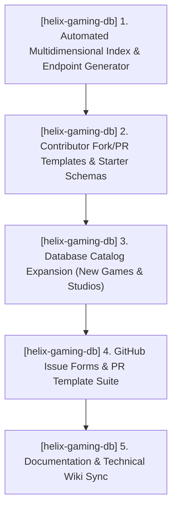
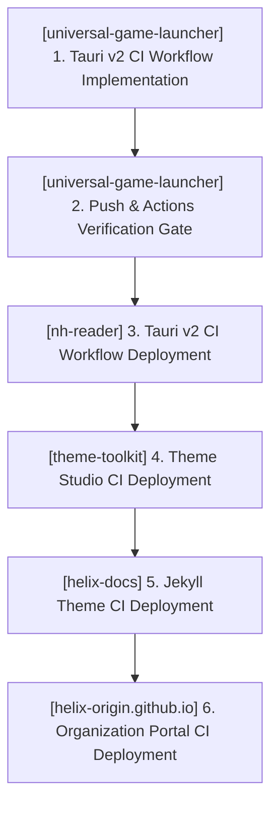

# TODO.md — HELIX Origin Consolidated Task Ledger

> 📋 **Living Source of Truth**: Actionable task ledger across all active repositories in the **HELIX Origin** organization.
> Statuses: ⬜ backlog · 🚧 in progress · ✅ done (tracked as `- [ ]` and `- [x]` checkboxes).
> High-level direction lives in [`ROADMAP.md`](./ROADMAP.md), active sprint planning in [`PLAN.md`](./PLAN.md), issues in [`BUGS.md`](./BUGS.md).
> Completed historical workstreams live in [`.github/TODO-ARCHIVE.md`](./.github/TODO-ARCHIVE.md).
> Last updated: 2026-10-16

---

## 📜 Tracking Rules

- **100% Active Direction Accuracy**: This file and its companion ledgers (`ROADMAP.md`, `PLAN.md`, `BUGS.md`) must always reflect the current, active direction of all projects with zero contradictions. Whenever a requirement changes or supersedes an earlier decision, immediately replace or remove the superseded statements in place.
- **Normalized & Categorized Locked User Directives**: Never paste raw chronological chat logs or contradictory historical quotes. Rewrite user directives into clean, typo-free engineering specifications grouped under explicit bold domain sub-headers so it is immediately clear what goes to what.
- **Zero Non-Organization Mentions**: Only reference active repositories belonging to the `HELIX-Origin` GitHub organization (`helix-docs`, `helix-origin.github.io`, `nh-reader`, `universal-game-launcher`, `theme-toolkit`, `windhawk-themes`, `helix-gaming-db`, `ffxiv-config`). Never directly mention external, third-party, or deleted projects/repositories by name.
- **Atomic Checklist Groups & Archival**: Group checklist items by functional component (`- [ ] **[<project-name>] Component Group**:` followed by atomic `- [ ]` sub-tasks). Never stuff multiple distinct deliverables into a single run-on paragraph. Move completed workstreams to [`.github/TODO-ARCHIVE.md`](./.github/TODO-ARCHIVE.md) and leave a concise single-line summary under `## ✅ Completed Workstreams`.
- **Mandatory Project Tagging**: Every workstream, checklist group, task, and backlog item must explicitly include its current project tag (`[<project-name>] (<project-path>)`).
- **Active Items First**: The currently active workstream must always be placed at the top of the content sections.

---

## 🔥 Active Workstreams

### 🎯 [helix-gaming-db] Workstream W.52: REST Metadata API Expansion — Comprehensive Endpoints, Contributor Fork/PR Tooling, Expanded Catalog & GitHub Issue Templates
- **Project Identifiers:** `[helix-gaming-db]` (`projects/helix-gaming-db`)
- **Target Components:**
  - **Static API v1 Hierarchy (`projects/helix-gaming-db/api/v1/`)**: Generates `/genres/index.json`, `/genres/{slug}.json`, `/platforms/index.json`, `/platforms/{slug}.json`, `/tags/index.json`, `/tags/{slug}.json`, `/developers/index.json`, `/publishers/index.json`, `/games/index.json`, `/meta/stats.json`, and starter templates (`/meta/template/game.json`, `/meta/template/developer.json`).
  - **Automated DB Generator (`projects/helix-gaming-db/scripts/build-search-index.mjs`)**: Comprehensive compilation script assembling all indexes, genre maps, platform mappings, publisher aggregates, and manifest directory.
  - **Extensive Database of Games (`projects/helix-gaming-db/api/v1/games/`)**: Expand curated game records across PC indie, Patreon, itch.io, emulation consoles, and storefront gems with strict schema compliance.
  - **Developer Contribution & Fork/PR Workflows**: Starter schemas, contribution guide, and fork/PR verification helpers.
  - **GitHub Issue Forms & PR Templates (`projects/helix-gaming-db/.github/`)**: Issue templates (`new-game-request.yml`, `metadata-correction.yml`, `new-developer-request.yml`, `config.yml`) and `pull_request_template.md`.
  - **Documentation & Wiki Sync (`projects/helix-gaming-db/_docs/`, `_wiki/`)**: Comprehensive endpoints explorer and contribution documentation.



**Locked user directives (normalized by domain):**
- **1. Versatile REST Metadata API Endpoints**:
  - Flesh out `helix-gaming-db` with an extensive list of endpoints (genres, platforms, tags, developers, publishers, compact catalog, metadata stats).
  - Provide developer-facing contribution endpoints and starter template payloads designed for forking the repository and submitting pull requests.
- **2. Extensive Database of Games**:
  - Build up a rich, extensive catalog of games covering obscure, indie, Patreon, itch.io, emulated console, and mainstream titles.
- **3. Community Contribution & Issue Templates**:
  - Author structured GitHub Issue templates and pull request templates to streamline community additions, metadata corrections, and studio requests.

**Implementation checklist:**
- [x] **[helix-gaming-db] 1. Three-Tier Automated Endpoint & Generator Suite**:
  - [x] `[helix-gaming-db]` Expand `build-search-index.mjs` to generate `/api/manifest.json` (root gateway), `/api/v1/` (flat client tier), `/api/v2/` (relational genres, platforms, tags, developers, publishers, catalog, stats, contributor templates & schemas), and `/api/v3/` (dedicated adult 18+ gaming catalog, search, developers, tags, and stats).
  - [x] `[helix-gaming-db]` Add contributor starter templates under `/api/v2/contribute/templates/game.json` and `/api/v2/contribute/templates/developer.json` plus JSON schemas.
- [x] **[helix-gaming-db] 2. Community GitHub Issue Forms & PR Template Suite**:
  - [x] `[helix-gaming-db]` Create `.github/ISSUE_TEMPLATE/01_new_game_request.yml`.
  - [x] `[helix-gaming-db]` Create `.github/ISSUE_TEMPLATE/02_metadata_correction.yml`.
  - [x] `[helix-gaming-db]` Create `.github/ISSUE_TEMPLATE/03_new_developer_request.yml`.
  - [x] `[helix-gaming-db]` Create `.github/ISSUE_TEMPLATE/config.yml`.
  - [x] `[helix-gaming-db]` Create `.github/pull_request_template.md`.
- [x] **[helix-gaming-db] 3. Extensive Database Expansion & Validation**:
  - [x] `[helix-gaming-db]` Expand catalog to 80 curated games and 42 developer studios across PC indie gems (Hades, Hollow Knight, Celeste, Stardew Valley, Balatro, Dead Cells, Outer Wilds, Disco Elysium, Slay the Spire, Vampire Survivors), adult creations (College Kings, Summer's Gone, FreshWomen, Lewd Island), and emulation classics (Ocarina of Time, SSBM, Persona 4 Golden, Symphony of the Night).
  - [x] `[helix-gaming-db]` Multi-tier schema and index validation (`npm test`) passing with 100% compliance across all 80 games and 42 developers.
- [x] **[helix-gaming-db] 4. Documentation & Technical Wiki Synchronization**:
  - [x] `[helix-docs]` Update `_docs/endpoints.md` with complete reference of Root, v1, v2, and v3 adult REST routes.
  - [x] `[helix-docs]` Update `_docs/contributing.md` with fork/PR developer workflow, starter templates, and issue template links.
  - [x] `[helix-docs]` Update `_docs/index.md` and `_wiki/architecture.md` with 3-tier architecture overview and Mermaid topology.
- [x] **[helix-gaming-db] 5. Automated PR Verification, Review Decision & Issue Triage Workflows**:
  - [x] `[helix-gaming-db]` Author `scripts/verify-pr.mjs` scanning changed game and developer payloads for schema conformity, slug matching, HTTPS artwork validity, and studio cross-referencing.
  - [x] `[helix-gaming-db]` Deploy `.github/workflows/pr-automation.yml` with automated comment reporting, label management (`status: validated`, `ready-to-merge` vs `needs-work`), and `APPROVE` / `REQUEST_CHANGES` GitHub reviews.
  - [x] `[helix-gaming-db]` Deploy `.github/workflows/issue-triage.yml` auto-labeling new game requests, metadata corrections, and developer studio requests with helpful fast-track contribution guidance.

---

### 🎯 [universal-game-launcher] & [Ecosystem] Workstream W.51: Organization-Wide CI Standards & Continuous Verification Workflows
- **Project Identifiers:** `[universal-game-launcher]` (`projects/universal-game-launcher`), `[nh-reader]` (`projects/nh-reader`), `[theme-toolkit]` (`projects/theme-toolkit`), `[helix-docs]` (`projects/helix-docs`), `[helix-origin.github.io]` (`projects/helix-origin.github.io`)
- **Target Components:**
  - **UGL CI (`projects/universal-game-launcher/`)**: `.github/workflows/ci.yml`
  - **NH-Reader CI (`projects/nh-reader/`)**: `.github/workflows/ci.yml`
  - **Theme Toolkit CI (`projects/theme-toolkit/`)**: `.github/workflows/ci.yml`
  - **Helix Docs CI (`projects/helix-docs/`)**: `.github/workflows/ci.yml`
  - **Portal CI (`projects/helix-origin.github.io/`)**: `.github/workflows/ci.yml`
  - **Template Architecture (`.agents/templates/`)**: `ci-tauri-workflow-template.yml`



**Locked user directives (normalized by domain):**
- **1. Standardized Automated Continuous Integration**:
  - Establish automated CI workflows as an official organization standard across all active repositories in `HELIX-Origin`.
  - Execute frontend type-checks (`svelte-check` / TypeScript), Rust backend checks (`cargo check`, `cargo test --lib`), schema validations, and Jekyll build checks on every push and pull request.
  - Implement sequentially, starting with `universal-game-launcher` and progressing across projects one at a time to account for individual repository differences and specific tooling requirements.

**Implementation checklist:**
- [x] **[universal-game-launcher] 1. Tauri v2 CI Workflow Deployment**:
  - [x] `[universal-game-launcher]` Create `.github/workflows/ci.yml` with dual-stage verification (`frontend` on Node 22, `backend` matrix on `windows-latest` and `ubuntu-22.04`).
  - [x] `[universal-game-launcher]` Run local test verification (`npm test`: check, rust, frontend passing cleanly).
  - [x] `[universal-game-launcher]` Commit, push to remote `main`, and verify GitHub Actions CI run succeeds (`39016342557` passed 100%).
- [ ] **[nh-reader] 2. Tauri v2 CI Workflow Deployment**:
  - [ ] `[nh-reader]` Create `.github/workflows/ci.yml` tailored for desktop reader stack.
  - [ ] `[nh-reader]` Verify local compilation and push to remote.
- [ ] **[theme-toolkit] 3. Theme Studio CI Deployment**:
  - [ ] `[theme-toolkit]` Create `.github/workflows/ci.yml` tailored for desktop theme applicator.
- [ ] **[helix-docs] 4. Jekyll Theme & SCSS CI Deployment**:
  - [ ] `[helix-docs]` Create `.github/workflows/ci.yml` verifying Ruby/Bundler Jekyll builds and dart-sass stylesheets.
- [ ] **[helix-origin.github.io] 5. Organization Portal CI Deployment**:
  - [ ] `[helix-origin.github.io]` Create `.github/workflows/ci.yml` validating portal links and Jekyll site builds.

---

## ⬜ Backlog / Candidate Tasks

### [nh-reader] (projects/nh-reader) — Post-v0.7.5 / M13 Candidates
- [ ] `[nh-reader]` **Tag Frequency Analytics**: Local reading history analytics showing top consumed tags, artists, and languages.
- [ ] `[nh-reader]` **Multi-Profile Partitioning**: Allow switching between isolated library/blacklist profile stores.
- [ ] `[nh-reader]` **Background Update Inspection**: Non-intrusive GitHub release notification check on app launch.

### [helix-docs] (projects/helix-docs) — v1.1.0 Candidates
- [ ] `[helix-docs]` **Mermaid Helper Component**: Client-side rendering helper for legible ` ```mermaid ` fences.
- [ ] `[helix-docs]` **In-Page TOC Module**: Robust sidebar TOC parser resolving `BUG-14`.
- [ ] `[helix-docs]` **Dynamic Catalogue Filters**: Interactive category filtering for software and theme showrooms.

### [windhawk-themes] (projects/windhawk-themes) — M.04 Candidates
- [ ] `[windhawk-themes]` **Theme Catalogue Integration**: Generate Jekyll showcase documentation in `docs/_catalogue/`.
- [ ] `[windhawk-themes]` **Full Multi-Mod Windows 11 Verification**: Validate cohesive visual language across 22H2, 23H2, and 24H2.

### [theme-toolkit] (projects/theme-toolkit) — Candidates (Planned)
- [ ] `[theme-toolkit]` **Core Tauri v2 Scaffolding**: Setup Tauri v2 app with SvelteKit frontend and Rust backend.
- [ ] `[theme-toolkit]` **Makecab & DDF Packaging Engine**: Rust engine generating Diamond Directive Files (`.ddf`) and executing `makecab.exe`.
- [ ] `[theme-toolkit]` **Sound Scheme Manager**: Win32 Sound Event mapping and `.wav` audio preview / bundling.
- [ ] `[theme-toolkit]` **Wallpaper & Slideshow Studio**: Desktop background viewport, slideshow interval / shuffle controls, and alignment settings.
- [ ] `[theme-toolkit]` **Cursor Scheme Inspector**: 15 standard Win32 cursor role configuration with `.ani` and `.cur` frame previews.
- [ ] `[theme-toolkit]` **Color & Visual Style Editor**: Real-time DWM accent colorization and dark/light system mode toggles.

---

## ✅ Completed Workstreams (Bare-Minimal Index)

> 📖 **Full Archive Details**: For complete task checklists, locked user directives, and technical scope notes, see [`.github/TODO-ARCHIVE.md`](./.github/TODO-ARCHIVE.md).

### [helix-gaming-db] (projects/helix-gaming-db)
- **[helix-gaming-db] W.50 — HELIX Gaming DB REST API Foundation, Static v1 Endpoints, JSON Schemas, Remote Theme Docs / Wiki & UGL Integration (v1.0.0)**: Dedicated gaming metadata API and database hosted via GitHub Pages (`api/v1/`), Draft 2020-12 schemas, automated validation, 62 curated games, 28 studio profiles, Jekyll documentation and wiki, and `metadata-helix` client provider in `universal-game-launcher`. See [`.github/TODO-ARCHIVE.md`](./.github/TODO-ARCHIVE.md).

### [universal-game-launcher] (projects/universal-game-launcher)
- **[universal-game-launcher] W.49 — Universal Core Plugins & Global Helpers Architecture, Authentic Vector SVG Platform Icons, Automatic Metadata Engine & Per-Game Customization (v1.4.0)**: Consolidated Universal Core Plugins, Authentic Vector SVG Platform Icons (`PlatformIcon.svelte`), multi-source automatic metadata cascade, `⚙ Manage` per-game customization modal, client discovery across all 7 desktop platforms outside Steam, and modular hand-rolled developer catalog. See [`.github/TODO-ARCHIVE.md`](./.github/TODO-ARCHIVE.md).
- **[universal-game-launcher] W.47 — Project Script Standards, Manifest Schema 1.12.0 & IDE Untracking (Hotfix v1.3.3)**: Canonical `main:sub:option` scripts, schema 1.12.0 validation, `.vscode` untracking, release CI. See [`.github/TODO-ARCHIVE.md`](./.github/TODO-ARCHIVE.md).
- **[universal-game-launcher] W.46 — Cross-Platform Compiler Warning Elimination & Release Pipeline Hardening (Hotfix v1.3.2)**: POSIX/Windows compiler warnings resolved, release v1.3.2. See [`.github/TODO-ARCHIVE.md`](./.github/TODO-ARCHIVE.md).
- **[universal-game-launcher] W.45 — Modular Multi-Platform Free Game Checker, Store Deals Engine, Library Patch Notes & Settings Ergonomics (Patch v1.3.1)**: Per-platform checkers, deals engine, patch notes feed, sidebar cog. See [`.github/TODO-ARCHIVE.md`](./.github/TODO-ARCHIVE.md).
- **[universal-game-launcher] W.44 — Two-Tier Data Architecture: In-Memory Serverless Redis-Compatible KV Tier & SQLite Global Persistence Layer**: In-memory KV tier and SQLite persistence. See [`.github/TODO-ARCHIVE.md`](./.github/TODO-ARCHIVE.md).
- **[universal-game-launcher] W.42 — Multi-Platform Launcher Detection, Settings Toggle Guards & Built-in Legendary CLI**: Detection guards, Legendary OAuth authentication. See [`.github/TODO-ARCHIVE.md`](./.github/TODO-ARCHIVE.md).
- **[universal-game-launcher] W.41 — Persistent Local Artwork Cache, In-Memory Fast Lookup, CSP Alignment & Settings Cache Reset**: `art_cache/` local disk cache, CSP `img-src` expansion. See [`.github/TODO-ARCHIVE.md`](./.github/TODO-ARCHIVE.md).
- **[universal-game-launcher] W.35 — Multi-Provider Metadata Parity, Settings & Per-Game Refresh**: Full metadata synchronization and localization. See [`.github/TODO-ARCHIVE.md`](./.github/TODO-ARCHIVE.md).
- **[universal-game-launcher] W.34 — Library 500 Repair, Artwork & Custom Display Name Sub-Window, Settings Consolidation**: Restored store export, artwork slot manager. See [`.github/TODO-ARCHIVE.md`](./.github/TODO-ARCHIVE.md).
- **[universal-game-launcher] W.33 — Multi-Platform Owned Games Detection, Official & Enhanced Metadata Engine, Interactive Library**: Multi-platform aggregation and per-game management. See [`.github/TODO-ARCHIVE.md`](./.github/TODO-ARCHIVE.md).
- **[universal-game-launcher] W.32 — Windows Store & Xbox Game Detection, Custom NSIS Installer, and System Tray Support**: AppModel scan, NSIS mutex hooks, tray minimize. See [`.github/TODO-ARCHIVE.md`](./.github/TODO-ARCHIVE.md).
- **[universal-game-launcher] W.18–W.28 — Milestones M1–M9 (Foundation through v1.0.0 Packaging)**: Whole library, filter builder, storage manager, custom artwork, smart collections, SQLite cache, obsidian UI, v1.0.0 release. See [`.github/TODO-ARCHIVE.md`](./.github/TODO-ARCHIVE.md).

### [windhawk-themes] (projects/windhawk-themes)
- **[windhawk-themes] W.15 — Command Center Suite Docs Sync (2026-10-13 Refactor)**: Cleaned stale references, synchronized README, static gate 0 errors / 0 warnings. See [`.github/TODO-ARCHIVE.md`](./.github/TODO-ARCHIVE.md).
- **[windhawk-themes] W.12 — Command Center — High-Contrast & explorer.exe Crash Fixes**: Confirmed crash caused by external mod; resolved high contrast fallback issues. See [`.github/TODO-ARCHIVE.md`](./.github/TODO-ARCHIVE.md).
- **[windhawk-themes] W.11 — Command Center Catalogue — Companion Extras Documentation**: Documented Phone Link and companion integration in docs catalogue. See [`.github/TODO-ARCHIVE.md`](./.github/TODO-ARCHIVE.md).
- **[windhawk-themes] W.08 — Site Branding Artwork (logo / icon / favicon)**: Squircle SVG logo, multi-size favicon suite. See [`.github/TODO-ARCHIVE.md`](./.github/TODO-ARCHIVE.md).
- **[windhawk-themes] W.04 — Suite Refinements & Geometry Alignment**: Start menu pin centering, companion card alignment. See [`.github/TODO-ARCHIVE.md`](./.github/TODO-ARCHIVE.md).
- **[windhawk-themes] Milestones M.01 & M.02 Foundation**: Initial agent ecosystem rules, Notification Center styler with frosted glass and rim highlights. See [`.github/TODO-ARCHIVE.md`](./.github/TODO-ARCHIVE.md).

### [nh-reader] (projects/nh-reader)
- **[nh-reader] Milestones M1–M12 & Web Assets (v0.1.0 – v0.7.5)**: Core foundation, browse, search filter drawer, blacklist stream buffering, responsive reader, 18-language localization core, NSIS installer polish, squircle website assets, unified `npm run sign` script. See [`.github/TODO-ARCHIVE.md`](./.github/TODO-ARCHIVE.md).

### [helix-docs] (projects/helix-docs)
- **[helix-docs] W.14 — Doc Site Refinements — Catalogue Width & ShareX Copy**: Expanded catalogue min column width to 400px, ShareX workflow docs. See [`.github/TODO-ARCHIVE.md`](./.github/TODO-ARCHIVE.md).
- **[helix-docs] W.10 — Home Page (vCard Pattern) Documentation**: Modular card authoring guide for landing pages. See [`.github/TODO-ARCHIVE.md`](./.github/TODO-ARCHIVE.md).
- **[helix-docs] W.06 & W.07 — Sidebar, Mermaid Rendering & Branding Artwork**: Fixed mermaid rendering, SVG squircle logo and multi-size favicon. See [`.github/TODO-ARCHIVE.md`](./.github/TODO-ARCHIVE.md).
- **[helix-docs] Theme Phases 1–5 & v1.0.0 Release**: Layered SCSS architecture, precompiled Dart Sass CSS, pure frontmatter nav engine, modular cards, universal navbar. See [`.github/TODO-ARCHIVE.md`](./.github/TODO-ARCHIVE.md).

### [theme-toolkit] (projects/theme-toolkit)
- **[theme-toolkit] W.39 — Theme Toolkit Repository Creation, Base Framework Scaffolding, and Dedicated Agent Suite**: Tauri v2 app scaffolding, Per-Platform Lib isolation, dedicated agents and rules. See [`.github/TODO-ARCHIVE.md`](./.github/TODO-ARCHIVE.md).
- **[Ecosystem-Wide] & [theme-toolkit] W.38 — GTK Theming Removal, Desktop Theme Engineer Repurposing & Windows Deskthemepack Engineering Suite Planning**: Purged GTK theming; pivoted to cross-platform Theme Toolkit and Microsoft `makecab.exe` DDF standards. See [`.github/TODO-ARCHIVE.md`](./.github/TODO-ARCHIVE.md).

### [helix-origin.github.io] (projects/helix-origin.github.io)
- **[helix-origin.github.io] W.09 & Portal Modernization**: Remote theme standardization, 16:9 vector showcase artwork integration (`universal-game-launcher.svg`, `nh-reader.svg`, `windhawk-themes.svg`, `helix-docs.svg`). See [`.github/TODO-ARCHIVE.md`](./.github/TODO-ARCHIVE.md).

### [Ecosystem & Infrastructure] (workspace root)
- **[Ecosystem-Wide] W.43 — Multi-Platform Clean Uninstaller Architecture, Windows Uninstall Registry Invariant & Process Termination Standards**: NSIS mutex termination hooks, registry hygiene, macOS/Linux uninstaller templates. See [`.github/TODO-ARCHIVE.md`](./.github/TODO-ARCHIVE.md).
- **[Ecosystem-Wide] W.36 — Ecosystem Scripts Standard, Platform Module Isolation, Opt-In Code Signing, and Package Registration**: Canonical `main:sub:option` standard, local code signing. See [`.github/TODO-ARCHIVE.md`](./.github/TODO-ARCHIVE.md).
- **[Ecosystem] W.21 & W.05 — Agent Governance, Workflow Skills & Template Architecture**: Workspace rules, task decomposition, file editing, shell command management, and tracking ledger templates. See [`.github/TODO-ARCHIVE.md`](./.github/TODO-ARCHIVE.md).
- **[Ecosystem] W.16 — Global Documentation Theme-Neutrality Invariant**: Enforced mod-agnostic and theme-neutral documentation standards across all projects. See [`.github/TODO-ARCHIVE.md`](./.github/TODO-ARCHIVE.md).
- **[Ecosystem] W.13 — Stale Agents-Ecosystem Reference Cleanup**: Removed internal workspace references from all standalone public repositories. See [`.github/TODO-ARCHIVE.md`](./.github/TODO-ARCHIVE.md).
