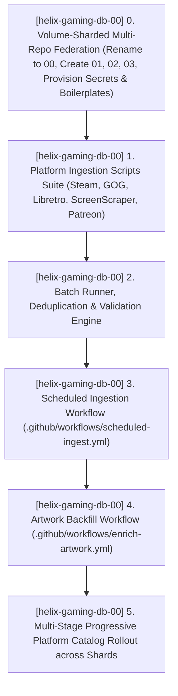
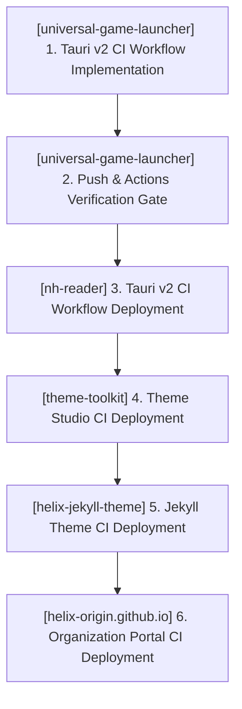

# TODO.md — HELIX Origin Consolidated Task Ledger

> 📋 **Living Source of Truth**: Actionable task ledger across all active repositories in the **HELIX Origin** organization.
> Statuses: ⬜ backlog · 🚧 in progress · ✅ done (tracked as `- [ ]` and `- [x]` checkboxes).
> High-level direction lives in [`ROADMAP.md`](./ROADMAP.md), active sprint planning in [`PLAN.md`](./PLAN.md), issues in [`BUGS.md`](./BUGS.md).
> Completed historical workstreams live in [`.github/TODO-ARCHIVE.md`](./.github/TODO-ARCHIVE.md).
> Last updated: 2026-10-16

---

## 📜 Tracking Rules

- **100% Active Direction Accuracy**: This file and its companion ledgers (`ROADMAP.md`, `PLAN.md`, `BUGS.md`) must always reflect the current, active direction of all projects with zero contradictions. Whenever a requirement changes or supersedes an earlier decision, immediately replace or remove the superseded statements in place.
- **Normalized & Categorized Locked User Directives**: Never paste raw chronological chat logs or contradictory historical quotes. Rewrite user directives into clean, typo-free engineering specifications grouped under explicit bold domain sub-headers so it is immediately clear what goes to what.
- **Zero Non-Organization Mentions**: Only reference active repositories belonging to the `HELIX-Origin` GitHub organization (`helix-jekyll-theme`, `helix-origin.github.io`, `docs`, `wiki`, `nh-reader`, `universal-game-launcher`, `theme-toolkit`, `windhawk-themes`, `helix-gaming-db-00` through `03`, `ffxiv-config`). Never directly mention external, third-party, or deleted projects/repositories by name.
- **Atomic Checklist Groups & Archival**: Group checklist items by functional component (`- [ ] **[<project-name>] Component Group**:` followed by atomic `- [ ]` sub-tasks). Never stuff multiple distinct deliverables into a single run-on paragraph. Move completed workstreams to [`.github/TODO-ARCHIVE.md`](./.github/TODO-ARCHIVE.md) and leave a concise single-line summary under `## ✅ Completed Workstreams`.
- **Mandatory Project Tagging**: Every workstream, checklist group, task, and backlog item must explicitly include its current project tag (`[<project-name>] (<project-path>)`).
- **Active Items First**: The currently active workstream must always be placed at the top of the content sections.

---

## 🔥 Active Workstreams

### 🎯 [helix-gaming-db-00] Workstream W.54: Multi-Platform Metadata Expansion & Automated Ingestion Pipeline — Volume-Sharded Federation (00, 01, 02, 03), Platform Scrapers, Batch Ingestion CLI & Scheduled GitHub Workflows
- **Project Identifiers:** `[helix-gaming-db-00]` (`projects/helix-gaming-db-00`), `[helix-gaming-db-01]` (`projects/helix-gaming-db-01`), `[helix-gaming-db-02]` (`projects/helix-gaming-db-02`), `[helix-gaming-db-03]` (`projects/helix-gaming-db-03`)
- **Target Components:**
  - **Volume-Sharded Multi-Repository Federation (`projects/helix-gaming-db-00/`, `01/`, `02/`, `03/`)**: Symmetrical autonomous metadata repositories preventing GitHub free tier storage (<1GB) limits with shared `PAT_TOKEN` automation and client cycling API.
  - **Platform Ingestion Scrapers (`projects/helix-gaming-db-00/scripts/ingest/`)**: `ingest-steam.mjs`, `ingest-gog.mjs`, `ingest-libretro-rdb.mjs`, `ingest-screenscraper.mjs`, `ingest-patreon-itch.mjs`.
  - **Batch Runner & Deduplication Engine (`projects/helix-gaming-db-00/scripts/ingest/run-batch.mjs`)**: CLI batch runner with platform filters, rate-limiting, canonical slug generation, and shard routing.
  - **Scheduled GitHub Ingestion Workflows (`.github/workflows/`)**: `scheduled-ingest.yml` (weekly batch cron opening automated PRs) and `enrich-artwork.yml` (bi-weekly artwork backfiller).
  - **Three-Tier Catalog Expansion (`api/`)**: Progressive ingestion into `v2/` (general, indie, retro) and `v3/` (adult 18+ titles) across shards.



**Locked user directives (normalized by domain):**
- **1. Multi-Platform Metadata Expansion & Volume Sharding**:
  - Implement a strategic plan and automated pipeline to slowly build up metadata in HELIX Gaming DB for every game available across all supported platforms (PC storefronts and retro consoles).
  - Split metadata across 4 separate repositories (`helix-gaming-db-00`, `helix-gaming-db-01`, `helix-gaming-db-02`, `helix-gaming-db-03`) that each support all providers and platforms with identical structure, scripts, and workflows.
  - The client API simply cycles between the different metadata repositories.
- **2. Automated Ingestion Scripts**:
  - Create dedicated scrapers and ingestion scripts for Steam, GOG, Libretro OpenVGDB, ScreenScraper, and Patreon/itch.io.
  - Automatically route family/general titles to `v2` and explicit adult (18+) creations to `v3`.
- **3. Scheduled GitHub Actions Automation**:
  - Deploy automated scheduled workflows to run ingestion batches in the background and open pull requests for validation.
- **4. HTML Badge Standards**:
  - Always use raw HTML `<a></a>` for shields.io and status badges across all Markdown files to allow better control over their rendering sizes and prevent layout shifts across high-DPI displays. Never use Markdown badge syntax (`[](url)`).
- **5. Organization Release & Asset Attachment Invariant**:
  - All repositories across the organization must publish GitHub Releases to track versions, milestones, and deployments.
  - Release assets must strictly ONLY be uploaded to repositories distributing packaged applications or resources (`universal-game-launcher`, `nh-reader`, `theme-toolkit`, `ffxiv-config`). All other repositories (`docs`, `wiki`, `helix-origin.github.io`, `helix-jekyll-theme`, `windhawk-themes`, `helix-gaming-db-00` through `03`, `agents`) publish zero-asset releases.
- **6. Universal Semantic Versioning & Universal Human-Readable Release Notes**:
  - All repositories strictly use Semantic Versioning (`vMAJOR.MINOR.PATCH`). Milestone-based releases are prohibited organization-wide.
  - Release notes standards must follow a detailed, human-readable, and universal format that works seamlessly across all repositories.

**Implementation checklist:**
- [x] **[Ecosystem] 0a. Universal HTML Badge Standards Migration**:
  - [x] Update agent rules (`documentation-standards.md`, `gfm-content.md`, `AGENTS.md`, `copilot-instructions.md`) to establish mandatory HTML badges with explicit `height="20"`.
  - [x] Migrate all project and root README files from Markdown badges to standard HTML badges with `height="20"`.

- [x] **[Ecosystem] 0b. Organization License & GitHub Repository Metadata Synchronization**:
  - [x] Deploy canonical GitHub BSD-3-Clause `LICENSE` file across all 14 local repositories and workspace root.
  - [x] Synchronize manifests (`package.json`, `Cargo.toml`, `helix-docs.gemspec`) and badges to strictly use `BSD-3-Clause`.
  - [x] Update GitHub repository metadata (descriptions, homepages pointing to `docs.helix-origin.club` / `wiki.helix-origin.club`, and topic tags) across all 15 repositories in the `HELIX-Origin` organization.
  - [x] Update portal repo (`helix-origin.github.io`) to strictly link to Docs Hub and Wiki Hub, removing raw API JSON gateway links and letting Docs and Wiki handle all project-specific information.

- [x] **[Ecosystem] 0c. Organization-Wide Semantic Versioning, Detailed Universal Release Notes & Baseline Releases**:
  - [x] Codify Universal Semantic Versioning Invariant and Release Asset Invariant across `AGENTS.md`, `.github/copilot-instructions.md`, `.agents/rules/release-notes.md`, and `.agents/templates/release-notes-template.md`.
  - [x] Migrate `windhawk-themes` and `docs` from milestone-based release framing to Semantic Versioning (`vMAJOR.MINOR.PATCH`).
  - [x] Publish baseline GitHub Releases for all repositories (`docs`, `wiki`, `helix-origin.github.io`, `helix-jekyll-theme`, `theme-toolkit`, `windhawk-themes`, `helix-gaming-db-00` through `03`, `agents`) adhering strictly to SemVer and the zero-asset policy.
  - [x] Restructure `docs` and `wiki` repositories from redundant `_docs` and `_wiki` folders to clean `_projects/` collections.
  - [x] Convert all repository `README.md` files into minimal entry points linking directly to centralized documentation and wiki hubs.


- [x] **[helix-gaming-db-00] 0. Volume-Sharded Multi-Repository Federation, Centralized Docs/Wiki Split & Cloudflare Worker Gateway (00, 01, 02, 03, docs, wiki, api)**:
  - [x] `[docs]` Create dedicated public repository `HELIX-Origin/docs`, provision `PAT_TOKEN`, configure GitHub Pages (`docs.helix-origin.club`), and set up `remote_theme: HELIX-Origin/helix-jekyll-theme`.
  - [x] `[wiki]` Create dedicated public repository `HELIX-Origin/wiki`, provision `PAT_TOKEN`, configure GitHub Pages (`wiki.helix-origin.club`), and set up `remote_theme: HELIX-Origin/helix-jekyll-theme`.
  - [x] `[helix-gaming-db-00]` Rename existing GitHub repository `helix-gaming-db` to `helix-gaming-db-00` and update local folder to `projects/helix-gaming-db-00`.
  - [x] `[helix-gaming-db-00]` Migrate docs to `docs` and wiki to `wiki`, removing Jekyll files from `helix-gaming-db-00` leaving it as a pure REST metadata API repository.
  - [x] `[docs]` Update `_config.yml` to `remote_theme: HELIX-Origin/helix-jekyll-theme` and author comprehensive documentation covering every project in `HELIX-Origin` (`universal-game-launcher`, `nh-reader`, `theme-toolkit`, `windhawk-themes`, `helix-gaming-db`, `ffxiv-config`, `helix-jekyll-theme`).
  - [x] `[wiki]` Update `_config.yml` to `remote_theme: HELIX-Origin/helix-jekyll-theme` and author comprehensive technical wikis covering every project in `HELIX-Origin`.
  - [x] `[Ecosystem]` Purge `docs/` folders and Jekyll configuration from all project repositories (`universal-game-launcher`, `nh-reader`, `windhawk-themes`, `ffxiv-config`) to maintain clean, standalone codebases.
  - [x] `[Ecosystem]` Disable GitHub Pages across all project repositories via GitHub API, reserving Pages strictly for `helix-origin.github.io`, `docs`, `wiki`, and `helix-jekyll-theme`.
  - [x] `[helix-gaming-db-01]` Create public repository `HELIX-Origin/helix-gaming-db-01`, provision `PAT_TOKEN`, and seed with identical boilerplate, schemas, validation scripts, workflows, and i18n locales.
  - [x] `[helix-gaming-db-02]` Create public repository `HELIX-Origin/helix-gaming-db-02`, provision `PAT_TOKEN`, and seed with identical boilerplate, schemas, validation scripts, workflows, and i18n locales.
  - [x] `[helix-gaming-db-03]` Create public repository `HELIX-Origin/helix-gaming-db-03`, provision `PAT_TOKEN`, and seed with identical boilerplate, schemas, validation scripts, workflows, and i18n locales.
  - [x] `[helix-gaming-db-00]` Implement cross-shard deduplication & ownership verification in `scripts/lib/cross-shard-dedup.mjs`, `scripts/validate.mjs`, and `scripts/verify-pr.mjs` checking both committed code and open PRs across all 4 shard repositories.
  - [x] `[helix-gaming-db-00]` Implement shard cycling PR router (`scripts/lib/shard-router.mjs` and `api/v2/contribute/router.json`) to open update PRs in owner repos and cycle new metadata PRs to the first shard without code or PR collisions.
  - [x] `[helix-gaming-api]` Deploy Cloudflare Worker Gateway (`helix-gaming-api` v2.0) on `api.helix-origin.club` supporting Mode 2 Unified Gateway (`/api/v{1,2,3}/...`) and Mode 1 Direct Shard Proxy (`/helix-gaming-db-{NN}/...`).
  - [x] `[universal-game-launcher]` Update client `src/lib/plugins/metadata/helix-db.ts` to seamlessly query the Unified Gateway and cycle through all four active metadata repositories (`helix-gaming-db-00`, `01`, `02`, `03`).
- [ ] **[helix-gaming-db-00] 1. Platform Ingestion Scripts Suite (`scripts/ingest/`)**:
  - [ ] `[helix-gaming-db-00]` Create `scripts/ingest/ingest-steam.mjs` for Steam PC storefront titles.
  - [ ] `[helix-gaming-db-00]` Create `scripts/ingest/ingest-gog.mjs` for GOG DRM-free releases.
  - [ ] `[helix-gaming-db-00]` Create `scripts/ingest/ingest-libretro-rdb.mjs` for retro console ROM databases.
  - [ ] `[helix-gaming-db-00]` Create `scripts/ingest/ingest-screenscraper.mjs` for retro/arcade metadata.
  - [ ] `[helix-gaming-db-00]` Create `scripts/ingest/ingest-patreon-itch.mjs` for indie/adult creations.
- [ ] **[helix-gaming-db-00] 2. Batch Ingestion CLI & Deduplication Engine (`scripts/ingest/run-batch.mjs`)**:
  - [ ] `[helix-gaming-db-00]` Author `run-batch.mjs` supporting `--platform`, `--limit`, `--tier`, and `--shard` flags with automatic slug generation and schema verification.
- [ ] **[helix-gaming-db-00] 3. Scheduled Ingestion GitHub Actions Workflow (`.github/workflows/scheduled-ingest.yml`)**:
  - [ ] `[helix-gaming-db-00]` Deploy scheduled weekly cron workflow running platform batches and opening validated PRs.
- [ ] **[helix-gaming-db-00] 4. Artwork Backfill & Health Check Workflow (`.github/workflows/enrich-artwork.yml`)**:
  - [ ] `[helix-gaming-db-00]` Deploy bi-weekly background workflow searching authorized CDNs to backfill missing vertical box art and hero banners.
- [ ] **[helix-gaming-db-00] 5. Multi-Stage Progressive Platform Rollout across Shards**:
  - [ ] `[helix-gaming-db-00]` Phase 1: Top PC Indie & Digital Hits (~250 games in `v2`).
  - [ ] `[helix-gaming-db-00]` Phase 2: Golden Age 16-bit & 32-bit Consoles (SNES, Genesis, PS1, GBA) (~500 games in `v2`).
  - [ ] `[helix-gaming-db-00]` Phase 3: Dedicated Adult & Patreon 18+ Visual Novels & RPGs (~150 games in `v3`).
  - [ ] `[helix-gaming-db-00]` Phase 4: 6th & 7th Generation 3D Classics (GameCube, PS2, Dreamcast, Wii, PSP) (~500 games in `v2`).
  - [ ] `[helix-gaming-db-00]` Phase 5: Long-Tail Storefronts & Retro Arcade (Epic, EA, Ubisoft, Battle.net, Arcade) (~1,000+ games).
- [ ] **[helix-gaming-db-00] 6. Outdated Information & Artwork Refresh Pipeline**:
  - [ ] `[helix-gaming-db-00]` Author `scripts/ingest/check-drift.mjs` scanning active entries against live storefronts to refresh descriptions, resolve 404 images, and fetch updated capsules/banners.
  - [ ] `[helix-gaming-db-00]` Deploy `.github/workflows/update-metadata-drift.yml` running bi-weekly drift scans and opening automated refresh PRs for actively maintained games.
- [x] **[helix-gaming-db-00] 7. Library-Driven Internationalization (i18next) & Multilingual Taxonomy**:
  - [x] `[helix-gaming-db-00]` Integrate `i18next` library (`scripts/i18n/index.mjs`) for dynamic taxonomy resolution, language negotiation, and ISO 639-1 / BCP 47 fallback chains.
  - [x] `[helix-gaming-db-00]` Author complete taxonomy dictionaries across 12 primary languages (`locales/{lang}/genres.json`, `categories.json`, `platforms.json`, `common.json` for `en`, `ja`, `zh-CN`, `zh-TW`, `es`, `fr`, `de`, `it`, `pt-BR`, `ru`, `ko`, `pl`).
  - [x] `[helix-gaming-db-00]` Update `schemas/game.schema.json` to formally support optional `locales` dictionary with per-language title, synopses, and aliases.
  - [x] `[helix-gaming-db-00]` Update `scripts/build-search-index.mjs` to emit static multilingual REST endpoints (`/api/v2/i18n/locales.json`, `/api/v2/i18n/{code}/bundle.json`, `/api/v2/i18n/{code}/genres.json`, `/api/v2/i18n/{code}/search/index.json`).
  - [x] `[universal-game-launcher]` Update Three-Tier client (`src/lib/plugins/metadata/helix-db.ts`) with `preferred_language` setting and dynamic localized metadata resolution.
- [ ] **[helix-gaming-db-00] 8. Volume-Sharded Multi-Repository Federation & Dedicated Docs Split**:
  - [x] `[helix-gaming-db-00]` Architect multi-repo volume sharding and cycling framework (`/api/v2/federation/index.json` and `shards.json`) to prevent GitHub free user storage and file count ceilings.
  - [x] `[docs] & [wiki]` Decouple Jekyll documentation and wiki sites out of metadata shards into dedicated repositories `HELIX-Origin/docs` and `HELIX-Origin/wiki`.
  - [ ] `[helix-gaming-db-00]` Register volume shards (`helix-gaming-db-00`, `01`, `02`, `03`) where each shard supports all platforms and providers.
  - [x] `[helix-gaming-db-00]` Update root manifest (`/api/manifest.json`), v1, v2, and v3 manifests with `federation` metadata.
  - [ ] `[universal-game-launcher]` Add multi-repo cycling to `helix-db.ts` across `helix-gaming-db-00`, `01`, `02`, and `03`.
- [x] **[Ecosystem] 9. Automated Secret & PAT Replication Across Projects**:
  - [x] `[Ecosystem]` Replicate shared legacy `PAT_TOKEN` secret across all organization repositories via `gh secret set`.
  - [x] `[agents]` Protect `.env` in root `.gitignore` and save `PAT_TOKEN` / `GITHUB_TOKEN` to local untracked `.env` file for agent automation.
  - [x] `[agents]` Create `provision-repo-secrets.ps1` helper script to instantly provision new repositories as they are created.


---

### 🎯 [universal-game-launcher] & [Ecosystem] Workstream W.51: Organization-Wide CI Standards & Continuous Verification Workflows
- **Project Identifiers:** `[universal-game-launcher]` (`projects/universal-game-launcher`), `[nh-reader]` (`projects/nh-reader`), `[theme-toolkit]` (`projects/theme-toolkit`), `[helix-jekyll-theme]` (`projects/helix-jekyll-theme`), `[helix-origin.github.io]` (`projects/helix-origin.github.io`)
- **Target Components:**
  - **UGL CI (`projects/universal-game-launcher/`)**: `.github/workflows/ci.yml`
  - **NH-Reader CI (`projects/nh-reader/`)**: `.github/workflows/ci.yml`
  - **Theme Toolkit CI (`projects/theme-toolkit/`)**: `.github/workflows/ci.yml`
  - **Helix Jekyll Theme CI (`projects/helix-jekyll-theme/`)**: `.github/workflows/ci.yml`
  - **Portal CI (`projects/helix-origin.github.io/`)**: `.github/workflows/ci.yml`
  - **Template Architecture (`.agents/templates/`)**: `ci-tauri-workflow-template.yml`



**Locked user directives (normalized by domain):**
- **1. Standardized Automated Continuous Integration**:
  - Establish automated CI workflows as an official organization standard across all active repositories in `HELIX-Origin`.
  - Execute frontend type-checks (`svelte-check` / TypeScript), Rust backend checks (`cargo check`, `cargo test --lib`), schema validations, and Jekyll build checks on every push and pull request.
  - Implement sequentially, starting with `universal-game-launcher` and progressing across projects one at a time to account for individual repository differences and specific tooling requirements.

**Implementation checklist:**
- [x] **[universal-game-launcher] 1. Tauri v2 CI Workflow Deployment**:
  - [x] `[universal-game-launcher]` Create `.github/workflows/ci.yml` with dual-stage verification (`frontend` on Node 22, `backend` matrix on `windows-latest` and `ubuntu-22.04`).
  - [x] `[universal-game-launcher]` Run local test verification (`npm test`: check, rust, frontend passing cleanly).
  - [x] `[universal-game-launcher]` Commit, push to remote `main`, and verify GitHub Actions CI run succeeds (`39016342557` passed 100%).
- [ ] **[nh-reader] 2. Tauri v2 CI Workflow Deployment**:
  - [ ] `[nh-reader]` Create `.github/workflows/ci.yml` tailored for desktop reader stack.
  - [ ] `[nh-reader]` Verify local compilation and push to remote.
- [ ] **[theme-toolkit] 3. Theme Studio CI Deployment**:
  - [ ] `[theme-toolkit]` Create `.github/workflows/ci.yml` tailored for desktop theme applicator.
- [ ] **[helix-jekyll-theme] 4. Jekyll Theme & SCSS CI Deployment**:
  - [ ] `[helix-jekyll-theme]` Create `.github/workflows/ci.yml` verifying Ruby/Bundler Jekyll builds and dart-sass stylesheets.
- [ ] **[helix-origin.github.io] 5. Organization Portal CI Deployment**:
  - [ ] `[helix-origin.github.io]` Create `.github/workflows/ci.yml` validating portal links and Jekyll site builds.

---

## ⬜ Backlog / Candidate Tasks

### [nh-reader] (projects/nh-reader) — Post-v0.7.5 / M13 Candidates
- [ ] `[nh-reader]` **Tag Frequency Analytics**: Local reading history analytics showing top consumed tags, artists, and languages.
- [ ] `[nh-reader]` **Multi-Profile Partitioning**: Allow switching between isolated library/blacklist profile stores.
- [ ] `[nh-reader]` **Background Update Inspection**: Non-intrusive GitHub release notification check on app launch.

### [helix-jekyll-theme] (projects/helix-jekyll-theme) — v1.1.0 Candidates
- [ ] `[helix-jekyll-theme]` **Mermaid Helper Component**: Client-side rendering helper for legible ` ```mermaid ` fences.
- [ ] `[helix-jekyll-theme]` **In-Page TOC Module**: Robust sidebar TOC parser resolving `BUG-14`.
- [ ] `[helix-jekyll-theme]` **Dynamic Catalogue Filters**: Interactive category filtering for software and theme showrooms.

### [windhawk-themes] (projects/windhawk-themes) — M.04 Candidates
- [ ] `[windhawk-themes]` **Theme Catalogue Integration**: Generate Jekyll showcase documentation in `docs/_catalogue/`.
- [ ] `[windhawk-themes]` **Full Multi-Mod Windows 11 Verification**: Validate cohesive visual language across 22H2, 23H2, and 24H2.

### [theme-toolkit] (projects/theme-toolkit) — Candidates (Planned)
- [ ] `[theme-toolkit]` **Core Tauri v2 Scaffolding**: Setup Tauri v2 app with SvelteKit frontend and Rust backend.
- [ ] `[theme-toolkit]` **Makecab & DDF Packaging Engine**: Rust engine generating Diamond Directive Files (`.ddf`) and executing `makecab.exe`.
- [ ] `[theme-toolkit]` **Sound Scheme Manager**: Win32 Sound Event mapping and `.wav` audio preview / bundling.
- [ ] `[theme-toolkit]` **Wallpaper & Slideshow Studio**: Desktop background viewport, slideshow interval / shuffle controls, and alignment settings.
- [ ] `[theme-toolkit]` **Cursor Scheme Inspector**: 15 standard Win32 cursor role configuration with `.ani` and `.cur` frame previews.
- [ ] `[theme-toolkit]` **Color & Visual Style Editor**: Real-time DWM accent colorization and dark/light system mode toggles.

---

## ✅ Completed Workstreams (Bare-Minimal Index)

> 📖 **Full Archive Details**: For complete task checklists, locked user directives, and technical scope notes, see [`.github/TODO-ARCHIVE.md`](./.github/TODO-ARCHIVE.md).

### [helix-gaming-db] (projects/helix-gaming-db)
- **[helix-gaming-db] W.52 — REST Metadata API Expansion: Three-Tier Endpoints, Contributor Fork/PR Suite, Dedicated Adult (18+) API, Expanded 80-Game Catalog & GitHub Issue Templates (v1.1.0)**: Three-tier REST architecture (`manifest.json`, `v1/`, `v2/`, `v3/`), 80 verified games, 42 developers, contributor fork/PR templates, GitHub Issue forms, and automated PR review workflow. See [`.github/TODO-ARCHIVE.md`](./.github/TODO-ARCHIVE.md).
- **[helix-gaming-db] W.50 — HELIX Gaming DB REST API Foundation, Static v1 Endpoints, JSON Schemas, Remote Theme Docs / Wiki & UGL Integration (v1.0.0)**: Dedicated gaming metadata API and database hosted via GitHub Pages (`api/v1/`), Draft 2020-12 schemas, automated validation, 62 curated games, 28 studio profiles, Jekyll documentation and wiki, and `metadata-helix` client provider in `universal-game-launcher`. See [`.github/TODO-ARCHIVE.md`](./.github/TODO-ARCHIVE.md).

### [universal-game-launcher] (projects/universal-game-launcher)
- **[universal-game-launcher] W.53 — Helix Gaming DB Three-Tier REST API Integration & Hand-Rolled Catalog Deprecation (v1.4.1)**: Full integration with Three-Tier REST API (`v2` relational discovery, `v3` adult 18+ tier), dual-tier index caching, persistent serverless KV offline fallback, and complete deletion of 28 hardcoded developer files in favor of dynamic API discovery. See [`.github/TODO-ARCHIVE.md`](./.github/TODO-ARCHIVE.md).
- **[universal-game-launcher] W.49 — Universal Core Plugins & Global Helpers Architecture, Authentic Vector SVG Platform Icons, Automatic Metadata Engine & Per-Game Customization (v1.4.0)**: Consolidated Universal Core Plugins, Authentic Vector SVG Platform Icons (`PlatformIcon.svelte`), multi-source automatic metadata cascade, `⚙ Manage` per-game customization modal, client discovery across all 7 desktop platforms outside Steam, and modular hand-rolled developer catalog. See [`.github/TODO-ARCHIVE.md`](./.github/TODO-ARCHIVE.md).
- **[universal-game-launcher] W.47 — Project Script Standards, Manifest Schema 1.12.0 & IDE Untracking (Hotfix v1.3.3)**: Canonical `main:sub:option` scripts, schema 1.12.0 validation, `.vscode` untracking, release CI. See [`.github/TODO-ARCHIVE.md`](./.github/TODO-ARCHIVE.md).
- **[universal-game-launcher] W.46 — Cross-Platform Compiler Warning Elimination & Release Pipeline Hardening (Hotfix v1.3.2)**: POSIX/Windows compiler warnings resolved, release v1.3.2. See [`.github/TODO-ARCHIVE.md`](./.github/TODO-ARCHIVE.md).
- **[universal-game-launcher] W.45 — Modular Multi-Platform Free Game Checker, Store Deals Engine, Library Patch Notes & Settings Ergonomics (Patch v1.3.1)**: Per-platform checkers, deals engine, patch notes feed, sidebar cog. See [`.github/TODO-ARCHIVE.md`](./.github/TODO-ARCHIVE.md).
- **[universal-game-launcher] W.44 — Two-Tier Data Architecture: In-Memory Serverless Redis-Compatible KV Tier & SQLite Global Persistence Layer**: In-memory KV tier and SQLite persistence. See [`.github/TODO-ARCHIVE.md`](./.github/TODO-ARCHIVE.md).
- **[universal-game-launcher] W.42 — Multi-Platform Launcher Detection, Settings Toggle Guards & Built-in Legendary CLI**: Detection guards, Legendary OAuth authentication. See [`.github/TODO-ARCHIVE.md`](./.github/TODO-ARCHIVE.md).
- **[universal-game-launcher] W.41 — Persistent Local Artwork Cache, In-Memory Fast Lookup, CSP Alignment & Settings Cache Reset**: `art_cache/` local disk cache, CSP `img-src` expansion. See [`.github/TODO-ARCHIVE.md`](./.github/TODO-ARCHIVE.md).
- **[universal-game-launcher] W.35 — Multi-Provider Metadata Parity, Settings & Per-Game Refresh**: Full metadata synchronization and localization. See [`.github/TODO-ARCHIVE.md`](./.github/TODO-ARCHIVE.md).
- **[universal-game-launcher] W.34 — Library 500 Repair, Artwork & Custom Display Name Sub-Window, Settings Consolidation**: Restored store export, artwork slot manager. See [`.github/TODO-ARCHIVE.md`](./.github/TODO-ARCHIVE.md).
- **[universal-game-launcher] W.33 — Multi-Platform Owned Games Detection, Official & Enhanced Metadata Engine, Interactive Library**: Multi-platform aggregation and per-game management. See [`.github/TODO-ARCHIVE.md`](./.github/TODO-ARCHIVE.md).
- **[universal-game-launcher] W.32 — Windows Store & Xbox Game Detection, Custom NSIS Installer, and System Tray Support**: AppModel scan, NSIS mutex hooks, tray minimize. See [`.github/TODO-ARCHIVE.md`](./.github/TODO-ARCHIVE.md).
- **[universal-game-launcher] W.18–W.28 — Milestones M1–M9 (Foundation through v1.0.0 Packaging)**: Whole library, filter builder, storage manager, custom artwork, smart collections, SQLite cache, obsidian UI, v1.0.0 release. See [`.github/TODO-ARCHIVE.md`](./.github/TODO-ARCHIVE.md).

### [windhawk-themes] (projects/windhawk-themes)
- **[windhawk-themes] W.15 — Command Center Suite Docs Sync (2026-10-13 Refactor)**: Cleaned stale references, synchronized README, static gate 0 errors / 0 warnings. See [`.github/TODO-ARCHIVE.md`](./.github/TODO-ARCHIVE.md).
- **[windhawk-themes] W.12 — Command Center — High-Contrast & explorer.exe Crash Fixes**: Confirmed crash caused by external mod; resolved high contrast fallback issues. See [`.github/TODO-ARCHIVE.md`](./.github/TODO-ARCHIVE.md).
- **[windhawk-themes] W.11 — Command Center Catalogue — Companion Extras Documentation**: Documented Phone Link and companion integration in docs catalogue. See [`.github/TODO-ARCHIVE.md`](./.github/TODO-ARCHIVE.md).
- **[windhawk-themes] W.08 — Site Branding Artwork (logo / icon / favicon)**: Squircle SVG logo, multi-size favicon suite. See [`.github/TODO-ARCHIVE.md`](./.github/TODO-ARCHIVE.md).
- **[windhawk-themes] W.04 — Suite Refinements & Geometry Alignment**: Start menu pin centering, companion card alignment. See [`.github/TODO-ARCHIVE.md`](./.github/TODO-ARCHIVE.md).
- **[windhawk-themes] Milestones M.01 & M.02 Foundation**: Initial agent ecosystem rules, Notification Center styler with frosted glass and rim highlights. See [`.github/TODO-ARCHIVE.md`](./.github/TODO-ARCHIVE.md).

### [nh-reader] (projects/nh-reader)
- **[nh-reader] Milestones M1–M12 & Web Assets (v0.1.0 – v0.7.5)**: Core foundation, browse, search filter drawer, blacklist stream buffering, responsive reader, 18-language localization core, NSIS installer polish, squircle website assets, unified `npm run sign` script. See [`.github/TODO-ARCHIVE.md`](./.github/TODO-ARCHIVE.md).

### [helix-jekyll-theme] (projects/helix-jekyll-theme)
- **[helix-jekyll-theme] W.14 — Doc Site Refinements — Catalogue Width & ShareX Copy**: Expanded catalogue min column width to 400px, ShareX workflow docs. See [`.github/TODO-ARCHIVE.md`](./.github/TODO-ARCHIVE.md).
- **[helix-jekyll-theme] W.10 — Home Page (vCard Pattern) Documentation**: Modular card authoring guide for landing pages. See [`.github/TODO-ARCHIVE.md`](./.github/TODO-ARCHIVE.md).
- **[helix-jekyll-theme] W.06 & W.07 — Sidebar, Mermaid Rendering & Branding Artwork**: Fixed mermaid rendering, SVG squircle logo and multi-size favicon. See [`.github/TODO-ARCHIVE.md`](./.github/TODO-ARCHIVE.md).
- **[helix-jekyll-theme] Theme Phases 1–5 & v1.0.0 Release**: Layered SCSS architecture, precompiled Dart Sass CSS, pure frontmatter nav engine, modular cards, universal navbar. See [`.github/TODO-ARCHIVE.md`](./.github/TODO-ARCHIVE.md).

### [theme-toolkit] (projects/theme-toolkit)
- **[theme-toolkit] W.39 — Theme Toolkit Repository Creation, Base Framework Scaffolding, and Dedicated Agent Suite**: Tauri v2 app scaffolding, Per-Platform Lib isolation, dedicated agents and rules. See [`.github/TODO-ARCHIVE.md`](./.github/TODO-ARCHIVE.md).
- **[Ecosystem-Wide] & [theme-toolkit] W.38 — GTK Theming Removal, Desktop Theme Engineer Repurposing & Windows Deskthemepack Engineering Suite Planning**: Purged GTK theming; pivoted to cross-platform Theme Toolkit and Microsoft `makecab.exe` DDF standards. See [`.github/TODO-ARCHIVE.md`](./.github/TODO-ARCHIVE.md).

### [helix-origin.github.io] (projects/helix-origin.github.io)
- **[helix-origin.github.io] W.09 & Portal Modernization**: Remote theme standardization, 16:9 vector showcase artwork integration (`universal-game-launcher.svg`, `nh-reader.svg`, `windhawk-themes.svg`, `helix-jekyll-theme.svg`). See [`.github/TODO-ARCHIVE.md`](./.github/TODO-ARCHIVE.md).

### [Ecosystem & Infrastructure] (workspace root)
- **[Ecosystem-Wide] W.43 — Multi-Platform Clean Uninstaller Architecture, Windows Uninstall Registry Invariant & Process Termination Standards**: NSIS mutex termination hooks, registry hygiene, macOS/Linux uninstaller templates. See [`.github/TODO-ARCHIVE.md`](./.github/TODO-ARCHIVE.md).
- **[Ecosystem-Wide] W.36 — Ecosystem Scripts Standard, Platform Module Isolation, Opt-In Code Signing, and Package Registration**: Canonical `main:sub:option` standard, local code signing. See [`.github/TODO-ARCHIVE.md`](./.github/TODO-ARCHIVE.md).
- **[Ecosystem] W.21 & W.05 — Agent Governance, Workflow Skills & Template Architecture**: Workspace rules, task decomposition, file editing, shell command management, and tracking ledger templates. See [`.github/TODO-ARCHIVE.md`](./.github/TODO-ARCHIVE.md).
- **[Ecosystem] W.16 — Global Documentation Theme-Neutrality Invariant**: Enforced mod-agnostic and theme-neutral documentation standards across all projects. See [`.github/TODO-ARCHIVE.md`](./.github/TODO-ARCHIVE.md).
- **[Ecosystem] W.13 — Stale Agents-Ecosystem Reference Cleanup**: Removed internal workspace references from all standalone public repositories. See [`.github/TODO-ARCHIVE.md`](./.github/TODO-ARCHIVE.md).
