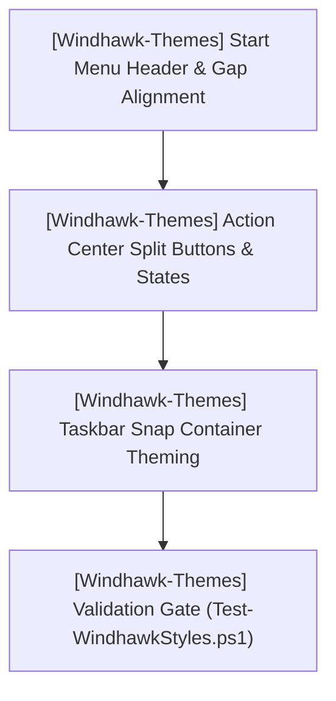

# TODO.md — HELIX Origin Consolidated Task Ledger

> 📋 **Living Source of Truth**: Actionable task ledger across all projects in the **HELIX Origin** organization.
> Statuses: ⬜ backlog · 🚧 in progress · ✅ done (tracked as `- [ ]` and `- [x]` checkboxes).
> High-level direction lives in [`ROADMAP.md`](./ROADMAP.md), active sprint planning in [`PLAN.md`](./PLAN.md), issues in [`BUGS.md`](./BUGS.md).
> Last updated: 2026-10-13

---

## 📜 Tracking Rules

- **No Typo Duplication**: When recording user reports, clean and fix all typos to preserve professional quality.
- **Consistent Formatting**: Maintain consistent formatting and style throughout all documentation to ensure readability and professionalism.
- **Clear Sectioning**: Use clear and descriptive headers for each section to improve navigation and readability.
- **Mandatory Project Tagging**: **Every single task, workstream, and backlog item must explicitly include its project tag** (`[<project-name>]`). Agents must never guess which repository a task belongs to.
- **Active Items First**: The currently active milestone, sprint, task, or workstream must always be placed at the top of the content sections.
- **Regular Updates**: Ensure that this file is regularly updated to reflect the latest developments and changes in the project.
- **Improve User Directives**: Continuously refine and clarify user directives to ensure they are easily understood and actionable.
- **Same-Change Updates**: When a task changes behavior or scope, update this file in the same change.
- **Done Moves Down**: When a task is done, check it off and archive completed sections under Completed Workstreams.
- **Tracking Docs Stay True**: Update `ROADMAP.md`, `TODO.md`, `BUGS.md`, and `PLAN.md` first or in lockstep with code changes.
- **Always Track Everything**: Every new feature request, enhancement, or bug report must be logged before execution.

---

## 🔥 Active Workstreams

### 🎯 [FFXIV-Config] Workstream W.17: README Entry Point + `docs/` GitHub Pages Site
- **Project Identifier:** `[FFXIV-Config]`
- **Repository Path:** `projects/FFXIV-Config`
- **Target Component:** `README.md`, `docs/` (new Jekyll site on the `helix-docs` remote theme), `.gitignore`

**Locked user directives:**
- "Restructure `projects/FFXIV-Config` so `README.md` is a minimal entry point and a new `docs/` GitHub Pages site (remote `helix-docs` theme) holds the detailed information (install instructions + per-file details)."
- "It currently has basic details. It needs proper details with instructions on how to install the configs, as well as detailed information on what each config file effects."
- "we use manual deployment. so no github pages workflows."

**Context:** FFXIV Config is a HUD/hotbar/macro layout built on Fr4nsson's FFC for 8.x jobs. The ten shipped `.DAT` files were reverse-engineered for accuracy: `CONTROL0.DAT` = keyboard/mouse controls, `CONTROL1.DAT` = gamepad controls (both plain-text `<Charcter Settings>` key/value); `MACRO.DAT` is XOR-masked (`0x73`) with typed records (`T` title, `I`/`K` ids, 15× `L` command lines) → 100 macro slots (job-change, menu controls, BFX 1–5 presets, reserved slots). Files are 17-byte header + content + 15-byte null footer.

**Implementation checklist:**
- [x] `[FFXIV-Config]` Author `docs/_config.yml`: `remote_theme: HELIX-Origin/helix-docs`, `baseurl: /FFXIV-Config`, `docs` collection (`permalink: /docs/:path/`), NH-Reader-style plugin list, `defaults` by `type` (`path: ""`), no `_data/navigation.yml`, no logo/favicon (theme guards + GitHub org fallback).
- [x] `[FFXIV-Config]` Write `docs/index.md` (portal, `layout: default`, `notice` + `header_actions`) and `docs/_docs/` pages: `index.md` ("Documentation Directory", `permalink: /docs/`), `Installation.md`, `Configuration-Files.md`, `Hud-And-Hotbars.md`, `Macros.md`, `Troubleshooting.md` — theme-neutral, per-file effects table, 10 shipped + 3 untouched files, verified technical notes.
- [x] `[FFXIV-Config]` Rewrite `README.md` as a minimal entry point (overview, 3-step install, supported jobs, full docs-site links, credits).
- [x] `[FFXIV-Config]` Add `.gitignore` for Jekyll build output (`_site/`, `.jekyll-cache/`, `.jekyll-metadata`, `Gemfile.lock`, …); repo previously had none.
- [x] `[FFXIV-Config]` Local build verified: `jekyll build` exit 0, remote theme fetched, 7 pages generated, sidebar nav + parent tree resolve, links carry `/FFXIV-Config` baseurl, no `_data` remnants. Build artifacts cleaned.
- [x] `[Ecosystem]` Register FFXIV-Config in `.agents/skills/helix-theme.md` per-project parent-anchor table (`"Documentation Directory"`, wiki `—`).
- [x] `[FFXIV-Config]` Commit + push the README rewrite, `docs/` site, and `.gitignore` (`87304dd`, pushed `99d5b28..87304dd`).
- [x] `[FFXIV-Config]` Set the GitHub repository description and 10 topics (`ffxiv`, `final-fantasy-xiv`, `ffxiv-config`, `ffxiv-hud`, `ffxiv-macros`, `hud-layout`, `hotbar`, `macros`, `game-config`, `mmorpg`) via `gh repo edit`.
- [x] `[Ecosystem]` Commit + push the agents-repo changes: clone scripts (`clone-org-repos-windows.ps1` / `-linux.sh` / `-macos.sh`, exec bits set), `AGENTS.md`, `.agents/skills/clone-org-repos.md`, `.agents/skills/helix-theme.md`, tracking docs (`3a99a83`, pushed `0c993a3..3a99a83`).
- [ ] `[FFXIV-Config]` Enable GitHub Pages (Settings → Pages → deploy from `main` / `/docs`) — deployment is manual, so the site goes live once the Pages source is set/rebuilds.

---

### 🎯 [Windhawk-Themes] Workstream W.15: Command Center Suite Docs Sync (2026-10-13 Refactor)
- **Project Identifier:** `[Windhawk-Themes]`
- **Repository Path:** `projects/Windhawk-Themes`
- **Target Component:** `docs/_catalogue/command-center.md`, `docs/_wiki/start-menu-styler/*`, `docs/_wiki/taskbar-styler/*`, `docs/_docs/Notification-Center.md`

**Locked user directives:**
- "I made some changes and fixes to the Command Center suite. Let's update the Command Center catalogue page to correctly reflect the current state of the command center suite."
- "the changes are pushed but the site itself needs to be updated. The details about the Command Center suite need to reflect the current state of the command center suite."
- "Also sync the whole docs site" (site-wide token-vocabulary sync); "Yes — commit & push".

**Context:** User refactored `windows-11-start-menu-styler.yml` + `windows-11-taskbar-styler.yml` (pushed `f9f228b`, 2026-10-13). Start Menu token set simplified/renamed: `CornerRadius=35`, `SearchBoxRadius=25`, `HoverCornerRadius=15`, `ElementCornerRadius=10`, `FlyoutCornerRadius=6` (retired `PanelRadius`/`CardRadius`/`ChipRadius` + the `ElementBackground`/`OverlayColor`/`RecommendedBorderBrush`/`ViewBorderBrush`/`HighlightBorder` fills). Taskbar tokens renamed: `R1=6`, `R2=20`, `Height=42`, `Width=42` (retired `CornerRadius`/`CornerRadiusAlt1`/`BaseHeight`/`BaseWidth`); added `ActiveColor`. New suite header image.

**Implementation checklist:**
- [x] `[Windhawk-Themes]` Rewrite `docs/_catalogue/command-center.md`: current surface-coverage sentence, radii-tier semantics (XL 35 / L 25 / M 15 / S 10 / XS 6), new **Accent-Aware States** pillar, updated Supported Surface Mods cells (taskbar flyouts, Snap Layout picker, virtual desktop bar; shell flyouts & context menus, folder modal, Lock screen).
- [x] `[Windhawk-Themes]` **Docs-neutrality correction (user directive, supersedes the earlier suite-vocabulary "sync"):** the wiki/docs must stay theme-neutral and mod-agnostic — they must **not** mirror the Command Center (or any catalogue theme). Reverted the token-vocabulary sync and removed **every** Command Center token/value/geometry from `docs/` + `docs/_wiki/` (5 element-target tables, 5 `configurations/schema.md`, 5 `overview.md`, the affected `_docs/` pages, plus `docs/index.md` / `Architecture.md` / `Getting-Started.md` / `Companion-Shell.md` branding and the signature rim gradient/thickness). Docs now name only the mod mechanism and stylable XAML properties; examples use generic `My*` placeholders. `docs/_catalogue/` remains the only suite-specific surface.
- [x] `[Windhawk-Themes]` Update `projects/command-center/README.md` to the current configs (taskbar no longer a detached dock; Start glass panel is `Grid#Root > Border`; per-file radii/token tables; `Height`/`Width`=42; removed invented tokens; `src/`→`projects/command-center/`); fixed stale `src/` links in `extras/README.md`.
- [x] `[Windhawk-Themes]` Static gate `tools/Test-WindhawkStyles.ps1` → **0 errors, 0 warnings** (deduplicated 8 repeated target selectors as behavior-preserving unions) — see BUGS.
- [ ] `[Windhawk-Themes]` Commit + push the neutralized docs + README + gate dedup (Pages rebuild pending live verification).
- [ ] `[Windhawk-Themes]` Open follow-ups (see BUGS): Notification Center still uses its own `PanelRadius=13`/`CardRadius=10`/`ChipRadius=6` scale (drift vs the refactored Start/Taskbar) — decide refactor-or-document; Start Menu `HoverCornerRadius=15` declared but unreferenced; `Grid#CompanionRoot > Border#AcrylicBorder` glass-styled yet collapsed by a more specific selector; `Border#AppBorder` collapsed **and** glass-styled.

---

### 🎯 [Ecosystem / HELIX-Origin] Workstream W.16: Global Documentation Theme-Neutrality Invariant
- **Project Identifier:** `[Ecosystem]`
- **Repository Path:** Workspace Root (`D:\Projects\GitHub\HELIX Origin`)
- **Target Component:** `.agents/rules/documentation-standards.md`, `AGENTS.md`, `.github/copilot-instructions.md`

**Locked user directives:**
- "don't make my styles the source of truth in the styling docs! those are intentionally supposed to be ambiguous to explain to users how to work with the mods. The catalogue is where users share their own themes and suites, the docs should not use style references from the catalogue."
- "you need to add this as a strict rule to follow in the agents ecosystem since you consistently choose ignore this rule."

**Implementation checklist:**
- [x] `[Ecosystem]` Author `.agents/rules/documentation-standards.md` (**BINDING — GLOBAL**): strictly separates `docs/` (theme-neutral, mechanism-only) from `docs/_catalogue/` + `docs/_store/` (the only home for an author's tokens/values/geometry), with 5 hard prohibitions, a decision test, and an enforcement clause.
- [x] `[Ecosystem]` Register the invariant in `AGENTS.md`: new absolute invariant **#6**, a Quick-reference row, and session-start checklist step 4.
- [x] `[Ecosystem]` Add hard invariant **#6** to `.github/copilot-instructions.md`.
- [ ] `[Ecosystem]` Commit + push the agents ecosystem (`AGENTS.md`, new rule, copilot-instructions, tracking docs).

---

### 🎯 [Ecosystem / HELIX-Origin] Workstream W.13: Stale Agents-Ecosystem Reference Cleanup Across Project Repos
- **Project Identifier:** `[Ecosystem]`
- **Repository Path:** Workspace Root + `projects/Windhawk-Themes`, `projects/NH-Reader`, `projects/helix-origin.github.io`
- **Target Component:** Removed per-repo agent ecosystems (`AGENTS.md`, `.agents/`, `check:agents`), agent-managed folders (`.backups/`, `scratch/`), and per-repo tracking docs (ROADMAP/PLAN/TODO/BUGS)

**Locked user directives:**
- "we should clean up all stale agents ecosystem references in all of our projects — we removed the old per-repo agents ecosystems in favor of the new global agents ecosystem."
- "the .backups folder is now managed by the new global agents ecosystem so it should not be in any of the other project repos either."
- "scratch is a folder used by the agent ecosystem so it only belongs in the agents repo as well."
- "TODO.md, ROADMAP.md, BUGS.md, and PLAN.md are all tracking files used by the agents ecosystem — they should only be in the agents ecosystem project repo."

**Implementation checklist:**
- [x] `[Windhawk-Themes]` Deleted the "AI Agent Ecosystem" section + TOC row from `README.md`; cleaned `AGENTS.md`/`.agents/`/tracker claims from `projects/command-center/README.md` + `extras/README.md` (incl. Rule 08/09 and Related Documentation).
- [x] `[Windhawk-Themes]` Cleaned multi-agent ecosystem claims in `docs/README.md`, `docs/index.md`, `docs/_docs/Getting-Started.md`; removed `.agents`/`scratch` Jekyll excludes; replaced `scratch/json` example paths in `Diagnostics.md` and `Companion-System.md`; reworded the tracked-in-BUGS note in `tools/style-baseline.ini`.
- [x] `[Windhawk-Themes]` Removed `.backups/` and `scratch/` folders (tracked `README.md` files deleted) + `.gitignore` whitelist entries.
- [x] `[NH-Reader]` Deleted `scripts/check-agents.mjs` + `check:agents` npm script; purged AGENTS.md / `.agents/` / tracker / scratch references from CONTRIBUTING.md, `docs/_wiki/Development-and-Contributing.md`, README, SECURITY, docs pages, and all five issue templates.
- [x] `[NH-Reader]` Deleted local `scratch/` folder (untracked) and removed `.agents`/`scratch` Jekyll excludes.
- [x] `[helix-origin.github.io]` Removed `.agents`/`scratch` excludes from `docs/_config.yml`.
- [x] `[Ecosystem]` Commit + push `Windhawk-Themes` (`72ab93d`), `NH-Reader` (`8a46971`), `helix-origin.github.io` (`0d87680`), and `agents` (`2098235`) — all pushed.

### 🎯 [helix-docs + Windhawk-Themes] Workstream W.14: Doc Site Refinements — Catalogue Width & ShareX Copy
- **Project Identifier:** `[helix-docs]` / `[Windhawk-Themes]`
- **Repository Path:** `projects/helix-docs`, `projects/Windhawk-Themes`
- **Target Component:** `.catalogue-item-shell` width; ShareX `VK_SLEEP` doc mentions

**Locked user directives:**
- "the category item pages need to be a little wider. the tables are causing mod names to render across two lines..." — render the catalogue item page cards wider.
- "There is no need to mention the vk_sleep print screen mappings. that is solely my system... the auto keybinding detection is enough to point out that it can detect wonky keybinds caused by the os."

**Implementation checklist:**
- [x] `[helix-docs]` Widened `.catalogue-item-shell` from `min(1080px, 100%)` → `min(1440px, 100%)` in `_sass/modules/catalogue.scss`; recompiled `assets/css/site.css` via Dart Sass with rule parity (0 lost rules; `b78c983`).
- [x] `[Windhawk-Themes]` Removed the device-specific `VK_SLEEP` PrintScreen mapping example from `docs/index.md`, `docs/_docs/Toolchain.md`, and `tools/README.md`; kept the generic "auto-detects user keybindings" wording (`a7f6ec8`).
- [x] `[Windhawk-Themes]` Mod-title rename in **tables only** (fixes table wrapping): renamed "Mod ID"/"Windhawk Mod ID"/"Styler Mod ID" columns → **Windhawk Mod** using formatted names (`Taskbar Styler`, `Start Menu Styler`, `Notification Center Styler`, `Settings Styler`, `File Explorer Styler`) in `docs/index.md` home surfaces table, `docs/README.md` Supported Mods table, `docs/_catalogue/command-center.md` Supported Surface Mods table (merged redundant Styler Mod + Mod ID columns), and the 5 `docs/_wiki/*/overview.md` spec tables; split multi-process cells onto separate lines (`ShellExperienceHost.exe` / `ShellHost.exe` in `index.md`/`README.md`/`docs/_docs/Architecture.md`, `SearchHost.exe` / `SearchApp.exe` in `Diagnostics.md`/start-menu overview). Non-table contexts (prose, bullets, headings, mermaid, file paths, URLs) keep the real `windows-11-*` IDs; companion-extras table & CHANGELOG untouched.

### 🎯 [Windhawk-Themes] Workstream W.12: Command Center — High-Contrast & explorer.exe Crash Fixes
- **Project Identifier:** `[Windhawk-Themes]`
- **Repository Path:** `projects/Windhawk-Themes`
- **Target Component:** Command Center Suite (`windows-11-start-menu-styler.yml`, `windows-11-taskbar-styler.yml`)

**Locked user directives:**
- "this is not a high contrast theme."
- "It's more than likely the taskbar style since it effects explorer.exe and is known to have this exact problem when a misconfigured style is being used." — superseded: root cause later confirmed as the external `file-operations-styler` companion mod.

**Implementation checklist:**
- [ ] `[Windhawk-Themes]` High-contrast neutrality (open): the `64711d2` removal of `Border#MainMenuHighContrastBorder` / `Border#RightCompanionHighContrastBorder` was rolled back — it damaged the Start Menu styling (the borders affect normal-mode rendering). Redesign a correct fix later that never alters normal glass styling. **Update (2026-10-13, `f9f228b`):** the refactor removed the `*HighContrastBorder` targets entirely, superseding the rollback — needs live re-verification that normal glass styling is intact before closing.
- [x] `[Windhawk-Themes]` Explorer crash root cause confirmed **external**: the companion `file-operations-styler` mod crashes `explorer.exe` during file ops (repro: folder delete → "provide administrator permission" prompt → freeze → crash). Not fixable in-repo; disable the mod pending upstream fix; user to report to the Windhawk mods team.
- [x] `[Windhawk-Themes]` Revert the taskbar styler edits from `64711d2` (bare-type flyout/menu targets + two `RenderTransform` overrides restored) — they were not the crash source and their removal undid intended styling.
- [x] `[Windhawk-Themes]` Restore `docs/_wiki/start-menu-styler/targets/elements.md` high-contrast row so the target catalog matches the restored Start Menu config.
- [x] `[Windhawk-Themes]` Static gate `tools/Test-WindhawkStyles.ps1` → 0 errors, 0 warnings on the restored configs.
- [x] `[Windhawk-Themes]` Commit + push `Windhawk-Themes` (restored stylers + `elements.md` + changelog) and `agents` (`BUGS.md`, `TODO.md`, `PLAN.md`).

---

### 🎯 [Windhawk-Themes] Workstream W.11: Command Center Catalogue — Companion Extras Documentation
- **Project Identifier:** `[Windhawk-Themes]`
- **Repository Path:** `projects/Windhawk-Themes`
- **Target Component:** `docs/_catalogue/command-center.md`

**Locked user directives:**
- "our catalogue has a page for the command center suite. but that page lacks instructions for configuring the extras. we need to add instructions for those into it as well."

**Implementation checklist:**
- [x] `[Windhawk-Themes]` Add a "🧩 Configuring the Companion Extras" section to the Command Center Suite catalogue page: extras matrix (8 companion mods with mod IDs, YAML files, and target process/scope), step-by-step install instructions, and a link to the full `projects/command-center/extras/README.md` reference.
- [x] `[Windhawk-Themes]` Commit + push (`5a331de`); Pages build succeeded and the rendered section was live-verified at `https://helix-origin.github.io/Windhawk-Themes/catalogue/command-center/`.

---

### 🎯 [helix-origin.github.io] Workstream W.09: Portal Project Card Naming
- **Project Identifier:** `[helix-origin.github.io]`
- **Repository Path:** `projects/helix-origin.github.io`
- **Target Component:** `docs/index.md` project grid

**Locked user directives:**
- "the repo title needs proper formatting. The correct way for the repo title to be displayed is HELIX Docs"

**Implementation checklist:**
- [x] `[helix-origin.github.io]` Render the HELIX Docs project card with the display title "HELIX Docs" instead of the repo slug `helix-docs` (card heading + image `alt`).
- [x] `[helix-docs]` Title the theme README heading as "HELIX Docs".
- [x] `[helix-docs]` Display the theme/preview site title as "HELIX Docs" (`_config.yml` `title:` + `index.md`) and dedupe the home-page `<title>` in `_includes/head.html`.
- [x] `[helix-origin.github.io]` Live verification after commit + Pages rebuild — portal card confirmed reading "HELIX Docs" (`409111f`; theme README `a00a540`).

---

### 🎯 [helix-docs] Workstream W.10: Home Page (vCard Pattern) Documentation
- **Project Identifier:** `[helix-docs]`
- **Repository Path:** `projects/helix-docs`
- **Target Component:** `_docs/home-page.md`, `_docs/index.md`, `_docs/layouts.md`

**Locked user directives:**
- "add instructions in the site for properly writing the index.md page to use our custom vcard layout in the site home pages"
- The vCard is a *pattern*, not a layout: home pages keep `layout: default` and are composed with hand-written HTML sections in `index.md`.

**Implementation checklist:**
- [x] `[helix-docs]` Author `_docs/home-page.md` documenting the vCard home pattern (hero front matter, `.doc-section`/`.section-heading`, feature cards, project cards, documentation directory, previews, timeline, closing CTA) with copy-paste snippets.
- [x] `[helix-docs]` Link the guide from the Theme Documentation Directory and cross-reference it from the Default layout section; renumber `nav_order` for the components/multilingual pages.
- [x] `[helix-docs]` Local build verified (Liquid examples render literally; page builds at `/docs/home-page/`); pushed `3b79c5f`.

---

### 🎯 [Windhawk-Themes] Workstream W.08: Site Branding Artwork (logo / icon / favicon)
- **Project Identifier:** `[Windhawk-Themes]`
- **Repository Path:** `projects/Windhawk-Themes`
- **Target Component:** `docs/assets/images/` (`logo.svg`, `icon.png`, `favicon.ico`), `docs/_config.yml` branding keys

Derive matching squircle branding artwork for the Windhawk Themes wiki from the existing `windhawk.jpg` source with ImageMagick.

**Locked user directives:**
- "The Windhawk Themes repo has a windhawk.jpg image that we can use as the source to generate the new svg, ico, and png images from."

**Implementation checklist:**
- [x] `[Windhawk-Themes]` Extract the white Windhawk glyph from the 600×600 grayscale `windhawk.jpg` (level 40%→100%, masked to alpha).
- [x] `[Windhawk-Themes]` Author `docs/assets/images/logo.svg` (256×256 squircle, dark tile + cyan→purple accent, embedded glyph).
- [x] `[Windhawk-Themes]` Export `docs/assets/images/icon.png` (256×256) and multi-size `docs/assets/images/favicon.ico` (256/48/32/16).
- [x] `[Windhawk-Themes]` Set `logo:`, `favicon:`, `icon:` in `docs/_config.yml`.
- [x] `[Windhawk-Themes]` Live verification after commit + Pages rebuild (logo/favicon/apple-touch-icon confirmed live on `eb4b2a6`).

---

### 🎯 [helix-docs] Workstream W.07: Site Branding Artwork (logo / icon / favicon)
- **Project Identifier:** `[helix-docs]`
- **Repository Path:** `projects/helix-docs`
- **Target Component:** `assets/images/` (`logo.svg`, `icon.png`, `favicon.ico`), `_config.yml` branding keys, `_includes/head.html`, `_includes/components/header.html`, `_includes/components/sidebar.html`

Generate matching HELIX Docs squircle branding artwork with ImageMagick and wire it as the preview site logo and favicon.

**Locked user directives:**
- "let's use imagemagick to generate custom matching logo.svg, icon.png, and favicon.ico images... under assets/images."
- "We have a squircle shape we use in all of our sites." (256×256 canvas, `rect x=8 y=8 w=240 h=240 rx=56`.)
- "favicon is able to be set via the _config.yml... so we should make sure your change isn't breaking that."

**Implementation checklist:**
- [x] `[helix-docs]` Author `assets/images/logo.svg` (256×256 squircle, cyan→purple accent matching the theme).
- [x] `[helix-docs]` Export `assets/images/icon.png` (256×256) and multi-size `assets/images/favicon.ico` (256/48/32/16) via ImageMagick.
- [x] `[helix-docs]` Set `logo:`, `favicon:`, `icon:` in `_config.yml`.
- [x] `[helix-docs]` **Robust path resolution** (`BUG-18`): resolve non-absolute `logo`/`favicon` paths from the site root in `head.html` + `header.html` (+ `sidebar.html`), passing absolute and protocol-relative URLs through untouched; add `apple-touch-icon`.
- [x] `[helix-docs]` Validate SVG/PNG/ICO with `magick` (zero RSVG errors) and verify emitted markup on nested routes (baseline, absolute, protocol-relative, root-relative).
- [x] `[helix-docs]` Live verification after commit + Pages rebuild (brand mark, favicon, Apple touch icon on nested pages) — confirmed live on `05b9943`.

---

### 🎯 [helix-docs] Workstream W.06: Sidebar & Mermaid Rendering Fixes
- **Project Identifier:** `[helix-docs]`
- **Repository Path:** `projects/helix-docs`
- **Target Component:** Sidebar navigation/footer (`_includes/components/nav.html`, `nav-icon.html`, `sidebar.html`), mermaid loader (`_includes/components/mermaid.html`), styles (`_sass/modules/navigation.scss`, `_sass/modules/sidebar.scss`)

Make the shared theme render Mermaid fences on every consuming site, and give the sidebar a left-aligned, structured navigation tree (category emoji + sub-page bullets) whose icons are configurable via YAML.

**Locked user directives:**
- "several sites have an ugly centered version with emoji in place of bullets. we need to left align it so it is properly structured and replace the emoji with proper emoji for the head category pages and bullets for the sub pages."
- "as an added measure to give users more control over category icons, we can make it so the categories and their icons are set via the yaml front matter."
- "We should also left align the sidebar footer links too."

**Implementation checklist:**
- [x] `[helix-docs]` **Mermaid default-on** (`BUG-15`): invert the `components/mermaid.html` gate to opt-out; verify the loader emits without config and is suppressed by `mermaid: false`.
- [x] `[helix-docs]` **Sidebar category icons + sub-page bullets** (`BUG-16`): emoji for level-1 categories, indented bullet dots for nested pages, left-aligned marker column in both docs and wiki trees.
- [x] `[helix-docs]` **Front-matter icon control**: resolve icons page `nav_icon:` → `_config.yml` `nav_icons:` map (title/path/url) → keyword heuristic → folder fallback via shared `components/nav-icon.html`.
- [x] `[helix-docs]` **Left-align sidebar footer links** (`BUG-17`): `justify-items`/`text-align` start; footer Docs/Wiki icons follow the category index front matter.
- [x] `[helix-docs]` Recompile `assets/css/site.css` with Dart Sass.
- [x] `[helix-docs]` Live verification on consuming sites (Windhawk-Themes, NH-Reader, Hentai-Senpai, helix-origin.github.io) after commit + Pages rebuild — `mermaid@11.12.0` loader, `nav-bullet`/`nav-icon` markers, and left-aligned footer confirmed live on `05b9943`.
- [ ] `[helix-docs]` Refresh docs that still reference the removed `assets/js/mermaid-init.js` (`README.md`, `_wiki/javascript-modules.md`).

---

### 🎯 [Windhawk-Themes] Workstream W.04: Suite Refinements & Geometry Alignment
- **Project Identifier:** `[Windhawk-Themes]`
- **Repository Path:** `projects/Windhawk-Themes`
- **Target Component:** Command Center Suite (`windows-11-start-menu-styler.yml`, `windows-11-notification-center-styler.yml`, `windows-11-taskbar-styler.yml`)



Refine spatial alignment in the Start Menu and companion pane, resolve color mismatches on Action Center Quick Settings split buttons, and theme internal Snap Layout elements.

**Locked user directives:**
- "The phone link cards should be moved up so they align with the top of the menu (this way the search box is perfectly aligned to the left of them as well)."
- "The extra space between the start menu sections and phone link sections needs to be reduced for improved visuals."
- "The search box needs to have its width shrunk so the toggle button is evenly lined up with the pinned app section under it."
- "Basically the left edge of the search box needs to align with the left edge of the pinned apps section while the right edge of the phone link toggle button should align with the right edge of the pinned apps section."
- "The notification/action center needs a bit of fixing. some areas are not applied correctly... section buttons are not getting the correct colors due to how things are applied."
- "Snap containers internal elements still aren't themed... we need to get that styled to match our styling."

**Implementation checklist:**
- [ ] **[Windhawk-Themes] Start Menu Search & Companion Alignment & Layering**:
  - [x] `[Windhawk-Themes]` Restore compact panel width (470px MainMenu, 3-column pins, 2-column categories) per user preference.
  - [x] `[Windhawk-Themes]` Eliminate right drift and center pinned apps within card with balanced padding.
  - [x] `[Windhawk-Themes]` Align search box width and spacing to avoid clipping into Phone Link toggle button.
  - [x] `[Windhawk-Themes]` Adjust overall height (`MaxHeight=790`) so panel is slightly taller than wide.
  - [x] `[Windhawk-Themes]` Preserve all custom styling, cards, and status icons intact.
- [ ] **[Windhawk-Themes] Notification / Action Center Split Buttons & Colors**:
  - [x] `[Windhawk-Themes]` Reset outer button backgrounds to `Transparent` and route states through `ContentPresenter@CommonStates`.
  - [ ] `[Windhawk-Themes]` Verify fix eliminating high-contrast blue fallback on split buttons (Wi-Fi, Bluetooth chevrons) on user desktop.
  - [ ] `[Windhawk-Themes]` Confirm canonical `$ElementBackground` and `$BorderBrush` on unselected quick action tiles.
- [ ] **[Windhawk-Themes] Taskbar Snap Layout Containers Theming**:
  - [ ] `[Windhawk-Themes]` Style internal snap containers (`SnapLayoutControl`, `LayoutBorder`, `Grid#LayoutGrid > Button`) with frosted glass and subtle borders without altering layout coordinate calculations.
- [ ] **[Windhawk-Themes] Taskbar System Tray Overflow Grid Glass Background**:
  - [ ] `[Windhawk-Themes]` Restore frosted glass background (`$Background`), top-lit border (`$BorderBrush`), and matching corner radius to the system tray overflow flyout (`Grid#OverflowRootGrid > Border` and `Border#OverflowFlyoutBackgroundBorder`).
  - [ ] `[Windhawk-Themes]` **Update (2026-10-13, `f9f228b`):** the refactor sets `Grid#OverflowRootGrid > Border` to `Background:=Transparent` / `BorderBrush:=Transparent` / `BorderThickness=0` — confirm whether this intentionally supersedes the glass restoration or is a regression.
- [ ] **[Windhawk-Themes] Validation & Quality Gate**:
  - [ ] `[Windhawk-Themes]` Pass `tools/Test-WindhawkStyles.ps1` with 0 errors and 0 warnings.
  - [ ] `[Windhawk-Themes]` Conduct live verification on user desktop.

---

### 🎯 [Ecosystem / HELIX-Origin] Workstream W.05: Organization Tracking Consolidation & Template Architecture
- **Project Identifier:** `[Ecosystem]`
- **Repository Path:** Workspace Root (`D:\Projects\GitHub\HELIX Origin`)

- [x] `[Ecosystem]` Survey root tracking files across all sub-projects (`NH-Reader`, `Windhawk-Themes`, `Hentai-Senpai`, `helix-docs`).
- [x] `[Ecosystem]` Create centralized [`ROADMAP.md`](./ROADMAP.md) detailing master milestone matrix and per-project direction.
- [x] `[Ecosystem]` Author canonical tracking templates with mandatory project tagging in `.agents/templates/`:
  - [x] `[Ecosystem]` [`roadmap-template.md`](.agents/templates/roadmap-template.md)
  - [x] `[Ecosystem]` [`plan-template.md`](.agents/templates/plan-template.md)
  - [x] `[Ecosystem]` [`todo-template.md`](.agents/templates/todo-template.md)
  - [x] `[Ecosystem]` [`bugs-template.md`](.agents/templates/bugs-template.md)
- [x] `[Ecosystem]` Consolidate all project sprint execution into master [`PLAN.md`](./PLAN.md) with explicit project tags.
- [x] `[Ecosystem]` Consolidate all task checklists into master [`TODO.md`](./TODO.md) with explicit project tags.
- [x] `[Ecosystem]` Consolidate all open and resolved issues into master [`BUGS.md`](./BUGS.md) with explicit project tags.
- [x] `[Ecosystem]` Update [`AGENTS.md`](./AGENTS.md) index table to register new tracking templates.

---

## ⬜ Backlog / Candidate Tasks

### [NH-Reader] (projects/NH-Reader) — Post-v0.7.5 / M13 Candidates
- [ ] `[NH-Reader]` **Tag Frequency Analytics**: Local reading history analytics showing top consumed tags, artists, and languages.
- [ ] `[NH-Reader]` **Multi-Profile Partitioning**: Allow switching between isolated library/blacklist profile stores.
- [ ] `[NH-Reader]` **Background Update Inspection**: Non-intrusive GitHub release notification check on app launch.

### [helix-docs] (projects/helix-docs) — v1.1.0 Candidates
- [ ] `[helix-docs]` **Mermaid Helper Component**: Client-side rendering helper for legible ` ```mermaid ` fences.
- [ ] `[helix-docs]` **In-Page TOC Module**: Robust sidebar TOC parser resolving `BUG-14`.
- [ ] `[helix-docs]` **Dynamic Catalogue Filters**: Interactive category filtering for software and theme showrooms.

### [Windhawk-Themes] (projects/Windhawk-Themes) — M.04 Candidates
- [ ] `[Windhawk-Themes]` **Theme Catalogue Integration**: Generate Jekyll showcase documentation in `docs/_catalogue/`.
- [ ] `[Windhawk-Themes]` **Full Multi-Mod Windows 11 Verification**: Validate cohesive visual language across 22H2, 23H2, and 24H2.

### [Hentai-Senpai-Multi-DE-Theme] (projects/Hentai-Senpai-Multi-DE-Theme) — Candidates
- [ ] `[Hentai-Senpai]` **GTK4/libadwaita Script Synchronization**: Scripted color overrides for libadwaita desktop environments.

---

## ✅ Completed Workstreams & Archive

### ✅ [Ecosystem] Workspace Scaffolding & Agent Governance
- [x] `[Ecosystem]` `AGENTS.md` at workspace root defining binding invariants (read-only git by default, org scope, tracking docs contract).
- [x] `[Ecosystem]` `.agents/rules/`: `git-operations.md`, `workspace.md`, `release-notes.md`, `verification.md`, `security-hygiene.md`, `project-artwork.md`.
- [x] `[Ecosystem]` `.agents/skills/`: `clone-org-repos.md`, `sass-compile.md`, `helix-theme.md`, `gfm-content.md`, `jekyll-remote-theme.md`, `project-artwork-generation.md`, `windhawk-styler-engineering.md`, `tauri-desktop-engineering.md`, `gtk-desktop-theming.md`.
- [x] `[Ecosystem]` `.agents/templates/`: `release-notes-template.md`, `pull-request-template.md`, `milestone-summary-template.md`, `project-artwork-template.svg`, `roadmap-template.md`, `plan-template.md`, `todo-template.md`, `bugs-template.md`.

### ✅ [helix-docs] Theme Phases 1–5 & v1.0.0 Release (`projects/helix-docs`)
- [x] `[helix-docs]` Reorganized `_sass/` into layered architecture (`support/`, `modules/`, `color_schemes/`, `vendor/`, `custom/`).
- [x] `[helix-docs]` Precompiled `assets/css/site.css` via Dart Sass (`sass-embedded` 1.105.1; 432 rules preserved + 5 nested-nav rules).
- [x] `[helix-docs]` Mirrored just-the-docs includes: `header`, `sidebar`, `nav`, `breadcrumbs`, `children_nav`, `footer`, `scripts`.
- [x] `[helix-docs]` Eliminated `_data/navigation.yml`; implemented frontmatter-driven tree navigation (`parent`, `nav_order`, `published`).
- [x] `[helix-docs]` Extracted universal site-wide top navbar partial (`_includes/components/navbar.html`).
- [x] `[helix-docs]` Expanded `.catalogue-grid` min column width to 400px in SCSS and regenerated CSS.
- [x] `[helix-docs]` Replaced standalone `docs.html` with delegation to `layout: wiki`.
- [x] `[helix-docs]` Standardized `{path: "", type: ...}` scope form across all configs.
- [x] `[helix-docs]` Published initial release `v1.0.0` with annotated git tag and SemVer release notes.

### ✅ [NH-Reader] Core Milestones M1–M12 & Web Assets (`projects/NH-Reader`)
- [x] `[NH-Reader]` Completed Milestones M1 through M12.
- [x] `[NH-Reader]` Built unified cross-platform sign script (`scripts/sign.mjs`) replacing five individual npm scripts.
- [x] `[NH-Reader]` Resolved blacklist pagination backfill via stream buffering (`streamBackfilledList`).
- [x] `[NH-Reader]` Fixed NSIS installer finish page contrast and synchronous uninstaller wait.
- [x] `[NH-Reader]` Shipped v0.7.5 release notes, tag, and GitHub Discussions announcement.
- [x] `[NH-Reader]` Generated squircle-shaped (`rx="56"`) website assets (`logo.svg`, `favicon.ico`, `icon.png`) from `assets/appicon.jpg`.
- [x] `[NH-Reader]` Updated `docs/_config.yml` logo/favicon and cleaned redundant `docs/assets/images/appicon.jpg`.

### ✅ [Windhawk-Themes] Milestones M.01 & M.02 Foundation (`projects/Windhawk-Themes`)
- [x] `[Windhawk-Themes]` Established complete agent governance ecosystem (Rules 00–09, skills, templates, validation gate).
- [x] `[Windhawk-Themes]` Generated `windows-11-notification-center-styler.yml` applying frosted glass and specular rim highlights.
- [x] `[Windhawk-Themes]` Evaluated and shelved Windows 11 File Explorer Styler (M.03) to avoid invasive translucency hooks.
- [x] `[Windhawk-Themes]` Migrated theme catalogue documentation to `_catalogue/index.md` and configured `{path: "", type: catalogue}` defaults.

### ✅ [Hentai-Senpai-Multi-DE-Theme] v1.0.0 Release & Icon Suite (`projects/Hentai-Senpai-Multi-DE-Theme`)
- [x] `[Hentai-Senpai]` Multi-desktop GTK theme installer for GNOME, Cinnamon, XFCE, Budgie, and MATE.
- [x] `[Hentai-Senpai]` Authored squircle vector icon assets (`icon.svg`, `logo.ico`, `my-avatar.png`).
- [x] `[Hentai-Senpai]` Aligned documentation with `helix-docs` remote theme and frontmatter navigation.

### ✅ [helix-origin.github.io] Portal Modernization (`projects/helix-origin.github.io`)
- [x] `[helix-origin.github.io]` Standardized on `remote_theme: HELIX-Origin/helix-docs`.
- [x] `[helix-origin.github.io]` Authored 16:9 vector project showcase artwork suite (`windhawk-themes.svg`, `nh-reader.svg`, `hentai-senpai-theme.svg`, `helix-docs.svg`).
- [x] `[helix-origin.github.io]` Integrated `helix-docs.svg` into `docs/index.md` project card.
